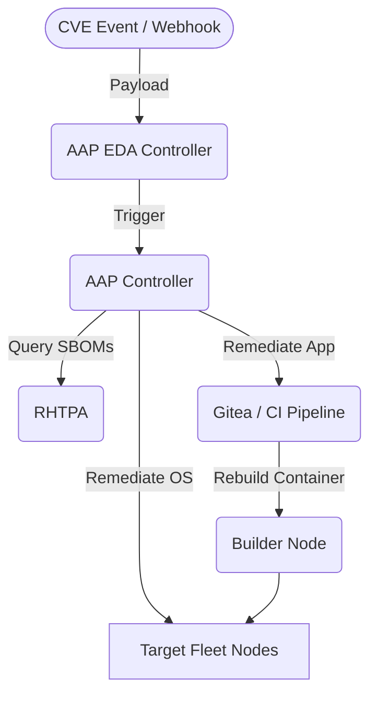


<div class="guide-header">
<h1>Automated vulnerability remediation with Lightwell and Ansible</h1>
<span class="guide-type-badge guide-type-badge--implementation"><i class="fas fa-check-circle" aria-hidden="true"></i> Solution Guide</span>
</div>

<style>
  div#toc { display: none; }
</style>

<div class="guide-hero-callout guide-hero-partner guide-hero-partner--lightwell" role="img" aria-label="Ansible Automation Platform and IBM Lightwell">
  
  <span class="guide-hero-partner__plus" aria-hidden="true">+</span>
  <span class="guide-hero-partner__partner card-partner-logo-set card-partner-logo-set--lightwell">
    
    
  </span>
</div>

<!-- tags: ansible, aap, eda, cve, lightwell, rhtpa, sbom, security, patch-management -->

## Overview

Security operations teams face a persistent gap: vulnerability scanners surface CVEs against SBOMs, but connecting that discovery to actual OS and application remediation still requires manual coordination across multiple teams and tools. This guide demonstrates a closed-loop, event-driven pipeline that detects a CVE disclosure, correlates it against infrastructure SBOMs stored in Red Hat Trusted Profile Analyzer (RHTPA), and automatically patches both OS packages and application container dependencies -- without manual handoffs.

<div class="guide-outcome">
<strong>Outcome:</strong> A fully automated CVE-to-patch pipeline driven by Event-Driven Ansible: from CVE disclosure webhook through SBOM correlation, OS package patching, and application container rebuilds, with full audit trail in AAP.
</div>

- [Background](#background)
- [Solution](#solution)
- [Prerequisites](#prerequisites)
- [Lightwell Vulnerability Management Workflow](#lightwell-vulnerability-management-workflow)
- [Solution Walkthrough](#solution-walkthrough)
- [Validation](#validation)
- [Maturity Path](#maturity-path)
- [Summary](#summary)

## Background

Traditional vulnerability management treats patching as a human process: a scanner detects a CVE, a ticket is raised, an engineer manually identifies affected packages, applies a fix, and closes the ticket. At scale this falls apart. A critical CVE affecting hundreds of hosts and multiple containerised applications can take days to fully remediate -- days during which the exposure remains active.

**Red Hat Trusted Profile Analyzer (RHTPA)** changes the picture by maintaining a continuously updated inventory of Software Bill of Materials (SBOMs) for every workload in the environment. When a CVE is disclosed, RHTPA can immediately answer: which hosts run the affected package? Which container images include the vulnerable dependency?

**Lightwell** provides the security intelligence feed and the application-layer context needed to drive remediation for containerised workloads -- triggering CI/CD pipelines to rebuild container images when a dependency is patched upstream. Combined with **Event-Driven Ansible (EDA)** as the integration layer, the entire detection-to-remediation cycle becomes a single automated pipeline.

## Solution

What makes up this solution?

- **Lightwell** -- security intelligence platform providing CVE disclosure events and application dependency fix notifications
- **Red Hat Trusted Profile Analyzer (RHTPA)** -- SBOM storage, CVE correlation, and affected-workload identification
- **Event-Driven Ansible (EDA) Controller** -- webhook receiver that listens for CVE and RHSA events and triggers AAP workflows
- **Ansible Automation Platform (AAP) Controller** -- executes remediation playbooks, manages credentials, and records audit trails
- **Gitea / CI Pipeline** -- receives rebuild triggers from AAP and produces patched container images
- **Target Fleet (RHEL 9)** -- OS nodes patched via `dnf` and updated container images deployed via Podman

### Who Benefits

| Persona | Challenge | What They Gain |
|---------|-----------|----------------|
| **Security Operations Engineer** | Manually triaging CVEs, SSH-ing into hosts to check package versions, coordinating with DevOps for container rebuilds | Single-pipeline automation: CVE in → patched host and container out, with an AAP job history as audit trail |
| **Platform / DevOps Lead** | Container image vulnerabilities discovered post-deployment, manual rebuild coordination | Automatic container rebuild triggered by the same pipeline, with CI/CD and GitOps paths both supported |
| **CISO / Security Director** | Unable to show mean-time-to-remediation (MTTR) for critical CVEs; no quantified coverage across SBOMs | Measurable pipeline execution times per CVE, RHTPA SBOM coverage as the baseline, and AAP job completion as remediation evidence |

## Prerequisites

### Ansible Automation Platform

- **Ansible Automation Platform 2.4+** with both AAP Controller and EDA Controller deployed and accessible.

### Featured Ansible Content Collections

| Collection | Type | Purpose |
|-----------|------|---------|
| <a target="_blank" href="https://console.redhat.com/ansible/automation-hub/repo/published/ansible/eda/">ansible.eda</a> | Certified | EDA webhook sources and rulebook execution |
| <a target="_blank" href="https://console.redhat.com/ansible/automation-hub/repo/published/ansible/controller/">ansible.controller</a> | Certified | Controller configuration-as-code: job templates, workflows, credentials |
| <a target="_blank" href="https://console.redhat.com/ansible/automation-hub/repo/published/redhat/rhel_system_roles/">redhat.rhel_system_roles</a> | Certified | OS-level configuration management on RHEL |
| <a target="_blank" href="https://console.redhat.com/ansible/automation-hub/repo/published/community/general/">community.general</a> | Community | General-purpose modules including package management helpers |
| <a target="_blank" href="https://console.redhat.com/ansible/automation-hub/repo/published/ansible/posix/">ansible.posix</a> | Certified | POSIX system management |
| <a target="_blank" href="https://console.redhat.com/ansible/automation-hub/repo/published/containers/podman/">containers.podman</a> | Certified | Podman container lifecycle management |

### External Systems

| System | Required | Purpose |
|--------|----------|---------|
| **RHTPA** | Yes | SBOM storage and CVE correlation |
| **Keycloak** | Yes | OIDC authentication for RHTPA and AAP |
| **Gitea** | Yes | Application source hosting and CI pipeline trigger |
| **Lightwell** | Yes | CVE disclosure events and dependency fix notifications |

**Operational Impact:** High -- automated patching reboots or restarts services; container rebuilds affect running workloads.

### Required Execution Environment

Build a custom Execution Environment containing `syft`, `grype`, and the collections listed above:

```yaml
# execution-environment/execution-environment.yml
version: 3
images:
  base_image:
    name: registry.redhat.io/ansible-automation-platform/ee-minimal-rhel9:latest
dependencies:
  python_interpreter:
    package_system: python3.11
  python:
    - jmespath
  system:
    - curl
    - jq
    - syft
    - grype
  galaxy:
    collections:
      - name: ansible.eda
      - name: ansible.controller
      - name: redhat.rhel_system_roles
      - name: community.general
      - name: ansible.posix
      - name: containers.podman
```

> **Tip:** Build with `ansible-builder`.
>
> Run `ansible-builder build -t lightwell-ee:latest -f execution-environment/execution-environment.yml` to produce the EE image. Push it to your private automation hub or registry before configuring the job templates.

## Lightwell Vulnerability Management Workflow

The pipeline is triggered entirely by events -- no polling, no scheduled scans. When Lightwell detects a CVE or a vendor fix becomes available, it sends a webhook payload to the EDA Controller, which evaluates the event against the `cve_lifecycle.yml` rulebook and launches the appropriate AAP workflow.



| Component | Role |
|-----------|------|
| **AAP Controller** | Executes remediation playbooks and configuration as code |
| **AAP EDA Controller** | Listens for CVE disclosure events and triggers workflows |
| **RHTPA** | Stores SBOMs; correlates CVEs to affected packages and images |
| **Keycloak** | Provides OIDC authentication for RHTPA and AAP |
| **Gitea** | Hosts application source; receives rebuild triggers via webhooks |
| **Target Fleet** | RHEL 9 nodes running vulnerable OS packages and application containers |

### How each workflow stage connects

1. **CVE Disclosed:** Lightwell sends a `cve_disclosed` event. EDA triggers `SBOM Correlate and Mitigate`, which queries RHTPA to identify affected hosts and applies mitigations while a patch is not yet available.
2. **RHSA Available:** Lightwell sends an `rhsa_available` event when a Red Hat Security Advisory is released. EDA triggers `Patch Test and Deploy`, which runs `dnf update` on the affected OS package and re-scans with Grype to confirm remediation.
3. **App Dependency Fixed:** Lightwell sends an `app_dependency_fixed` event when an upstream Python/library fix is available. EDA triggers `App Dependency Remediate`, which sends a rebuild signal to Gitea. The CI pipeline rebuilds the container image with the patched dependency.

> **Tip:** Use an LLM to identify which containers need rebuilding.
>
> When a dependency fix arrives, it is rarely obvious which of many container images actually bundle the affected package. The `App Dependency Remediate` workflow can include a task that calls an LLM (via an MCP endpoint or the AAP MCP server) with the patched package name and the full SBOM inventory from RHTPA. The model cross-references the package against every image's dependency tree and returns a ranked list of containers that need a rebuild -- so the CI/CD trigger is scoped to only the affected services rather than rebuilding the entire fleet.
>
> A simple pattern using the `ansible.builtin.uri` module:
>
> ```yaml
> - name: Ask LLM which containers include the affected package
>   ansible.builtin.uri:
>     url: "{{ llm_mcp_endpoint }}/query"
>     method: POST
>     body_format: json
>     body:
>       prompt: >
>         Given the following SBOM inventory: {{ rhtpa_sbom_summary }}.
>         Which container images include the package {{ affected_package }}
>         as a direct or transitive dependency? Return a JSON list of image names only.
>   register: llm_response
>
> - name: Trigger rebuild only for affected images
>   ansible.builtin.set_fact:
>     rebuild_targets: "{{ llm_response.json.images }}"
> ```

## Solution Walkthrough

### Step 1: Configure Inventory and Variables

Edit `inventory/hosts.yml` to map your node IP addresses and roles:

```yaml
all:
  children:
    targets:
      hosts:
        node1:
          ansible_host: "{{ vault_node1_host }}"
          node_role: target_fleet
          environment_type: production
    builders:
      hosts:
        node2:
          ansible_host: "{{ vault_node2_host }}"
          node_role: rhtpa_builder
          rhtpa_enabled: true
```

Store sensitive values in an Ansible Vault file:

```yaml
# inventory/group_vars/vault.yml  (ansible-vault create)
vault_ansible_user: "your_ssh_user"
vault_ssh_password: "your_ssh_password"
vault_node1_host: "10.0.0.1"
vault_node2_host: "10.0.0.2"
vault_controller_host: "https://aap.example.com"
vault_controller_username: "admin"
vault_controller_password: "aap_password"
vault_controller_token: "aap_oauth_token"
vault_registry_username: "registry_user"
vault_registry_password: "registry_password"
vault_gitea_admin_password: "gitea_secure_password"
```

> **Warning:** Do not change `demo_cve_id` or `demo_app_cve_id`.
>
> These variables must match the CVE IDs embedded in the webhook payload JSON files under `demo/`. Changing them without updating the payload files will cause the RHTPA correlation to return empty results.

### Step 2: Deploy Platform Services

Install the required collections, then provision all supporting services on Node 2:

```bash
ansible-galaxy collection install -r collections/requirements.yml

# Keycloak + RHTPA
ansible-playbook setup/deploy_keycloak.yml -i inventory/hosts.yml --ask-vault-pass
ansible-playbook setup/deploy_rhtpa.yml -i inventory/hosts.yml --ask-vault-pass

# Gitea + act_runner + Lightwell PyPI index
ansible-playbook setup/deploy_gitea.yml -i inventory/hosts.yml --ask-vault-pass
ansible-playbook setup/deploy_pypiserver.yml -i inventory/hosts.yml --ask-vault-pass
ansible-playbook setup/seed_gitea.yml -i inventory/hosts.yml --ask-vault-pass
```

### Step 3: Prepare Target and Builder Nodes

```bash
# Install vulnerable OS package on targets
ansible-playbook setup/prepare_target.yml -i inventory/hosts.yml --ask-vault-pass

# Install syft and grype on builder
ansible-playbook setup/prepare_builder.yml -i inventory/hosts.yml --ask-vault-pass
```

### Step 4: Configure AAP via Configuration as Code

A single CaC playbook creates all job templates, workflow templates, credentials, and projects in AAP Controller:

```bash
ansible-playbook controller/configure.yml --ask-vault-pass
```

### Step 5: Establish SBOM Baseline

Scan all target nodes and upload their SBOMs to RHTPA before the pipeline runs. This baseline is what RHTPA correlates CVEs against:

```bash
ansible-playbook playbooks/sbom_scan_upload.yml -i inventory/hosts.yml --ask-vault-pass
```

### Step 6: Deploy the EDA Rulebook

In the AAP EDA Controller UI, create a new **Rulebook Activation** and deploy `rulebooks/cve_lifecycle.yml`. The rulebook listens on `eda_webhook_port` (default `5000`) and routes incoming events to the correct AAP workflow:

```yaml
# rulebooks/cve_lifecycle.yml
- name: CVE Lifecycle Management
  hosts: all
  sources:
    - ansible.eda.webhook:
        host: 0.0.0.0
        port: "{{ eda_webhook_port | default(5000) }}"
  rules:
    - name: CVE Disclosed -- Correlate and Mitigate
      condition: event.payload.event_type == "cve_disclosed"
      action:
        run_job_template:
          name: "SBOM Correlate and Mitigate"
          organization: Default
          job_args:
            extra_vars:
              cve_id: "{{ event.payload.cve_id }}"
              cvss_score: "{{ event.payload.cvss_score }}"

    - name: RHSA Available -- Patch and Deploy
      condition: event.payload.event_type == "rhsa_available"
      action:
        run_job_template:
          name: "Patch Test and Deploy"
          organization: Default
          job_args:
            extra_vars:
              rhsa_id: "{{ event.payload.rhsa_id }}"
              target_package: "{{ event.payload.package_name }}"

    - name: App Dependency Fixed -- Rebuild Container
      condition: event.payload.event_type == "app_dependency_fixed"
      action:
        run_job_template:
          name: "App Dependency Remediate"
          organization: Default
          job_args:
            extra_vars:
              rebuild_path: "{{ event.payload.rebuild_path | default('cicd') }}"
```

Configure the EDA rulebook activation with the following settings:

| Field | Value |
|-------|-------|
| **Rulebook** | `cve_lifecycle.yml` |
| **Decision Environment** | Lightwell EE (built in Step 1) |
| **AAP Controller credential** | Token with job template execute rights |
| **Webhook port** | `5000` (or `eda_webhook_port` from variables) |

## Validation

### Verify OS Patching

Run this command on a target node after the `Patch Test and Deploy` workflow completes:

```bash
ssh root@<node1_ip> "rpm -q python-cryptography"
```

**Expected Output:** `python-cryptography-36.0.1-6.el9_6` (or the `demo_cve_fixed_version` from variables).

### Verify App Dependency Patching

Check the running container's dependency version after the `App Dependency Remediate` workflow completes:

```bash
ssh root@<node1_ip> "podman exec config-service pip show pyyaml"
```

**Expected Output:** `Version: 6.0.2` (or the `demo_app_fixed_version` from variables).

### Verify AAP Job Completion

In the AAP Controller UI navigate to **Jobs**. Confirm successful executions for:

- `CVE Correlation`
- `CME Mitigate` (if mitigation workflow ran)
- `Patch and Verify`
- `App Dependency Remediate` (if app workflow ran)

### Troubleshooting

| Failure Mode | How to Read Logs | Specific Fix |
|---|---|---|
| **EDA Webhook Timeout** | Check `trigger_*.sh` output for `curl: (7) Failed to connect` | Verify `EDA_HOST` is exported and the EDA rulebook activation is running on port `5000` |
| **Controller CaC Fails** | Check `controller/configure.yml` output for `401 Unauthorized` | Verify `vault_controller_token` is valid with admin rights |
| **Gitea Seed Fails** | Check `setup/seed_gitea.yml` for authentication errors | Ensure `vault_gitea_api_token` was generated by `deploy_gitea.yml` and added to `vault.yml` |
| **RHTPA Upload Fails** | Check `sbom_scan_upload.yml` logs for `403 Forbidden` or connection refused | Verify Node 2 is reachable from the EE and `rhtpa_oidc_client_secret` matches Keycloak configuration |
| **Container Rebuild Fails** | Check `App Container Rebuild` job logs in AAP | Confirm `vault_registry_username` and password are correct and the builder node has internet access |

> **Note:** To reset the environment for a fresh pipeline run:
>
> `ansible-playbook setup/reset_demo.yml -i inventory/hosts.yml --ask-vault-pass`

## Maturity Path

| Maturity | Description |
|----------|-------------|
| **Crawl** | **Manual triage with SBOM visibility.** RHTPA maintains SBOMs for all workloads. Security engineers query RHTPA manually when a CVE is announced, identify affected hosts, and remediate via ad-hoc Ansible playbooks. SBOM coverage replaces guesswork; patching is still human-initiated. |
| **Walk** | **EDA-triggered pipeline with approval gates.** Lightwell CVE events trigger EDA automatically. The AAP workflow runs SBOM correlation and OS patching, but an approval node requires a human sign-off before container rebuilds execute. Engineers review the blast radius before allowing CI/CD changes. |
| **Run** | **Fully autonomous CVE-to-patch.** Policy-based automation replaces approval gates for well-understood CVE classes (CVSS < 7, OS package only, no app-layer changes). High-severity or container-rebuild paths retain human approval. Mean-time-to-remediation for low-risk patches drops to under 30 minutes with no manual steps. |

## Summary

This solution closes the manual gap between CVE disclosure and remediation by connecting Lightwell's security intelligence feed to Red Hat Trusted Profile Analyzer's SBOM inventory through an event-driven pipeline built on Ansible. When a CVE is announced, EDA routes the event to the appropriate AAP workflow -- whether that is correlating the CVE against SBOMs to identify blast radius, patching OS packages via `dnf`, or triggering a container image rebuild through Gitea CI/CD. Each pipeline stage is governed by AAP, providing RBAC, audit trails, and approval gates. The maturity path moves from SBOM visibility with manual patching through approval-gated automation to fully policy-driven remediation, giving security and platform teams a clear path to reducing mean-time-to-remediation without sacrificing governance.


