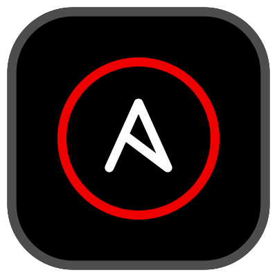
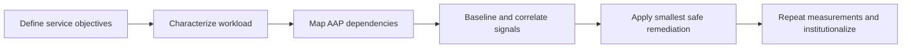


<div class="guide-header">

<h1>Designing a reliable, measurable Ansible Automation Platform workload</h1>

<span class="guide-type-badge guide-type-badge--solution"><i class="fas fa-check-circle" aria-hidden="true"></i> Solution Guide</span>

</div>

<style>
  div#toc { display: none; }
</style>

<div class="guide-hero-callout" role="img" aria-label="Ansible unlocks measurable automation">
  
  <span>Ansible unlocks measurable automation</span>
</div>

<!-- tags: ansible, aap, performance, capacity, reliability, monitoring, api, rbac, execution-environments -->

## Overview

As Ansible Automation Platform (AAP) becomes a shared service, performance depends on more than node counts. Launch bursts, concurrency, schedules, synchronization, API clients, execution environments, playbook behavior, authorization changes, and retained job events all contribute to the workload.

This guide provides an evidence-based method to assess, design, operate, and redesign AAP environments. It helps teams identify the limiting component, choose the smallest safe remediation, and verify the result with comparable measurements.

<div class="guide-outcome">
<strong>Outcome:</strong> A repeatable AAP assessment that connects workload shape to platform design, produces a prioritized remediation plan, and records measurable evidence without turning customer observations into unsupported product limits.
</div>

- [Background](#background)
- [Solution](#solution)
- [Prerequisites](#prerequisites)
- [AAP workload assessment workflow](#aap-workload-assessment-workflow)
- [Solution walkthrough](#solution-walkthrough)
- [Assessment worksheet](#assessment-worksheet)
- [Validation](#validation)
- [Maturity path](#maturity-path)
- [Summary](#summary)

## Background

A playbook can be functionally correct and still create an inefficient platform workload. For example, a wrapper that synchronizes a project before every launch adds source-control and database work to every business action. A client that repeatedly reads unchanged objects or retries without backoff can create control-plane pressure. A broadly used execution environment can add startup and image-pull cost to jobs that need only a small subset of its dependencies.

The assessment starts with workload characteristics, then maps those characteristics to the control plane, execution plane, database, automation mesh, source-control systems, registries, identity provider, and external APIs. A slow job is not automatically a controller-capacity problem. It may be waiting on a target host, synchronization, an external API, an execution environment, or the database.

Use the evidence labels in this guide to keep conclusions precise:

| Label | Meaning | How to use it |
| :---- | :---- | :---- |
| **Documented** | A requirement, supported topology, configuration behavior, or limit stated in applicable Red Hat documentation for the target version. | Cite the exact version-specific source and recheck after upgrades. |
| <span style="white-space: nowrap;"><strong>Recommended</strong></span> | A practice intended to reduce avoidable work or improve diagnosability. | Explain the trade-off and define the measurement that should show benefit. |
| **Observed** | An anonymized customer or escalation pattern. | Use it as a discovery prompt, not as a universal limit. |
| **Validate** | A plausible relationship that still needs a controlled test. | State the test, success metric, and owner before making a commitment. |

> **Warning:** Do not treat counts from an individual environment as sizing targets.
>
> Approximate figures such as 10,000 job templates, 36,000 role or team assignments, or 700 technical users are observed context only. They require validation against AAP version, deployment model, topology, workload shape, and change frequency.

## Solution

This solution combines discovery, measurement, targeted remediation, and verification:

- **AAP Controller** executes jobs and workflows, manages credentials, and provides job history and audit evidence.
- **Event-Driven Ansible and API clients** represent event-driven and programmatic launch patterns that must be measured alongside scheduled and interactive work.
- **Execution nodes and execution environments (EEs)** provide the runtime capacity and dependency lifecycle for automation jobs.
- **Projects and inventories** connect AAP to source control and inventory sources, making synchronization frequency and freshness important workload variables.
- **Database, ingress, identity, registry, and external systems** provide dependencies whose latency, storage, and change behavior can limit the overall service.
- **Monitoring and an assessment worksheet** connect symptoms to evidence, ownership, risk, remediation, and follow-up measurement.

### Who benefits

| Persona | Challenge | What they gain |
|---------|-----------|----------------|
| **Service or field architect** | Sizing conversations rely on object counts or anecdotes instead of workload evidence. | A structured discovery model, evidence classifications, and a version-aware design record. |
| **AAP administrator or SRE** | Queueing, slow jobs, synchronization, and API issues are difficult to isolate. | Baselines, diagnostic questions, safe remediation patterns, and repeatable validation tests. |
| **Automation architect** | Correct playbooks can still multiply platform work through retries, output, fan-out, or redundant calls. | A way to review consumption characteristics as part of automation design. |
| **Platform or product owner** | Capacity changes may solve one symptom while moving pressure to another dependency. | Component-level measurements and a remediation plan with explicit trade-offs. |

## Prerequisites

### Red Hat Ansible Automation Platform

- A supported AAP deployment and a known target version and deployment model.
- Access to Controller job history, project and inventory synchronization history, API or gateway metrics, and platform resource metrics.
- A representative steady-state period and at least one known busy period for comparison.
- An owner for each evidence area: workload, AAP administration, source control or inventory, execution environments, database, and identity or RBAC.

### External dependencies

| Dependency | Why it matters |
|------------|----------------|
| Source-control and inventory systems | Synchronization duration, freshness, overlap, and retry behavior can delay jobs. |
| Container registries | EE image size, pull latency, cache behavior, and availability affect job startup. |
| Identity provider | Authentication and identity synchronization can influence API and RBAC operations. |
| Database and storage | Event volume, output retention, connections, maintenance, and growth affect platform health. |
| Managed hosts and external APIs | Target response, rate limits, and downstream calls contribute to job duration and retries. |

**Operational impact:** Medium to high. Some remediations change schedules, reduce retained output, alter synchronization behavior, or move workloads between execution resources. Validate freshness, auditability, security, isolation, and recoverability before rollout.

## AAP workload assessment workflow



Start by defining business-critical automation journeys, response expectations, availability needs, maintenance windows, and the impact of delayed automation. Classify work as interactive, scheduled, event-driven, or API-driven. Measure average and peak launches, concurrency, schedules, dependencies, retries, duration, forks, managed hosts, output, and external-system calls.

Then map the AAP object model and topology. Inventory projects, repositories, inventories, sources, credentials, job templates, workflows, schedules, surveys, notifications, users, teams, organizations, roles, assignments, EEs, collections, plugins, and integrations. Review the control plane, execution plane, database, ingress, automation mesh or routing, registry, identity provider, source control, and storage.

During operation, capture a baseline that includes queue depth and wait time, job duration distributions, success and retry rates, resource indicators, API latency and errors, synchronization duration and overlap, EE startup behavior, event volume, and database growth. Correlate timestamps before diagnosing a bottleneck.

For an incident or redesign, preserve evidence, construct a timeline, isolate the limiting resource or dependency, apply a reversible remediation, and repeat the same measurements. Record side effects such as stale source content, increased queueing elsewhere, weaker isolation, reduced audit detail, or a failed integration.

## Solution walkthrough

### Step 1: Define workload and service objectives

**Evidence:** Recommended. Validate applicability for the target version and topology.

Record the workload in ranges and distributions rather than averages alone:

```yaml
# assessment/workload-profile.yml
service_objectives:
  critical_workflows:
    - name: compliance-remediation
      launch_sources: [schedule, api]
      response_target: "complete within maintenance window"
      availability: business-critical
    - name: incident-response
      launch_sources: [event, interactive]
      response_target: "start within 60 seconds"
      availability: business-critical

workload:
  managed_hosts: 2500
  average_launches_per_hour: 120
  peak_launches_per_hour: 420
  peak_concurrent_jobs: 80
  job_duration_percentiles_minutes: {p50: 8, p95: 35, p99: 90}
  forks: 25
  retry_policy: bounded-exponential-backoff
  project_sync_before_every_job: false
```

Use the profile to separate capacity questions from service objectives. A high launch rate with low concurrency can have a different limiting factor from a bursty workload with a large execution fan-out.

### Step 2: Map the object model and dependencies

**Evidence:** Recommended. Confirm supported behavior for the target deployment model.

Create an inventory of the objects and relationships that drive management work. Look for duplication that can be replaced by reuse, but preserve isolation, ownership, auditability, and change control where they are required.

```yaml
# assessment/dependency-register.yml
components:
  controller:
    job_templates: 320
    workflows: 48
    schedules: 210
  source_control:
    repositories: 22
    project_sync_policy: "on change or scheduled freshness window"
  inventories:
    static: 6
    dynamic_sources: 4
    update_policy: "only when source data changes"
  execution_environments:
    standard: "registry.example.com/aap/ee-standard:v4"
    network: "registry.example.com/aap/ee-network:v7"
    image_pull_policy: "pre-stage on execution nodes"
  api_clients:
    - name: service-portal
      request_policy: "cache reads, batch writes, backoff retries"
      owner: automation-platform-team
```

Measure object mutation rate, not only steady-state object count. Frequent RBAC changes, repeated writes of unchanged objects, or many jobs with the same template and inventory may create more work than a larger but stable object graph.

### Step 3: Establish a baseline and correlate signals

**Evidence:** Recommended. Use version-specific AAP monitoring guidance for collection procedures.

Capture a representative steady-state window and a busy window. At minimum, preserve:

- job launch, start, waiting, and completion timestamps;
- running and waiting jobs by workload class;
- job duration percentiles, failures, cancellations, and retries;
- controller, execution-node, database, storage, and network indicators;
- API request rate, latency, errors, response volume, and retry behavior;
- project and inventory synchronization duration, overlap, failures, and dependent jobs;
- EE image pull and startup behavior; and
- event and output volume, retention, cleanup duration, and database growth.

Use a common timestamp and correlation identifier when possible. A useful timeline breaks end-to-end duration into queue wait, synchronization, startup, controller processing, execution, target-host work, external calls, and output or event processing.

### Step 4: Apply the smallest safe remediation

**Evidence:** Recommended. Treat the selected bottleneck as a hypothesis until correlated measurements support it.

Prefer reversible actions that reduce avoidable work or protect critical workloads:

| Pattern | First remediation to test | Side effect to verify |
|---------|---------------------------|------------------------|
| Bursty schedules | Stagger schedules and separate critical workload classes. | Critical jobs still meet their response target. |
| Duplicate launches | Coalesce equivalent requests and make dependencies explicit. | Isolation, authorization, and audit requirements remain intact. |
| Per-job synchronization | Define freshness objectives and trigger updates only when needed. | Jobs do not use unacceptably stale content. |
| API polling or retry storms | Cache stable reads and use bounded backoff with jitter. | Cache invalidation and authorization changes are handled correctly. |
| EE startup or pull cost | Remove unused dependencies and pre-stage approved images. | Jobs retain required modules and image availability improves. |
| Excessive output or retention | Summarize loops and define retention by audit need. | Support and audit evidence remain sufficient. |
| RBAC churn | Reuse teams and roles, remove stale assignments, and batch changes. | Least privilege and separation of duties are preserved. |

Capacity changes may be necessary, but they should follow workload characterization and component evidence. Scaling the whole platform is not a substitute for eliminating duplicated work or an uncontrolled retry loop.

### Step 5: Verify and institutionalize

Repeat the same measurements under comparable workload conditions. Confirm both improvement and absence of unacceptable side effects. Update the design record, runbook, dashboard, owner assignments, and rollback procedure. Reassess after material changes to launch rate, concurrency, managed-host population, forks, object model, RBAC, synchronization cadence, EE lifecycle, or retention policy.

## Requirements and recommendations matrix

| Area | Evidence | Assessment question | Measurement | Typical remediation |
|------|----------|---------------------|-------------|---------------------|
| Workload | Documented / recommended | What are launch rate, peak burst, concurrency, duration, forks, and queue behavior? | Arrival rate, concurrent jobs, wait time, duration percentiles, peak-to-average ratio. | Stagger schedules, classify workloads, tune retries, and scale the constrained component. |
| Object model | Recommended | Are projects, inventories, credentials, templates, and workflows unnecessarily duplicated? | Object growth, duplicate ratio, sync activity, API calls per change. | Consolidate where safe and automate lifecycle management. |
| RBAC | Observed / validate | How large is the authorization graph, and how often does it change? | Assignment mutations, reconciliation duration, API latency and errors. | Reuse teams and roles, remove stale assignments, and batch changes. |
| API usage | Recommended | Are clients repeating reads or writes, polling aggressively, or retrying without backoff? | Requests per second, duplicate ratio, latency, errors, retries, response size. | Cache stable data, use change detection, batch work, and back off. |
| Synchronization | Observed / recommended | Is a project or inventory synchronized before every job, or are updates overlapping? | Sync frequency, duration, overlap, blocked jobs, stale-data incidents. | Define freshness policy, deduplicate triggers, and decouple jobs where safe. |
| Execution environments | Recommended / validate | Are EEs purposeful, tested, and sized for the jobs that use them? | Image size, pull frequency, startup time, cache hit rate, plugin calls. | Consolidate compatible EEs, remove unused dependencies, and isolate expensive integrations. |
| Playbooks | Recommended | Do tasks repeat work or generate avoidable external calls and output? | Tasks per host, task duration, external calls, changed ratio, output bytes. | Refactor repeated work, use appropriate modules, and reduce non-actionable output. |
| Retention and database | Recommended | Is retained data aligned with operational, audit, and support needs? | Growth rate, table and index size, cleanup duration, query latency. | Set an approved retention policy and monitor cleanup and maintenance. |
| Capacity and topology | Documented / validate | Which component is constrained under the measured workload? | CPU, memory, storage, network, connections, queue time, API latency. | Scale or tune the constrained component and repeat the workload test. |

## Assessment worksheet

Use this worksheet as the required evidence record for a customer assessment. Keep workload measures separate from object counts, and record the source and time window for every value.

### Assessment record

| Field | Record |
|-------|--------|
| Customer or environment |  |
| AAP version and deployment type |  |
| Topology and component placement |  |
| Assessment date and assessor |  |
| Evidence owner |  |
| Baseline and peak measurement windows, including timezone |  |
| Business-critical workloads and peak operating window |  |
| Known incident or escalation |  |
| Leading bottleneck or hypothesis |  |
| Confidence and basis | High / medium / low, with explanation |
| Validation status | Not started / collecting / hypothesis tested / confirmed / rejected / blocked |

### Workload and object inventory

| Measure | Observed | Peak or planned | Source and time window | Notes |
|---------|----------|-----------------|------------------------|-------|
| Managed hosts |  |  |  |  |
| Jobs per hour |  |  |  |  |
| Maximum concurrent jobs |  |  |  |  |
| Typical and maximum forks |  |  |  |  |
| API requests per second |  |  |  |  |
| Project and inventory syncs per hour |  |  |  |  |
| Average and longest job duration |  |  |  |  |
| Job failure, cancellation, and retry rate |  |  |  |  |
| Average event size and job events per run |  |  |  |  |

Record projects, inventories, credentials, teams, organizations, users, job templates, workflows, and role or team assignments separately. If counts vary by organization or team, record the breakdown rather than collapsing it into one unexplained total.

### Consumption-pattern checklist

<div class="assessment-checklist">
<label><input type="checkbox" disabled> Equivalent job template and inventory launches are not repeated in parallel without a workload reason.</label><br>
<label><input type="checkbox" disabled> Project and inventory synchronization is not performed before every job unless required by a documented freshness objective.</label><br>
<label><input type="checkbox" disabled> Repeated API work is consolidated or cached where appropriate.</label><br>
<label><input type="checkbox" disabled> Job concurrency and forks are intentional for the available capacity.</label><br>
<label><input type="checkbox" disabled> Custom EEs are focused and sized for their purpose.</label><br>
<label><input type="checkbox" disabled> Plugins and initialization hooks have a measured benefit that justifies startup overhead.</label><br>
<label><input type="checkbox" disabled> Playbooks avoid repeated expensive work and unnecessary event output.</label><br>
<label><input type="checkbox" disabled> Container-image pull behavior is appropriate for the operating environment.</label>
</div>

### Symptom-to-investigation decision tree

| Symptom | Check first | Then check | Evidence to preserve |
|---------|-------------|------------|----------------------|
| Jobs remain pending | Project or inventory update dependencies | Concurrent jobs, forks, remaining control or execution capacity, and external launch dependencies | Queue time, sync timestamps, job impact, capacity, and external-system latency |
| Job output is delayed | Control-plane CPU and memory | Event-processing lag, event queue size, database insertion and storage, output volume, and EE startup | Callback lag, queue size, event rate, disk I/O, and job output volume |
| API latency or timeouts increase | Request rate and burst behavior | Duplicate calls, control-plane pressure, database or authentication dependencies, and client timeout settings | Endpoint, client, request rate, payload, latency, errors, retries, and timestamps |
| Jobs are slower than local execution | Update-on-launch behavior | Project transfer, EE pulls, control-to-execution network path, and event serialization | End-to-end timeline broken into sync, startup, execution, and persistence |
| Database storage continues to grow | Job-event and output retention | Cleanup schedule, maintenance behavior, workload growth, event volume, and retention ownership | Growth rate, cleanup duration, I/O, and the approved retention requirement |

### Risk rating and remediation record

| Rating | Use when | Required response |
|--------|----------|------------------|
| **Low** | The pattern is understood and current capacity has headroom. | Document the baseline and monitor. |
| **Medium** | There is measurable pressure, unclear ownership, or a pattern likely to become a bottleneck as workload grows. | Define remediation and a follow-up measurement. |
| **High** | The pattern contributes to instability, persistent queueing, timeouts, resource exhaustion, or uncontrolled data growth. | Prioritize redesign or capacity change and establish an incident owner. |

| Finding | Evidence | Risk | Recommended change | Owner | Success measure | Target date |
|---------|----------|------|--------------------|-------|-----------------|------------|
|  |  |  |  |  |  |  |
|  |  |  |  |  |  |  |

## Source register and publication gates

Keep a source register with every guide revision. Product documentation is authoritative only for the version, deployment model, and scope it documents. Engagement lessons and internal drafts are useful discovery inputs, but remain observations or open evidence requests until the owner, artifact, and validation status are known.

| Source class | Intended use | Publication rule |
|--------------|--------------|------------------|
| AAP capacity-planning documentation | Workload characterization, node roles, API rate, concurrency, forks, and topology assumptions. | Cite the version-specific page and confirm applicability to the target environment. |
| AAP capacity-planning exercise | Example workload modeling and common symptoms. | Do not generalize example values into limits or targets. |
| AAP monitoring documentation | Metrics for event lag, queue size, CPU, memory, disk I/O, and instance capacity. | Preserve the measurement procedure and version context. |
| Internal playbook or upgrade drafts | Structure, customer prompts, or candidate design guidance. | Identify the owner and review status before treating any claim as evidence. |
| Customer refactoring or escalation lessons | Candidate anti-patterns and remediation hypotheses. | Anonymize, label **Observed**, and reproduce or obtain engineering validation before publishing as guidance. |

Before using a recommendation as a customer requirement, confirm the AAP version and topology, classify the evidence as documented, measured, observed, recommended, or validate, review every numeric threshold with the relevant product or performance owner, and remove identifying customer details.

## Validation

### Test

Run the assessment against one representative busy window. Export job timestamps and compare the baseline with the same workload after one controlled remediation. The following command illustrates the minimum result expected from a playbook-level validation run:

```bash
ansible-playbook -i inventory/hosts.yml playbooks/assessment-probe.yml \
  -e assessment_window_start="2026-11-19T13:00:00Z" \
  -e assessment_window_end="2026-11-19T14:00:00Z"
```

For a platform-level test, record the AAP version, deployment model, topology, workload profile, change under test, and rollback condition. Do not compare a quiet window with a peak window and call the difference an improvement.

### Expected result

The assessment should produce a result with a clear owner, evidence label, and follow-up measurement:

```
Assessment: aap-performance-baseline
Evidence window: 2026-11-19T13:00:00Z to 2026-11-19T14:00:00Z
Jobs observed: 120
Peak concurrent jobs: 80
P95 queue wait: 00:02:14
P95 job duration: 00:35:12
Project syncs preceding jobs: 18%
API error rate: 0.2%
Database growth: 1.4 GiB
Finding: per-job synchronization is a candidate avoidable dependency
Classification: OBSERVED -> VALIDATE
Owner: source-control and inventory owner
Follow-up: compare queue wait and stale-data incidents after trigger policy change
```

### Troubleshooting

| Symptom | Likely cause | Fix |
|---------|--------------|-----|
| Jobs wait during predictable windows | Aligned schedules, execution capacity, or duplicate launches. | Group by workload class, inspect arrival rate and concurrency, stagger schedules, and check for equivalent requests. |
| Jobs are slow before tasks start | Project or inventory synchronization, EE image pulls, or plugin initialization. | Split the timeline, inspect sync and image events, and compare cold and warm starts. |
| API latency rises during administration | Repeated reads or writes, RBAC mutation, or retry bursts. | Identify the client and endpoint, inspect duplicate work, add caching or backoff, and batch changes where supported. |
| Database storage grows unexpectedly | Excessive output or events, long retention, or cleanup lag. | Measure bytes and events per job, review retention against audit needs, and verify cleanup safely. |
| Scaling does not improve the symptom | The limiting dependency is elsewhere. | Correlate controller, execution, database, source-control, registry, target-host, and external API signals before changing topology again. |
| Remediation improves latency but creates stale results | Freshness policy was implicit or too aggressive. | Define freshness by workload, test last-known-good behavior, and restore synchronization where required. |

## Maturity path

| Maturity | Description |
|----------|-------------|
| **Crawl** | Capture version, topology, workload profile, queue time, job duration, synchronization, API, EE, and database baselines. Label uncertain conclusions as **Validate**. |
| **Walk** | Establish owners and service objectives, separate workload classes, remove duplicate work, govern synchronization and retries, and validate changes in a representative busy window. |
| **Run** | Continuously correlate workload and platform signals, enforce lifecycle policies for objects and EEs, review consumption in automation design, and use evidence-based capacity changes with rollback plans. |

## Summary

Reliable AAP performance comes from understanding the workload as a system. Measure how automation is launched, synchronized, executed, authorized, integrated, and retained. Use documented guidance for version-specific requirements, label recommendations and observations clearly, and test hypotheses before making commitments. The result is a platform design that can explain its capacity, identify its limiting dependency, and demonstrate whether a remediation actually improved the service.

## References

- [AAP capacity planning](https://docs.redhat.com/en/documentation/red_hat_ansible_automation_platform/2.7/optimize-ref_controller_capacity_planning)
- [AAP capacity planning exercise](https://docs.redhat.com/en/documentation/red_hat_ansible_automation_platform/2.7/optimize-ref_controller_capacity_planning_exercise)
- [AAP monitoring guidance](https://docs.redhat.com/en/documentation/red_hat_ansible_automation_platform/2.7/observe-ensure_system_health_and_efficiency_through_monitoring)
- [AAP platform performance optimization](https://docs.redhat.com/en/documentation/red_hat_ansible_automation_platform/2.7/optimize-optimize_platform_performance)
- [Red Hat Ansible Automation Platform documentation](https://docs.redhat.com/en/documentation/red_hat_ansible_automation_platform/)

