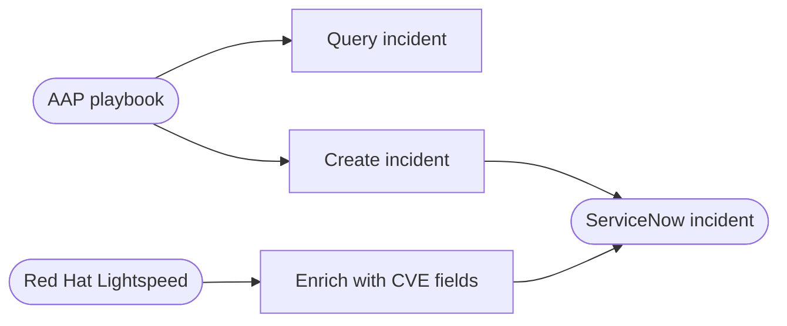
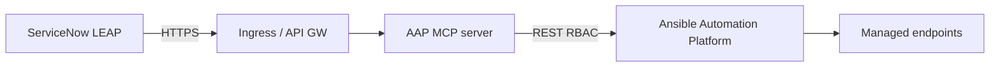


<div class="guide-header">

<h1>ServiceNow ITSM automation with Ansible</h1>

<span class="guide-type-badge guide-type-badge--solution"><i class="fas fa-check-circle" aria-hidden="true"></i> Solution Guide</span>

</div>

<div class="guide-hero-callout guide-hero-partner guide-hero-partner--servicenow" role="img" aria-label="Ansible Automation Platform and ServiceNow">
  
  <span class="guide-hero-partner__plus" aria-hidden="true">+</span>
  <span class="guide-hero-partner__partner card-partner-logo-set">
    
    
  </span>
</div>

## Overview

Service management and automation teams still solve the same problems from two systems of work: **ServiceNow** holds incidents and workflows, while **Ansible Automation Platform (AAP)** executes remediation. The gap shows up as copy-paste ticket enrichment, slow handoffs, and automation that exists but is not operationalized from the ITSM console.

This guide covers two outcomes on one ServiceNow + AAP path:

- **[Use Case A: ServiceNow ITSM ticket enrichment](#use-case-a-servicenow-itsm-ticket-enrichment)** -- Create and enrich incidents with Red Hat Lightspeed (Insights) CVE advisory context via `servicenow.itsm` (Crawl introduction; read-only enrichment).
- **[Use Case B: Unlock AIOps with LEAP and Ansible MCP](#use-case-b-leap-and-ansible-mcp)** -- ServiceNow Learning-Enhanced Automation Platform (LEAP) maps opportunities to approved playbooks through the AAP MCP server and runs them with enterprise governance (Walk/Run).

| Use case | Primary outcome | Operational impact | Maturity fit |
|----------|-----------------|-------------------|--------------|
| **A. Ticket enrichment** | Incidents carry CVE context without manual paste | None to Low | Crawl; Walk when chained in workflows |
| **B. LEAP + MCP AIOps** | Governed remediation from the ITSM context | Medium to High on execute | Walk mapping; Run with guardrails |

For Crawl/Walk/Run across all AIOps patterns, see [AIOps automation with Ansible](README-AIOps.md).

## Table of Contents

- [Background](#background)
- [Solution](#solution)
- [Prerequisites](#prerequisites)
- **[Use Case A: ServiceNow ITSM ticket enrichment](#use-case-a-servicenow-itsm-ticket-enrichment)**
- **[Use Case B: Unlock AIOps with LEAP and Ansible MCP](#use-case-b-leap-and-ansible-mcp)**
- [Maturity Path](#maturity-path)
- [Summary](#summary)
- [Next Steps](#next-steps)

## Background

**ServiceNow ITSM** is the enterprise system of record for incidents, problems, and change. The certified **servicenow.itsm** collection lets AAP open, update, and query those records. **Red Hat Lightspeed** (console.redhat.com; formerly Red Hat Insights) supplies authoritative CVE and advisory data for enrichment.

**LEAP** extends ServiceNow by identifying recurring automation opportunities and connecting them to executable remediation. The **Ansible Automation Platform MCP server** gives LEAP a supported way to discover and launch approved job templates without bespoke REST glue per playbook. AAP remains the execution plane: RBAC, credentials, execution environments, and audit.

> **Terminology update -- Lightspeed rebranding.**
>
> **Red Hat Insights** (console.redhat.com) is now **Red Hat Lightspeed**. Enrichment APIs and product behavior are the same; this guide uses Lightspeed in prose and may still show Insights in URLs or lab screenshots.

## Solution

What makes up the solution?

- **ServiceNow ITSM** -- Incidents and service operations (both); LEAP workspace and Connectors (Use Case B)
- **servicenow.itsm** -- Create, read, and update incidents (Use Case A; recommended follow-up in Use Case B)
- **Red Hat Lightspeed** -- Advisory and CVE context for enrichment (Use Case A)
- **Ansible Automation Platform** -- Job templates, workflows, RBAC, audit (both)
- **AAP MCP server** -- Integration surface between LEAP and AAP (Use Case B)

### Who Benefits

| Persona | Challenge | What They Gain |
|---------|-----------|----------------|
| **IT Ops / Service Desk** | Manual CVE paste into tickets; swivel-chair to AAP | Enriched incidents; LEAP-driven governed runs from ITSM |
| **Automation Architect** | Fragile integrations; unclear audit | Standard `servicenow.itsm` and MCP connector; AAP-native RBAC |
| **IT Leader** | High MTTR; automation not operationalized | Faster triage, reuse of trusted playbooks, measurable governance |

## Prerequisites

### Ansible Automation Platform

- **Use Case A:** AAP 2.4+ with job templates (workflows recommended).
- **Use Case B:** AAP 2.6+ with the **MCP server for Ansible Automation Platform** (confirm release notes; some trains allow 2.5+). Dedicated integration user with least-privilege access to approved templates only.

### ServiceNow

- ITSM module active; <a target="_blank" href="https://store.servicenow.com/store/app/6b1ca36e1b246a50a85b16db234bcb0d">API for Red Hat Ansible Automation Platform Certified Content Collection</a> from the ServiceNow Store (Use Case A).
- **LEAP** available with rights to configure Connectors (Use Case B). Demo path: Workspaces → Learning-Enhanced Automation Platform.

### Featured Ansible Content Collections

| Collection | Type | Purpose |
|-----------|------|---------|
| <a target="_blank" href="https://console.redhat.com/ansible/automation-hub/repo/published/servicenow/itsm/">servicenow.itsm</a> | Certified | Incident create/update/query (A); correlation work notes (B) |
| <a target="_blank" href="https://console.redhat.com/ansible/automation-hub/repo/published/ansible/controller/">ansible.controller</a> | Certified | Job templates as code for LEAP-facing catalogs (B) |

### External Systems

| System | Required | Details |
|--------|----------|---------|
| ServiceNow | Required | ITSM (A); LEAP + Connectors (B) |
| Red Hat Lightspeed / RHSM API access | Use Case A | Advisory enrichment |
| AAP MCP endpoint | Use Case B | Reachable from ServiceNow (TLS, allow lists) |

---

<h2 id="use-case-a-servicenow-itsm-ticket-enrichment">Use Case A: ServiceNow ITSM ticket enrichment</h2>

### Overview

Lowest-risk entry point: gather existing ticket data, create incidents, and enrich them with CVE advisory type, description, affected CVEs, and solution text from Red Hat Lightspeed -- no infrastructure change.

### Demos and labs

- <a target="_blank" href="https://www.redhat.com/en/interactive-labs/ansible#getting-started">Interactive lab: Get started with ServiceNow automation</a>
- <a target="_blank" href="https://play.instruqt.com/redhat/invite/zjj1kyez8nwg">Self-paced lab: Getting started with ServiceNow ITSM automation</a>
- <a target="_blank" href="https://youtu.be/Wg4wnREKkkE">Video: Hands-on with servicenow.itsm</a>

### Workflow



### Solution Walkthrough

#### Step 1: Gather ticket data

**Operational Impact:** None

```yaml
---
- name: Retrieve ServiceNow ticket details
  hosts: localhost
  gather_facts: false
  vars:
    ticket_number: "{{ ticket }}"
  tasks:
    - name: Retrieve incidents by number
      servicenow.itsm.incident_info:
        instance:
          host: "{{ servicenow_instance }}"
          username: "{{ servicenow_username }}"
          password: "{{ servicenow_password }}"
        number: "{{ ticket_number }}"
      register: result
      delegate_to: localhost
```

#### Step 2: Create a service ticket

**Operational Impact:** Low

```yaml
---
- name: Create Service Ticket
  hosts: localhost
  gather_facts: false
  tasks:
    - name: Create ticket
      servicenow.itsm.incident:
        instance:
          host: "{{ SN_HOST }}"
          username: "{{ SN_USERNAME }}"
          password: "{{ SN_PASSWORD }}"
        state: new
        caller: Admin
        impact: low
        urgency: low
      register: ticket_details
      delegate_to: localhost
```

#### Step 3: Enrich with CVE advisory data

**Operational Impact:** Low

Query Lightspeed patch APIs, then create an incident with structured CVE fields (use a job survey for `advisory_id`):

```yaml
    - name: Gather CVE details
      ansible.builtin.uri:
        url: "https://console.redhat.com/api/patch/v3/advisories/{{ advisory_id }}"
        method: GET
        url_username: "{{ rhsm_username }}"
        url_password: "{{ rhsm_password }}"
        force_basic_auth: true
        status_code: 200
      register: cve_details

    - name: Extract advisory fields
      ansible.builtin.set_fact:
        cve_type: "{{ cve_details.json.data.attributes.advisory_type_name }}"
        cves_description: "{{ cve_details.json.data.attributes.description }}"
        solution: "{{ cve_details.json.data.attributes.solution }}"
        cves: "{{ cve_details.json.data.attributes.cves }}"

    - name: Create enriched incident
      servicenow.itsm.incident:
        instance:
          host: "{{ SN_HOST }}"
          username: "{{ SN_USERNAME }}"
          password: "{{ SN_PASSWORD }}"
        state: new
        caller: "{{ SN_USERNAME }}"
        short_description: "New Advisory CVE Type - {{ cve_type }}"
        description: |
          Alert Type: {{ cve_type }}
          CVE: {{ cves }}
          CVE Description: {{ cves_description }}
          Possible Solution: {{ solution }}
        urgency: high
```

### Validation

| Checkpoint | Success indicator |
|-----------|-------------------|
| Retrieve | `result` contains incident fields |
| Create | New incident number visible in ServiceNow |
| Enrich | Description includes CVE type, CVEs, description, solution |

#### Troubleshooting

| Symptom | Likely Cause | Fix |
|---------|-------------|-----|
| `401` from ServiceNow | Bad credentials / roles | Fix `SN_*`; confirm ITSM roles |
| Module not found | EE missing collection | Add `servicenow.itsm`; rebuild EE |
| Lightspeed `403` | RHSM / entitlements | Fix credentials; verify subscription |
| Empty description | `set_fact` / register mismatch | Align variable names |

### Summary

Use Case A is the Crawl introduction: trusted ITSM create/read plus Lightspeed-backed enrichment before any remediating automation.

---

<h2 id="use-case-b-leap-and-ansible-mcp">Use Case B: Unlock AIOps with LEAP and Ansible MCP</h2>

### Overview

LEAP identifies automation opportunities in ServiceNow, connects to AAP through the MCP server, surfaces an approved playbook, and runs it with RBAC and audit -- then optionally writes correlation IDs back with `servicenow.itsm`.

### Demos and labs

- Interactive walkthrough: <a target="_blank" href="https://app.arcade.software/share/UAt0jBV2NHwrV3rgaTQr">Arcade demo</a>
- Demo video: <a target="_blank" href="https://youtu.be/x5QtEykcrsM">Watch the demo</a>

<iframe src="https://www.youtube.com/embed/x5QtEykcrsM" style="width: 100%; max-width: 400px; aspect-ratio: 16/9; display: block;" frameborder="0" allowfullscreen></iframe>

### Workflow



Logical story: Incident → LEAP opportunity → MCP surfaces AAP playbook → AAP executes → status returns to ServiceNow / LEAP.


### Solution Walkthrough

#### Step 1: Create an AAP API token for MCP

**Operational Impact:** None

In AAP: Access Management → API Tokens → Create token → copy immediately. Scope the token to the integration user that may only see approved LEAP-facing templates.

#### Step 2: Connect ServiceNow LEAP to the MCP server

**Operational Impact:** Low

Workspaces → Learning-Enhanced Automation Platform → settings → Connectors → + Connect. Enter MCP URL and API key; save. Confirm LEAP can reach the endpoint (see Validation).

#### Step 3: Map opportunities and execute from Service Operations

**Operational Impact:** Medium to High on run

In LEAP, review an opportunity, confirm a valid remediation playbook, and save. From Service Operations, open an incident → Execute Ansible playbooks → LEAP matches and runs the approved template. Verify AAP job success and incident resolution.

Publish templates as code and write correlation work notes from AAP:

```yaml
---
- name: Example - ensure LEAP-facing remediation template exists
  hosts: localhost
  gather_facts: false
  tasks:
    - name: Create or update governed job template
      ansible.controller.job_template:
        controller_host: "{{ aap_host }}"
        controller_oauth_token: "{{ aap_token }}"
        name: "LEAP - Restore web application"
        playbook: "playbooks/remediate_webapp.yml"
        project: "Org - Trusted playbooks"
        inventory: "Production - Linux"
        ask_limit_on_launch: true
        ask_variables_on_launch: true
        state: present
```

```yaml
    - name: Append work note with remediation correlation
      servicenow.itsm.incident:
        instance:
          host: "{{ snow_instance }}"
          username: "{{ snow_api_user }}"
          password: "{{ snow_api_password }}"
        number: "{{ incident_number }}"
        state: present
        other:
          work_notes: |
            Ansible Automation Platform remediation completed.
            Job ID: {{ tower_job_id | default('unknown') }}
            Job template: {{ job_template_name | default('unknown') }}
            Status: {{ job_status | default('unknown') }}
      when: incident_number is defined
```

> **Why `servicenow.itsm` follow-up?**
>
> LEAP polling is session-bounded. AAP writing work notes makes the job ID authoritative for any client (LEAP, ChatOps, other MCP agents).

### Validation

| Checkpoint | Success indicator |
|-----------|-------------------|
| Token / RBAC | Integration user sees only approved templates |
| Connector | Saves; LEAP lists mapped playbooks |
| Execution | AAP job for expected template; incident resolves per policy |
| Correlation | Work notes contain job ID after follow-up |

Smoke-test templates:

```bash
curl -sS -H "Authorization: Bearer <AAP_TOKEN>" \
  "https://controller.example.com/api/v2/job_templates/?name__icontains=LEAP"
```

#### Troubleshooting

| Symptom | Likely Cause | Fix |
|---------|-------------|-----|
| Connector save fails | MCP URL / TLS / egress | Validate certs, proxy, MCP health |
| LEAP cannot list playbooks | Token RBAC | Recreate token; confirm UI visibility |
| Wrong target | Limit / survey missing | Enforce `ask_limit_on_launch` and surveys |
| 401/403 from AAP | Expired token | Rotate; verify team ownership |

### Security and governance

Executing Ansible changes production state. Prefer least privilege, approved templates only, change windows or approvals where required, TLS on MCP, and matching stories in AAP job output and ServiceNow history.

### Summary

Use Case B operationalizes AIOps from ServiceNow: LEAP + MCP + AAP turn mapped opportunities into governed remediation with full audit.

---

## Maturity Path

| Maturity | Use Case A | Use Case B |
|----------|------------|------------|
| **Crawl** | Manual JT create/read; survey-driven enrichment | Connector + small golden-path playbook map |
| **Walk** | Workflow-chained enrichment; surveys | Broader opportunity catalog; surveys/limits; approvals |
| **Run** | EDA-triggered ticket create/enrich into closed loop | High-confidence matching, policy guardrails, continuous verification |

## Summary

ServiceNow ITSM automation with Ansible starts with **ticket enrichment** (Use Case A) and grows into **LEAP-driven governed remediation** through the AAP MCP server (Use Case B). Shared `servicenow.itsm` and AAP controls keep both paths auditable.

## Next Steps

1. Start a free <a target="_blank" href="https://www.redhat.com/en/technologies/management/ansible/trial">Ansible Automation Platform trial</a>.
2. Run Use Case A labs, then the <a target="_blank" href="https://app.arcade.software/share/UAt0jBV2NHwrV3rgaTQr">LEAP + MCP Arcade</a> for Use Case B.
3. Return to [AIOps automation with Ansible](README-AIOps.md) for Crawl/Walk/Run across partners.
4. Engage <a target="_blank" href="https://www.redhat.com/en/services/consulting">Red Hat Consulting</a> or <a target="_blank" href="https://www.redhat.com/en/services/training-and-certification">Training</a>.

<span class="guide-closing-logo-set">


</span>

