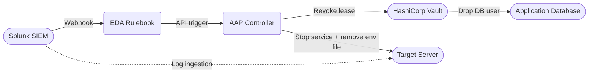

<div class="guide-header">

<h1>Automated Brute-Force Remediation with Event-Driven Ansible</h1>

<span class="guide-type-badge guide-type-badge--solution"><i class="fas fa-check-circle" aria-hidden="true"></i> Solution Guide</span>

</div>

<style>
  div#toc {
    display: none;
  }
</style>

<div class="guide-hero-callout guide-hero-partner guide-hero-partner--splunk" role="img" aria-label="Ansible Automation Platform and Splunk">
  
  <span class="guide-hero-partner__plus" aria-hidden="true">+</span>
  <span class="guide-hero-partner__partner card-partner-logo-set">
    
    
  </span>
</div>

## Overview

Security operations centers (SOCs) spend countless hours manually chasing alerts and isolating compromised hosts, a delay that offers attackers time to pivot and exfiltrate data. This guide demonstrates how to build a closed-loop security automation pipeline using Event-Driven Ansible (EDA). By connecting Splunk's real-time threat detection directly to HashiCorp Vault and Ansible Automation Platform (AAP), organizations can automatically contain brute-force attacks in seconds by revoking dynamic database credentials.

<div class="guide-outcome">
<strong>Outcome:</strong> A closed-loop EDA pipeline that detects a Splunk brute-force alert, revokes the compromised application's HashiCorp Vault database lease, and stops the affected service -- all within seconds, without human intervention.
</div>

* [Background](#background)
* [Solution](#solution)
* [Prerequisites](#prerequisites)
* [Brute-Force Remediation Workflow](#brute-force-remediation-workflow)
* [Solution Walkthrough](#solution-walkthrough)
* [Validation](#validation)
* [Maturity Path](#maturity-path)
* [Summary](#summary)

## Background

In traditional security operations, discovering a breach and containing it are two completely disconnected processes. A Security Information and Event Management (SIEM) system detects an anomaly—such as a brute-force SSH attack—and creates a ticket. A human operator must then see the ticket, log into the target system, block the IP, or rotate the application's passwords. During this gap, the attacker is actively exploring the network.

Under the principles of **Zero Trust Architecture (ZTA)** (specifically NIST SP 800-207), trust is continuously monitored and evaluated. When an identity or workload exhibits suspicious behavior, its trust score drops, and policy enforcement points must immediately restrict its access. Event-Driven Ansible acts as the connective tissue between the Policy Information Point (Splunk) and the Policy Enforcement Point (Vault and infrastructure), translating a threat signal into an immediate, governed access revocation.

## Solution

This solution replaces manual alert triage with an automated remediation pipeline. When Splunk detects rapid authentication failures, it fires a webhook payload to the EDA Controller. EDA validates the alert against a rulebook and immediately orchestrates a Job Template in AAP that connects to HashiCorp Vault to destroy the compromised application's database lease.

- **Splunk Enterprise** for continuous log aggregation and brute-force detection.
- **Event-Driven Ansible (EDA)** to ingest SIEM webhooks and trigger automated responses.
- **Ansible Automation Platform (AAP)** for orchestrating the Vault revocation and isolating the host.
- **HashiCorp Vault** for dynamic, short-lived database credential management.

### Who Benefits

| Persona | Challenge | What They Gain |
|---------|-----------|---------------|
| **IT Ops Engineer / SRE** | Waking up at 3 AM to manually block IPs or revoke passwords during an attack. | Automated, closed-loop remediation that handles the immediate threat so they can investigate during business hours. |
| **Security Architect** | Incident response times fail to meet strict compliance and risk mitigation thresholds. | A verifiable, code-driven response mechanism that enforces policy at machine speed. |
| **IT Manager / Director** | High risk of lateral movement and data exfiltration due to slow manual response times. | Reduced blast radius, predictable containment, and lower overall organizational risk. |

**Recommended Demos and Self-Paced Labs:**
- [Zero Trust Architecture Workshop (GitHub)](https://github.com/ansible/workshops)

## Prerequisites

### Ansible Automation Platform

- **Ansible Automation Platform 2.4+** -- Required for Event-Driven Ansible Controller support. (AAP 2.6 is recommended for Token Event Stream enhancements).

### Featured Ansible Content Collections

| Collection | Type | Purpose |
|-----------|------|---------|
| [ansible.eda](https://console.redhat.com/ansible/automation-hub/repo/published/ansible/eda/) | Certified | EDA webhook event sources and rulebook execution |
| [community.hashi_vault](https://console.redhat.com/ansible/automation-hub/repo/published/community/hashi_vault/) | Community | Interacting with HashiCorp Vault APIs |
| [hashicorp.vault](https://console.redhat.com/ansible/automation-hub/collections/published/hashicorp/vault/details) | Certified | Interacting with HashiCorp Vault APIs |
| [ansible.builtin](https://console.redhat.com/ansible/automation-hub/) | Built-in | Interacting with REST APIs via the `uri` module |

### External Systems

| System | Required | Examples |
|--------|----------|----------|
| **SIEM / EDR** | Yes | Splunk Enterprise (with Ansible Add-on for Splunk) |
| **Secrets Manager** | Yes | HashiCorp Vault |

**Operational Impact:** High (Revokes active credentials and stops application services).

## Brute-Force Remediation Workflow

The remediation workflow relies on an event-driven architecture, completely removing human latency from the initial containment phase.



1. **Threat Detection:** A threat actor targets a workload with an SSH brute-force attack. Splunk Universal Forwarders stream these authentication failures to the indexer.
2. **Alert Forwarding:** A Splunk saved search (e.g., 5+ failures in 60s) triggers the Ansible Add-on for Splunk, which POSTs the event payload to an EDA Token Event Stream.
3. **Rulebook Evaluation:** Event-Driven Ansible evaluates the payload structure. The `SSH Brute Force Detected` condition matches, triggering a Job Template inside AAP.
4. **Remediation Execution:** AAP authenticates to HashiCorp Vault, retrieves the active lease ID for the compromised application, and revokes it. The database drops the user immediately.
5. **Host Isolation:** AAP removes the compromised `.env` file and stops the system service to halt lateral movement.

## Solution Walkthrough

### Step 1: Configure Splunk EDA Webhook Endpoint

**Operational Impact:** Low

The Splunk environment must first be configured to forward specific alert actions to the EDA Event Stream URL. In AAP, create an External Event Stream and copy its URL. Then, run the configuration playbook against your Splunk instance:

```yaml
    - name: Update EDA environment webhook endpoint
      ansible.builtin.uri:
        url: "{{ splunk_mgmt }}/servicesNS/nobody/ansible_addon_for_splunk/ansible_addon_for_splunk_environment/ZTA"
        method: POST
        user: admin
        password: "{{ splunk_password }}"
        force_basic_auth: true
        validate_certs: false
        body_format: form-urlencoded
        body:
          webhook_endpoint: "{{ eda_event_stream_url }}"
          auth_type: apikey
          token: "{{ eda_token }}"
        status_code: [200]
```

### Step 2: Define Event-Driven Ansible Rulebook

**Operational Impact:** None

The EDA rulebook listens on the webhook port and evaluates incoming payloads from Splunk. If the payload matches the expected search criteria, it triggers the "Emergency: Revoke App Credentials" Job Template, passing the incident context as extra variables.

```yaml
- name: Splunk Brute-Force → Credential Revocation
  hosts: all

  sources:
    - ansible.eda.webhook:
        host: 0.0.0.0
        port: 5000

  rules:
    - name: Revoke credentials on SSH brute-force detection
      condition: event.payload.search_name is search("SSH Brute Force Detected")
      action:
        run_job_template:
          name: "Emergency: Revoke App Credentials"
          organization: Default
```

> **Custom Credential Types:**
>
> EDA needs a Controller token to launch the job template. Inject this token into the EDA environment securely using custom credentials in the EDA Controller UI.

### Step 3: Simulate Brute-Force Attack

**Operational Impact:** None

To generate the required log volume, a playbook utilizes `sshpass` to aggressively fail authentication attempts against the target host. Splunk indexes these logs and triggers the scheduled search.

```yaml
    - name: "Generate failed SSH login attempts"
      shell: |
        sshpass -p 'wrong-password-{{ item }}' \
          ssh -o StrictHostKeyChecking=no \
              -o UserKnownHostsFile=/dev/null \
              -o ConnectTimeout=3 \
              -p 22 rhel@{{ target_ip }} \
              'echo should-not-reach' 2>&1 || true
      loop: "{{ range(1, 21) | list }}"
```

### Step 4: Authenticate and Read Vault Lease

**Operational Impact:** None

Once triggered by EDA, the remediation playbook begins. AAP must authenticate to Vault and identify the active database lease associated with the compromised workload.

```yaml
    - name: Authenticate to Vault with userpass
      uri:
        url: "{{ vault_addr }}/v1/auth/userpass/login/{{ vault_username }}"
        method: POST
        body_format: json
        body:
          password: "{{ vault_password }}"
        validate_certs: false
      register: vault_login
      delegate_to: localhost

    - name: Read current Vault DB lease ID
      slurp:
        src: /tmp/zta-db-lease
      register: lease_raw
      ignore_errors: true
```

### Step 5: Revoke the Vault Lease and Stop Application

**Operational Impact:** High

This step intentionally severs the application's connection to the database. In a Zero Trust framework, an assumed breach requires containing the threat immediately, preventing lateral movement into the data tier. The playbook revokes the lease and stops the service.

```yaml
    - name: Revoke the database credentials in Vault
      command: "vault lease revoke {{ lease_raw.content | b64decode | trim }}"
      environment: 
        VAULT_ADDR: "{{ vault_addr }}"
        VAULT_TOKEN: "{{ vault_login.json.auth.client_token }}"
      when: lease_raw is succeeded and lease_raw.content is defined

    - name: Remove application environment file (contains credentials)
      file:
        path: "/opt/app/env"
        state: absent

    - name: Stop the application service
      systemd:
        name: ztaapp
        state: stopped
```

> **Warning:** PostgreSQL Existing Connections
>
> `vault lease revoke` removes the generated user from PostgreSQL, preventing new connections. However, existing active sessions may remain open depending on your database configuration. Ensure PostgreSQL is configured to aggressively terminate sessions for dropped users.

## Validation

### Test

Trigger the end-to-end event chain by launching the brute-force simulation from the AAP Controller or any host with SSH access to the application server. Ensure you wait at least 20-30 seconds for Splunk to index the events, evaluate the saved search, and dispatch the webhook.

```bash
# Run the simulation playbook to generate 20 failed login attempts
ansible-playbook section5/playbooks/simulate-bruteforce.yml
```

### Expected Result

Watch the EDA Controller rulebook activations to ensure the event was ingested. Then, check the AAP Jobs dashboard. The "Emergency: Revoke App Credentials" job will output a summary:

```
TASK [Display incident response summary] ****************************************
ok: [app.example.com] => {
    "msg": "Incident response — credentials revoked\n========================================\n\nTrigger: brute-force detected (Splunk)\nSource:  splunk-eda\nTarget:  app.example.com\n\nActions taken:\n  Vault DB lease revoked\n  App role leases revoked (prefix)\n  App env file removed\n  ztaapp stopped\n  Incident log written to /var/log/zta-incident-*.log\n\nApplication has no DB access.\n"
}
```

### Troubleshooting

| Symptom | Likely Cause | Fix |
|---------|-------------|-----|
| SIEM detects the attack but EDA does not fire | Webhook port blocked or incorrect URL | Verify network connectivity from the Splunk forwarder/indexer to the EDA Event Stream URL. Validate the Splunk Add-on configuration. |
| EDA fires but AAP job fails with `401 Unauthorized` | Invalid or expired Vault token | Regenerate the Vault token and update the credential in AAP, or ensure the AppRole used for login has permissions to revoke leases. |
| AAP job succeeds but app still accesses the database | Existing database sessions were not killed | Configure PostgreSQL to terminate active sessions for dropped users, or append a PostgreSQL connection kill task to the playbook. |

## Maturity Path

| Maturity | Description |
|----------|-------------|
| **Crawl** | **Alerting Only:** Splunk detects the brute force and sends an alert to a Slack channel or ServiceNow ticket. Human operators manually review and revoke credentials. |
| **Walk** | **Curated Remediation:** Splunk creates an ITSM ticket. An operator reviews the SIEM logs, clicks an "Approve Remediation" button in ServiceNow, which triggers the AAP playbook to isolate the host. |
| **Run** | **Automated Zero Trust:** EDA automatically intercepts the Splunk event and revokes the Vault database lease instantly, completely isolating the threat without human intervention. |

## Summary

Automating incident response with Event-Driven Ansible transforms security from a reactive monitoring task into a proactive defense mechanism. By integrating SIEM detections (Splunk) with HashiCorp Vault and AAP, organizations can enforce Zero Trust principles at machine speed -- automatically severing database access during a brute-force attack and significantly reducing the risk of a data breach.
