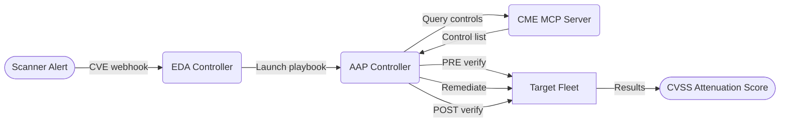


<div class="guide-header">
<h1>Automated CVE response and compliance verification with CME</h1>
<span class="guide-type-badge guide-type-badge--solution"><i class="fas fa-check-circle" aria-hidden="true"></i> Solution Guide</span>
</div>

<style>
  div#toc { display: none; }
</style>

<div class="guide-hero-callout guide-hero-partner guide-hero-partner--rhel" role="img" aria-label="Ansible Automation Platform and Red Hat Enterprise Linux">
  
  <span class="guide-hero-partner__plus" aria-hidden="true">+</span>
  <span class="guide-hero-partner__partner card-partner-logo-set card-partner-logo-set--rhel">
    
    
  </span>
</div>

<h2 id="overview"></h2>

## Overview

When a critical CVE drops, most organisations scramble. Security teams manually map the vulnerability to defensive controls, engineers SSH into hosts to check whether mitigations are in place, remediation happens ad-hoc with no audit trail, and nobody can quantify how much the existing security posture actually reduces the risk. For a CVSS 9.8 vulnerability, every hour of this manual process is exposure waiting to be exploited.

This guide demonstrates how to automate the **full vulnerability response lifecycle** -- from CVE detection through control verification, automated remediation, re-verification, and CVSS attenuation scoring -- using the Common Mitigation Enumeration (CME) taxonomy and Ansible Automation Platform. The result is a closed-loop pipeline that maps CVEs to defensive controls in seconds, verifies and remediates them at scale, and produces auditable evidence showing exactly how much residual risk remains.

- [Overview](#overview)
- [Background](#background)
- [Solution](#solution)
  - [Who Benefits](#who-benefits)
- [Prerequisites](#prerequisites)
  - [Ansible Automation Platform](#ansible-automation-platform)
  - [Featured Ansible Content Collections](#featured-ansible-content-collections)
  - [External Systems](#external-systems)
- [CVE Response Workflow](#cve-response-workflow)
  - [Operational Impact per Stage](#operational-impact-per-stage)
  - [Workflow Architecture Diagram](#workflow-architecture-diagram)
- [Solution Walkthrough](#solution-walkthrough)
  - [1. Query CME for Mitigating Controls](#1-query-cme-for-mitigating-controls)
  - [2. Verify Current Security Posture (PRE)](#2-verify-current-security-posture-pre)
  - [3. Remediate Controls](#3-remediate-controls)
  - [4. Re-Verify and Report (POST)](#4-re-verify-and-report-post)
  - [5. Calculate CVSS Score Attenuation](#5-calculate-cvss-score-attenuation)
  - [6. Configure Automation Controller (CaC)](#6-configure-automation-controller-cac)
- [Validation](#validation)
  - [Troubleshooting](#troubleshooting)
- [Maturity Path](#maturity-path)
- [Summary](#summary)

<h2 id="background"></h2>

## Background

**Common Mitigation Enumeration (CME)** is a taxonomy of 118 defensive security controls -- kernel hardening, mandatory access control, cryptographic policies, network isolation, audit pipelines, and more -- each catalogued with the CVSS vector metrics it attenuates, the CWE weaknesses it mitigates, and machine-verifiable commands to confirm whether the control is active on a host.

Traditional vulnerability management focuses on patching: find the CVE, apply the vendor fix, close the ticket. But patching alone ignores the layered defences that are already reducing exploitability. A host with ASLR, SELinux enforcing, kernel lockdown, and signed package enforcement is materially harder to exploit than a freshly installed system -- yet no standard tooling quantifies that difference or automates the verification.

**Compliance-as-code** bridges this gap by expressing each defensive control as an executable Ansible role with two capabilities: `verify` (read-only audit) and `remediate` (converge to desired state). Combined with the CME MCP server for CVSS vector mathematics, this enables a pipeline that starts with a CVE and ends with a scored, auditable posture report showing exactly how much the organisation's defences reduce the base risk.

 <a target="_blank" href="https://www.redhat.com/en/topics/security">Security -- redhat.com</a>

 <a target="_blank" href="https://www.redhat.com/en/topics/automation/what-is-infrastructure-as-code-iac">Infrastructure as Code -- redhat.com</a>

<h2 id="solution"></h2>

## Solution

What makes up the solution?

-  **CME Taxonomy and MCP Server** for defensive control knowledge, CVE-to-control mapping, and CVSS attenuation scoring <a target="_blank" href="https://github.com/nmartins0611/cme">[Link]</a>
-  **Ansible Automation Platform (AAP)** for orchestration, governance, approval gates, and RBAC <a target="_blank" href="https://www.redhat.com/en/technologies/management/ansible">[Link]</a>
-  **Event-Driven Ansible (EDA)** for triggering CVE response workflows from scanner webhooks <a target="_blank" href="https://www.redhat.com/en/technologies/management/ansible/event-driven-ansible">[Link]</a>
-  **cme.controls Ansible Collection** for 118 compliance-as-code roles with verify and remediate capabilities <a target="_blank" href="https://github.com/nmartins0611/cme/tree/main/collection">[Link]</a>

### Who Benefits

| Persona | Challenge | What They Gain |
|---------|-----------|---------------|
|  **Security Operations Engineer** | Manually mapping CVEs to relevant defensive controls, SSH-ing into hosts to check posture, and assembling evidence with no standard format -- triage takes hours per CVE | `cme_query` maps CVE to controls in seconds; `verify.yml` audits the entire fleet without changes; HTML/PDF reports provide auditable evidence |
|  **Automation Architect** | No standard way to express security controls as code; compliance checks are one-off scripts with no reusable structure | 118 idempotent roles with consistent verify/remediate patterns, profile-driven execution, and CaC for controller setup |
|  **CISO / Security Director** | Cannot quantify how existing defences reduce CVE risk; reports show pass/fail counts but not residual exposure | CVSS attenuation scoring shows the exact before/after risk reduction (e.g. 9.8 Critical to 4.2 Medium) with per-metric attribution |
|  **Compliance Officer** | Assembling audit evidence manually -- copying terminal output, correlating controls to frameworks | Timestamped HTML reports with control-level pass/fail, CVSS vector modifications, and tactic categorisation |

<h2 id="prerequisites"></h2>

## Prerequisites

### Ansible Automation Platform

- **Ansible Automation Platform 2.5+** -- required for Automation Controller workflow approval nodes and EDA Controller integration

### Featured Ansible Content Collections

| Collection | Type | Purpose |
|-----------|------|---------|
| <a target="_blank" href="https://console.redhat.com/ansible/automation-hub/repo/published/ansible/posix/">ansible.posix</a> | Certified | `sysctl`, `selinux` for kernel hardening and MAC enforcement |
| <a target="_blank" href="https://console.redhat.com/ansible/automation-hub/repo/published/ansible/controller/">ansible.controller</a> | Certified | Controller configuration-as-code: organisations, job templates, workflows, credentials |
| cme.controls | Custom | 118 CME roles (verify + remediate), `cme_score` and `cme_query` modules, filter plugins, profiles |

### External Systems

| System | Required | Examples |
|--------|----------|----------|
| CME MCP Server | Yes | Self-hosted via Docker Compose (`docker-compose.yml` included), or `cmetaxonomy.org` public endpoint |
| Vulnerability Scanner | Optional (for EDA trigger) | Rapid7, Qualys, Tenable, RHACS -- any scanner that can send a webhook with CVE ID, CVSS vector, and CWE IDs |
| SIEM / SOAR | Optional (for notification) | Splunk, Elastic, ServiceNow -- webhook notification on workflow completion |

**Operational Impact:** Medium -- remediation tasks modify host configuration (sysctl, SELinux, firewall, crypto policies). Verification is read-only with no impact.

<h2 id="cve-response-workflow"></h2>

## CVE Response Workflow

The workflow begins when a vulnerability scanner detects a CVE and fires a webhook to Event-Driven Ansible. EDA evaluates the event against a rulebook and launches the `cve_response.yml` playbook on Automation Controller, passing the CVE ID, CVSS vector string, and CWE IDs as extra variables. Phase 1 queries the CME MCP server to determine which of the 118 defensive controls are relevant to this specific vulnerability -- typically 50-100+ controls for a critical CVE. The playbook dynamically builds a compliance profile from the results.

Phase 2 runs read-only verification of every matched control across all target hosts, recording each control's status (passed, failed, skipped) into a structured results list. Phase 3 applies automated remediation for controls that support it -- kernel hardening via `sysctl`, SELinux enforcement, cryptographic policy updates, service configuration -- wrapped in block/rescue handlers so individual failures don't halt the run. Phase 4 re-verifies all controls and generates PRE/POST HTML reports per host. Finally, Phase 5 sends both the pre-remediation and post-remediation active control lists to the CME MCP server, which calculates the CVSS vector attenuation and returns a modified score showing the residual risk.

### Operational Impact per Stage

| Stage | Impact | Description |
|-------|--------|-------------|
| 1. Query CME | None | Localhost-only MCP API call; no changes to target hosts |
| 2. PRE Verify | None | Read-only shell commands and fact checks; no system modifications |
| 3. Remediate | **High** | Modifies sysctl parameters, SELinux mode, crypto policies, installs packages, enables services |
| 4. POST Verify + Report | None | Read-only verification and report generation (delegated to localhost) |
| 5. CVSS Scoring | None | Localhost-only MCP API call; produces risk assessment |

### Workflow Architecture Diagram



In Automation Controller, the same flow maps to a **workflow template** with an approval gate:

```
[Verify Posture] --> [Approve Remediation] --> [Remediate] --> [Posture Report + Score]
```

<h2 id="solution-walkthrough"></h2>

## Solution Walkthrough

### 1. Query CME for Mitigating Controls

**Operational Impact:** None

The `cme_query` module connects to the CME MCP server and asks: "Which defensive controls mitigate this CVE?" It queries by CVSS vector (to find controls that attenuate specific metrics like Attack Vector or Privileges Required) and by CWE ID (to find controls that address the root weakness class). The results are deduplicated, normalised to role names, and written to disk as a dynamic profile.

**Featured Tasks:**

```yaml
- name: Query CME MCP for mitigating controls
  cme_query:
    cvss_vector: "{{ cvss_vector }}"
    cwe_ids: "{{ cwe_ids }}"
    mcp_endpoint: "{{ cme_mcp_endpoint }}"
  register: cme_query_result

- name: Build dynamic profile
  ansible.builtin.set_fact:
    cme_dynamic_profile:
      controls: "{{ cme_query_result.cme_ids | map('lower') | map('replace', '-', '_') | list }}"
```

> **RBAC:** Restrict MCP credential access.
>
> The CME MCP Endpoint credential should only be assigned to job templates that need scoring or querying. Use a Custom Credential Type to inject the endpoint URL as an extra variable.

**Job Template Configuration:**

| Field | Value |
|-------|-------|
| **Name** | `CME — CVE Response` |
| **Inventory** | `CME Target Hosts` |
| **Project** | `CME Compliance Collection` |
| **Playbook** | `collection/playbooks/cve_response.yml` |
| **Credentials** | `CME Machine Credential`, `CME MCP Server` |
| **Survey** | CVE ID, CVSS Vector, CWE IDs |

### 2. Verify Current Security Posture (PRE)

**Operational Impact:** None

The playbook loops over every control in the dynamic profile and includes the role's `verify.yml` task file. Each verify task runs the CME-specified verification commands (e.g. checking sysctl values, SELinux mode, kernel parameters) and records the result into a `cme_results` host fact. No changes are made to the system.

**Featured Tasks:**

```yaml
- name: Verify each control
  ansible.builtin.include_role:
    name: "{{ control_id }}"
    tasks_from: verify.yml
  loop: "{{ cme_target_controls }}"
  loop_control:
    loop_var: control_id
  ignore_errors: true

- name: Save PRE results
  ansible.builtin.set_fact:
    cme_pre_results: "{{ cme_results }}"
    cme_pre_passed: "{{ cme_results | selectattr('status', 'equalto', 'passed') | list }}"
    cme_pre_failed: "{{ cme_results | selectattr('status', 'equalto', 'failed') | list }}"
```

### 3. Remediate Controls

**Operational Impact:** High

Each control is applied through a block/rescue wrapper (`_apply_control.yml`) so that individual role failures are caught and logged without halting the entire run. Remediation strategies vary by category: kernel hardening uses `ansible.posix.sysctl`, mandatory access control uses `ansible.posix.selinux`, cryptographic controls run `update-crypto-policies`, and package-based controls use `ansible.builtin.dnf`.

**Featured Tasks:**

```yaml
# _apply_control.yml — block/rescue wrapper
- name: "Apply control {{ control_id }}"
  block:
    - name: "Include role {{ control_id }}"
      ansible.builtin.include_role:
        name: "{{ control_id }}"
  rescue:
    - name: "Log failure for {{ control_id }}"
      ansible.builtin.debug:
        msg: "Control {{ control_id }} remediation failed — continuing with next control"
```

Example role remediation (CME-301, SELinux):

```yaml
- name: "CME-301 | Ensure SELinux packages are installed"
  ansible.builtin.package:
    name:
      - libselinux
      - policycoreutils
      - selinux-policy-targeted
    state: present
  when: ansible_os_family == 'RedHat'

- name: "CME-301 | Set SELinux to enforcing"
  ansible.posix.selinux:
    policy: targeted
    state: enforcing
  when: ansible_os_family == 'RedHat'
```

> **Warning:** Remediation modifies system state.
>
> Controls like FIPS mode, Secure Boot, and LUKS encryption require reboots or hardware support and cannot be applied in-place. These roles emit a debug message and fall through to verify-only. Review the profile to understand which controls have automated remediation.

### 4. Re-Verify and Report (POST)

**Operational Impact:** None

The playbook re-runs verification on all controls and compares POST results against the saved PRE results. It identifies newly passed controls (remediation gains), still-failed controls, and generates per-host HTML reports using a Jinja2 template. Reports are delegated to localhost.

**Featured Tasks:**

```yaml
- name: Calculate remediation gains
  ansible.builtin.set_fact:
    cme_newly_passed: >-
      {{ (cme_post_passed | map(attribute='cme_id') | list)
         | difference(cme_pre_passed | map(attribute='cme_id') | list) }}

- name: Generate POST report
  ansible.builtin.template:
    src: "{{ playbook_dir }}/../templates/verify_report.html.j2"
    dest: "{{ cme_report_dir }}/cve_{{ cve_id }}_{{ inventory_hostname }}_POST.html"
    mode: "0644"
  delegate_to: localhost
```

### 5. Calculate CVSS Score Attenuation

**Operational Impact:** None

The `cme_score` module sends the list of active controls to the CME MCP server, which calculates how each control attenuates specific CVSS vector metrics. The result is a modified CVSS vector and score that reflects the residual risk after accounting for active defences. Both PRE and POST scores are calculated to show the delta.

**Featured Tasks:**

```yaml
- name: Calculate POST attenuation score
  cme_score:
    active_controls: "{{ all_post_active }}"
    mcp_endpoint: "{{ cme_mcp_endpoint }}"
    base_score: 9.8
    base_vector: "{{ cvss_vector }}"
  register: post_score
```

The module returns per-metric attenuation with contributing control attribution:

```json
{
  "attenuation": [
    {"metric": "AC", "modified_to": "H", "contributing_controls": ["CME-101", "CME-104", "CME-109"]},
    {"metric": "AV", "modified_to": "A", "contributing_controls": ["CME-201"]},
    {"metric": "C",  "modified_to": "L", "contributing_controls": ["CME-108", "CME-406"]}
  ],
  "simulation": {
    "original": {"score": 9.8, "severity": "Critical"},
    "modified": {"score": 4.2, "severity": "Medium"},
    "modifications_applied": 26
  }
}
```

### 6. Configure Automation Controller (CaC)

**Operational Impact:** Low (controller-only, no target host changes)

The `configure_controller.yml` playbook provisions all AAP resources in a single run: organisation, custom credential type for MCP endpoints, project linked to the Git repository, inventory, four job templates, a workflow template with an approval gate, and an optional webhook notification.

**Featured Tasks:**

```yaml
- name: Create CVE Response job template
  ansible.controller.job_template:
    name: "CME — CVE Response"
    organization: "{{ cme_org_name }}"
    project: "{{ cme_project_name }}"
    playbook: "collection/playbooks/cve_response.yml"
    inventory: "{{ cme_inventory_name }}"
    credential: "{{ cme_credential_name }}"
    execution_environment: "{{ cme_ee_name }}"
    become_enabled: true
    survey_enabled: true
    survey_spec:
      name: "CVE Details"
      spec:
        - question_name: "CVE ID"
          variable: cve_id
          type: text
          required: true
        - question_name: "CVSS Vector"
          variable: cvss_vector
          type: text
          required: true
```

**Job Template Configuration:**

| Field | Value |
|-------|-------|
| **Name** | `CME — Configure Controller` |
| **Inventory** | `localhost` |
| **Project** | `CME Compliance Collection` |
| **Playbook** | `collection/playbooks/configure_controller.yml` |
| **Credentials** | `Automation Controller API Token` |
| **Extra Vars** | `controller_host`, `controller_oauthtoken`, `cme_scm_url` |

> **RBAC:** Limit controller configuration access.
>
> Only the automation architect team should have `Execute` on this template. It creates organisations, credentials, and job templates with `become_enabled`.

<h2 id="validation"></h2>

## Validation

### Test

Run the CVE response workflow from the CLI:

```bash
ansible-playbook collection/playbooks/cve_response.yml \
  -e cme_mcp_endpoint=http://localhost:8000 \
  -e 'cvss_vector=CVSS:3.1/AV:N/AC:L/PR:N/UI:N/S:U/C:H/I:H/A:H' \
  -e '{"cwe_ids": ["CWE-829"]}' \
  -e cve_id=CVE-2024-38476 \
  -e cme_report_dir=./reports \
  -i inventory.yml
```

Or launch via the Controller API:

```bash
curl -sk https://controller.example.com/api/v2/job_templates/CME%20%E2%80%94%20CVE%20Response/launch/ \
  -H "Authorization: Bearer $TOKEN" \
  -H "Content-Type: application/json" \
  -d '{"extra_vars": {"cve_id": "CVE-2024-38476", "cvss_vector": "CVSS:3.1/AV:N/AC:L/PR:N/UI:N/S:U/C:H/I:H/A:H", "cwe_ids": ["CWE-829"]}}' \
  | jq .status
```

### Expected Result

```
TASK [Display final CVE response summary] *************************************
ok: [localhost] => {
    "msg": "═══════════════════════════════════════════════════════════\n
              CVE RESPONSE SUMMARY — CVE-2024-38476\n
            ═══════════════════════════════════════════════════════════\n
             POSTURE:\n
               PRE:     24 controls active\n
               POST:    24 controls active\n
               GAINED:  +3 remediated\n
            ───────────────────────────────────────────────────────────\n
             CVSS ATTENUATION:\n
               POST: 7 metrics attenuated\n
                     AC: → H  (19 controls)\n
                     AV: → A  (1 control)\n
                     PR: → H  (3 controls)\n
            ═══════════════════════════════════════════════════════════"
}

PLAY RECAP *********************************************************************
localhost  : ok=12   changed=2    unreachable=0    failed=0    skipped=0
rhel-vm    : ok=48   changed=5    unreachable=0    failed=0    skipped=3
```

### Troubleshooting

| Symptom | Likely Cause | Fix |
|---------|-------------|-----|
| `cme_query` returns empty `cme_ids` list | MCP server unreachable or CVSS vector format invalid | Verify `cme_mcp_endpoint` is reachable (`curl http://host:8000/mcp`). Ensure vector starts with `CVSS:3.1/` |
| Remediation fails with `No route to host` | Target host unreachable via SSH | Check network connectivity, SSH key authentication, and inventory host address |
| Remediation role fails with package install error | Target host not registered to package repositories | Register the host (`subscription-manager register`) or configure local repos before running remediation |
| `cme_score` returns no attenuation data | No active controls passed to the module | Verify that `cme_pre_passed` or `cme_post_passed` is non-empty; at least one control must be `passed` |
| Verify task fails with YAML parsing error | Backslash or special character in control description | Regenerate roles with `python scripts/generate_collection.py` (fixed escaping in `_escape_yaml`) |
| Workflow approval node times out | No user with approval permissions is logged in | Assign the `Approve` role to a team in AAP and ensure a member processes the approval within the configured timeout (default 3600s) |

<h2 id="maturity-path"></h2>

## Maturity Path

| Maturity | Description |
|----------|-------------|
|  **Crawl** | Run `verify.yml` with the `minimal` profile (25 controls) on a single host. Read-only audit, no remediation. Review HTML reports manually. Establish baseline posture visibility with zero operational risk. |
|  **Walk** | Deploy the full compliance cycle workflow on Automation Controller with the approval gate. Use the `rhel9_baseline` profile (55 controls) across fleet inventory. Enable CVSS attenuation scoring via MCP. Security team reviews and approves remediation before execution. |
|  **Run** | Connect EDA Controller to scanner webhooks for automatic CVE response. `cve_response.yml` runs the full 5-phase pipeline autonomously with policy-based approval (severity threshold gates replace human gates). AI agent triages CVEs, selects profiles, and escalates only novel threats. Posture reports feed SIEM dashboards for continuous compliance monitoring. |

## Day-2 Operations

### Monitoring

- **CME MCP Server:** Poll `http://<mcp-host>:8000/health` (or `/mcp`) to confirm the endpoint is responsive. Alert if the server returns non-200 or takes longer than 2 seconds to respond -- MCP unavailability causes `cme_query` and `cme_score` tasks to fail silently with empty results.
- **EDA Rulebook Activation:** Monitor the EDA Controller for activation status `RUNNING`. A stopped or crashed activation means no CVE events will trigger the pipeline. Set up a synthetic event (a test `cve_disclosed` webhook) in your monitoring system to verify end-to-end liveness.
- **AAP Job Duration:** Baseline the runtime of `CME -- CVE Response` across your fleet size. Runtimes that exceed 2x the baseline typically indicate SSH connectivity issues or package repository failures on a subset of hosts.

### Maintenance

- **`cme.controls` Collection Updates:** As the CME taxonomy grows (currently 118 controls), pull collection updates via `ansible-galaxy collection install cme.controls --upgrade` before running the pipeline against new CVE classes. New controls require regenerating roles with `python scripts/generate_collection.py`.
- **MCP Server Docker Image:** Rebuild or pull the latest `cme-mcp` image before major CVE response campaigns to ensure CVSS vector mathematics reflect the latest NVD data. If using `cmetaxonomy.org`, monitor their status page.
- **Execution Environment:** Rebuild the CME EE quarterly or when `ansible.controller`, `ansible.posix`, or `ansible.eda` release a new minor version. Pin EE image tags in AAP to prevent unintended upgrades during active incidents.

### Known Issues

| Issue | Symptom | Workaround |
|-------|---------|-----------|
| **FIPS mode controls skip remediation** | Roles for FIPS, Secure Boot, and LUKS emit `debug` messages and fall through to verify-only | Expected behavior -- these controls require reboots or hardware changes. Track as accepted risk or remediate manually during a maintenance window. |
| **`cme_score` returns no attenuation on first run** | `cme_post_passed` is empty because no controls passed PRE verify | Run a second `verify.yml` pass after the initial baseline deployment to populate the passed-controls list before scoring. |
| **Workflow approval node times out** | No user with `Approve` role processes the approval within the timeout (default 3600s) | Assign the `Approve` role to a team with on-call coverage, or increase the timeout for low-urgency workflows via the AAP Controller API. |
| **Backslash in control description causes YAML parse error** | `include_role` task fails with `yaml.scanner.ScannerError` | Regenerate the affected role with `python scripts/generate_collection.py` -- the fixed `_escape_yaml` function strips problematic characters. |

<h2 id="summary"></h2>

## Summary

This solution automates the complete CVE response lifecycle using 118 CME defensive controls expressed as compliance-as-code Ansible roles. By querying the CME MCP server with a CVE's CVSS vector and CWE classification, the system dynamically determines which controls are relevant, verifies their status across the fleet, applies automated remediation, and calculates the resulting CVSS score attenuation -- turning a manual, multi-day process into a single automated pipeline. In testing against CVE-2024-38476 (CVSS 9.8 Critical), the pipeline demonstrated a reduction to 4.2 Medium through 26 vector modifications across 7 CVSS metrics, with full per-control attribution. The maturity path moves from read-only posture audits (Crawl) through approval-gated remediation (Walk) to fully autonomous, scanner-triggered CVE response with policy-based governance (Run).


