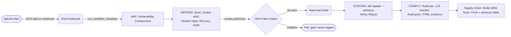


<!--
taxonomy:
  products: [Red Hat Ansible Automation Platform 2.5, Red Hat Enterprise Linux 9]
  technologies: [Event-Driven Ansible, Open Policy Agent, Splunk, Podman, firewalld, SELinux, AIDE, UBI9-minimal, oscap-podman]
  use_case: [Security automation, Event-driven automation, Patch management, Compliance]
  classification: Event-driven + Security
  maturity: Workshop (production-ready patterns)
-->

<div class="guide-header">
<h1>Automated CVE response with policy-gated patching and compliance evidence</h1>
<span class="guide-type-badge guide-type-badge--solution"><i class="fas fa-check-circle" aria-hidden="true"></i> Solution Guide</span>
</div>

<style>
  div#toc { display: none; }
</style>

<div class="guide-hero-callout guide-hero-partner guide-hero-partner--splunk" role="img" aria-label="Ansible Automation Platform and Splunk">
  
  <span class="guide-hero-partner__plus" aria-hidden="true">+</span>
  <span class="guide-hero-partner__partner card-partner-logo-set">
    
    
  </span>
</div>

<!-- tags: ansible, aap, eda, splunk, opa, compliance, cve, security, patch-management, container -->

## Overview

Security teams responding to a critical CVE face the same four gaps every time: detection exists but response is manual SSH work measured in tens of minutes per host; patching rules live in documents nobody enforces; audit evidence is assembled by hand after the fact; and application deployments carry no provenance or scanning. This guide automates all four phases in sequence -- detect and contain within seconds of a Splunk alert, patch with OPA policy gates and human approval, then generate auditor-ready before/after compliance evidence and a supply-chain-verified container image.

<div class="guide-outcome">
<strong>Outcome:</strong> Three-phase automated CVE response -- DEFEND (EDA contains the threat in seconds), CONTAIN (OPA-gated patching with human approval), and COMPLY (automated compliance evidence, CIS hardening, and a scanned container image pushed to the registry).
</div>

- [Background](#background)
- [Solution](#solution)
- [Prerequisites](#prerequisites)
- [CVE Response Workflow](#cve-response-workflow)
- [Solution Walkthrough](#solution-walkthrough)
- [Validation](#validation)
- [Maturity Path](#maturity-path)
- [Summary](#summary)

## Background

When a CVSS 9.8 SSRF flaw (CVE-2024-38476, Apache HTTP Server) appears on a production host, each gap in the manual process widens the window an attacker can exploit. Detection may be near-real-time, but the response chain -- ticket, triage, SSH access, manual patch, evidence collection -- routinely takes 45+ minutes per host under pressure. A human in the loop at every step is not a safety feature; it is the attack surface.

Under the principles of **Zero Trust Architecture (ZTA)** (NIST SP 800-207), trust is continuously monitored and evaluated. When a host exhibits a known vulnerability, policy enforcement points must respond before the window is exploited -- not after the ticket queue drains. Event-Driven Ansible acts as the connective tissue between the Policy Information Point (Splunk) and the Policy Enforcement Points (firewall, service configuration, and the patching workflow).

## Solution

Three automation stages map directly to the three real response phases: contain first, patch second, prove third.

| Stage | Trigger | Automation |
|-------|---------|------------|
| **DEFEND** | Splunk detects the CVE and fires the Ansible add-on | EDA rulebook launches a containment workflow: scan confirmation, firewall interface isolation, httpd hardening, SELinux booleans, AIDE baseline |
| **CONTAIN** | Red Hat publishes the errata | AAP workflow queries OPA policy gates, pauses at an approval node, patches via `dnf update --advisory`, verifies and reports |
| **COMPLY** | Post-remediation | OPA compliance audit (13 controls), CIS hardening, before/after HTML evidence, hardened UBI9-minimal container built, scanned, pushed |

Two policy layers enforce control. OPA evaluates *system state* (backup age, maintenance window, disk space, service health) inside the workflow. A second OPA execution policy controls *who* may launch patching at the platform level -- even an AAP superuser is blocked.

### Who Benefits

| Persona | Challenge | What They Gain |
|---------|-----------|----------------|
| **IT Ops Engineer / SRE** | 45+ minutes of manual SSH work per host when a critical CVE lands | Automated containment in seconds, patching triggered by the errata, no manual host access required |
| **Security Architect** | Patching rules exist in documents that nobody enforces under time pressure | OPA policy gates enforced in code -- backup age, maintenance window, and disk space checked before any patch runs |
| **Compliance Officer** | Evidence collected manually weeks after remediation, inconsistent formats | Before/after HTML compliance reports generated automatically by the same workflow that applies the fix |
| **CISO / Security Director** | No traceable supply chain for the container images deployed after patching | Every image carries the exact advisory ID that triggered the rebuild, scanned clean before push |

## Prerequisites

- **Red Hat Ansible Automation Platform 2.5+** (Controller + EDA Controller)
- **RHEL 9 targets** with `httpd`, `firewalld`, SELinux `targeted`, Podman installed
- **Splunk** with HTTP Event Collector enabled (port 8088) and the Ansible add-on for Splunk installed
- **Open Policy Agent** (port 8181) with the Rego policies from `lab/setup/files/opa-policies/`

### Featured Ansible Content Collections

| Collection | Type | Purpose |
|-----------|------|---------|
| <a target="_blank" href="https://console.redhat.com/ansible/automation-hub/repo/published/ansible/controller/">ansible.controller</a> | Certified | Job template launch, workflow control, set_stats |
| <a target="_blank" href="https://console.redhat.com/ansible/automation-hub/repo/published/ansible/posix/">ansible.posix</a> | Certified | `firewalld`, `selinux`, `sysctl` for hardening and containment |
| <a target="_blank" href="https://console.redhat.com/ansible/automation-hub/repo/published/ansible/utils/">ansible.utils</a> | Certified | Structured fact manipulation in compliance reporting |
| <a target="_blank" href="https://console.redhat.com/ansible/automation-hub/repo/published/containers/podman/">containers.podman</a> | Certified | Container build, scan, and push for the supply chain stage |
| <a target="_blank" href="https://console.redhat.com/ansible/automation-hub/repo/published/redhat/rhel_system_roles/">redhat.rhel_system_roles</a> | Certified | CIS hardening and audit configuration |
| <a target="_blank" href="https://console.redhat.com/ansible/automation-hub/repo/published/community/general/">community.general</a> | Community | AIDE management and miscellaneous host tasks |
| `ansible.eda` | Certified | Webhook event sources and rulebook execution (decision environment) |

**Operational Impact:** High -- the CONTAIN stage reboots or restarts services; the COMPLY stage modifies host and container configuration.

## CVE Response Workflow



The EDA rulebook is the decision point that turns detection into response:

```yaml
sources:
  - ansible.eda.pg_listener:
      token: "{{ EDA_WEBHOOK_TOKEN | default('') }}"
rules:
  - name: CVE alert from Splunk -- trigger containment
    condition: event.payload.search_name is search("CVE Alert")
    actions:
      - run_workflow_template:
          name: "Vulnerability Containment"
          organization: Default
          job_args:
            limit: "{{ event.payload.results.host }}"
```

The affected host flows from the Splunk alert into the workflow limit, so containment touches exactly one server. Patching is gated by OPA before execution:

```yaml
- name: Query OPA patch policy
  ansible.builtin.uri:
    url: "{{ opa_url }}/v1/data/dcc/patch_policy/result"
    method: POST
    body_format: json
    body:
      input:
        current_hour: "{{ ansible_date_time.hour | int }}"
        backup_age_hours: "{{ backup_age_hours | float }}"
        free_disk_gb: "{{ free_disk_gb | float }}"
        service_state: "{{ _service_state.status.ActiveState }}"
  register: _opa_response
```

If `allow_patch` is false, the playbook fails with the specific violated gate and the workflow never reaches the approval node.

## Solution Walkthrough

### Step 1: Detect and Confirm

**Operational Impact:** None

Splunk aggregates scanner and log events for the CVE. The `DEFEND - Scan System` job confirms ground truth from the target itself (`yum updateinfo`), separating detection from confirmation to prevent containment on stale alerts.

### Step 2: Contain

**Operational Impact:** Medium (service reconfiguration, no downtime)

The `Vulnerability Containment` workflow isolates the external interface (`eth0`) into an `internal-only` firewalld zone, removes HTTP/HTTPS from the public zone, hardens httpd (`ServerTokens Prod`, security headers, disabled modules), enforces SELinux booleans against SSRF exploitation, and activates AIDE. The service keeps running on the internal network -- a graduated response, not a kill switch.

### Step 3: Patch with Policy Gates

**Operational Impact:** High (service restart required after patch)

The `Policy-Gated Patching` workflow evaluates OPA gates, pauses at an approval node (15-minute timeout), applies `RHSA-2024:5138` via `dnf update --advisory`, verifies the CVE is resolved, and records `set_stats` artifacts (`pre_patch_policy_passed`, `patch_applied`, `cve_resolved`) as a machine-readable audit trail.

```yaml
- name: Apply advisory patch
  ansible.builtin.dnf:
    name: "*"
    state: latest
    bugfix: false
    security: true
    advisory: "{{ rhsa_id }}"
  register: patch_result
```

> **Warning:** OPA gates block patching, not containment.
>
> The DEFEND workflow runs immediately without policy gates -- containment is always faster than verification. OPA gates apply only to the CONTAIN (patching) stage. If all gates pass but the approval node times out (15 minutes), the workflow fails safe and does not apply the patch.

### Step 4: Prove and Deliver

**Operational Impact:** Medium (CIS hardening modifies host configuration)

The `Compliance and Hardening` workflow audits 13 controls (SELinux, firewall, SSH, kernel, file permissions, services, vulnerability state), applies CIS hardening, re-audits for before/after evidence, then builds a hardened container from UBI9-minimal, scans it inside the Trusted Pipeline EE using `oscap-podman`, and pushes it to the registry with `security.advisory` labels.

```yaml
- name: Build hardened container with advisory label
  containers.podman.podman_image:
    name: "parasol-app"
    tag: "{{ rhsa_id }}"
    path: "{{ playbook_dir }}/../container/"
    build:
      extra_args: "--label security.advisory={{ rhsa_id }}"
    push: true
    push_args:
      dest: "{{ registry_url }}/parasol-app:{{ rhsa_id }}"
```

## Validation

**Containment works:** After the DEFEND workflow, `firewall-cmd --get-active-zones` shows `eth0` in `internal-only` (SSH only), httpd still running and answering on the internal interface, security headers served, SELinux booleans off, AIDE cron active.

**Policy gates actually block:** Removing the backup marker (`/var/log/last-backup-timestamp`) makes the pre-patch check fail, naming the violated gate. Restore it and the check passes again. Launching the patching workflow as `admin` is denied by the OPA execution policy.

**Compliance improved:** The pre-hardening audit report lists failed controls; the post-hardening report shows all 13 passing. Both are published to the compliance portal as before/after evidence.

**Supply chain is clean:** The image scan shows no critical CVEs, and `curl http://localhost:5000/v2/_catalog` lists the pushed `parasol-app` image with the advisory label.

### Troubleshooting

| Symptom | Likely Cause | Fix |
|---------|-------------|-----|
| EDA rulebook fires but workflow does not start | Token Event Stream credential missing or expired in EDA | Rotate the AAP controller token and update the EDA credential; verify the Event Stream URL in the Splunk add-on matches the activated rulebook |
| OPA gate fails with `connection refused` | OPA server not running or wrong port | Confirm `curl http://<opa-host>:8181/health` returns `{"status":"ok"}` from the execution environment |
| Approval node times out before an operator acts | Notification not configured on the approval step | Add an email or webhook notifier to the approval step in the workflow template |
| Container scan fails inside the Trusted Pipeline EE | `oscap-podman` not in the EE image | Rebuild the EE with `oscap-podman` as a system dependency; verify with `ansible-navigator exec -- oscap-podman --version` |
| `dnf update --advisory` reports advisory not found | RHSM subscription not attached or repos not synced | Run `subscription-manager refresh` on the target and re-enable the advisory's repo channel |

## Maturity Path

| Maturity | Description |
|----------|-------------|
| **Crawl** | **Alerting only.** Splunk detects the CVE and sends an alert to a Slack channel or ServiceNow ticket. Human operators SSH in to confirm, manually harden `httpd`, and track the patch in a spreadsheet. |
| **Walk** | **EDA-triggered containment + manual patch.** EDA receives the Splunk webhook and runs the DEFEND containment workflow automatically. An operator manually approves and applies the patch. The COMPLY audit runs post-patch but evidence is reviewed manually. |
| **Run** | **Full three-phase automation.** DEFEND runs in seconds on Splunk alert. CONTAIN waits for the errata, passes OPA gates, and pauses only for the required human approval. COMPLY generates evidence, applies CIS hardening, builds the signed container, and uploads results -- the operator reviews outcomes, not process. |
| **Scale out** | Add hosts to the inventory and use job slicing for parallel patching. Sign the container supply chain with `cosign`. Trigger container builds from Containerfile commits via GitOps. Connect the approval node to ServiceNow for automatic change ticket creation. |

## Summary

This solution automates the complete CVE response lifecycle on Red Hat Enterprise Linux using Event-Driven Ansible, Open Policy Agent, and Ansible Automation Platform. When Splunk detects CVE-2024-38476, EDA triggers containment in seconds -- isolating the affected interface, hardening the service, and activating AIDE -- without waiting for a human to open a ticket. When the errata lands, OPA evaluates patching prerequisites in code: backup recency, maintenance window, disk space, and service health. The workflow pauses at a human approval node, applies the advisory, then hands off to a compliance pipeline that audits 13 controls before and after CIS hardening and produces a scanned, labeled container image as the final deliverable. Mean-time-to-contain drops from 45+ minutes of SSH work to seconds of automated response.


