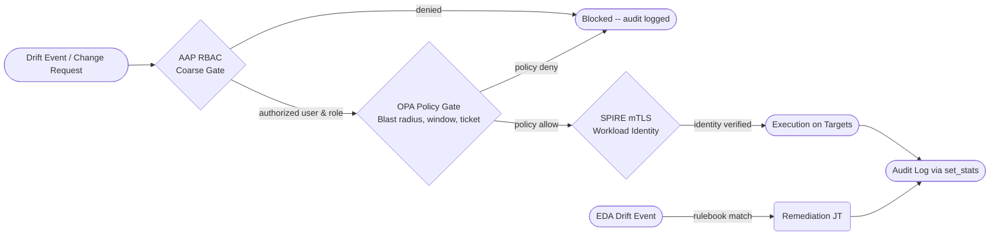


<div class="guide-header">

<h1>Enforcing Compliance and Network Governance</h1>

<span class="guide-type-badge guide-type-badge--implementation"><i class="fas fa-check-circle" aria-hidden="true"></i> Implementation Guide</span>

</div>

<div class="guide-hero-callout guide-hero-partner guide-hero-partner--opa" role="img" aria-label="Ansible Automation Platform and Open Policy Agent">
  
  <span class="guide-hero-partner__plus" aria-hidden="true">+</span>
  <span class="guide-hero-partner__partner card-partner-logo-set card-partner-logo-set--opa">
    
    
  </span>
</div>

<div class="guide-outcome">
<strong>Outcome:</strong> Continuous compliance monitoring with automated drift remediation, contextual OPA policy gates that evaluate blast radius and change windows before any infrastructure change is applied, and cryptographic workload identity for sensitive network paths -- all with a fully queryable audit trail in AAP Controller.
</div>

## Overview

Organizations spend hundreds of hours manually verifying compliance, managing access, and gating network changes, leading to audit gaps and security risks. This guide demonstrates how to automate continuous compliance monitoring, enforce least-privilege access, and govern infrastructure changes using Ansible Automation Platform (AAP) -- reducing manual audit effort and improving configuration consistency.

**Table of Contents**
- [Background](#background)
- [Solution](#solution)
- [Prerequisites](#prerequisites)
- [Compliance and Governance Workflow](#compliance-and-governance-workflow)
- [Solution Walkthrough](#solution-walkthrough)
- [Validation](#validation)
- [Maturity Path](#maturity-path)
- [Summary](#summary)

## Background

Governance in IT automation means ensuring that only authorized users can perform specific actions, within approved windows, and that all actions are fully audited. As infrastructure scales, relying on manual change advisory boards (CABs) and periodic audits becomes a bottleneck.

Modern IT operations require a Zero Trust architecture and Policy as Code (PaC) approach. This shifts governance from reactive audits to proactive enforcement. By integrating identity management, policy engines, and event-driven automation, organizations can continuously monitor their posture and automatically gate infrastructure changes based on real-time context -- such as blast radius, open ITSM tickets, and active maintenance windows.

## Solution

This solution creates a robust, automated governance pipeline that ensures only the right people can touch production, and that every change is approved and logged.

- **Ansible Automation Platform (AAP)** -- orchestration, RBAC coarse gate, and audit log via `set_stats`
- **Event-Driven Ansible (EDA)** -- listens for compliance drift events and triggers remediation automatically
- **Open Policy Agent (OPA)** -- contextual, fine-grained authorization decisions using Rego policies
- **SPIFFE/SPIRE** -- cryptographic workload identity for sensitive core-network execution paths
- **Identity Management (IDM / Keycloak)** -- user account lifecycle and group-to-role sync with AAP RBAC

### Who Benefits

| Persona | Challenge | What They Gain |
|---------|-----------|---------------|
| IT Ops Engineer / SRE | Network changes require tedious approvals and context gathering | Automated validation of change windows and blast radius, speeding up safe deployments |
| Automation Architect | Integrating disparate security tools into a cohesive pipeline | A clear reference architecture connecting AAP, OPA, EDA, and workload identity |
| IT Manager / Director | Inability to prove compliance and access controls during an audit | Continuous, queryable audit trails and automated remediation of drifted configurations |


## Prerequisites

### Ansible Automation Platform

- **Ansible Automation Platform 2.5+** -- Required for Controller API v2 and EDA Event Streams gateway features.

### Featured Ansible Content Collections

| Collection | Type | Purpose |
|-----------|------|---------|
| <a target="_blank" href="https://console.redhat.com/ansible/automation-hub/repo/published/ansible/eda/">ansible.eda</a> | Certified | EDA event sources and webhooks for drift detection |
| <a target="_blank" href="https://console.redhat.com/ansible/automation-hub/repo/certified/cisco/ios/">cisco.ios</a> | Certified | Managing Cisco network device configurations |
| <a target="_blank" href="https://console.redhat.com/ansible/automation-hub/repo/certified/arista/eos/">arista.eos</a> | Certified | Managing Arista network device configurations |

### External Systems

| System | Required | Notes |
|--------|----------|-------|
| Identity Management | Yes | Red Hat IdM, FreeIPA, or Keycloak -- groups sync to AAP Organizations/Teams via LDAP or OIDC |
| Policy Engine | Yes | Open Policy Agent (OPA) 0.60+ with the `network.change_control` bundle loaded |
| Workload Identity | Optional | SPIFFE/SPIRE agent running on execution nodes; required for "Run" maturity tier |

### Credential Management

Store all integration secrets in AAP Credentials -- never in playbooks or extra_vars files:

- **OPA token** -- Custom Credential Type with `OPA_TOKEN` injected as an environment variable; reference as `{{ lookup('env', 'OPA_TOKEN') }}` in the `Authorization` header.
- **SPIRE socket path** -- mount the SPIRE workload API socket (`/run/spire/sockets/agent.sock`) into the EE image via the Container Group pod spec.
- **IdM / Keycloak service account** -- Machine Credential or Custom Credential Type; used only by the AAP LDAP/OIDC sync, not in playbooks directly.

## Compliance and Governance Workflow



This pipeline implements defense-in-depth governance. AAP RBAC provides the coarse gate -- ensuring the requesting user has the right role and organization membership, synchronized from IdM/Keycloak. OPA then evaluates fine-grained context: is there an open ITSM ticket? Is the change window active? Does the blast radius exceed the policy threshold? For sensitive core-network targets, SPIFFE/SPIRE validates the cryptographic identity of the execution environment before the change is applied. All decisions and actions are logged via `set_stats`, making them queryable from the AAP API for audit reporting.

## Solution Walkthrough

### Step 1: Continuous Compliance Monitoring

**Operational Impact:** Low

Scheduled scans emit compliance events to an EDA webhook. When a target drifts from its CIS baseline, EDA intercepts the event and automatically triggers a remediation job without human intervention. In AAP 2.5, the EDA webhook is exposed through the platform gateway -- no internal container ports are opened to the network.

```yaml
- name: Detect CIS baseline drift and trigger remediation
  hosts: all
  sources:
    - ansible.eda.webhook:
        host: 0.0.0.0
        port: 5001

  rules:
    - name: Remediate a failed CIS control
      condition: event.payload.compliance_status == "fail"
      throttle:
        group_by_attributes:
          - event.payload.host
          - event.payload.control_id
        once_within: 5 minutes
      action:
        run_job_template:
          name: "90-Reapply CIS Baseline"
          organization: "FW26-Compliance Flow Demo"
```

> **Tip:** Use Event Streams in AAP 2.5.
>
> AAP 2.5 exposes the EDA webhook via the platform gateway, ensuring secure ingestion of telemetry without exposing internal container ports.

IdM/Keycloak group membership controls which teams can see and launch the `90-Reapply CIS Baseline` job template. Configure AAP's LDAP or OIDC integration to map IdM groups (for example `cn=compliance-remediators`) to an AAP Team with Execute permissions on the template.

### Step 2: Contextual Change Control Gates

**Operational Impact:** Medium

Before making a network change, AAP queries OPA to evaluate contextual factors: the active change window, the presence of an ITSM ticket, and the blast radius of the targeted switch group.

```yaml
- name: Ask OPA to evaluate the contextual change-control policy
  ansible.builtin.uri:
    url: "http://opa.example.com:8181/v1/data/network/change_control"
    method: POST
    headers:
      Authorization: "Bearer {{ lookup('env', 'OPA_TOKEN') }}"
    body_format: json
    body:
      input:
        requestor: "{{ requestor }}"
        ticket_ref: "{{ ticket_ref }}"
        target_switch_group: "{{ target_switch_group }}"
        affected_device_count: "{{ affected_device_count }}"
        requested_at: "{{ ansible_date_time.iso8601 }}"
        change_window:
          start: "{{ change_window_start }}"
          end: "{{ change_window_end }}"
    return_content: true
  register: opa_decision

- name: Halt the workflow when the fine-grained gate denies the change
  ansible.builtin.fail:
    msg: "Fine-grained gate denied: {{ opa_decision.json.result.deny_reasons | join(', ') }}"
  when: not opa_decision.json.result.allow
```

A minimal Rego policy for the `network.change_control` package looks like:

```rego
package network.change_control

default allow = false

allow {
    input.ticket_ref != ""
    time_in_window
    input.affected_device_count <= data.policy.max_blast_radius
}

deny_reasons[msg] {
    input.ticket_ref == ""
    msg := "no ITSM ticket provided"
}

deny_reasons[msg] {
    not time_in_window
    msg := "outside approved change window"
}

deny_reasons[msg] {
    input.affected_device_count > data.policy.max_blast_radius
    msg := sprintf("blast radius %d exceeds limit %d", [input.affected_device_count, data.policy.max_blast_radius])
}

time_in_window {
    now := time.now_ns()
    start := time.parse_rfc3339_ns(input.change_window.start)
    end := time.parse_rfc3339_ns(input.change_window.end)
    now >= start
    now <= end
}
```

### Step 3: Centralized Audit Logging

**Operational Impact:** None

Every playbook that makes a governance decision uses `ansible.builtin.set_stats` to publish the outcome. These stats are stored against the AAP job record and are queryable from the Controller API (`GET /api/v2/jobs/<id>/`), providing an immutable, per-job audit trail without a separate logging sink.

```yaml
- name: Publish the fine-grained decision for the audit report
  ansible.builtin.set_stats:
    data:
      act: change_control
      gate: fine_grained_gate
      requestor: "{{ requestor }}"
      ticket_ref: "{{ ticket_ref }}"
      decision: "{{ opa_decision.json.result.allow }}"
      deny_reasons: "{{ opa_decision.json.result.deny_reasons | default([]) }}"
      evaluated_at: "{{ ansible_date_time.iso8601 }}"
```

### Step 4: Cryptographic Workload Identity with SPIFFE/SPIRE

**Operational Impact:** Low (configuration only)

For sensitive core-network targets, add a SPIFFE/SPIRE check before the change is applied. The SPIRE agent running on the execution node exposes a workload API socket. The playbook calls it to obtain a short-lived X.509 SVID (SPIFFE Verifiable Identity Document), which proves to downstream systems that the automation is running inside a trusted execution environment -- not a rogue workload.

```yaml
- name: Fetch SVID from SPIRE workload API
  ansible.builtin.uri:
    url: "unix:///run/spire/sockets/agent.sock/workload.v1.SpiffeWorkloadAPI/FetchX509SVID"
    method: POST
    body_format: json
    body: {}
    return_content: true
  register: spire_svid

- name: Verify SVID SPIFFE ID matches expected trust domain
  ansible.builtin.assert:
    that:
      - "'spiffe://example.com/aap-executor' in spire_svid.json.svids[0].spiffe_id"
    fail_msg: "Workload identity mismatch -- aborting core-network change"

- name: Apply core-network change only after identity is verified
  cisco.ios.ios_config:
    lines: "{{ config_lines }}"
  when: spire_svid is success
```

> **Why SPIFFE/SPIRE?:**
>
> RBAC and OPA prove the *user* is authorized. SPIRE proves the *execution environment* is trusted -- useful when core-network devices require mutual TLS and the organization has a zero-trust mandate for infrastructure-to-infrastructure calls.

## Validation

### Test

Send a simulated drift event to the EDA endpoint to trigger the compliance remediation workflow:

```bash
curl -s -H "Content-Type: application/json" \
  -d '{
        "host": "rhel01-wave.example.com",
        "control_id": "CIS-5.2.10",
        "compliance_status": "fail",
        "current_value": "PermitRootLogin yes",
        "expected_value": "no"
      }' \
  http://eda-controller.example.com:5001/endpoint
```

Then test the OPA gate directly:

```bash
curl -s -H "Content-Type: application/json" \
  -H "Authorization: Bearer ${OPA_TOKEN}" \
  -d '{
        "input": {
          "requestor": "jsmith",
          "ticket_ref": "CHG0012345",
          "target_switch_group": "core-fabric-east",
          "affected_device_count": 3,
          "requested_at": "2026-10-20T11:00:00Z",
          "change_window": {
            "start": "2026-10-20T08:00:00Z",
            "end": "2026-10-20T18:00:00Z"
          }
        }
      }' \
  http://opa.example.com:8181/v1/data/network/change_control | jq .
```

### Expected Result

A passing OPA gate returns:

```json
{
  "result": {
    "allow": true,
    "deny_reasons": []
  }
}
```

A denied request (outside window or missing ticket) returns:

```json
{
  "result": {
    "allow": false,
    "deny_reasons": ["outside approved change window"]
  }
}
```

After the EDA event fires, the remediation job in AAP Controller should show:

```text
TASK [Remediate CIS-5.2.10 -- PermitRootLogin] *********************************
changed: [rhel01-wave.example.com]

PLAY RECAP *********************************************************************
rhel01-wave.example.com : ok=3    changed=1    unreachable=0    failed=0    skipped=0
```

The `set_stats` audit record is visible at `GET /api/v2/jobs/<job_id>/` under the `artifacts` key:

```json
{
  "act": "change_control",
  "gate": "fine_grained_gate",
  "decision": true,
  "deny_reasons": [],
  "evaluated_at": "2026-10-20T11:00:03Z"
}
```

### Troubleshooting

| Symptom | Likely Cause | Fix |
|---------|-------------|-----|
| EDA rulebook doesn't fire | Event payload doesn't match condition | Verify the JSON payload structure against the `event.payload` conditions in your rulebook; use the EDA activation log to see raw received events |
| Fine-grained OPA gate always denies | Missing ITSM ticket or outside window | Ensure `ticket_ref` is populated and the AAP system clock is synchronized; check OPA decision log at `GET /v1/data` with `?explain=notes` |
| `CERTIFICATE_VERIFY_FAILED` during OPA API calls | Internal CA not trusted by EE | Mount the custom CA bundle into the Execution Environment image and set `SSL_CERT_FILE` in the EE env |
| SPIRE SVID fetch fails | Agent socket not mounted into EE | Add the SPIRE socket volume mount to the Container Group pod spec: `hostPath: /run/spire/sockets/agent.sock` |
| AAP `set_stats` artifacts missing from job record | `append` not set for multi-host jobs | Add `append: true` to `set_stats` so per-host results are merged rather than overwritten |

## Maturity Path

| Maturity | Description |
|----------|-------------|
| **Crawl** | Scheduled compliance scans report drift passively. AAP RBAC (Organization + Team roles synced from IdM/Keycloak) is the only enforcement gate. |
| **Walk** | OPA change-control gates are added to all network change workflows. EDA auto-triggers remediation for low-risk CIS failures. All governance decisions are logged via `set_stats`. |
| **Run** | SPIFFE/SPIRE workload identity validates execution environments on core-network paths. EDA handles all remediation automatically with throttle and blast-radius limits enforced by OPA. Audit artifacts are forwarded to a SIEM for long-term retention. |

## Summary

This guide demonstrated a layered Policy as Code governance pipeline built on AAP, EDA, OPA, and SPIFFE/SPIRE. RBAC and IdM integration provide the coarse authorization gate. OPA evaluates fine-grained context -- blast radius, change windows, ITSM tickets -- before any change reaches a device. SPIRE adds cryptographic proof of workload identity for sensitive paths. Every decision is logged via `set_stats` and queryable from the Controller API, giving auditors a verifiable trail without a separate logging sink.


