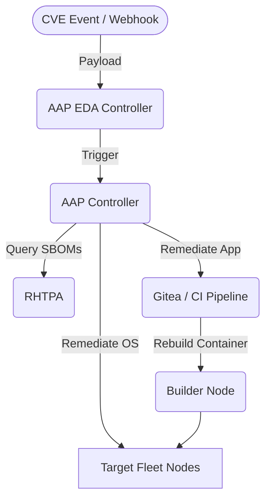

<div class="guide-header">
<h1>Vulnerability management with Lightwell</h1>
<span class="guide-type-badge guide-type-badge--implementation"><i class="fas fa-cogs" aria-hidden="true"></i> Implementation Guide</span>
</div>

<!-- tags: ansible, aap, eda, cve, lightwell, rhtpa, security -->

## Overview

<div class="guide-outcome">
<strong>Outcome:</strong> Deploy an automated, event-driven patch management pipeline that detects CVEs, correlates them against your infrastructure SBOMs, and automatically remediates both OS packages and application dependencies.
</div>

This guide provides step-by-step instructions for deploying, configuring, and executing the Lightwell + AAP Patch Demo. It covers both OS-level package patching and application dependency remediation workflows.

## Background

This implementation guide demonstrates a security automation architecture using Ansible Automation Platform (AAP), Event-Driven Ansible (EDA), and Red Hat Trusted Profile Analyzer (RHTPA). It is designed to be deployed on RHEL 9.3+ virtual machines and showcases how to bridge the gap between security discovery and automated remediation.

## Architecture



| Component | Role |
|---|---|
| **AAP Controller** | Executes remediation playbooks and configuration as code. |
| **AAP EDA Controller** | Listens for CVE disclosure events and triggers workflows. |
| **RHTPA** | Red Hat Trusted Profile Analyzer. Stores SBOMs and correlates CVEs. |
| **Keycloak** | Provides OIDC authentication for RHTPA and AAP. |
| **Gitea** | Hosts application source code and triggers CI/CD rebuilds via webhooks. |
| **Target Fleet** | RHEL 9 nodes running the vulnerable OS packages and application containers. |

## Prerequisites

- **Ansible Automation Platform 2.4+** (Controller and EDA Controller deployed and accessible)
- **Target Fleet (Nodes 1, 3, 4)**: RHEL 9.3+ with active subscriptions and Podman installed.
- **Builder/DevOps Node (Node 2)**: RHEL 9.3+ with Podman and at least 8GB RAM.
- **Operational Impact:** High (Automated patching and container rebuilds affect running services).

### Required Execution Environments (EE)
The workflows require a custom Execution Environment containing specific collections and system tools (Syft, Grype).
- **Base Image**: `registry.redhat.io/ansible-automation-platform/ee-minimal-rhel9:latest`
- **Python Dependencies**: `jmespath`
- **System Tools**: `curl`, `jq`, `syft`, `grype`
- **Collections**: `ansible.eda`, `ansible.controller`, `redhat.rhel_system_roles`, `community.general`, `ansible.posix`, `containers.podman`

> **Tip:** You can build this EE using the provided `execution-environment/execution-environment.yml` and `ansible-builder`.

### Required Credentials
You must configure an Ansible Vault file to store sensitive information used during deployment and by the AAP Controller.

Create the vault file:
```bash
ansible-vault create inventory/group_vars/vault.yml
```

Populate it with the following required variables:
```yaml
vault_ansible_user: "your_ssh_user"
vault_ssh_password: "your_ssh_password" # Or use vault_ssh_key_path
vault_node1_host: "10.0.0.1"
vault_node2_host: "10.0.0.2"
vault_controller_host: "https://aap.example.com"
vault_controller_username: "admin"
vault_controller_password: "aap_password"
vault_controller_token: "aap_oauth_token"
vault_registry_username: "registry_user"
vault_registry_password: "registry_password"
vault_gitea_admin_password: "gitea_secure_password"
# vault_gitea_api_token will be generated during Gitea deployment
```

## Implementation Walkthrough

### Step 1: Configuration & Variables

Edit `inventory/hosts.yml` to map your actual hostnames or IP addresses to the demo nodes. Ensure the `ansible_host` values match your infrastructure.

```yaml
all:
  children:
    targets:
      hosts:
        node1:
          ansible_host: "{{ vault_node1_host }}" # Or hardcode IP
          node_role: target_fleet
          environment_type: production
    builders:
      hosts:
        node2:
          ansible_host: "{{ vault_node2_host }}"
          node_role: rhtpa_builder
          rhtpa_enabled: true
```

Review and customize `inventory/group_vars/all/main.yml`. Key variables include:
- `eda_webhook_port`: Default `5000`.
- `rhtpa_api_endpoint`: URL for RHTPA (defaults to Node 2 on port 8443).
- `cme_mcp_endpoint`: URL for CME MCP (defaults to Node 2 on port 8000).
- `demo_app_image_registry`: The registry used for Demo 4 container rebuilds.

> **Warning:** Do not change the `demo_cve_id` or `demo_app_cve_id` unless you are also updating the mock payload JSON files in the `demo/` directory.

### Step 2: Install Required Collections
Install the collections required for the setup playbooks:
```bash
ansible-galaxy collection install -r collections/requirements.yml
```

### Step 3: Provision the Environment
Run the setup playbooks against your inventory to deploy the required services (Keycloak, RHTPA, Gitea, PyPI) and prepare the target and builder nodes.

```bash
# Deploy Keycloak + RHTPA on Node 2
ansible-playbook setup/deploy_keycloak.yml -i inventory/hosts.yml --ask-vault-pass
ansible-playbook setup/deploy_rhtpa.yml -i inventory/hosts.yml --ask-vault-pass

# Deploy Gitea + act_runner on Node 2
ansible-playbook setup/deploy_gitea.yml -i inventory/hosts.yml --ask-vault-pass

# Deploy Lightwell PyPI index on Node 2
ansible-playbook setup/deploy_pypiserver.yml -i inventory/hosts.yml --ask-vault-pass

# Seed Gitea with the config-service demo app
ansible-playbook setup/seed_gitea.yml -i inventory/hosts.yml --ask-vault-pass

# Prepare targets (installs vulnerable OS package)
ansible-playbook setup/prepare_target.yml -i inventory/hosts.yml --ask-vault-pass

# Install scanning tools on builder
ansible-playbook setup/prepare_builder.yml -i inventory/hosts.yml --ask-vault-pass
```

### Step 4: Configure AAP Controller
Use Configuration as Code (CaC) to automatically create all required Job Templates, Workflow Templates, Credentials, and Projects in AAP.

```bash
ansible-playbook controller/configure.yml --ask-vault-pass
```

### Step 5: Establish Initial SBOM Baseline
Run the initial SBOM scan to populate RHTPA with the baseline state of your targets.

```bash
ansible-playbook playbooks/sbom_scan_upload.yml -i inventory/hosts.yml --ask-vault-pass
```

### Step 6: Configure EDA Rulebook
Deploy the EDA Rulebook (`rulebooks/cve_lifecycle.yml`) in your AAP EDA Controller. Configure it to listen on the port specified by `eda_webhook_port` (default 5000).

### Step 7: Execute the Workflows

The demo is driven by simulating external events (like a CVE disclosure or a fix becoming available) via webhook payloads sent to EDA.

Export your EDA host URL:
```bash
export EDA_HOST="http://your-eda-host:5000"
```

**Demo 1 & 2: CVE Disclosed (No Fix Yet)**
Triggers the `SBOM Correlate and Mitigate` workflow.
```bash
./demo/trigger_cve_disclosure.sh
```
*Expected Runtime:* ~15 minutes.

**Demo 3: Lightwell Resolves OS Package**
Triggers the `Patch Test and Deploy` workflow to apply the `dnf update`.
```bash
./demo/trigger_rhsa_available.sh
```
*Expected Runtime:* ~20 minutes.

**Demo 4: Lightwell Resolves App Dependency**
Triggers the CI/CD rebuild pipeline.
```bash
# For Direct CI/CD path:
./demo/trigger_app_dependency_fix.sh cicd

# For GitOps PR path:
./demo/trigger_app_dependency_fix.sh gitops
```
*Expected Runtime:* ~25 minutes.

## Validation

### Verify OS Patching (Demo 3)
Run this command on a target node (e.g., Node 1) to prove the OS package was patched:
```bash
ssh root@<node1_ip> "rpm -q python-cryptography"
```
**Expected Output:** `python-cryptography-36.0.1-6.el9_6` (or the `demo_cve_fixed_version` defined in variables).

### Verify App Dependency Patching (Demo 4)
Run this command on a target node to check the running container's dependencies:
```bash
ssh root@<node1_ip> "podman exec config-service pip show pyyaml"
```
**Expected Output:** `Version: 6.0.2` (or the `demo_app_fixed_version` defined in variables).

### Verify AAP Job Output
In the AAP Controller UI, navigate to **Jobs**. You should see successful executions for:
- `CVE Correlation`
- `CME Mitigate`
- `Patch and Verify`
- `App Dependency Remediate` (if Demo 4 was run)

### Troubleshooting

| Failure Mode | How to Read Logs | Specific Fix |
|---|---|---|
| **EDA Webhook Timeout** | Check `trigger_*.sh` output for `curl: (7) Failed to connect`. | Ensure `EDA_HOST` is exported correctly and the EDA rulebook activation is running and accessible on port 5000. |
| **Controller CaC Fails** | Check `controller/configure.yml` output for `401 Unauthorized`. | Verify `vault_controller_token` in `vault.yml` is valid and has admin rights. |
| **Gitea Seed Fails** | Check `setup/seed_gitea.yml` output for authentication errors. | Ensure `vault_gitea_api_token` was correctly generated by `deploy_gitea.yml` and added to `vault.yml`. |
| **RHTPA Upload Fails** | Check `sbom_scan_upload.yml` logs in AAP for `403 Forbidden` or connection refused. | Verify Node 2 is reachable from the execution environment and `rhtpa_oidc_client_secret` matches the Keycloak configuration. |
| **Container Rebuild Fails** | Check `App Container Rebuild` job logs in AAP. | Ensure `vault_registry_username` and `password` are correct, and the builder node has internet access to pull base images. |

---
> **Note:** To reset the environment for another demo run, execute:
> `ansible-playbook setup/reset_demo.yml -i inventory/hosts.yml --ask-vault-pass`

## Day-2 Operations

### Monitoring
- **EDA Webhook:** Monitor the EDA Controller rulebook activation logs to ensure the webhook receiver on port `5000` remains active and responsive.
- **RHTPA Database:** Monitor storage utilization for the RHTPA PostgreSQL database, as continuous SBOM ingestion can grow the database significantly.

### Maintenance
- **Keycloak Certificate Rotation:** Ensure OIDC certificates between Keycloak, AAP, and RHTPA are rotated before expiration to prevent authentication failures during automated patching.
- **EE Image Updates:** Regularly rebuild the custom Execution Environment to pull in the latest versions of `syft` and `grype` for accurate vulnerability scanning.

### Known Issues
- **Gitea Webhook Timeouts:** Heavy load on the builder node during simultaneous container rebuilds may cause Gitea webhooks to time out. Consider scaling the builder node resources if managing a large fleet.

## Related Guides

- [Zero Trust Architecture with Ansible Automation Platform](README-ZTA.md)
- [High Availability and Disaster Recovery for AAP on OpenShift](README-AAP-HA-DR-OpenShift.md)
