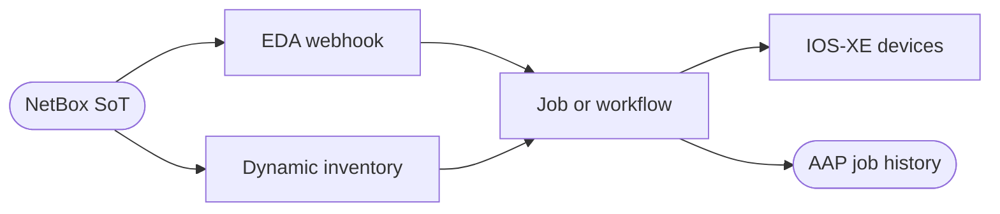
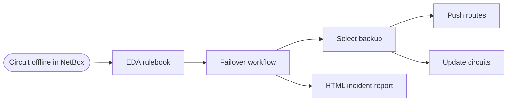


<div class="guide-header">

<h1>Event-Driven Network Automation with NetBox and Ansible Automation Platform</h1>

<span class="guide-type-badge guide-type-badge--solution"><i class="fas fa-check-circle" aria-hidden="true"></i> Solution Guide</span>

</div>

<div class="guide-hero-callout guide-hero-partner guide-hero-partner--netbox" role="img" aria-label="Ansible Automation Platform and NetBox">
  
  <span class="guide-hero-partner__plus" aria-hidden="true">+</span>
  <span class="guide-hero-partner__partner card-partner-logo-set card-partner-logo-set--netbox">
    
    
  </span>
</div>

## Overview

Network teams still treat NetBox as documentation while devices and circuits change through tickets and CLI. Desired state drifts from running state: NTP and banner standards lag, new devices wait on manual playbooks, and WAN circuit failover takes 30-60 minutes of coordinated reconfiguration, CMDB updates, and incident reporting.

This guide shows how **NetBox** as the network source of truth plus **Ansible Automation Platform (AAP)** and **Event-Driven Ansible (EDA)** close that gap for two operational outcomes:

- **[Use Case A: Event-driven network source of truth](#use-case-a-event-driven-network-source-of-truth)** -- Dynamic inventory from NetBox, config-context-driven NTP and banner pushes, and zero-touch device provisioning when a device is created.
- **[Use Case B: Event-driven WAN circuit failover](#use-case-b-event-driven-wan-circuit-failover)** -- Circuit status changes trigger backup discovery, router reconfiguration, CMDB updates, and automated incident reports in under 30 seconds.

| Use case | Primary outcome | Operational impact | Maturity fit |
|----------|-----------------|-------------------|--------------|
| **A. Network source of truth** | Config and inventory stay aligned with NetBox | Low to Medium | Crawl inventory; Walk/Run event-driven config and provisioning |
| **B. WAN circuit failover** | Failover and audit without manual CMDB/router steps | Medium to High | Crawl manual JT; Walk with approval; Run full EDA pipeline |

## Table of Contents

- [Background](#background)
- [Solution](#solution)
- [Prerequisites](#prerequisites)
- **[Use Case A: Event-driven network source of truth](#use-case-a-event-driven-network-source-of-truth)**
- **[Use Case B: Event-driven WAN circuit failover](#use-case-b-event-driven-wan-circuit-failover)**
- [Maturity Path](#maturity-path)
- [Summary](#summary)
- [Next Steps](#next-steps)

## Background

**NetBox** stores desired network state: devices, sites, interfaces, circuits, and config contexts (JSON intent for NTP, banners, and similar standards). Webhooks and event rules fire when that state changes. **Ansible Automation Platform** supplies inventory sync, job and workflow templates, credentials, RBAC, and audit. **Event-Driven Ansible** turns NetBox webhooks into approved job or workflow launches -- without polling.

Two gaps this guide closes:

- **Config and inventory drift (Use Case A)** -- Static inventory files and manual playbook runs lag behind NetBox. Dynamic inventory plus config contexts and EDA push desired state when NetBox changes.
- **Circuit outage coordination (Use Case B)** -- Failover needs backup selection, router changes, CMDB updates, and reports. Modeling circuits in NetBox lets automation discover backups by policy and keep the CMDB authoritative.

> **Why NetBox as the trigger?**
>
> Monitoring detects symptoms. NetBox captures **intent** (a circuit is offline, a config context changed, a device was created). Intent-based triggers reduce false positives and keep automation tied to the source of truth.

## Solution

What makes up the solution?

- **[NetBox](https://netboxlabs.com/)** -- Network source of truth: devices, sites, config contexts (Use Case A); circuits, cables, terminations (Use Case B); webhooks and event rules (both)
- **[Ansible Automation Platform 2.5+](https://www.redhat.com/en/technologies/management/ansible)** -- Controller for job/workflow templates; Automation Decisions (EDA) for webhooks (both). AAP 2.6 recommended for latest EDA features
- **[netbox.netbox](https://console.redhat.com/ansible/automation-hub/repo/published/netbox/netbox/)** -- `nb_inventory`, `nb_lookup`, and NetBox resource modules (both)
- **[ansible.eda](https://console.redhat.com/ansible/automation-hub/repo/published/ansible/eda/)** -- Webhook source; `run_job_template` / `run_workflow_template` (both)
- **[cisco.ios](https://console.redhat.com/ansible/automation-hub/repo/published/cisco/ios/)** -- Device and router configuration (both)
- **[ansible.utils](https://console.redhat.com/ansible/automation-hub/repo/published/ansible/utils/)** -- IP math for gateway derivation (Use Case B)
- **[ansible.netcommon](https://console.redhat.com/ansible/automation-hub/repo/published/ansible/netcommon/)** -- `network_cli` and network utilities (both)

### Who Benefits

| Persona | Challenge | What They Gain |
|---------|-----------|----------------|
| **Network Engineer** | Manual NTP/banner pushes and emergency circuit reconfiguration | NetBox changes drive approved AAP jobs; failover completes in seconds with CMDB consistency |
| **Network Architect** | Inventory files and backup mappings drift from topology | Dynamic inventory and dynamic backup discovery follow NetBox as topology changes |
| **IT Manager / Director** | Weak audit trails for config and outage response | Every push and failover is an AAP job with NetBox event linkage and optional HTML incident reports |

## Prerequisites

### Ansible Automation Platform

- **Ansible Automation Platform 2.5+** with Automation Decisions (EDA). **AAP 2.6** recommended.
- Decision Environment: default supported DE is enough for these rulebooks.
- Execution Environment must include `netbox.netbox`, `cisco.ios`, and (for Use Case B) `ansible.utils` with `pynetbox` (for example `quay.io/acme_corp/netbox-summit-2026-ee:v3.22`).

### Featured Ansible Content Collections

| Collection | Type | Purpose |
|-----------|------|---------|
| <a target="_blank" href="https://console.redhat.com/ansible/automation-hub/repo/published/netbox/netbox/">netbox.netbox</a> | Certified | Dynamic inventory, lookups, circuit/device modules (both) |
| <a target="_blank" href="https://console.redhat.com/ansible/automation-hub/repo/published/ansible/eda/">ansible.eda</a> | Certified | Webhook source and job/workflow actions (both) |
| <a target="_blank" href="https://console.redhat.com/ansible/automation-hub/repo/published/cisco/ios/">cisco.ios</a> | Certified | IOS-XE NTP, banner, and routing config (both) |
| <a target="_blank" href="https://console.redhat.com/ansible/automation-hub/repo/published/ansible/utils/">ansible.utils</a> | Certified | `ipaddr` / gateway derivation (Use Case B) |
| <a target="_blank" href="https://console.redhat.com/ansible/automation-hub/repo/published/ansible/netcommon/">ansible.netcommon</a> | Certified | Network connection plugins (both) |

### External Systems

| System | Required | Details |
|--------|----------|---------|
| NetBox | Required | v3.3+ for config contexts (Use Case A); v4.x recommended. Custom fields `ansible_host` / `ansible_port` for devices (Use Case A). Circuit webhooks (Use Case B). |
| Cisco IOS-XE | Lab required for real push | Catalyst 8000v / CSR 1000v or equivalent. Use Case B can run simulated without a router. |
| Git repository | Required | Inventory plugin config, rulebooks, and playbooks as AAP Projects. |
| GitHub Pages (or report server) | Optional | Use Case B incident report publish target. |

**Operational Impact:** Use Case A is Low to Medium (inventory read-only; config and provisioning change devices). Use Case B is Medium to High (routing and circuit status). Prefer a non-production NetBox and lab devices first.

---

<h2 id="use-case-a-event-driven-network-source-of-truth">Use Case A: Event-driven network source of truth</h2>

### Overview

Pull device lists and config context variables from NetBox into AAP, then react when desired state changes: update NTP or login banner config contexts to push devices automatically, and create a device in NetBox to trigger parallel provisioning (NTP, banner, VLANs).

### Demos and labs

- <a target="_blank" href="https://github.com/rhpds/zt-ans-bu-eda-netbox">EDA + NetBox Hands-On Workshop</a> -- dynamic inventory, webhooks, workflows
- <a target="_blank" href="https://github.com/leogallego/aap-netbox-lab-playbooks">Playbooks</a> -- NTP, banner, VLAN
- <a target="_blank" href="https://github.com/leogallego/aap-netbox-lab-eda">EDA rulebooks</a>
- <a target="_blank" href="https://github.com/leogallego/netbox-inventory">NetBox inventory plugin config</a>

### Workflow



NetBox holds devices and config contexts. The inventory plugin syncs hosts and variables on launch. Config context or device-create events fire EDA, which runs approved templates against that inventory.

### Solution Walkthrough

#### Step 1: NetBox dynamic inventory

**Operational Impact:** Low

Define device custom fields `ansible_host` and `ansible_port`. Store this inventory plugin file in a Git project AAP syncs:

```yaml
plugin: netbox.netbox.nb_inventory
config_context: true
validate_certs: false
group_by:
  - platforms
  - device_roles
  - sites
compose:
  ansible_network_os: platform.name
  ansible_host: custom_fields.host
  ansible_port: custom_fields.port
```

Create a custom credential type that injects `NETBOX_API` and `NETBOX_TOKEN` as environment variables, then an inventory source with **Update on Launch** so every job gets a fresh device list.

> **Why `config_context: true`?**
>
> Config contexts become Ansible host variables. Playbooks use `{{ ntp_servers }}` / banner data without extra API calls.

#### Step 2: Event-driven NTP and banner configuration

**Operational Impact:** Medium

Create NetBox config contexts (for example `ntp_servers`, `login_banner`). Job templates use the NetBox inventory and playbooks such as:

```yaml
---
- name: Configure NTP on network devices using NetBox inventory config_context
  connection: network_cli
  hosts: all
  gather_facts: false
  tasks:
    - name: Extract NTP servers from NetBox inventory config_context
      ansible.builtin.set_fact:
        ntp_servers: "{{ hostvars[inventory_hostname].config_context[0].ntp_servers | default([]) }}"

    - name: Apply NTP configuration to Cisco IOS devices
      when: ansible_network_os == 'cisco.ios.ios'
      cisco.ios.ios_ntp_global:
        config: "{{ lookup('template', 'templates/ntp_config.j2') | from_yaml }}"
        state: replaced
```

EDA rulebook routes each context name to the matching job template:

```yaml
---
- name: Listen for NetBox events on a webhook
  hosts: all
  sources:
    - ansible.eda.webhook:
        host: 0.0.0.0
        port: 5001
  rules:
    - name: NTP updates
      condition: >-
        event.payload.event == "updated" and
        event.payload.model == "configcontext" and
        event.payload.data.name == "ntp_servers"
      action:
        run_job_template:
          organization: "Default"
          name: "Configure NTP Servers"
    - name: Update login banner
      condition: >-
        event.payload.event == "updated" and
        event.payload.model == "configcontext" and
        event.payload.data.name == "login_banner"
      action:
        run_job_template:
          organization: "Default"
          name: "Configure Login Banner"
```

Activate the rulebook in Automation Decisions and point NetBox webhooks/event rules at the EDA endpoint for config context updates.

#### Step 3: Event-driven device provisioning

**Operational Impact:** Medium

Add a workflow job template that runs NTP, banner, and VLAN job templates in parallel. Extend the rulebook:

```yaml
    - name: New Device Added
      condition: >-
        event.payload.event == "created" and
        event.payload.model == "device"
      action:
        run_workflow_template:
          organization: "Default"
          name: "Provision New Device Workflow"
```

Create a NetBox event rule on **Device / Object Created**. Adding a device with site, platform, and custom fields launches provisioning against the updated dynamic inventory.

### Validation

#### Test

1. Sync **NetBox Dynamic Inventory** in AAP and confirm hosts, groups, and config context variables.
2. Update the `ntp_servers` config context in NetBox and save.
3. Confirm the rulebook fire count increments and **Configure NTP Servers** completes successfully.

```bash
ssh admin@<device-ip>
show ntp associations
```

#### Expected Result

```
Inventory lists expected devices with ntp_servers / login_banner vars.
EDA fire count increments; NTP job status Successful; device shows new NTP peer.
```

#### Troubleshooting

| Symptom | Likely Cause | Fix |
|---------|-------------|-----|
| Inventory sync shows 0 hosts | Bad NetBox URL/token | Test API from the EE; fix credential |
| No config context variables | Missing `config_context: true` | Update inventory file; re-sync project |
| EDA never fires | Webhook URL or event rule | Match payload URL to EDA endpoint; verify event rules |
| Job "No hosts matched" | Update on Launch off or missing custom fields | Enable Update on Launch; populate `ansible_host` / `ansible_port` |

### Summary

Use Case A makes NetBox the live inventory and desired-state driver: sync devices automatically, push NTP and banners when config contexts change, and provision new devices when they appear in the CMDB.

---

<h2 id="use-case-b-event-driven-wan-circuit-failover">Use Case B: Event-driven WAN circuit failover</h2>

### Overview

When a WAN circuit status becomes `offline` or `failed` in NetBox, EDA launches an AAP workflow that discovers the best backup by committed bandwidth, reconfigures routers (or simulates the push), updates circuit status in NetBox, and publishes a timestamped HTML incident report.

### Demos and labs

- <a target="_blank" href="https://github.com/leogallego/summit-netbox-circuits-demo">Circuit failover source repo</a> -- playbooks, rulebooks, report templates
- <a target="_blank" href="https://github.com/rhpds/zt-ans-bu-eda-netbox">EDA + NetBox Workshop</a> -- shared NetBox/EDA lab modules

### Workflow



Status change to offline/failed matches the rulebook. The workflow fails over, then reports. Setting the backup offline later reuses the same path for failback; activating a circuit does not re-trigger because the condition ignores `active`.

### Solution Walkthrough

#### Step 1: EDA rulebook and NetBox event rule

**Operational Impact:** Low

```yaml
---
- name: NetBox Circuit Failover
  hosts: all
  sources:
    - name: netbox_webhook
      ansible.eda.webhook:
        host: 0.0.0.0
        port: 5000
  rules:
    - name: Circuit failure detected - trigger failover workflow
      condition: >-
        event.payload.object_type == "circuits.circuit" and
        event.payload.data.status.value in ["offline", "failed"]
      action:
        run_workflow_template:
          name: "Circuit Failover Workflow"
          organization: "Default"
          job_args:
            extra_vars:
              failed_circuit: "{{ event.payload.data.cid }}"
```

Create a NetBox webhook to the EDA endpoint (or workflow launch URL in your lab design) and an event rule on `circuits.circuit` / `object_updated`. Filter on status in EDA, not in NetBox field-level triggers.

> **Warning:** Lab webhooks often disable SSL verification. Use TLS and `ssl_verification: true` in production.

#### Step 2: Dynamic backup discovery and router update

**Operational Impact:** High

Workflow step 1 (`circuit_failover.yml`) queries active circuits at both termination sites and picks the highest `commit_rate`:

```yaml
- name: Query all available circuits at both sites
  ansible.builtin.set_fact:
    backup_candidates: >-
      {{ all_circuits | selectattr('value.status.value', 'eq', 'active')
         | rejectattr('value.cid', 'eq', failed_circuit)
         | selectattr('value.terminations', 'defined')
         | list }}

- name: Select best backup by highest committed bandwidth
  ansible.builtin.set_fact:
    selected_backup: >-
      {{ backup_candidates
         | sort(attribute='value.commit_rate', reverse=true)
         | first }}
```

Derive gateways from NetBox cable/IP data, push routes, then update CMDB state:

```yaml
- name: Push failover routing to router
  cisco.ios.ios_config:
    lines:
      - "ip route 0.0.0.0 0.0.0.0 {{ backup_gateway }}"
      - "no ip route 0.0.0.0 0.0.0.0 {{ failed_gateway }}"

- name: Update circuit status in NetBox
  netbox.netbox.netbox_circuit:
    netbox_url: "{{ netbox_url }}"
    netbox_token: "{{ netbox_token }}"
    data:
      cid: "{{ selected_backup.value.cid }}"
      status: active
    state: present
```

> **Why dynamic discovery?**
>
> Hardcoded primary-backup pairs break when circuits change. New circuits in NetBox become failover candidates without playbook edits.

#### Step 3: Automated incident reporting

**Operational Impact:** Low

Workflow step 2 re-queries NetBox, renders `failover_report.html.j2` (topology, bandwidth rationale, timeline, NetBox history links), and publishes a timestamped file (for example via GitHub Contents API to Pages).

```yaml
- name: Query all circuits for report
  ansible.builtin.set_fact:
    report_circuits: >-
      {{ query('netbox.netbox.nb_lookup', 'circuits',
         api_endpoint=netbox_url,
         token=netbox_token,
         api_filter='tag=dd') }}

- name: Push report to GitHub repository
  ansible.builtin.uri:
    url: "https://api.github.com/repos/{{ github_repo }}/contents/{{ report_filename }}"
    method: PUT
    headers:
      Authorization: "Bearer {{ github_token }}"
    body_format: json
    body: "{{ github_put_body }}"
```

Failback uses the same rulebook: take the backup offline and the primary becomes the best candidate. Loop prevention: only `offline` / `failed` match; setting a circuit `active` does not relaunch the workflow.

### Validation

#### Test

```bash
curl -s -X PATCH \
  -H "Authorization: Token $NETBOX_TOKEN" \
  -H "Content-Type: application/json" \
  -d '{"status": "offline"}' \
  "$NETBOX_URL/api/circuits/circuits/?cid=IPLC-GB-AT-PRI"
```

Confirm **Circuit Failover Workflow** succeeds in AAP, NetBox shows primary offline and backup active, and a new report appears at the publish URL.

#### Expected Result

```
EDA fire count increments; workflow Successful; backup selected by commit_rate;
primary=offline, backup=active; timestamped HTML report published.
```

#### Troubleshooting

| Symptom | Likely Cause | Fix |
|---------|-------------|-----|
| EDA does not fire | Webhook URL or port | Align payload URL; test POST to EDA endpoint |
| No backup found | No active peer circuits | Ensure another active circuit shares A/Z sites |
| NetBox 403 | Token or pynetbox version | Full API permissions; pynetbox >= 7.6.0 on NetBox 4.5+ |
| Report not published | Token scope or Pages off | `repo` scope; enable gh-pages (or fix SSH report target) |

### Summary

Use Case B turns a NetBox circuit status change into governed failover, CMDB consistency, and audit-ready reporting -- with bidirectional failback and no hardcoded backup map.

---

## Maturity Path

| Maturity | Use Case A | Use Case B |
|----------|------------|------------|
| **Crawl** | Dynamic inventory; manually launch config jobs | Manually launch failover JT with circuit CID survey |
| **Walk** | EDA on config context / device create; review job output | EDA trigger with approval node before router push |
| **Run** | Fully closed-loop config and zero-touch provisioning | Full EDA failover, failback, and auto-published reports |

## Summary

NetBox plus AAP and EDA delivers two complementary outcomes: **desired-state configuration and inventory** that stay aligned with the CMDB, and **WAN circuit failover** that discovers backups, reconfigures routers, updates NetBox, and reports automatically. Shared building blocks -- webhooks, certified collections, and approved templates -- keep both paths auditable.

## Next Steps

1. Start a free <a target="_blank" href="https://www.redhat.com/en/technologies/management/ansible/trial">Ansible Automation Platform trial</a> including Event-Driven Ansible.
2. Work the <a target="_blank" href="https://github.com/rhpds/zt-ans-bu-eda-netbox">EDA + NetBox workshop</a>, then deepen with the Use Case A or B source repos linked above.
3. Engage <a target="_blank" href="https://www.redhat.com/en/services/consulting">Red Hat Consulting</a> or <a target="_blank" href="https://www.redhat.com/en/services/training-and-certification">Training</a> for production architecture and skills.

