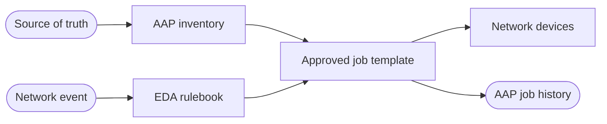


<div class="guide-header">

<h1>Network automation with Ansible</h1>

<span class="guide-type-badge guide-type-badge--solution"><i class="fas fa-check-circle" aria-hidden="true"></i> Solution Guide</span>

</div>

<style>
  div#toc {
    display: none;
  }
</style>

<div class="guide-hero-callout" role="img" aria-label="Ansible unlocks Network automation">
  
  <p class="guide-hero-callout__text">
    <span class="guide-hero-callout__ansible">Ansible</span>
    <span class="guide-hero-callout__unlocks">unlocks</span>
    <span class="guide-hero-callout__aiops">Network</span>
  </p>
</div>

## Overview

Network change is still too often a ticket, a change window, and a manual CLI session. Drift accumulates, source of truth and live devices disagree, and failover remains a runbook instead of an automated path. This foundational guide frames how **Ansible Automation Platform (AAP)** and **Event-Driven Ansible (EDA)** turn inventory intent and network events into governed configuration, provisioning, and recovery -- before you dive into partner Solution Guides such as NetBox or Gluware.

<div class="guide-outcome">
<strong>Outcome:</strong> A Crawl/Walk/Run path for network automation with AAP: source of truth as inventory, event-driven config when state changes, and approved job templates for remediation and failover.
</div>

- [Background](#background)
- [Solution](#solution)
- [Common network automation patterns](#common-network-automation-patterns)
- [Prerequisites](#prerequisites)
- [Network automation workflow](#network-automation-workflow)
- [Solution Walkthrough](#solution-walkthrough)
- [Validation](#validation)
- [Maturity Path](#maturity-path)
- [Summary](#summary)
- [Next Steps](#next-steps)

## Background

**Network automation** connects a reliable **source of truth** (what should be true) with **device execution** (what is true on the wire). Ansible Automation Platform supplies inventory, credentials, RBAC, and audit. Event-Driven Ansible adds reaction when topology, circuit, or compliance state changes -- without waiting for the next scheduled sync.

Typical building blocks:

- **Source of truth** -- NetBox (or similar) as inventory and intent
- **Multi-vendor device automation** -- network collections and execution environments
- **Event triggers** -- webhooks, syslog, or partner alerts into EDA
- **Governed remediation** -- job templates and workflows operators already approved

Partner guides in this category go deep on specific platforms. Start here for the shared maturity model and vocabulary.

## Solution

What makes up the foundational pattern?

- **Ansible Automation Platform** for orchestration, inventory, and audit
- **Event-Driven Ansible** for webhook- and state-driven triggers
- **Network source of truth** (for example NetBox) for dynamic inventory and intent
- **Approved job templates** for NTP, banners, interfaces, routing, and failover

### Who Benefits

| Persona | Challenge | What They Gain |
|---------|-----------|----------------|
| **Network Engineer** | Manual device changes and inconsistent baselines | Intent from SoT applied through repeatable AAP jobs |
| **Automation Architect** | One-off scripts without RBAC or audit | Shared patterns for EDA + inventory + governed remediation |
| **NOC / Ops Lead** | Failover depends on tribal knowledge | Event-driven recovery paths with measurable drill outcomes |

## Common network automation patterns

| Pattern | Maturity | What it solves |
|---------|----------|----------------|
| Dynamic inventory from SoT | Crawl | Devices and sites stay aligned with NetBox (or equivalent) |
| Config context / intent push | Crawl–Walk | NTP, banners, baselines applied from SoT events |
| Zero-touch / day-0 provisioning | Walk | New devices join with approved workflows |
| Circuit / WAN failover | Walk–Run | EDA reacts to link loss and drives backup path jobs |
| Compliance drift remediation | Run | Detect drift, select approved fix, execute with audit |

Deep dives live in the partner cards under **Network automation** on the catalog (NetBox SoT, WAN failover, Gluware, LogicMonitor).

## Prerequisites

### Ansible Automation Platform

- **Ansible Automation Platform 2.4+** with Controller (and EDA when using event paths)

### Featured Ansible Content Collections

| Collection | Type | Purpose |
|-----------|------|---------|
| <a target="_blank" href="https://console.redhat.com/ansible/automation-hub/repo/published/ansible/eda/">ansible.eda</a> | Certified | Rulebooks and event sources |
| <a target="_blank" href="https://console.redhat.com/ansible/automation-hub/repo/published/ansible/netcommon/">ansible.netcommon</a> | Certified | Shared network connection and utility modules |
| <a target="_blank" href="https://console.redhat.com/ansible/automation-hub/repo/published/cisco/ios/">cisco.ios</a> | Certified | Example multi-vendor device automation (substitute as needed) |

### External Systems

| System | Required | Purpose |
|--------|----------|---------|
| Network source of truth | Recommended | Inventory and intent (for example NetBox) |
| Device credentials in AAP | Yes | Governed access to network gear |
| Event source for EDA | Optional for Crawl | Webhooks, syslog, or partner alerts |

**Operational Impact:** Medium -- configuration and failover jobs change live network state.

## Network automation workflow



Intent and inventory come from the source of truth. Events (or humans) trigger EDA or a workflow. AAP runs only **approved** automation against devices and records the outcome.

## Solution Walkthrough

> **Scaffold note:** Expand each step with production-ready YAML from partner guides as this foundational page matures.
>
> Partner walkthroughs already cover NetBox webhooks, Gluware compliance, and LogicMonitor remediation in depth.

### Step 1: Connect source of truth to AAP inventory

**Operational Impact:** Low

Point Controller inventory at your SoT plugin or sync job so sites, devices, and roles stay current.

### Step 2: Publish approved network job templates

**Operational Impact:** Low

Promote NTP, banner, interface, and failover playbooks as job templates with surveys and credentials.

### Step 3: Add EDA for state-change triggers

**Operational Impact:** Medium

Wire SoT or monitoring webhooks to rulebooks that launch the matching template -- start with one high-confidence event type.

## Validation

### Test

```bash
# Confirm inventory sync and a dry-run job against a lab device
# (Replace with your Controller URL and template name.)
curl -k -H "Authorization: Bearer $AAP_TOKEN" \
  "$CONTROLLER_HOST/api/v2/inventories/?search=netbox"
```

### Expected Result

```
Inventory sync succeeds; a check-mode or lab job completes with failed=0.
```

### Troubleshooting

| Symptom | Likely Cause | Fix |
|---------|-------------|-----|
| Empty inventory | SoT token or sync schedule | Re-check credential and inventory source |
| Job auth failures | Wrong network credential or EE | Align EE collections and vaulted secrets |
| EDA never fires | Webhook URL or rule filter | Replay a test payload; verify rulebook conditions |

## Maturity Path

| Maturity | Description |
|----------|-------------|
| **Crawl** | SoT-backed inventory + manual launch of approved network jobs |
| **Walk** | EDA on a small set of SoT or monitoring events with human approval for risky changes |
| **Run** | Broader event coverage, automated failover drills, compliance drift closed in policy |

## Summary

Network automation with Ansible starts from a shared source of truth and grows into event-driven, governed change. Use this foundational page for Crawl/Walk/Run language, then open the partner Solution Guides for NetBox, Gluware, and related integrations.

## Next Steps

1. Read [Event-Driven Network Source of Truth with NetBox and AAP](README-NetBox-SoT-EDA-Config.md).
2. Practice failover with [Event-driven WAN circuit failover with NetBox and AAP](README-NetBox-WAN-EDA-Failover.md).
3. Return to the catalog **Network automation** section for Gluware and LogicMonitor paths.

