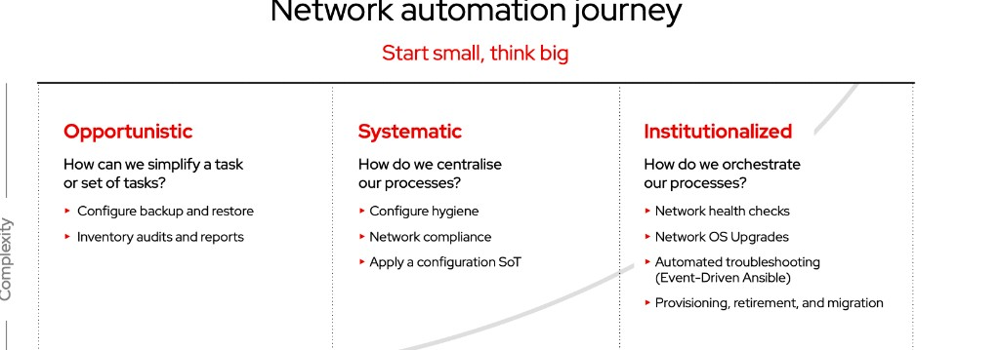
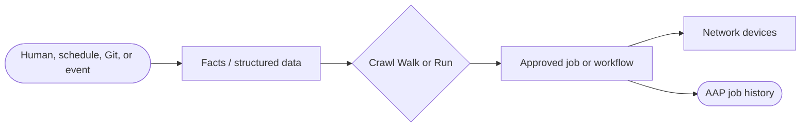


<div class="guide-header">

<h1>Network automation with Ansible</h1>

<span class="guide-type-badge guide-type-badge--solution"><i class="fas fa-check-circle" aria-hidden="true"></i> Solution Guide</span>

</div>

<style>
  div#toc {
    display: none;
  }
</style>

<div class="guide-hero-callout" role="img" aria-label="Ansible unlocks Network automation">
  
  <p class="guide-hero-callout__text">
    <span class="guide-hero-callout__ansible">Ansible</span>
    <span class="guide-hero-callout__unlocks">unlocks</span>
    <span class="guide-hero-callout__aiops">Network</span>
  </p>
</div>

## Overview

Network change is still too often a ticket, a change window, and a manual CLI session. Drift accumulates, source of truth and live devices disagree, and recovery remains a runbook instead of an automated path. This foundational guide frames **NetOps as Code** with **Ansible Automation Platform (AAP)** -- start small on low-risk visibility and backup, then centralize process with source of truth and compliance, then orchestrate upgrades, event-driven troubleshooting, and device lifecycle.

The maturity language matches the Network automation journey: **Opportunistic → Systematic → Institutionalized**, mapped here to **Crawl / Walk / Run** so it stays consistent with the rest of this site.

<div class="guide-outcome">
<strong>Outcome:</strong> A shared Crawl/Walk/Run reference for network automation with nine NetOps as Code use cases -- from backup and inventory facts through SoT, compliance, health checks, NOS upgrades, Event-Driven Ansible troubleshooting, and device lifecycle.
</div>

- [Background](#background)
- [Solution](#solution)
- [Common network automation use cases](#common-network-automation-use-cases)
- [Prerequisites](#prerequisites)
- [Network automation workflow](#network-automation-workflow)
- [Solution Walkthrough](#solution-walkthrough)
- [Validation](#validation)
- [Maturity Path](#maturity-path)
- [Summary](#summary)
- [Next Steps](#next-steps)

## Background

**Network automation** connects a reliable **source of truth** (what should be true) with **device execution** (what is true on the wire). Ansible Automation Platform supplies inventory, credentials, RBAC, workflows, and audit. Network resource modules turn vendor config into structured data. Event-Driven Ansible adds reaction when monitoring, topology, or compliance state changes -- without waiting for the next scheduled sync.

Typical building blocks:

- **Facts and structured data** -- network resource modules and reporting
- **Source of truth** -- Git, NetBox, IPAM, or similar intent stores
- **Multi-vendor device automation** -- certified network collections and execution environments
- **Event triggers** -- monitoring, syslog, or partner alerts into EDA
- **Governed remediation** -- job templates and workflows operators already approved

Partner Solution Guides (NetBox, Gluware, LogicMonitor, and others) go deep on specific platforms. Start here for the shared journey and the nine use cases from the Ansible Network Automation technical narrative.

## Solution

What makes up the foundational pattern?

- **Ansible Automation Platform** for orchestration, inventory, surveys, scheduling, and audit
- **Network resource modules** for multivendor config as structured data
- **Event-Driven Ansible** for monitoring-driven troubleshooting and response
- **Source of truth and GitOps** for intent-driven pipelines as maturity grows
- **Approved job templates and workflows** for backup, hygiene, compliance, upgrades, and lifecycle

### Who Benefits

| Persona | Challenge | What They Gain |
|---------|-----------|----------------|
| **Network Engineer** | Manual device changes and inconsistent baselines | Repeatable AAP jobs and facts-driven visibility |
| **Automation Architect** | One-off scripts without RBAC or audit | Shared NetOps as Code patterns across Crawl/Walk/Run |
| **NOC / Ops Lead** | Upgrades and incidents depend on tribal knowledge | Workflows, pre/post checks, and event-driven enrichment |



<h2 id="common-network-automation-use-cases">Common network automation use cases</h2>

Nine **NetOps as Code** patterns for customer conversations (from the Ansible Network Automation 301 narrative). **Start small, think big.** Each row maps to **Crawl**, **Walk**, or **Run** (see maturity chips). Journey stages **Opportunistic / Systematic / Institutionalized** align to those same three columns.

### How work starts

Network automation can begin from a human in Automation controller, a schedule, a Git or SoT change, or a monitoring event into EDA. The use case describes the **pattern**; the entry point depends on the customer environment.

Each pattern has its own **Network Use Case** page (adoption notes and room to grow). Pick a row below or open the [Common network automation use cases hub](network-use-cases.md).

This foundational guide's [workflow](#network-automation-workflow) is a **high-level walkthrough** of the shared Detect → Decide → Execute loop. Open a use-case strip item when you want the dedicated pattern page.

<div class="cards-track-section cards-track-section--use-cases">
<nav class="use-case-strip" aria-label="Network automation use cases">
<a class="use-case-strip__item" href="README-Network-Use-Case-01-Config-Backup-Restore.html">
  <span class="use-case-strip__num">1</span>
  <span class="use-case-strip__body">
    <span class="use-case-strip__title">Configuration backup and restore</span>
    <span class="use-case-strip__question">How do we recover network steady state without CLI heroics?</span>
  </span>
  <span class="use-case-maturity-chip use-case-maturity-chip--crawl">Crawl</span>
</a>
<a class="use-case-strip__item" href="README-Network-Use-Case-02-Inventory-Audits-Reports.html">
  <span class="use-case-strip__num">2</span>
  <span class="use-case-strip__body">
    <span class="use-case-strip__title">Inventory audits and reports</span>
    <span class="use-case-strip__question">How do we know what is actually on the network?</span>
  </span>
  <span class="use-case-maturity-chip use-case-maturity-chip--crawl">Crawl</span>
</a>
<a class="use-case-strip__item" href="README-Network-Use-Case-03-Configuration-Hygiene.html">
  <span class="use-case-strip__num">3</span>
  <span class="use-case-strip__body">
    <span class="use-case-strip__title">Configuration hygiene</span>
    <span class="use-case-strip__question">How do we standardize VLANs, ACLs, and SNMP without a big-bang rewrite?</span>
  </span>
  <span class="use-case-maturity-chip use-case-maturity-chip--crawl">Crawl</span>
</a>
<a class="use-case-strip__item" href="README-Network-Use-Case-04-Compliance-Drift.html">
  <span class="use-case-strip__num">4</span>
  <span class="use-case-strip__body">
    <span class="use-case-strip__title">Network compliance and drift</span>
    <span class="use-case-strip__question">How do we enforce security and config policy consistently?</span>
  </span>
  <span class="use-case-maturity-chip use-case-maturity-chip--walk">Walk</span>
</a>
<a class="use-case-strip__item" href="README-Network-Use-Case-05-Sources-of-Truth.html">
  <span class="use-case-strip__num">5</span>
  <span class="use-case-strip__body">
    <span class="use-case-strip__title">Apply sources of truth</span>
    <span class="use-case-strip__question">How do we make NetOps data-centric with GitOps and IPAM?</span>
  </span>
  <span class="use-case-maturity-chip use-case-maturity-chip--walk">Walk</span>
</a>
<a class="use-case-strip__item" href="README-Network-Use-Case-06-Network-Health-Checks.html">
  <span class="use-case-strip__num">6</span>
  <span class="use-case-strip__body">
    <span class="use-case-strip__title">Network health checks</span>
    <span class="use-case-strip__question">How do we validate operational state beyond the running config?</span>
  </span>
  <span class="use-case-maturity-chip use-case-maturity-chip--walk">Walk</span>
</a>
<a class="use-case-strip__item" href="README-Network-Use-Case-07-Network-OS-Upgrades.html">
  <span class="use-case-strip__num">7</span>
  <span class="use-case-strip__body">
    <span class="use-case-strip__title">Network OS upgrades</span>
    <span class="use-case-strip__question">How do we upgrade NOS fleets consistently with pre and post checks?</span>
  </span>
  <span class="use-case-maturity-chip use-case-maturity-chip--run">Run</span>
</a>
<a class="use-case-strip__item" href="README-Network-Use-Case-08-Event-Driven-Troubleshooting.html">
  <span class="use-case-strip__num">8</span>
  <span class="use-case-strip__body">
    <span class="use-case-strip__title">Event-driven troubleshooting</span>
    <span class="use-case-strip__question">How do we troubleshoot from monitoring events in near real time?</span>
  </span>
  <span class="use-case-maturity-chip use-case-maturity-chip--run">Run</span>
</a>
<a class="use-case-strip__item" href="README-Network-Use-Case-09-Provisioning-Retirement-Migration.html">
  <span class="use-case-strip__num">9</span>
  <span class="use-case-strip__body">
    <span class="use-case-strip__title">Provisioning, retirement, and migration</span>
    <span class="use-case-strip__question">How do we automate device lifecycle instead of one-off cutovers?</span>
  </span>
  <span class="use-case-maturity-chip use-case-maturity-chip--run">Run</span>
</a>
</nav>
</div>

## Prerequisites

Requirements depend on which use case or partner guide you implement.

### Ansible Automation Platform

- **Ansible Automation Platform 2.4+** with Controller
- **Event-Driven Ansible** when you adopt monitoring-driven troubleshooting (use case 8) or SoT webhooks

### Featured Ansible Content Collections

| Collection | Type | Purpose |
|-----------|------|---------|
| <a target="_blank" href="https://console.redhat.com/ansible/automation-hub/repo/published/ansible/netcommon/">ansible.netcommon</a> | Certified | Shared network connection and utility modules |
| <a target="_blank" href="https://console.redhat.com/ansible/automation-hub/repo/published/ansible/utils/">ansible.utils</a> | Certified | Parse, validate, and manipulate structured network data |
| <a target="_blank" href="https://console.redhat.com/ansible/automation-hub/repo/published/ansible/eda/">ansible.eda</a> | Certified | Rulebooks and event sources for troubleshooting and SoT events |
| <a target="_blank" href="https://console.redhat.com/ansible/automation-hub/repo/published/cisco/ios/">cisco.ios</a> | Certified | Example multivendor device automation (substitute EOS, Junos, NX-OS, and others as needed) |

### External Systems

| System | Required | Purpose |
|--------|----------|---------|
| Multivendor network devices | Yes | Targets for facts, backup, hygiene, and remediation |
| Config backup repository | Recommended | Git or shared store for backup/restore |
| Source of truth / IPAM | Optional for Crawl | NetBox, Infoblox, Device42, Git -- required as you reach Walk SoT |
| Monitoring / observability | Optional for Crawl | Feeds event-driven troubleshooting at Run |

**Operational Impact:** Medium to High -- hygiene, compliance, upgrades, and lifecycle jobs change live network state. Prefer check mode and lab inventories first.

## Network automation workflow



Work starts from a person, a schedule, a SoT or Git change, or a monitoring event. Facts and resource modules make the network malleable as data. AAP runs only **approved** automation and records the outcome.

## Solution Walkthrough

> **Scaffold note:** Expand with production YAML as use-case pages mature. Partner guides already cover NetBox, Gluware, and LogicMonitor in depth.

### Step 1: Land a Crawl victory

**Operational Impact:** Low

Ship **backup and restore** or **inventory audits** as Controller job templates with surveys. No production write path required for audits; backups build confidence quickly.

### Step 2: Add hygiene and SoT

**Operational Impact:** Medium

Automate VLANs, ACLs, and SNMP from a source of truth. Introduce GitOps-style pipelines before broad compliance enforcement.

### Step 3: Orchestrate Run operations

**Operational Impact:** High

Use workflows for NOS upgrades with pre/post checks, EDA for ticket enrichment and troubleshooting, and lifecycle jobs for provisioning, retirement, and migration.

## Validation

### Test

```bash
# Confirm inventory reachability and a check-mode or backup job against a lab device
ansible-inventory -i inventories/network.yml --graph
```

### Expected Result

```
Inventory lists expected network hosts; a lab backup or facts job completes with failed=0.
```

### Troubleshooting

| Symptom | Likely Cause | Fix |
|---------|-------------|-----|
| Empty or stale inventory | SoT sync or inventory source | Re-check credential and schedule |
| Job auth failures | Wrong network credential or EE | Align EE collections and vaulted secrets |
| EDA never fires | Webhook URL or rule filter | Replay a test payload; verify rulebook conditions |

## Maturity Path

| Journey stage | Site maturity | Focus | Use cases |
|---------------|---------------|-------|-----------|
| **Opportunistic** | **Crawl** | Simplify a task or set of tasks | 1 Backup/restore, 2 Inventory audits, 3 Configuration hygiene |
| **Systematic** | **Walk** | Centralize processes | 4 Compliance/drift, 5 Sources of truth, 6 Health checks |
| **Institutionalized** | **Run** | Orchestrate processes | 7 NOS upgrades, 8 Event-driven troubleshooting, 9 Lifecycle |

## Summary

Network automation with Ansible is a journey: opportunistic wins on backup and facts, systematic SoT and compliance, then institutionalized upgrades, EDA troubleshooting, and device lifecycle. Use this foundational page and the nine use-case strip for customer conversations, then open partner Solution Guides for platform depth.

## Next Steps

1. Browse the [Common network automation use cases hub](network-use-cases.md).
2. For NetBox depth, read [Event-Driven Network Automation with NetBox and AAP](README-NetBox-EDA.md) ([source of truth](README-NetBox-EDA.md#use-case-a-event-driven-network-source-of-truth) and [WAN failover](README-NetBox-EDA.md#use-case-b-event-driven-wan-circuit-failover)).
3. Return to the catalog **Network automation** section for Gluware and LogicMonitor paths.

