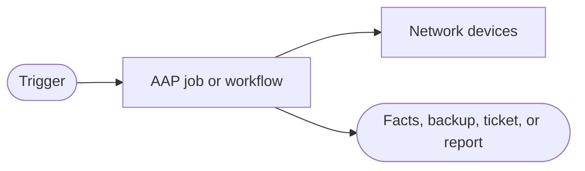


<div class="guide-header">

<h1>Network OS upgrades</h1>

<span class="guide-type-badge guide-type-badge--use-case"><i class="fas fa-layer-group" aria-hidden="true"></i> Network Use Case</span>

</div>

<style>
  div#toc {
    display: none;
  }
</style>

## Overview

Orchestrate the full upgrade: dependency and capacity checks, stage and transfer images, integrity verification, and consistent execution across standalone devices and controllers.

**Maturity:** Run. **Customer question:** How do we upgrade NOS fleets consistently with pre and post checks?

Start from the [Common network automation use cases hub](network-use-cases.md) or the foundational [Network automation with Ansible](README-Network-Automation.md) guide. Partner Solution Guides may appear as examples -- swap collections and APIs for your multivendor stack.

## Background

This page is a scaffold aligned to the Ansible Network Automation (301) NetOps as Code narrative. Expand with workflow diagrams, validation commands, and partner deep links as the pattern hardens.

## Solution

- **Ansible Automation Platform** for governed job templates and workflows
- **Network resource modules / facts** where structured data is required
- **Event-Driven Ansible** when the pattern is event-triggered (especially use case 8)
- **Source of truth / Git** when intent must drive configuration (especially use cases 3-5, 9)

### Who Benefits

| Persona | Challenge | What They Gain |
|---------|-----------|----------------|
| **Network Engineer** | Manual, inconsistent execution of this pattern | Repeatable AAP automation with audit |
| **Automation Architect** | Unclear where this sits in Crawl/Walk/Run | Shared vocabulary with the foundational journey |
| **NOC / Ops Lead** | Pattern depends on tribal knowledge | Measurable, scheduled, or event-driven outcomes |

## Prerequisites

- Ansible Automation Platform with network execution environments and credentials
- Lab or non-production inventory for first runs
- Additional systems as required by this pattern (backup repo, SoT, monitoring)

## Workflow



## Solution Walkthrough

> **Scaffold:** Add playbook and workflow examples from the 301 deck and partner guides in a follow-up pass.

### Step 1: Define success for this pattern

Document the read-only vs write blast radius and the approval model.

### Step 2: Publish an approved job template

Expose the automation in Controller with surveys where operators need choices (for example restore file selection).

### Step 3: Validate on a lab inventory

Run check mode or a scoped inventory before production schedules or EDA triggers.

## Validation

### Test

```bash
# Replace with the job template or playbook for this pattern
ansible-playbook -i inventories/network-lab.yml site.yml --check
```

### Expected Result

```
Lab run completes with failed=0; evidence (backup file, report, or ticket update) is produced.
```

### Troubleshooting

| Symptom | Likely Cause | Fix |
|---------|-------------|-----|
| Auth failures | Credential or EE mismatch | Align network credential and collections |
| Partial inventory | Limit or SoT sync | Fix inventory source and host patterns |

## Maturity Path

| Maturity | For this use case |
|----------|-------------------|
| **Crawl** | Manual or scheduled launch; limited blast radius |
| **Walk** | Broader inventory; SoT or policy integration |
| **Run** | Workflows, approvals, and/or EDA at fleet scale |

## Summary

**Network OS upgrades** is use case 7 in the Network automation foundational set. Deepen this page with executable examples as demos land; keep the foundational guide as the shared journey.

## Next Steps

1. Return to [Network automation with Ansible](README-Network-Automation.md).
2. Browse [all nine use cases](network-use-cases.md).
3. Open partner Network cards on the catalog when you need platform-specific depth.

