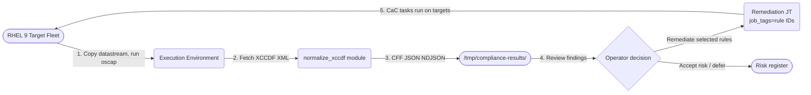


---
title: "RHEL 9 STIG and CIS Compliance Scanning"
description: "Agentless OpenSCAP scanning and selective CaC remediation for RHEL 9 with Ansible Automation Platform"
components: [Automation Controller, Execution Environments, Ansible Builder]
domains: [security, compliance]
profiles: [rhel9-stig, rhel9-cis-l1, rhel9-cis-l2]
last_verified: 2026-10-20
---

<div class="guide-header">
<h1>RHEL 9 STIG and CIS compliance scanning with Ansible</h1>
<span class="guide-type-badge guide-type-badge--solution"><i class="fas fa-check-circle" aria-hidden="true"></i> Solution Guide</span>
</div>

<style>
  div#toc { display: none; }
</style>

<div class="guide-hero-callout guide-hero-partner guide-hero-partner--rhel9" role="img" aria-label="Ansible Automation Platform and Red Hat Enterprise Linux 9">
  
  <span class="guide-hero-partner__plus" aria-hidden="true">+</span>
  <span class="guide-hero-partner__partner card-partner-logo-set card-partner-logo-set--rhel9">
    
    
  </span>
</div>

<!-- tags: ansible, aap, openscap, stig, cis, compliance, rhel9, execution-environment, security -->

## Overview

Security teams must prove RHEL 9 compliance against frameworks such as DISA STIG and the CIS Benchmarks, and then drive hosts back into conformance. Traditional Compliance-as-Code tooling (OpenSCAP with scap-security-guide) is certified and authoritative, but running it at scale has friction: scanners must be installed on targets, XCCDF result XML is verbose and hard to aggregate, and CaC remediation playbooks apply every fix at once when operators often want to fix only selected findings.

This guide deploys three self-contained Ansible collections that scan RHEL 9 hosts against DISA STIG V2R8 (366 rules), CIS Benchmark Level 1 Server (~195 rules), and CIS Benchmark Level 2 Server (~262 rules). Each collection pairs an agentless OpenSCAP assessment job with a separate, tag-scoped remediation job, both packaged in a purpose-built Execution Environment. Results are normalized to a Common Findings Format (CFF) and written per-host to structured JSON files on the execution node, so a security team can review posture, identify findings, and launch targeted remediation -- deliberately and with full auditability.

<div class="guide-outcome">
<strong>Outcome:</strong> Agentless RHEL 9 compliance scanning against DISA STIG V2R8 and CIS Benchmarks Level 1 and Level 2, with a separate tag-scoped remediation job that applies only the rules you choose -- no permanent scanner footprint on targets, no all-or-nothing fixes, per-host CFF JSON findings written to the execution node for review and targeted follow-up.
</div>

- [Background](#background)
- [Solution](#solution)
- [Prerequisites](#prerequisites)
- [Compliance Scanning Workflow](#compliance-scanning-workflow)
- [Solution Walkthrough](#solution-walkthrough)
- [Validation](#validation)
- [Day-2 Operations](#day-2-operations)
- [Maturity Path](#maturity-path)
- [Summary](#summary)

## Background

Compliance scanning with OpenSCAP is well-understood for a single host, but three problems emerge at fleet scale. First, `openscap-scanner` must be present on every target, which means managing a package that has no operational purpose between audits. Second, XCCDF result XML is verbose -- a STIG scan produces thousands of rule results per host, which overflows Automation Controller's event streaming when all results are returned in a single play. Third, the CaC remediation playbooks generated by `scap-security-guide` apply every rule at once; operators who need to fix only selected findings from a failed audit have no clean way to scope the run.

This implementation removes all three friction points: the scanner and datastream are delivered ephemerally from the Execution Environment at scan time and cleaned up afterwards; normalization happens in the same container as the scan so there is no cross-container file sharing; and remediation is a separate, user-initiated job scoped with native AAP job tags -- the normalized rule IDs match CaC tags exactly, so no mapping file is needed.

## Solution

Each profile directory (`profiles/rhel9-stig`, `profiles/rhel9-cis-l1`, `profiles/rhel9-cis-l2`) contains:

- **An Ansible collection** (`security.compliance_rhel9_stig`, `security.compliance_rhel9_cis_l1`, `security.compliance_rhel9_cis_l2`) with the assessment playbook, remediation playbook, a standalone normalize utility, and the `normalize_xccdf` module (XCCDF to Common Findings Format JSON).
- **An EE definition** (ansible-builder v3) based on `ee-minimal-rhel9` that installs `scap-security-guide` and `openscap-scanner`, then extracts rule metadata from the datastream at build time.
- **An `install.yml` playbook** that registers the Project, the Assessment Job Template, and the Remediation Job Template on the AAP Controller via its REST API.

The automation pattern is **Day-2 security/compliance**: assess continuously, then remediate on demand.

**Key design decisions:**

1. **Agentless scanning.** Play 1 installs `openscap-scanner` only if missing, copies the ~15 MB datastream from the EE, runs `oscap xccdf eval`, fetches results back, and removes everything it installed.
2. **Single Job Template, two plays.** The scan (targets) and normalization (localhost) run in the same container, so fetched XML needs no cross-container file sharing.
3. **Per-host NDJSON output.** Each host's findings are normalized individually and written as NDJSON to `/tmp/compliance-results/` on the execution node, avoiding Controller event-size truncation with 4000+ findings per scan.
4. **Separate remediation.** The assessment never changes hosts. Remediation imports the CaC playbook from `scap-security-guide` and is scoped with native AAP `job_tags` -- the normalized rule IDs match CaC tags exactly, so no mapping file is needed.

### Who Benefits

| Persona | Challenge | What They Gain |
|---------|-----------|----------------|
| **Security Engineer** | Running OpenSCAP at fleet scale means managing a permanent scanner package on every host and drowning in raw XCCDF XML | Ephemeral scanning from the EE -- no permanent footprint -- with normalized CFF JSON findings per host ready for review |
| **Compliance Officer** | Demonstrating STIG or CIS conformance requires manual evidence collection; remediation is all-or-nothing | Per-host CFF JSON reports generated automatically, before/after comparison built into the workflow, selective remediation scoped to chosen rules |
| **Platform Owner / SRE** | Compliance scans that run as full-fleet playbooks with no safeguards cause unintended configuration changes | Assessment job never modifies hosts; remediation is a separate, explicitly-launched job with `job_tags` and `limit` prompts |

### Framework Coverage

| Profile | Framework / Version | XCCDF profile ID | CaC playbook | Rules | Certification |
|---------|-------------------|------------------|--------------|-------|---------------|
| `rhel9-stig` | DISA STIG V2R8 | `xccdf_org.ssgproject.content_profile_stig` | `rhel9-playbook-stig.yml` | 366 | Certified (NIST SCAP 1.2) |
| `rhel9-cis-l1` | CIS v1.0.0, Level 1 Server | `xccdf_org.ssgproject.content_profile_cis_server_l1` | `rhel9-playbook-cis_server_l1.yml` | ~195 | Conformant |
| `rhel9-cis-l2` | CIS, Level 2 Server | `xccdf_org.ssgproject.content_profile_cis` | `rhel9-playbook-cis.yml` | ~262 | Conformant |

## Prerequisites

- **Ansible >= 2.15.0** and `ansible-builder` v3 for EE builds
- **AAP Controller** access (host URL and API token) for `install.yml`
- **RHEL 9 target hosts** reachable over SSH, with a machine credential using `become`
- **Registry access** to `registry.redhat.io` for the base EE image, and CentOS 9 Stream repos at build time (for `scap-security-guide` and `openscap-scanner` RPMs)
- **Optional:** an external reporting system or SIEM to ingest the per-host CFF JSON files written to `/tmp/compliance-results/` after each scan

**Operational Impact:** Low for assessment (ephemeral package install/remove). Medium for remediation (modifies host configuration; some CIS Level 2 rules require a reboot).

### Featured Ansible Content Collections

| Collection | Type | Purpose |
|-----------|------|---------|
| <a target="_blank" href="https://console.redhat.com/ansible/automation-hub/repo/published/ansible/posix/">ansible.posix</a> | Certified | `sysctl`, `selinux`, `firewalld` -- kernel and MAC enforcement in CaC remediation |
| <a target="_blank" href="https://console.redhat.com/ansible/automation-hub/repo/published/redhat/rhel_system_roles/">redhat.rhel_system_roles</a> | Certified | CIS hardening roles (SSH, audit, crypto policies) |
| `security.compliance_rhel9_*` | Project | Per-profile assessment + remediation playbooks, `normalize_xccdf` module, CFF schema |

## Compliance Scanning Workflow



The scanner runs as Play 1 (on targets) and the normalizer runs as Play 2 (on localhost) inside the same EE container, so the XCCDF XML fetched from targets never leaves the execution context before normalization.

## Solution Walkthrough

### Step 1 -- Build the EE and register the profile

**Operational Impact:** None (build only)

Build the EE and push it to your registry (Private Automation Hub or your container registry):

```bash
cd profiles/rhel9-stig/ee/
ansible-builder build -f execution-environment.yml -t compliance-stig-rhel9:latest -v3
```

The EE build verifies content at image-build time -- the build fails fast if required files are missing:

```yaml
append_final:
  - RUN test -f /usr/share/scap-security-guide/ansible/rhel9-playbook-stig.yml
  - RUN test -f /usr/share/xml/scap/ssg/content/ssg-rhel9-ds.xml
  - RUN python3 /tmp/extract_rule_metadata.py \
        /usr/share/xml/scap/ssg/content/ssg-rhel9-ds.xml \
        --profile stig --framework DISA_STIG --version V2R8 \
        -o .../rules/stig_rhel9.yml
```

Register the profile by running `install.yml` as a one-time bootstrap. Create a temporary job template pointing at the project and `profiles/rhel9-stig/install.yml`, enable **Prompt on launch** for variables, then launch it with `aap_host` and `aap_token` as prompted extra_vars. This single job creates the permanent Assessment JT and Remediation JT -- delete the temporary template afterwards.

The Remediation JT is registered with `ask_tags_on_launch: true` and `ask_variables_on_launch: true` so operators always scope the run explicitly.

### Step 2 -- Launch the assessment job template

**Operational Impact:** Low (ephemeral package install/remove on targets)

In Automation Controller, go to **Templates**, select the Assessment JT (for example `compliance-scan-stig-rhel9`), and click **Launch**. The framework, version, and XCCDF profile ID ship as default extra_vars, so no arguments are required for a standard scan.

Play 1 performs the ephemeral scan on every target. The oscap exit codes are handled explicitly -- `0` means all rules pass, `2` means some failed, and both are valid outcomes:

```yaml
- name: Run OpenSCAP XCCDF evaluation
  ansible.builtin.command:
    cmd: >-
      oscap xccdf eval
      --profile {{ oscap_profile }}
      --results {{ target_results_dir }}/xccdf-results.xml
      {{ ssg_datastream_target_path }}
  register: _scan_result
  failed_when: _scan_result.rc not in [0, 2]
```

Play 2 normalizes each host's XML into CFF JSON and writes each as an NDJSON file to `/tmp/compliance-results/<hostname>-findings.ndjson` on the execution node. The `normalize_xccdf` module strips the XCCDF prefix (`xccdf_org.ssgproject.content_rule_sshd_set_keepalive_0` becomes `sshd_set_keepalive_0`) so rule IDs match CaC remediation tags directly.

### Step 3 -- Review findings and remediate selected rules

**Operational Impact:** Medium (modifies host configuration; some CIS L2 rules require reboot)

Review the per-host NDJSON files in `/tmp/compliance-results/` to identify the failing rule IDs you want to fix. Launch the Remediation JT (for example `compliance-remediate-stig-rhel9`) in Automation Controller, clicking **Launch** and filling in the prompts with your chosen rule IDs:

```text
Job tags:    sshd_set_keepalive_0,accounts_tmout
Variables:   {"var_accounts_tmout": 900}
Limit:       (optional subset of target hosts)
```

Because remediation is a separate job template -- never a node in the assessment workflow -- assessment scans can never modify hosts, and every change is a deliberate, user-initiated action scoped to specific rules.

> **Warning:** Some CIS Level 2 rules require a reboot.
>
> Rules in the `rhel9-cis-l2` profile that enforce FIPS mode, kernel parameters set at boot, or grub configuration changes will not take effect until the target is rebooted. These rules report `remediated` in the job output but remain `fail` on the next scan until a reboot is performed. Schedule reboots in a maintenance window and re-run the assessment to confirm.

## Validation

**Scenario 1 -- scan completes and findings are accurate.** Launch the assessment JT against a RHEL 9 test host. Confirm the job succeeds, the target has no leftover `/tmp/compliance-scan`, `/tmp/ssg-rhel9-ds.xml`, or `openscap-scanner` package (if it was not pre-installed), and the per-host CFF JSON files appear under `/tmp/compliance-results`. Cross-check one failing rule against a manual `oscap xccdf eval --profile stig` run on the same host.

**Scenario 2 -- remediation applies only selected rules.** From a known-drifted test host, launch the Remediation JT for a single rule (job tag `accounts_tmout`) and verify: only that rule's CaC tasks ran (check the job's task list), the rule now passes on rescan, and all other failed findings remain unchanged.

**Scenario 3 -- CI guardrails.** The EE build fails fast if content is missing (`test -f` steps), and collection unit/integration tests cover the `normalize_xccdf` module (`tests/unit/plugins/modules/test_normalize_xccdf.py`).

### Troubleshooting

| Symptom | Likely Cause | Fix |
|---------|-------------|-----|
| `oscap xccdf eval` exits with rc=1 (job fails) | Fatal XML parse error in the datastream, not a scan finding -- rc=1 is a scanner error, rc=2 is findings | Verify `ssg-rhel9-ds.xml` in the EE is intact: rebuild the EE and re-run. Check for disk space on the execution node during the copy step |
| `normalize_xccdf` fails with `ElementTree.ParseError` | XCCDF result XML was truncated during the fetch (large fleet, slow network) | Increase `ansible_ssh_timeout` on the fetch task; check `/tmp/compliance-scan/xccdf-results.xml` size on the target before fetch |
| NDJSON output files are very large | Large profiles (STIG V2R8, 366+ rules × 100 hosts) produce multi-MB NDJSON files | Reduce `ndjson_batch_size` in the assessment extra_vars (default 500; try 100 for large profiles) or archive files to an artifact store after each run |
| EE build fails at `test -f /usr/share/scap-security-guide/...` | `scap-security-guide` not installed -- CentOS 9 Stream repo unavailable or package version changed | Verify CentOS 9 Stream repos are reachable from the build host; pin the `scap-security-guide` version in the EE definition `system` dependencies |
| Remediation JT applies all rules, not just tagged ones | `ask_tags_on_launch` was not set during `install.yml` registration, or job was launched via API without `job_tags` | Re-run `install.yml` for the profile; when launching via API, always pass `job_tags` in the launch payload |
| CIS L2 rule shows `remediated` but fails on next scan | Rule requires a reboot (FIPS mode, grub, kernel cmdline) | Schedule a maintenance window reboot and re-scan to confirm. See warning in Step 3 above |

## Day-2 Operations

### DISA quarterly STIG updates

DISA publishes STIG updates approximately quarterly. Each update changes rule content, adds new rules, or retires old ones. Because rule metadata is extracted from the datastream at EE build time (`extract_rule_metadata.py`), updating compliance content means **rebuilding the EE** -- no mapping files go stale, but the EE image tag must be updated in the Assessment and Remediation JTs after each rebuild.

Monitor the [DISA STIG document library](https://public.cyber.mil/stigs/) for RHEL 9 updates. When a new version is published:

1. Update `scap-security-guide` version pin in the EE `system` dependencies.
2. Run `ansible-builder build` and push the new image to your registry.
3. Update the EE version in Automation Controller (**Administration → Execution Environments**).
4. Re-run `install.yml` to update the `ssg_version` extra_var on the Assessment JT.

### Monitoring

- **EE image currency:** Track the build date of the deployed EE image. An EE older than the current STIG version will produce findings against an outdated ruleset -- scheduled quarterly EE rebuilds align with the DISA update cadence.
- **Scan job duration baseline:** A STIG scan of a single RHEL 9 host takes approximately 3-5 minutes. If fleet scans exceed 3x the per-host baseline, check SSH connectivity and execution node resource pressure.

### Known Issues

| Issue | Symptom | Workaround |
|-------|---------|-----------|
| CIS L2 FIPS mode rules cannot be auto-remediated | Rule `enable_fips_mode` applies the fix but the host fails on next scan until rebooted | Tag these rules separately and remediate only during a maintenance window with a post-reboot rescan scheduled |
| `openscap-scanner` version drift | An older `openscap-scanner` on the target produces slightly different rule IDs than the EE datastream expects | Pin `openscap-scanner` version in the EE to match the RPM version available on your RHEL 9 targets, or pre-install the matching version via a baseline playbook |
| Large fleets hit Controller job event limits | Jobs against 100+ hosts produce millions of events and slow the Controller UI | Enable `EVENT_STDOUT_MAX_BYTES_DISPLAY` tuning in AAP settings; rely on the per-host NDJSON files in `/tmp/compliance-results/` rather than Controller job event output for findings review |

## Maturity Path

| Maturity | Description |
|----------|-------------|
| **Crawl** | **Visibility only.** Run assessment JTs manually against a pilot inventory (5-10 hosts). Review per-host CFF JSON files locally. No remediation. Establish baseline pass/fail counts for STIG and CIS L1 before touching any configuration. |
| **Walk** | **Selective remediation.** Review per-host CFF JSON files from the assessment output. Launch the Remediation JT manually for low-risk rules (SSH keepalive, session timeouts, audit rules), passing the chosen rule IDs as job tags. Run post-remediation rescans to confirm. Scope all remediation runs with `limit` to staging hosts first. |
| **Run** | **Continuous compliance.** Schedule assessment JTs on a recurring schedule (daily or after every change-window playbook). Configure EDA to trigger a targeted rescan when a change event touches a host. Automate EE rebuilds on DISA STIG release. Feed CFF findings into your SIEM for compliance trending and SLA reporting. |

## Summary

This implementation guide deploys agentless RHEL 9 compliance scanning across three frameworks -- DISA STIG V2R8, CIS Level 1 Server, and CIS Level 2 Server -- using OpenSCAP as the certified scanning engine, purpose-built Execution Environments for ephemeral scanner delivery, and the `normalize_xccdf` module for per-host findings normalization. The separation between assessment (read-only, never modifies hosts) and remediation (explicit, tag-scoped, user-initiated) means compliance scans can run continuously without change-management risk, while remediation remains a deliberate, auditable action. The NDJSON streaming design handles the scale reality of 4000+ findings per host without hitting Controller event limits.


