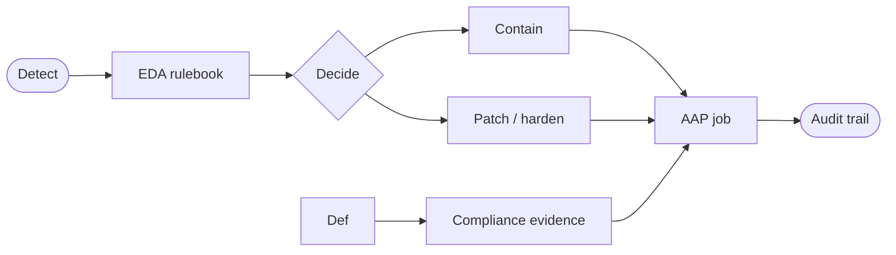


<div class="guide-header">

<h1>Security automation with Ansible</h1>

<span class="guide-type-badge guide-type-badge--solution"><i class="fas fa-check-circle" aria-hidden="true"></i> Solution Guide</span>

</div>

<style>
  div#toc {
    display: none;
  }
</style>

<div class="guide-hero-callout" role="img" aria-label="Ansible unlocks Security automation">
  
  <p class="guide-hero-callout__text">
    <span class="guide-hero-callout__ansible">Ansible</span>
    <span class="guide-hero-callout__unlocks">unlocks</span>
    <span class="guide-hero-callout__aiops">Security</span>
  </p>
</div>

## Overview

Security operations still lose time between detection and durable change: an alert fires, an analyst pivots across tools, and remediation is a ticket plus a manual playbook run. This foundational guide frames how **Ansible Automation Platform (AAP)** and **Event-Driven Ansible (EDA)** close that loop -- SIEM and runtime signals in, approved containment, patching, and compliance jobs out -- before you open partner Solution Guides such as Splunk, Falco, Satellite, or Lightwell.

<div class="guide-outcome">
<strong>Outcome:</strong> A Crawl/Walk/Run path for security automation with AAP: event intake, governed remediation, compliance evidence, and clear handoffs to deeper partner guides.
</div>

- [Background](#background)
- [Solution](#solution)
- [Common security automation patterns](#common-security-automation-patterns)
- [Prerequisites](#prerequisites)
- [Security automation workflow](#security-automation-workflow)
- [Solution Walkthrough](#solution-walkthrough)
- [Validation](#validation)
- [Maturity Path](#maturity-path)
- [Summary](#summary)
- [Next Steps](#next-steps)

## Background

**Security automation** turns detections into **repeatable, auditable actions**. AAP holds credentials, RBAC, and job history. EDA listens for SIEM, runtime, or vulnerability events and selects workflows your security and ops teams already approved -- containment, credential rotation, patching, or compliance scans.

Shared themes across this category:

- **Detect** -- Splunk, Falco, Satellite, vulnerability feeds
- **Decide** -- rulebooks, policy (OPA), optional AI triage
- **Act** -- AAP job templates and workflows with approvals
- **Prove** -- STIG/CIS evidence, CME controls, job audit trails

Partner guides specialize. This page is the shared starting vocabulary and maturity model.

## Solution

What makes up the foundational pattern?

- **Ansible Automation Platform** for governed execution and audit
- **Event-Driven Ansible** for alert- and webhook-driven response
- **Security event sources** (SIEM, runtime security, vulnerability platforms)
- **Approved remediation and compliance content** (collections, STIG/CIS, curated remediations)

### Who Benefits

| Persona | Challenge | What They Gain |
|---------|-----------|----------------|
| **SOC / SecOps Analyst** | Alerts without a fast, consistent response path | Seconds-to-minutes containment via approved jobs |
| **Security Architect** | One-off scripts without policy or audit | EDA + AAP patterns with RBAC and evidence |
| **CISO / Compliance Lead** | Hard to prove response and hardening at scale | Job history, compliance scans, Crawl/Walk/Run adoption |

## Common security automation patterns

| Pattern | Maturity | What it solves |
|---------|----------|----------------|
| Alert enrichment / ticket update | Crawl | Context on the incident before humans act |
| Credential or session revocation | Crawl–Walk | Active-attack response (for example brute force) |
| Runtime mitigation | Walk | Falco (or similar) events trigger host containment |
| CVE defend / contain / comply | Walk–Run | Detection through patch and evidence |
| Continuous compliance (STIG/CIS) | Walk–Run | Scan, remediate, re-scan under governance |

Deep dives live under **Security automation** on the catalog (Falco, Splunk, Satellite, Lightwell, CME, ZTA, STIG/CIS, PQC).

## Prerequisites

### Ansible Automation Platform

- **Ansible Automation Platform 2.4+** with Controller (and EDA for event-driven paths)

### Featured Ansible Content Collections

| Collection | Type | Purpose |
|-----------|------|---------|
| <a target="_blank" href="https://console.redhat.com/ansible/automation-hub/repo/published/ansible/eda/">ansible.eda</a> | Certified | Rulebooks and event sources |
| <a target="_blank" href="https://console.redhat.com/ansible/automation-hub/repo/published/ansible/posix/">ansible.posix</a> | Certified | Host-level security and system tasks |
| <a target="_blank" href="https://console.redhat.com/ansible/automation-hub/repo/published/redhat/rhel_system_roles/">redhat.rhel_system_roles</a> | Certified | Hardening and system configuration on RHEL |

### External Systems

| System | Required | Purpose |
|--------|----------|---------|
| SIEM or runtime detector | Recommended | Event source for EDA |
| Vulnerability / patch source | Optional | CVE and errata-driven workflows |
| Policy engine (OPA) | Optional | Gate risky remediations |

**Operational Impact:** High -- containment and patching change production security posture.

## Security automation workflow



Detection enters EDA. Decision logic selects an approved path. AAP executes and leaves an auditable record for operations and compliance.

## Solution Walkthrough

> **Scaffold note:** Replace placeholder steps with concrete YAML as this foundational page matures.
>
> Partner guides already detail Splunk webhooks, Falco sidekick, Satellite errata, and Lightwell CVE pipelines.

### Step 1: Map one alert type to one job template

**Operational Impact:** Low

Pick a high-confidence detection (for example failed SSH flood) and a single approved remediation template.

### Step 2: Wire EDA with an approval gate

**Operational Impact:** Medium

Start Walk maturity: automatic enrichment or containment draft, human approval before destructive change.

### Step 3: Add evidence and compliance follow-on

**Operational Impact:** Medium

Chain a STIG/CIS or CME verification job after remediation so the close-out includes proof.

## Validation

### Test

```bash
# Replay a sample webhook or run the remediation job in check mode
# against a lab host from Controller.
```

### Expected Result

```
EDA activation receives the event; the linked job completes with failed=0
and appears in Controller job history.
```

### Troubleshooting

| Symptom | Likely Cause | Fix |
|---------|-------------|-----|
| Rulebook never matches | Payload field mismatch | Log the event; tighten or loosen conditions |
| Job fails on privilege | Missing become or vault | Fix credential and EE |
| False-positive remediations | Over-broad rule | Add filters and approval nodes |

## Maturity Path

| Maturity | Description |
|----------|-------------|
| **Crawl** | Manual launch of approved security jobs; optional ticket enrichment |
| **Walk** | EDA triggers with approvals on high-impact remediations |
| **Run** | Broader auto-containment, CVE pipelines, and continuous compliance evidence |

## Summary

Security automation with Ansible is a governed detect–decide–act loop. Use this foundational page for shared maturity language, then open partner Solution Guides for SIEM, runtime, vulnerability, and compliance depth.

## Next Steps

1. Start with a concrete response path such as [Automated Brute-Force Remediation with Event-Driven Ansible](README-BruteForce-AAP.md).
2. Expand into [CVE defend, contain, and comply](README-CVE-defend-contain-comply.md) or [Falco runtime mitigation](README-Falco-runtime-mitigation.md).
3. Browse the catalog **Security automation** section for Satellite, Lightwell, CME, ZTA, and compliance guides.

