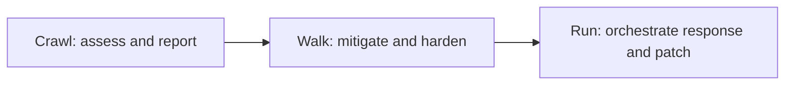
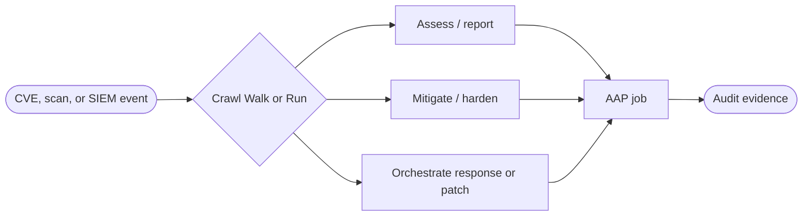


<div class="guide-header">

<h1>Security automation with Ansible</h1>

<span class="guide-type-badge guide-type-badge--solution"><i class="fas fa-check-circle" aria-hidden="true"></i> Solution Guide</span>

</div>

<style>
  div#toc {
    display: none;
  }
</style>

<div class="guide-hero-callout" role="img" aria-label="Ansible unlocks Security automation">
  
  <p class="guide-hero-callout__text">
    <span class="guide-hero-callout__ansible">Ansible</span>
    <span class="guide-hero-callout__unlocks">unlocks</span>
    <span class="guide-hero-callout__aiops">Security</span>
  </p>
</div>

## Overview

Security operations still lose time between detection and durable change: a CVE or SIEM alert lands, analysts pivot across tools, and remediation is a ticket plus a manual playbook run. This foundational guide frames **Security automation in the AI era** with **Ansible Automation Platform (AAP)** -- start with compliance, exposure reporting, and governed patching, then harden and mitigate before patch windows, then orchestrate incident response and cross-infrastructure patching with Event-Driven Ansible and Automation orchestrator.

The maturity language matches the 301 use-case map: **Crawl → Walk → Run**.

<div class="guide-outcome">
<strong>Outcome:</strong> A shared Crawl/Walk/Run reference for security automation with eight use cases -- from OpenSCAP and exposure reporting through mitigation, hardening, Zero Trust deployment, orchestrated incident response, and orchestrated patching.
</div>

- [Background](#background)
- [Solution](#solution)
- [Common security automation use cases](#common-security-automation-use-cases)
- [Prerequisites](#prerequisites)
- [Security automation workflow](#security-automation-workflow)
- [Solution Walkthrough](#solution-walkthrough)
- [Validation](#validation)
- [Maturity Path](#maturity-path)
- [Summary](#summary)
- [Next Steps](#next-steps)

## Background

**Security automation** turns detections and audit findings into **repeatable, auditable actions**. AAP holds credentials, RBAC, and job history. Event-Driven Ansible listens for SIEM, vulnerability, or runtime events. Automation orchestrator adds correlation, approvals, and multi-step routing when a single job template is not enough -- for example SBOM-aware patch vs mitigate vs escalate.

Shared themes across this category:

- **Assess** -- OpenSCAP STIG/CIS, PQC discovery, exposure reports
- **Mitigate and harden** -- compensating controls, baselines, Zero Trust policy enforcement
- **Respond** -- SIEM-triggered containment across firewall, Vault, network, and infra
- **Patch and prove** -- Lightwell, Satellite, Lightspeed remediations, MECM/Azure paths with audit evidence

Partner and Implementation Guides specialize (STIG/CIS, Falco, Splunk, Lightwell, ZTA, CME, and others). Start here for the shared journey and the eight use cases from the Security Automation in the AI Era technical narrative.

## Solution

What makes up the foundational pattern?

- **Ansible Automation Platform** for governed execution and audit-ready job records
- **Event-Driven Ansible** for SIEM and vulnerability event triggers
- **Automation orchestrator** (optional at Run) for SBOM correlation, approvals, and multi-path remediation
- **Compliance and security content** -- OpenSCAP, STIG/CIS, curated remediations, compensating controls
- **Supply-chain and patch sources** -- Lightwell, Satellite, Lightspeed, Windows update managers

### Who Benefits

| Persona | Challenge | What They Gain |
|---------|-----------|----------------|
| **SOC / SecOps Analyst** | Alerts without a fast, consistent response path | Orchestrated containment and enrichment via approved jobs |
| **Security Architect** | One-off scripts without policy or audit | Crawl/Walk/Run patterns with RBAC and evidence |
| **CISO / Compliance Lead** | Hard to prove hardening and patch posture | Continuous assessment, mitigation before patch, audit trails |



<h2 id="common-security-automation-use-cases">Common security automation use cases</h2>

Eight patterns for customer conversations (from the Security Automation in the AI Era 301 use-case map). **Mix and match by pain point and maturity.** Each row maps to **Crawl**, **Walk**, or **Run**.

### How work starts

Security automation can begin from a scheduled compliance scan, a CVE or advisory notification, a SIEM event, a policy gate at deploy time, or a human in Automation controller. The use case describes the **pattern**; the entry point depends on the customer environment.

Each pattern has its own **Security Use Case** page (scaffold today; deepen over time). Pick a row below or open the [Common security automation use cases hub](security-use-cases.md).

This foundational guide's [workflow](#security-automation-workflow) is a **high-level Detect → Decide → Act → Prove** loop. Open a strip item for the dedicated pattern page.

<div class="cards-track-section cards-track-section--use-cases">
<nav class="use-case-strip" aria-label="Security automation use cases">
<a class="use-case-strip__item" href="README-Security-Use-Case-01-Compliance.html">
  <span class="use-case-strip__num">1</span>
  <span class="use-case-strip__body">
    <span class="use-case-strip__title">Compliance</span>
    <span class="use-case-strip__question">How do we assess STIG/CIS posture and cryptographic exposure continuously?</span>
  </span>
  <span class="use-case-maturity-chip use-case-maturity-chip--crawl">Crawl</span>
</a>
<a class="use-case-strip__item" href="README-Security-Use-Case-02-Exposure-Reporting.html">
  <span class="use-case-strip__num">2</span>
  <span class="use-case-strip__body">
    <span class="use-case-strip__title">Exposure reporting</span>
    <span class="use-case-strip__question">How do we turn CVE notifications into SBOM-aware reports for ITSM?</span>
  </span>
  <span class="use-case-maturity-chip use-case-maturity-chip--crawl">Crawl</span>
</a>
<a class="use-case-strip__item" href="README-Security-Use-Case-03-Patching.html">
  <span class="use-case-strip__num">3</span>
  <span class="use-case-strip__body">
    <span class="use-case-strip__title">Patching</span>
    <span class="use-case-strip__question">How do we deploy trusted patches on RHEL and Windows with audit proof?</span>
  </span>
  <span class="use-case-maturity-chip use-case-maturity-chip--crawl">Crawl</span>
</a>
<a class="use-case-strip__item" href="README-Security-Use-Case-04-Mitigation-Before-Patching.html">
  <span class="use-case-strip__num">4</span>
  <span class="use-case-strip__body">
    <span class="use-case-strip__title">Mitigation before patching</span>
    <span class="use-case-strip__question">How do we lower exploitability while waiting for a patch window?</span>
  </span>
  <span class="use-case-maturity-chip use-case-maturity-chip--walk">Walk</span>
</a>
<a class="use-case-strip__item" href="README-Security-Use-Case-05-Hardening-Baselines.html">
  <span class="use-case-strip__num">5</span>
  <span class="use-case-strip__body">
    <span class="use-case-strip__title">Establish hardening baselines</span>
    <span class="use-case-strip__question">How do we enforce STIG/CIS hardening at scale from scan results?</span>
  </span>
  <span class="use-case-maturity-chip use-case-maturity-chip--walk">Walk</span>
</a>
<a class="use-case-strip__item" href="README-Security-Use-Case-06-Zero-Trust-App-Deployment.html">
  <span class="use-case-strip__num">6</span>
  <span class="use-case-strip__body">
    <span class="use-case-strip__title">Application deployment with Zero Trust</span>
    <span class="use-case-strip__question">How does AAP act as a policy enforcement point at deploy time?</span>
  </span>
  <span class="use-case-maturity-chip use-case-maturity-chip--walk">Walk</span>
</a>
<a class="use-case-strip__item" href="README-Security-Use-Case-07-Orchestrated-Incident-Response.html">
  <span class="use-case-strip__num">7</span>
  <span class="use-case-strip__body">
    <span class="use-case-strip__title">Orchestrated incident response</span>
    <span class="use-case-strip__question">How do SIEM events drive coordinated firewall, Vault, and infra changes?</span>
  </span>
  <span class="use-case-maturity-chip use-case-maturity-chip--run">Run</span>
</a>
<a class="use-case-strip__item" href="README-Security-Use-Case-08-Orchestrated-Patching.html">
  <span class="use-case-strip__num">8</span>
  <span class="use-case-strip__body">
    <span class="use-case-strip__title">Orchestrated patching across infrastructure</span>
    <span class="use-case-strip__question">How do we correlate SBOM risk, mitigate, patch, and validate end to end?</span>
  </span>
  <span class="use-case-maturity-chip use-case-maturity-chip--run">Run</span>
</a>
</nav>
</div>

## Prerequisites

Requirements depend on which use case or partner guide you implement.

### Ansible Automation Platform

- **Ansible Automation Platform 2.5+** recommended for EDA-heavy paths
- **Automation orchestrator** when you adopt use case 8 (SBOM correlation and multi-path decisions)

### Featured Ansible Content Collections

| Collection | Type | Purpose |
|-----------|------|---------|
| <a target="_blank" href="https://console.redhat.com/ansible/automation-hub/repo/published/ansible/eda/">ansible.eda</a> | Certified | Rulebooks for SIEM and vulnerability events |
| <a target="_blank" href="https://console.redhat.com/ansible/automation-hub/repo/published/ansible/posix/">ansible.posix</a> | Certified | Host-level hardening and system tasks |
| <a target="_blank" href="https://console.redhat.com/ansible/automation-hub/repo/published/redhat/rhel_system_roles/">redhat.rhel_system_roles</a> | Certified | RHEL hardening and configuration |

### External Systems

| System | Required | Purpose |
|--------|----------|---------|
| Compliance content (OpenSCAP / STIG / CIS) | For Crawl compliance | Assessment and hardening baselines |
| Vulnerability / SBOM sources | Recommended | Exposure reporting and orchestrated patching |
| SIEM | For Run incident response | Event notification into EDA |
| Patch sources (Satellite, Lightwell, MECM/Azure) | For patching paths | Trusted content into production |

**Operational Impact:** High -- mitigation, hardening, containment, and patching change production security posture. Prefer approvals and lab inventories first.

## Security automation workflow



Signals enter as scans, advisories, or SIEM events. Maturity decides whether you only assess, mitigate while waiting to patch, or fully orchestrate response and patching. AAP keeps the request, decision, change, and result in the job record.

## Solution Walkthrough

> **Scaffold note:** Expand with production YAML as use-case pages mature. Existing catalog guides already cover STIG/CIS, PQC, brute-force response, ZTA, CME, Satellite, and Lightwell depth.

### Step 1: Establish Crawl assessment

**Operational Impact:** Low

Run OpenSCAP against a pilot inventory; produce exposure reports into ITSM without automatic remediation.

### Step 2: Add Walk mitigation and hardening

**Operational Impact:** Medium

Apply compensating controls from advisory data; enforce hardening baselines from scan results; gate app deploy with OPA/Vault Zero Trust checks.

### Step 3: Orchestrate Run response and patching

**Operational Impact:** High

Wire SIEM to multi-domain incident workflows; use Automation orchestrator for SBOM-aware mitigate vs patch vs escalate, then verify state.

## Validation

### Test

```bash
# Example: confirm a compliance or remediation job template exists and a lab host is reachable
ansible-inventory -i inventories/security-lab.yml --graph
```

### Expected Result

```
Lab inventory lists expected hosts; a check-mode or assess-only job completes with failed=0
and produces a report or AAP job artifact.
```

### Troubleshooting

| Symptom | Likely Cause | Fix |
|---------|-------------|-----|
| Scan content missing | OpenSCAP/STIG content not on EE | Add content packages to the execution environment |
| EDA never fires | Webhook or SIEM filter | Replay a test event; verify rulebook conditions |
| Patch job blocked | Missing approval or maintenance window | Align workflow approvals and Satellite/stage gates |

## Maturity Path

| Maturity | Focus | Use cases |
|----------|-------|-----------|
| **Crawl** | Assess and report; trusted patch paths | 1 Compliance, 2 Exposure reporting, 3 Patching |
| **Walk** | Mitigate, harden, enforce at deploy | 4 Mitigation before patching, 5 Hardening baselines, 6 Zero Trust app deployment |
| **Run** | Orchestrate response and end-to-end patch | 7 Orchestrated incident response, 8 Orchestrated patching |

## Summary

Security automation with Ansible is a journey from continuous assessment and trusted patching, through mitigation and Zero Trust enforcement, to orchestrated incident response and SBOM-aware patch pipelines. Use this foundational page and the eight use-case strip for customer conversations, then open partner and Implementation Guides for platform depth.

## Next Steps

1. Browse the [Common security automation use cases hub](security-use-cases.md).
2. For concrete depth, open [RHEL 9 STIG and CIS compliance](README-STIG-CIS-compliance.md), [Automated Brute-Force Remediation](README-BruteForce-AAP.md), [ZTA with AAP](README-ZTA-with-AAP.md), or [Lightwell](README-AAP-LightWell-AO.md).
3. Return to the catalog **Security automation** section for the full set of guides.

