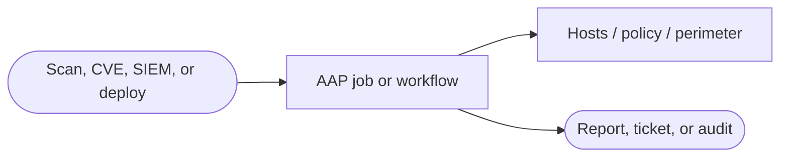


<div class="guide-header">

<h1>Mitigation before patching</h1>

<span class="guide-type-badge guide-type-badge--use-case"><i class="fas fa-layer-group" aria-hidden="true"></i> Security Use Case</span>

</div>

<style>
  div#toc {
    display: none;
  }
</style>

## Overview

Using advisory data (CVSS, CWE), AAP gathers compensating controls that match the exploitation path and enforces mitigation to lower risk scoring before a patch window is available.

**Maturity:** Walk. **Customer question:** How do we lower exploitability while waiting for a patch window?

Start from the [Common security automation use cases hub](security-use-cases.md) or the foundational [Security automation with Ansible](README-Security-Automation.md) guide.

**Related catalog depth:** [CVE response with CME](README-CME.md), [CVE defend contain comply](README-CVE-defend-contain-comply.md)

## Background

This page is a scaffold aligned to the Security Automation in the AI Era (301) technical deck. Expand with workflow diagrams, validation commands, and partner deep links as the pattern hardens.

## Solution

- **Ansible Automation Platform** for governed jobs, RBAC, and audit evidence
- **Event-Driven Ansible** when the pattern is alert- or advisory-triggered
- **Automation orchestrator** when multi-path correlation is required (especially use case 8)
- **Compliance, SIEM, SBOM, and patch sources** as required by the pattern

### Who Benefits

| Persona | Challenge | What They Gain |
|---------|-----------|----------------|
| **SecOps / Compliance** | Manual, inconsistent execution of this pattern | Repeatable AAP automation with evidence |
| **Security Architect** | Unclear Crawl/Walk/Run placement | Shared vocabulary with the foundational journey |
| **CISO / Leader** | Hard to show posture improvement | Measurable assess, mitigate, respond, and patch outcomes |

## Prerequisites

- Ansible Automation Platform with appropriate credentials and execution environments
- Lab or pilot inventory for first runs
- Pattern-specific systems (OpenSCAP content, SIEM, Satellite/Lightwell, OPA/Vault, and so on)

## Workflow



## Solution Walkthrough

> **Scaffold:** Add playbook and workflow examples from the 301 deck and catalog guides in a follow-up pass.

### Step 1: Define success and blast radius

Document assess-only vs change, and where human approval is required.

### Step 2: Publish an approved job template or workflow

Expose the automation in Controller (and EDA/AO when event- or multi-path-driven).

### Step 3: Validate on a pilot inventory

Run assess-only or check mode before production schedules or SIEM triggers.

## Validation

### Test

```bash
# Replace with the job template or playbook for this pattern
ansible-playbook -i inventories/security-lab.yml site.yml --check
```

### Expected Result

```
Pilot run completes with failed=0; evidence (scan report, ticket, or job artifact) is produced.
```

### Troubleshooting

| Symptom | Likely Cause | Fix |
|---------|-------------|-----|
| Missing content / collections | EE incomplete | Add OpenSCAP, network, or security collections |
| Event path silent | EDA filter or webhook | Replay payload; adjust rulebook |

## Maturity Path

| Maturity | For this use case |
|----------|-------------------|
| **Crawl** | Assess, report, or trusted single-domain patch |
| **Walk** | Mitigate, harden, or policy-gated deploy |
| **Run** | Multi-domain orchestration with EDA and/or AO |

## Summary

**Mitigation before patching** is use case 4 in the Security automation foundational set. Deepen this page with executable examples as demos land; keep the foundational guide as the shared journey.

## Next Steps

1. Return to [Security automation with Ansible](README-Security-Automation.md).
2. Browse [all eight use cases](security-use-cases.md).
3. Open related catalog guides listed in the Overview for platform-specific depth.

