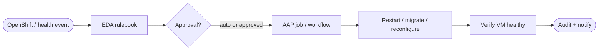


<div class="guide-header">

<h1>Self-healing VMs on OpenShift</h1>

<span class="guide-type-badge guide-type-badge--solution"><i class="fas fa-check-circle" aria-hidden="true"></i> Solution Guide</span>

</div>

<style>
  div#toc {
    display: none;
  }
</style>

<div class="guide-hero-callout guide-hero-partner" role="img" aria-label="Ansible Automation Platform and OpenShift Virtualization">
  
  <span class="guide-hero-partner__plus" aria-hidden="true">+</span>
  <span class="guide-hero-partner__partner" style="font-size:1.1rem;font-weight:700;letter-spacing:0.01em;">OpenShift Virtualization</span>
</div>

## Overview

When a virtual machine on OpenShift Virtualization becomes unhealthy -- guest agent down, workload probe failing, node pressure, or storage attach issues -- teams still default to tickets and console access. Mean time to recovery stays high because detection, decision, and remediation live in different tools. This guide shows how **Event-Driven Ansible (EDA)**, **OpenShift**, and **Ansible Automation Platform (AAP)** form a closed loop: platform and guest signals trigger rulebooks, approved job templates remediate or evacuate the VM, and every step is audited in Controller.

<div class="guide-outcome">
<strong>Outcome:</strong> Self-healing VM infrastructure on OpenShift Virtualization -- EDA consumes health events, AAP runs governed remediations (restart, reconfigure, migrate, notify), and operators retain RBAC and approval gates.
</div>

- [Background](#background)
- [Solution](#solution)
- [Prerequisites](#prerequisites)
- [Self-healing VM workflow](#self-healing-vm-workflow)
- [Solution Walkthrough](#solution-walkthrough)
- [Validation](#validation)
- [Maturity Path](#maturity-path)
- [Summary](#summary)
- [Next Steps](#next-steps)

## Background

**OpenShift Virtualization** runs VMs as Kubernetes-native workloads. That means the same event fabric that watches pods and nodes can watch **VirtualMachine** and **VirtualMachineInstance** health. Alone, those events only page a human. Paired with **EDA**, they become triggers. Paired with **AAP**, they become **governed automation**: restart the guest, recreate a failed volume attach, cordon and evacuate, or open a change with full context.

Self-healing here does **not** mean unconstrained AI. It means:

1. Detect a known unhealthy state from OpenShift or monitoring
2. Match it in an EDA rulebook
3. Run an **approved** AAP job (or workflow with approval)
4. Verify the VM returns to Ready / guest-healthy

Start with high-confidence remediations (restart VMI, re-apply cloud-init config). Expand to migration and capacity actions as trust grows.

## Solution

### Executive summary

Self-healing VMs on OpenShift combine three Red Hat strengths. **OpenShift Virtualization** exposes VM lifecycle and health through the Kubernetes API and platform alerting. **Event-Driven Ansible** subscribes to those signals -- for example a VMI that never reaches Running, a guest agent heartbeat loss, or a node NotReady that hosts critical VMs -- and evaluates them in rulebooks without polling scripts. **Ansible Automation Platform** then executes the remediation your platform team already trusts: restart or recreate the VMI, apply a guest playbook, trigger a live migration away from a failing node, or enrich a ServiceNow/incident ticket before any destructive step. The result is self-healing infrastructure that is still auditable: every action is a Controller job with RBAC, credentials, and history. Crawl with manually launched jobs; Walk with EDA plus approvals; Run with broader automatic recovery inside policy.

### Components

- **OpenShift Virtualization** -- VM plane and API events
- **Event-Driven Ansible** -- rulebooks on health and lifecycle signals
- **Ansible Automation Platform** -- job templates, workflows, credentials, audit
- **Optional observability / ITSM** -- extra context and ticket updates

### Who Benefits

| Persona | Challenge | What They Gain |
|---------|-----------|----------------|
| **Virt / Platform Admin** | Unhealthy VMs wait on manual recovery | Automated restart/migrate paths with audit |
| **SRE** | VM incidents lack a standard runbook in automation | EDA + AAP patterns aligned to OpenShift events |
| **IT Manager** | Hard to show MTTR improvement for VM estates | Measurable job outcomes and maturity path |

**Recommended Demos and Self-Paced Labs:**

- Scaffold -- link Arcade or lab assets here when available

## Prerequisites

### Ansible Automation Platform

- **Ansible Automation Platform 2.5+** recommended (EDA + Controller); 2.4 minimum for Controller-only Crawl paths

### Featured Ansible Content Collections

| Collection | Type | Purpose |
|-----------|------|---------|
| <a target="_blank" href="https://console.redhat.com/ansible/automation-hub/repo/published/ansible/eda/">ansible.eda</a> | Certified | Rulebooks and Kubernetes/ webhook sources |
| <a target="_blank" href="https://console.redhat.com/ansible/automation-hub/repo/published/kubernetes/core/">kubernetes.core</a> | Certified | VirtualMachine / VMI and related API objects |
| <a target="_blank" href="https://console.redhat.com/ansible/automation-hub/repo/published/ansible/controller/">ansible.controller</a> | Certified | Optional configuration-as-code for templates |

### External Systems

| System | Required | Purpose |
|--------|----------|---------|
| OpenShift cluster with Virtualization | Yes | VM platform under management |
| AAP kubeconfig / token credential | Yes | API access from the EE |
| Guest OS credentials | Optional | In-guest remediation jobs |
| Alertmanager / monitoring | Optional | Richer health signals into EDA |

**Operational Impact:** High -- automated restart or migration affects running workloads; use approvals in Walk.

## Self-healing VM workflow



An OpenShift or monitoring event reaches EDA. The rulebook selects a remediation path, optionally pausing for approval. AAP mutates the VM or guest, verification confirms health, and the job history is the audit record.

## Solution Walkthrough

> **Scaffold note:** Expand with production YAML (rulebook source, `kubernetes.core` tasks, and sample alerts) in a follow-up pass. Structure below matches the Solution Guide framework.

### Step 1: Define unhealthy conditions worth automating

**Operational Impact:** Low

Document 1–3 signals (for example VMI CrashLoop, guest agent down, node NotReady with pinned VMs). Map each to an approved action.

### Step 2: Create AAP job templates for remediations

**Operational Impact:** Medium

```yaml
# Placeholder -- replace with real kubernetes.core tasks for your cluster
- name: Restart VirtualMachineInstance (illustrative)
  kubernetes.core.k8s:
    state: present
    definition:
      apiVersion: kubevirt.io/v1
      kind: VirtualMachine
      metadata:
        name: "{{ vm_name }}"
        namespace: "{{ vm_namespace }}"
      spec:
        running: true
```

### Step 3: Wire EDA rulebook to OpenShift events

**Operational Impact:** Medium

```yaml
# Placeholder rulebook sketch
---
- name: Self-heal OpenShift VMs
  hosts: all
  sources:
    - name: wait for kubernetes or webhook events
      ansible.eda.webhook:
        host: 0.0.0.0
        port: 5000
  rules:
    - name: Unhealthy VM -- launch remediation
      condition: event.payload.severity == "critical"
      action:
        run_job_template:
          name: "VM Self-Heal Restart"
          organization: Default
```

### Step 4: Verify and notify

**Operational Impact:** Low

After remediation, check VMI phase / guest agent, update the ticket or chat channel, and keep failures loud (page on repeated fail).

## Validation

### Test

```bash
# Lab: simulate or wait for an unhealthy VMI, confirm EDA activation and job
oc get vmi -n <namespace> <vm-name> -o wide
# Then confirm Controller job for "VM Self-Heal Restart" succeeded
```

### Expected Result

```
VMI returns to Running / Ready; AAP job RECAP shows failed=0;
EDA activation log shows the matching rule fired once.
```

### Troubleshooting

| Symptom | Likely Cause | Fix |
|---------|-------------|-----|
| Rule never fires | Event filter or webhook path | Capture payload; adjust condition |
| Job cannot patch VM | RBAC on service account | Grant least-privilege on target namespaces |
| Restart loops | Underlying storage/node fault | Add max-retry and escalate instead of blind restart |

## Maturity Path

| Maturity | Description |
|----------|-------------|
| **Crawl** | Operators run approved VM remediation jobs from AAP manually |
| **Walk** | EDA triggers remediations with approval on migrate/destructive actions |
| **Run** | Broader auto-heal set, node evacuate, and verification with escalation policy |

## Summary

Self-healing VMs on OpenShift use EDA to listen, AAP to act under governance, and OpenShift Virtualization as the platform that makes VM health observable as API events. Scaffolded here as a Solution Guide -- deepen the walkthrough YAML and validation commands as the demo hardens.

## Next Steps

1. Read the category foundation: [Virtualization automation with Ansible](README-Virtualization.md).
2. Align guest and OS remediation with [AIOps automation with Ansible](README-AIOps.md) when VM issues are part of a broader ops loop.
3. Add monitoring and ITSM partners from the catalog when enrichment or ticketing is required.

