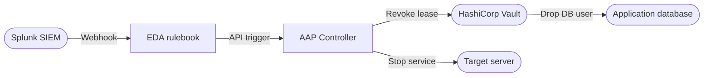
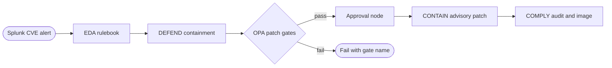


<div class="guide-header">

<h1>Security automation with Splunk and Event-Driven Ansible</h1>

<span class="guide-type-badge guide-type-badge--solution"><i class="fas fa-check-circle" aria-hidden="true"></i> Solution Guide</span>

</div>

<div class="guide-hero-callout guide-hero-partner guide-hero-partner--splunk" role="img" aria-label="Ansible Automation Platform and Splunk">
  
  <span class="guide-hero-partner__plus" aria-hidden="true">+</span>
  <span class="guide-hero-partner__partner card-partner-logo-set">
    
    
  </span>
</div>

## Overview

Security operations still lose time between detection and durable change. A Splunk alert lands, analysts open tickets, and containment or patching waits on manual SSH and spreadsheet evidence -- giving attackers room to pivot, or leaving CVE windows open for tens of minutes per host.

This guide shows how **Splunk**, **Event-Driven Ansible (EDA)**, and **Ansible Automation Platform (AAP)** close that gap for two operational outcomes:

- **[Use Case A: Automated brute-force remediation](#use-case-a-automated-brute-force-remediation)** -- SSH authentication failures trigger EDA, which revokes HashiCorp Vault database credentials and stops the compromised service in seconds.
- **[Use Case B: Automated CVE response](#use-case-b-automated-cve-response)** -- Splunk CVE alerts drive DEFEND containment, OPA-gated CONTAIN patching with human approval, then COMPLY evidence and a scanned container image.

| Use case | Primary outcome | Operational impact | Maturity fit |
|----------|-----------------|-------------------|--------------|
| **A. Brute-force remediation** | Instant credential and service containment | High | Crawl alert; Walk approve; Run closed-loop revoke |
| **B. CVE response** | Contain, policy-gated patch, prove | High | Crawl alert; Walk EDA contain; Run full DEFEND/CONTAIN/COMPLY |

> **AIOps Splunk is separate.**
>
> Predictive ITSI and RHEL/network AIOps patterns live in [AIOps with Splunk and Event-Driven Ansible](README-AIOps-Splunk-ITSI.md). This guide is the **Security** track.

## Table of Contents

- [Background](#background)
- [Solution](#solution)
- [Prerequisites](#prerequisites)
- **[Use Case A: Automated brute-force remediation](#use-case-a-automated-brute-force-remediation)**
- **[Use Case B: Automated CVE response](#use-case-b-automated-cve-response)**
- [Maturity Path](#maturity-path)
- [Summary](#summary)
- [Next Steps](#next-steps)

## Background

**Splunk** aggregates authentication and vulnerability signals and can forward alerts through the Ansible add-on (or HTTP Event Collector) into EDA. **Event-Driven Ansible** evaluates rulebooks and launches approved AAP jobs or workflows. **Ansible Automation Platform** executes governed remediations with credentials, RBAC, and job history.

Under **Zero Trust Architecture (ZTA)** (NIST SP 800-207), trust is continuously evaluated. When a workload shows brute-force behavior or a known CVE, policy enforcement points must restrict access or harden before the ticket queue drains. EDA connects the Policy Information Point (Splunk) to enforcement (Vault, firewall, services, patch workflows).

Two gaps this guide closes:

- **Brute-force blast radius (Use Case A)** -- Manual revoke and service stop leave active Vault leases and DB sessions open during triage.
- **CVE response chain (Use Case B)** -- Containment, patching policy, and compliance evidence are separate manual steps; OPA and workflows make gates and proof part of the same pipeline.

## Solution

What makes up the solution?

- **Splunk Enterprise** -- Brute-force and CVE detection; Ansible add-on webhooks (both)
- **Event-Driven Ansible** -- Rulebooks that launch job or workflow templates (both)
- **Ansible Automation Platform 2.5+** -- Orchestration, approvals, audit (both). AAP 2.6 recommended for Token Event Stream enhancements
- **HashiCorp Vault** -- Dynamic DB leases and revocation (Use Case A)
- **Open Policy Agent (OPA)** -- Patch and execution policy gates (Use Case B)
- **RHEL 9 targets** -- firewalld, SELinux, httpd, Podman for containment and compliance (Use Case B)

### Who Benefits

| Persona | Challenge | What They Gain |
|---------|-----------|----------------|
| **IT Ops / SRE** | 3 AM manual revoke or 45+ minutes SSH per CVE host | Closed-loop containment; patching after gates and approval |
| **Security Architect** | Response times miss policy; patch rules live in docs | Code-driven revoke and OPA-enforced patch prerequisites |
| **Compliance / CISO** | Weak evidence and supply-chain provenance | AAP job trails; before/after HTML evidence; labeled scanned images (Use Case B) |

## Prerequisites

### Ansible Automation Platform

- **Ansible Automation Platform 2.4+** for EDA (Use Case A minimum); **2.5+** recommended for Use Case B workflows. **2.6** recommended for Token Event Stream enhancements.

### Featured Ansible Content Collections

| Collection | Type | Purpose |
|-----------|------|---------|
| <a target="_blank" href="https://console.redhat.com/ansible/automation-hub/repo/published/ansible/eda/">ansible.eda</a> | Certified | Webhook / event stream sources and rulebook actions (both) |
| <a target="_blank" href="https://console.redhat.com/ansible/automation-hub/repo/published/community/hashi_vault/">community.hashi_vault</a> / <a target="_blank" href="https://console.redhat.com/ansible/automation-hub/collections/published/hashicorp/vault/details">hashicorp.vault</a> | Community / Certified | Vault APIs (Use Case A) |
| <a target="_blank" href="https://console.redhat.com/ansible/automation-hub/repo/published/ansible/controller/">ansible.controller</a> | Certified | Workflow control and set_stats (Use Case B) |
| <a target="_blank" href="https://console.redhat.com/ansible/automation-hub/repo/published/ansible/posix/">ansible.posix</a> | Certified | firewalld, SELinux, sysctl (Use Case B) |
| <a target="_blank" href="https://console.redhat.com/ansible/automation-hub/repo/published/containers/podman/">containers.podman</a> | Certified | Build, scan, push (Use Case B) |
| <a target="_blank" href="https://console.redhat.com/ansible/automation-hub/repo/published/redhat/rhel_system_roles/">redhat.rhel_system_roles</a> | Certified | CIS hardening (Use Case B) |

### External Systems

| System | Required | Details |
|--------|----------|---------|
| Splunk | Required | Enterprise with Ansible add-on (both); HEC optional for Use Case B |
| HashiCorp Vault | Use Case A | Dynamic DB credentials and lease revoke |
| Open Policy Agent | Use Case B | Patch and execution policies (for example port 8181) |
| RHEL 9 lab hosts | Use Case B | httpd, firewalld, SELinux targeted, Podman |

**Operational Impact:** High for both use cases -- credential revoke / service stop (A); interface isolation, advisory patch, CIS and container changes (B). Lab first.

---

<h2 id="use-case-a-automated-brute-force-remediation">Use Case A: Automated brute-force remediation</h2>

### Overview

When Splunk detects rapid SSH authentication failures, EDA launches an AAP job that authenticates to HashiCorp Vault, revokes the application's database lease, removes the credential env file, and stops the compromised service -- closed-loop containment without waiting for a ticket.

### Demos and labs

- <a target="_blank" href="https://github.com/ansible/workshops">Zero Trust Architecture Workshop</a>

### Workflow



### Solution Walkthrough

#### Step 1: Point Splunk at the EDA event stream

**Operational Impact:** Low

Create an External Event Stream in AAP and configure the Ansible add-on webhook endpoint:

```yaml
    - name: Update EDA environment webhook endpoint
      ansible.builtin.uri:
        url: "{{ splunk_mgmt }}/servicesNS/nobody/ansible_addon_for_splunk/ansible_addon_for_splunk_environment/ZTA"
        method: POST
        user: admin
        password: "{{ splunk_password }}"
        force_basic_auth: true
        validate_certs: false
        body_format: form-urlencoded
        body:
          webhook_endpoint: "{{ eda_event_stream_url }}"
          auth_type: apikey
          token: "{{ eda_token }}"
        status_code: [200]
```

#### Step 2: EDA rulebook for SSH brute-force

**Operational Impact:** None

```yaml
- name: Splunk Brute-Force to Credential Revocation
  hosts: all
  sources:
    - ansible.eda.webhook:
        host: 0.0.0.0
        port: 5000
  rules:
    - name: Revoke credentials on SSH brute-force detection
      condition: event.payload.search_name is search("SSH Brute Force Detected")
      action:
        run_job_template:
          name: "Emergency: Revoke App Credentials"
          organization: Default
```

Inject a Controller token into EDA with a custom credential so the rulebook can launch the job template.

#### Step 3: Revoke Vault lease and stop the application

**Operational Impact:** High

Authenticate to Vault, read the active lease, revoke it, remove credentials on disk, and stop the service:

```yaml
    - name: Authenticate to Vault with userpass
      uri:
        url: "{{ vault_addr }}/v1/auth/userpass/login/{{ vault_username }}"
        method: POST
        body_format: json
        body:
          password: "{{ vault_password }}"
        validate_certs: false
      register: vault_login
      delegate_to: localhost

    - name: Revoke the database credentials in Vault
      command: "vault lease revoke {{ lease_raw.content | b64decode | trim }}"
      environment:
        VAULT_ADDR: "{{ vault_addr }}"
        VAULT_TOKEN: "{{ vault_login.json.auth.client_token }}"
      when: lease_raw is succeeded and lease_raw.content is defined

    - name: Remove application environment file (contains credentials)
      file:
        path: "/opt/app/env"
        state: absent

    - name: Stop the application service
      systemd:
        name: ztaapp
        state: stopped
```

> **Warning:** PostgreSQL existing connections
>
> `vault lease revoke` drops the generated user for new connections. Configure PostgreSQL to terminate sessions for dropped users, or add an explicit kill-sessions task.

### Validation

#### Test

```bash
ansible-playbook section5/playbooks/simulate-bruteforce.yml
```

Wait 20-30 seconds for Splunk to index, evaluate the saved search, and POST to EDA.

#### Expected Result

EDA activation fire count increments. Job **Emergency: Revoke App Credentials** succeeds and summarizes Vault revoke, env file removal, and service stop -- application has no DB access.

#### Troubleshooting

| Symptom | Likely Cause | Fix |
|---------|-------------|-----|
| Splunk detects but EDA silent | Webhook URL or network | Match add-on endpoint to Event Stream; open firewall |
| Job `401` to Vault | Bad token / AppRole | Rotate credential; confirm revoke permission |
| App still has DB access | Lingering sessions | Terminate sessions for dropped users |

### Summary

Use Case A turns a Splunk brute-force alert into governed Vault revoke and host isolation at machine speed.

---

<h2 id="use-case-b-automated-cve-response">Use Case B: Automated CVE response</h2>

### Overview

Three phases map to real CVE response: **DEFEND** (EDA containment in seconds from a Splunk alert), **CONTAIN** (OPA patch gates plus human approval, then advisory update), and **COMPLY** (before/after evidence, CIS hardening, scanned container with advisory label).

### Workflow



### Solution Walkthrough

#### Step 1: EDA triggers containment

**Operational Impact:** Medium

```yaml
sources:
  - ansible.eda.pg_listener:
      token: "{{ EDA_WEBHOOK_TOKEN | default('') }}"
rules:
  - name: CVE alert from Splunk -- trigger containment
    condition: event.payload.search_name is search("CVE Alert")
    actions:
      - run_workflow_template:
          name: "Vulnerability Containment"
          organization: Default
          job_args:
            limit: "{{ event.payload.results.host }}"
```

DEFEND confirms the CVE on-host, moves `eth0` to an `internal-only` firewalld zone, hardens httpd, sets SELinux booleans against SSRF, and activates AIDE -- graduated containment, not a kill switch.

#### Step 2: OPA-gated patching with approval

**Operational Impact:** High

```yaml
- name: Query OPA patch policy
  ansible.builtin.uri:
    url: "{{ opa_url }}/v1/data/dcc/patch_policy/result"
    method: POST
    body_format: json
    body:
      input:
        current_hour: "{{ ansible_date_time.hour | int }}"
        backup_age_hours: "{{ backup_age_hours | float }}"
        free_disk_gb: "{{ free_disk_gb | float }}"
        service_state: "{{ _service_state.status.ActiveState }}"
  register: _opa_response

- name: Apply advisory patch
  ansible.builtin.dnf:
    name: "*"
    state: latest
    bugfix: false
    security: true
    advisory: "{{ rhsa_id }}"
  register: patch_result
```

If `allow_patch` is false, the workflow fails with the violated gate and never reaches approval. Approval timeout fails safe (no patch). A second OPA execution policy can block who may launch patching even as a Controller admin.

> **Warning:** OPA gates block patching, not containment.
>
> DEFEND runs immediately without patch gates. Gates apply only to CONTAIN.

#### Step 3: Compliance evidence and supply chain

**Operational Impact:** Medium

Audit controls before and after CIS hardening, publish HTML evidence, then build and scan a UBI9-minimal image labeled with the advisory:

```yaml
- name: Build hardened container with advisory label
  containers.podman.podman_image:
    name: "parasol-app"
    tag: "{{ rhsa_id }}"
    path: "{{ playbook_dir }}/../container/"
    build:
      extra_args: "--label security.advisory={{ rhsa_id }}"
    push: true
    push_args:
      dest: "{{ registry_url }}/parasol-app:{{ rhsa_id }}"
```

### Validation

#### Test

1. Fire a CVE alert (or lab webhook) and confirm **Vulnerability Containment** isolates `eth0` and hardens httpd while the service still answers internally.
2. Remove `/var/log/last-backup-timestamp` and confirm the OPA pre-patch check fails by gate name; restore and confirm it passes.
3. After patch and COMPLY, confirm before/after reports and a clean scanned image with the advisory label.

#### Expected Result

```
DEFEND completes in seconds; OPA blocks when gates fail; approved CONTAIN applies advisory;
COMPLY shows improved controls; registry lists parasol-app tagged with RHSA id.
```

#### Troubleshooting

| Symptom | Likely Cause | Fix |
|---------|-------------|-----|
| EDA fires, workflow missing | Event Stream token | Rotate Controller token; match Splunk URL |
| OPA connection refused | OPA down / wrong port | `curl http://<opa-host>:8181/health` from EE |
| Approval timeout | No notifier | Email/webhook on approval step |
| Advisory not found | RHSM / repos | `subscription-manager refresh`; enable channel |

### Summary

Use Case B automates detect-contain-patch-prove: Splunk to EDA for immediate DEFEND, OPA and approval for CONTAIN, then COMPLY evidence and a labeled scanned image.

---

## Maturity Path

| Maturity | Use Case A | Use Case B |
|----------|------------|------------|
| **Crawl** | Splunk alert to Slack/ITSM; manual revoke | Alert only; manual SSH harden and patch tracking |
| **Walk** | ITSM approval then AAP revoke playbook | EDA DEFEND automatic; operator approves patch |
| **Run** | EDA auto-revoke Vault lease and stop service | Full DEFEND / CONTAIN / COMPLY with OPA and evidence |

## Summary

Splunk plus EDA and AAP delivers two Security outcomes on one platform: **instant brute-force containment** via Vault and service isolation, and **policy-gated CVE response** with automated compliance proof. Shared webhook and rulebook patterns keep both paths auditable; AIOps Splunk patterns remain in the separate AIOps Solution Guide.

## Next Steps

1. Start a free <a target="_blank" href="https://www.redhat.com/en/technologies/management/ansible/trial">Ansible Automation Platform trial</a> including Event-Driven Ansible.
2. Work the <a target="_blank" href="https://github.com/ansible/workshops">Zero Trust Architecture workshop</a> for Use Case A patterns; apply Use Case B OPA and compliance stages in a RHEL 9 lab.
3. For Splunk AIOps (ITSI / RHEL / network), open [AIOps with Splunk and Event-Driven Ansible](README-AIOps-Splunk-ITSI.md).
4. Engage <a target="_blank" href="https://www.redhat.com/en/services/consulting">Red Hat Consulting</a> or <a target="_blank" href="https://www.redhat.com/en/services/training-and-certification">Training</a> for production security automation.

