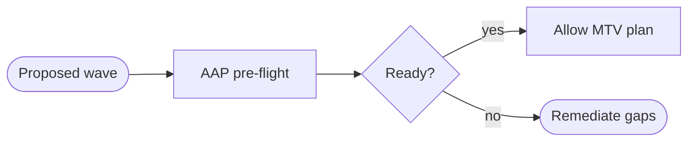


<div class="guide-header">

<h1>Pre-migration validation</h1>

<span class="guide-type-badge guide-type-badge--use-case"><i class="fas fa-layer-group" aria-hidden="true"></i> Virtualization Use Case</span>

</div>

<style>
  div#toc {
    display: none;
  }
</style>

## Overview

Automatically verify Migration Toolkit for Virtualization (MTV) prerequisites on the source and target before any cutover. Validate network mappings, storage mappings, and cluster readiness so AAP fails fast instead of failing mid-wave.

**Maturity:** Crawl (Migration). **Customer question:** How do we prove target readiness and MTV prerequisites before cutover?

Start from the [Common virtualization automation use cases hub](virtualization-use-cases.md) or the foundational [Virtualization automation with Ansible](README-Virtualization.md) guide.

## Background

This page is a scaffold aligned to the AVA 301 technical deck (pre-configuration for migration). Expand with check playbooks and MTV API validation as demos land.

## Solution

- **Ansible Automation Platform** for pre-flight workflows
- **MTV and OpenShift APIs** for prerequisite verification
- **Source virt platform checks** (for example VMware MTV prerequisites)

### Who Benefits

| Persona | Challenge | What They Gain |
|---------|-----------|----------------|
| **Migration Team** | Cutover surprises from missing mappings | Automated pre-flight with clear fail reasons |
| **Platform Ops** | Target cluster not ready | Readiness gates before MTV starts |
| **Change Manager** | Weak evidence for go/no-go | AAP job artifacts as gate evidence |

## Prerequisites

- AAP with credentials to source virt and target OpenShift
- MTV installed on the target platform for the migration path you will use

## Workflow



## Solution Walkthrough

### Step 1: Codify network and storage mapping checks

Turn UI checklist items into Ansible assertions.

### Step 2: Publish a pre-flight job or workflow

Require a successful pre-flight before the MTV orchestration template.

### Step 3: Gate production waves

Fail the workflow early when prerequisites are missing.

## Validation

### Test

```bash
# Replace with your pre-flight job template or playbook
ansible-playbook -i inventories/virt-lab.yml preflight.yml --check
```

### Expected Result

```
Pre-flight completes with failed=0 on a known-good lab; intentionally broken mappings fail with a clear message.
```

### Troubleshooting

| Symptom | Likely Cause | Fix |
|---------|-------------|-----|
| False negatives | Over-strict assertions | Align checks with MTV documented prerequisites |
| Cannot reach target API | Credential or network | Fix kubeconfig and EE packages |

## Maturity Path

| Maturity | For this use case |
|----------|-------------------|
| **Crawl** | Manual launch of pre-flight before each wave |
| **Walk** | Pre-flight is a required workflow node |
| **Run** | Continuous readiness checks across many clusters |

## Summary

**Pre-migration validation** is use case 2 -- MTV does the heavy lifting; AAP makes sure you do not make mistakes.

## Next Steps

1. Return to [Virtualization automation with Ansible](README-Virtualization.md).
2. Browse [all nine use cases](virtualization-use-cases.md).
3. Continue with [MTV migration orchestration](README-Virtualization-Use-Case-03-MTV-Migration-Orchestration.md).

