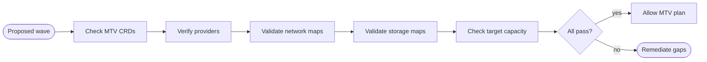
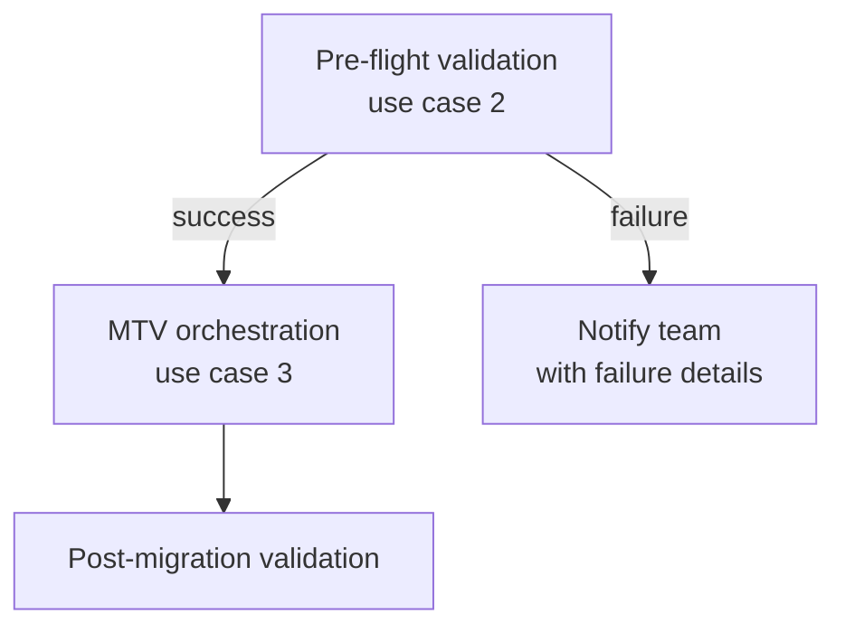


<div class="guide-header">

<h1>Pre-migration validation</h1>

<span class="guide-type-badge guide-type-badge--use-case"><i class="fas fa-layer-group" aria-hidden="true"></i> Virtualization Use Case</span>

</div>

<style>
  div#toc {
    display: none;
  }
</style>

## Overview

Automatically verify Migration Toolkit for Virtualization (MTV) prerequisites on the source and target before any cutover. Validate network mappings, storage mappings, and cluster readiness so AAP fails fast instead of failing mid-wave.

**Maturity:** Crawl (Migration). **Customer question:** How do we prove target readiness and MTV prerequisites before cutover?

Start from the [Common virtualization automation use cases hub](virtualization-use-cases.md) or the foundational [Virtualization automation with Ansible](README-Virtualization.md) guide.

## Background

MTV pre-flight failures during a live cutover window are expensive -- they consume scheduled downtime, require re-scheduling, and erode confidence in the migration program. AAP codifies every prerequisite check (CRDs present, providers connected, network and storage mappings valid, target capacity sufficient) into a single pre-flight playbook. Run it before every wave; gate the migration workflow on its success.

The AVA 301 deck identifies pre-configuration for migration as a distinct automation step: validate the target before touching the source. This use case turns that step into a repeatable, auditable AAP job.

## Solution

- **Ansible Automation Platform** for pre-flight workflows
- **MTV and OpenShift APIs** for prerequisite verification
- **Source virt platform checks** (for example VMware MTV prerequisites)

### Who Benefits

| Persona | Challenge | What They Gain |
|---------|-----------|----------------|
| **Migration Team** | Cutover surprises from missing mappings | Automated pre-flight with clear fail reasons |
| **Platform Ops** | Target cluster not ready | Readiness gates before MTV starts |
| **Change Manager** | Weak evidence for go/no-go | AAP job artifacts as gate evidence |

## Prerequisites

- AAP with credentials to source virt and target OpenShift
- MTV installed on the target platform for the migration path you will use
- Execution environment with:
  - <a target="_blank" href="https://console.redhat.com/ansible/automation-hub/repo/published/kubernetes/core/">kubernetes.core</a>
  - <a target="_blank" href="https://console.redhat.com/ansible/automation-hub/repo/validated/infra/openshift_virtualization_migration/">infra.openshift_virtualization_migration</a> (optional validated roles; walkthroughs use `kubernetes.core.k8s_info` against MTV CRDs)

## Workflow



## Solution Walkthrough

### Step 1: Validate MTV CRDs and operator health

Confirm the MTV operator is installed and its custom resource definitions are available on the target cluster.

```yaml
---
- name: Pre-migration validation -- MTV prerequisites
  hosts: localhost
  connection: local
  gather_facts: false
  vars:
    target_namespace: "{{ survey_target_namespace | default('vms') }}"
    source_provider_name: "{{ survey_source_provider | default('vmware-source') }}"
    target_provider_name: "{{ survey_target_provider | default('host') }}"
  tasks:
    - name: Check MTV CRDs exist
      kubernetes.core.k8s_info:
        api_version: apiextensions.k8s.io/v1
        kind: CustomResourceDefinition
        name: "{{ item }}"
      register: crd_check
      loop:
        - providers.forklift.konveyor.io
        - plans.forklift.konveyor.io
        - migrations.forklift.konveyor.io
        - networkmaps.forklift.konveyor.io
        - storagemaps.forklift.konveyor.io
      failed_when: crd_check.resources | length == 0

    - name: Verify MTV operator CSV is healthy
      kubernetes.core.k8s_info:
        api_version: operators.coreos.com/v1alpha1
        kind: ClusterServiceVersion
        namespace: openshift-mtv
        label_selectors:
          - "operators.coreos.com/mtv-operator.openshift-mtv="
      register: mtv_csv

    - name: Assert MTV operator is Succeeded
      ansible.builtin.assert:
        that:
          - mtv_csv.resources | length > 0
          - mtv_csv.resources[0].status.phase == "Succeeded"
        fail_msg: >-
          MTV operator is not healthy.
          Phase: {{ mtv_csv.resources[0].status.phase | default('not found') }}.
          Install MTV before proceeding.
        success_msg: "MTV operator {{ mtv_csv.resources[0].spec.version }} is healthy"
```

### Step 2: Verify provider connectivity

Check that both source (VMware) and target (OpenShift Virtualization) providers are registered and in a Ready condition.

```yaml
    - name: Check source provider status
      kubernetes.core.k8s_info:
        api_version: forklift.konveyor.io/v1beta1
        kind: Provider
        name: "{{ source_provider_name }}"
        namespace: openshift-mtv
      register: source_provider

    - name: Assert source provider is Ready
      ansible.builtin.assert:
        that:
          - source_provider.resources | length > 0
          - >-
            source_provider.resources[0].status.conditions
            | selectattr('type', 'equalto', 'Ready')
            | selectattr('status', 'equalto', 'True')
            | list | length > 0
        fail_msg: >-
          Source provider '{{ source_provider_name }}' is not ready.
          Check credentials and network connectivity to vCenter.
        success_msg: "Source provider '{{ source_provider_name }}' is ready"

    - name: Check target provider status
      kubernetes.core.k8s_info:
        api_version: forklift.konveyor.io/v1beta1
        kind: Provider
        name: "{{ target_provider_name }}"
        namespace: openshift-mtv
      register: target_provider

    - name: Assert target provider is Ready
      ansible.builtin.assert:
        that:
          - target_provider.resources | length > 0
          - >-
            target_provider.resources[0].status.conditions
            | selectattr('type', 'equalto', 'Ready')
            | selectattr('status', 'equalto', 'True')
            | list | length > 0
        fail_msg: >-
          Target provider '{{ target_provider_name }}' is not ready.
          Check OpenShift API connectivity and credentials.
        success_msg: "Target provider '{{ target_provider_name }}' is ready"
```

### Step 3: Validate network and storage mappings

Confirm that the NetworkMap and StorageMap CRs exist and reference valid target resources.

```yaml
    - name: List network mappings
      kubernetes.core.k8s_info:
        api_version: forklift.konveyor.io/v1beta1
        kind: NetworkMap
        namespace: openshift-mtv
      register: network_maps

    - name: Assert at least one network mapping exists
      ansible.builtin.assert:
        that:
          - network_maps.resources | length > 0
        fail_msg: >-
          No NetworkMap resources found in openshift-mtv namespace.
          Create a NetworkMap before running migration plans.
        success_msg: >-
          Found {{ network_maps.resources | length }} network mapping(s):
          {{ network_maps.resources | map(attribute='metadata.name') | list | join(', ') }}

    - name: List storage mappings
      kubernetes.core.k8s_info:
        api_version: forklift.konveyor.io/v1beta1
        kind: StorageMap
        namespace: openshift-mtv
      register: storage_maps

    - name: Assert at least one storage mapping exists
      ansible.builtin.assert:
        that:
          - storage_maps.resources | length > 0
        fail_msg: >-
          No StorageMap resources found in openshift-mtv namespace.
          Create a StorageMap before running migration plans.
        success_msg: >-
          Found {{ storage_maps.resources | length }} storage mapping(s):
          {{ storage_maps.resources | map(attribute='metadata.name') | list | join(', ') }}

    - name: Verify target storage classes exist
      kubernetes.core.k8s_info:
        api_version: storage.k8s.io/v1
        kind: StorageClass
      register: storage_classes

    - name: Extract mapped storage class names
      ansible.builtin.set_fact:
        mapped_storage_classes: >-
          {{ storage_maps.resources
             | map(attribute='spec.map')
             | flatten
             | map(attribute='destination.storageClass')
             | list | unique }}

    - name: Assert all mapped storage classes exist on target
      ansible.builtin.assert:
        that:
          - item in (storage_classes.resources | map(attribute='metadata.name') | list)
        fail_msg: "Storage class '{{ item }}' referenced in StorageMap does not exist on the target cluster"
        success_msg: "Storage class '{{ item }}' exists on target"
      loop: "{{ mapped_storage_classes }}"

    - name: Check target namespace exists
      kubernetes.core.k8s_info:
        api_version: v1
        kind: Namespace
        name: "{{ target_namespace }}"
      register: target_ns

    - name: Assert target namespace exists
      ansible.builtin.assert:
        that:
          - target_ns.resources | length > 0
        fail_msg: "Target namespace '{{ target_namespace }}' does not exist. Create it before migration."
        success_msg: "Target namespace '{{ target_namespace }}' exists"

    - name: Pre-flight summary
      ansible.builtin.debug:
        msg: >-
          Pre-migration validation PASSED.
          MTV operator: {{ mtv_csv.resources[0].spec.version }}.
          Source provider: {{ source_provider_name }} (Ready).
          Target provider: {{ target_provider_name }} (Ready).
          Network maps: {{ network_maps.resources | length }}.
          Storage maps: {{ storage_maps.resources | length }}.
          Target namespace: {{ target_namespace }}.
```

### Gating pattern in AAP workflows

Use this pre-flight playbook as a required workflow node. Configure the workflow so the migration orchestration template (use case 3) only runs on pre-flight success.



In AAP Controller, create a workflow template with:

1. **Node 1:** Pre-flight validation job template (this playbook)
2. **Node 2 (on success):** MTV migration orchestration job template
3. **Node 2 (on failure):** Notification template with failure context

## Validation

### Test

```bash
# Run pre-flight in check mode against a lab cluster
ansible-playbook preflight-validation.yml --check -v

# Verify MTV CRDs directly
oc get crd | grep forklift

# Check provider status
oc get providers.forklift.konveyor.io -n openshift-mtv -o wide

# List network and storage maps
oc get networkmaps.forklift.konveyor.io -n openshift-mtv
oc get storagemaps.forklift.konveyor.io -n openshift-mtv

# Verify storage classes
oc get sc
```

### Expected Result

```text
$ ansible-playbook preflight-mtv.yml -v
...
TASK [Assert MTV operator is healthy] ******************************************
ok: [localhost] => {
    "msg": "MTV operator 2.7.0 is healthy"
}
TASK [Assert NetworkMap exists] ************************************************
ok: [localhost] => {"changed": false, "msg": "all assertions passed"}

PLAY RECAP *********************************************************************
localhost                  : ok=12   changed=0    unreachable=0    failed=0

# Intentionally missing StorageMap:
TASK [Assert StorageMap exists] ************************************************
fatal: [localhost]: FAILED! => {
    "assertion": "storagemaps.resources | length > 0",
    "msg": "Missing StorageMap in openshift-mtv. Create mappings before cutover."
}
```

### Troubleshooting

| Symptom | Likely Cause | Fix |
|---------|-------------|-----|
| CRD not found | MTV operator not installed | Install MTV operator via OperatorHub |
| Provider not Ready | Credential expired or vCenter unreachable | Update the Provider secret; verify network path |
| Storage class missing | Target cluster storage not provisioned | Deploy ODF or configure the expected storage class |
| False negatives (pass when should fail) | Assertions too broad | Tighten condition filters on provider status |
| Cannot reach target API | Credential or network | Fix kubeconfig; verify EE has `python3-openshift` |

## Maturity Path

| Maturity | For this use case |
|----------|-------------------|
| **Crawl** | Manual launch of pre-flight before each wave |
| **Walk** | Pre-flight is a required workflow node; failure blocks migration |
| **Run** | Continuous readiness checks across many clusters with drift alerting |

## Summary

**Pre-migration validation** is use case 2 -- MTV does the heavy lifting; AAP makes sure prerequisites are met before the first disk moves. Every assertion produces a clear pass/fail message so teams fix gaps before scheduling cutover windows.

## Next Steps

1. Return to [Virtualization automation with Ansible](README-Virtualization.md).
2. Browse [all nine use cases](virtualization-use-cases.md).
3. Continue with [MTV migration orchestration](README-Virtualization-Use-Case-03-MTV-Migration-Orchestration.md).

