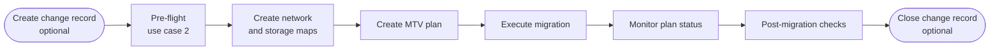


<div class="guide-header">

<h1>MTV migration orchestration</h1>

<span class="guide-type-badge guide-type-badge--use-case"><i class="fas fa-layer-group" aria-hidden="true"></i> Virtualization Use Case</span>

</div>

<style>
  div#toc {
    display: none;
  }
</style>

## Overview

Orchestrate Migration Toolkit for Virtualization (MTV) plans with Ansible Automation Platform: create plans via API, apply the same plan across clusters, batch waves with dependency ordering, run automated cutover, and hook change management (for example ServiceNow approvals).

**Maturity:** Crawl (Migration). **Customer question:** How do we run the same migration plan across clusters without UI mistakes?

Start from the [Common virtualization automation use cases hub](virtualization-use-cases.md) or the foundational [Virtualization automation with Ansible](README-Virtualization.md) guide.

**Related content:** Validated roles in <a target="_blank" href="https://console.redhat.com/ansible/automation-hub/repo/validated/infra/openshift_virtualization_migration/">infra.openshift_virtualization_migration</a> (`mtv_management`, `mtv_migrate`) for AVA-scale waves. The walkthroughs below create MTV CRs with `kubernetes.core.k8s`.

## Background

MTV moves the data. AAP ensures the same migration plan runs identically across environments, pre-flight has passed, and post-migration validation happens automatically. Without automation, migration teams create plans through the MTV UI one cluster at a time -- a process that does not scale to 50+ clusters and introduces human error in network/storage mapping selections.

Use `kubernetes.core.k8s` to apply NetworkMap, StorageMap, and Plan objects as code, or adopt the validated `infra.openshift_virtualization_migration` roles (`mtv_management`, `mtv_migrate`) for broader AVA content. AAP adds workflow orchestration, wave ordering, ITSM approval gates, and a complete audit trail.

> **Warning:** Cutover risk.
>
> Executing an MTV plan moves or cuts over workloads. Run pre-flight (use case 2), use a change ticket, and start with a lab wave before production.

## Solution

- **Ansible Automation Platform** for multi-cluster orchestration and audit
- **MTV** for the migration data plane
- **ITSM** optional for approvals before execute

### Who Benefits

| Persona | Challenge | What They Gain |
|---------|-----------|----------------|
| **Migration Team** | UI clicking does not scale to 50+ clusters | Codified, reviewable plans in Git and AAP |
| **Automation Architect** | One-off scripts per wave | Shared workflows with surveys and RBAC |
| **Leadership** | Migration risk and headcount | Scale waves without proportional headcount |

## Prerequisites

- AAP, MTV, and target OpenShift Virtualization
- Successful [pre-migration validation](README-Virtualization-Use-Case-02-Pre-Migration-Validation.md) pattern
- Execution environment with:
  - <a target="_blank" href="https://console.redhat.com/ansible/automation-hub/repo/published/kubernetes/core/">kubernetes.core</a>
  - <a target="_blank" href="https://console.redhat.com/ansible/automation-hub/repo/validated/infra/openshift_virtualization_migration/">infra.openshift_virtualization_migration</a> (optional validated roles)
  - <a target="_blank" href="https://console.redhat.com/ansible/automation-hub/repo/published/servicenow/itsm/">servicenow.itsm</a> (optional ITSM)

## Workflow



## Solution Walkthrough

### Step 1: Create network and storage mappings programmatically

Define mappings as code so the same source-to-target translation applies across every cluster.

```yaml
---
- name: Create MTV network and storage mappings
  hosts: localhost
  connection: local
  gather_facts: false
  vars:
    mtv_namespace: openshift-mtv
    source_provider: vmware-source
    target_provider: host
    network_map_name: "{{ wave_name }}-netmap"
    storage_map_name: "{{ wave_name }}-storagemap"
  tasks:
    - name: Create NetworkMap
      kubernetes.core.k8s:
        state: present
        definition:
          apiVersion: forklift.konveyor.io/v1beta1
          kind: NetworkMap
          metadata:
            name: "{{ network_map_name }}"
            namespace: "{{ mtv_namespace }}"
          spec:
            provider:
              source:
                name: "{{ source_provider }}"
                namespace: "{{ mtv_namespace }}"
              destination:
                name: "{{ target_provider }}"
                namespace: "{{ mtv_namespace }}"
            map:
              - source:
                  id: "{{ vmware_network_id }}"
                destination:
                  type: pod
                  name: default
                  namespace: "{{ target_namespace }}"

    - name: Create StorageMap
      kubernetes.core.k8s:
        state: present
        definition:
          apiVersion: forklift.konveyor.io/v1beta1
          kind: StorageMap
          metadata:
            name: "{{ storage_map_name }}"
            namespace: "{{ mtv_namespace }}"
          spec:
            provider:
              source:
                name: "{{ source_provider }}"
                namespace: "{{ mtv_namespace }}"
              destination:
                name: "{{ target_provider }}"
                namespace: "{{ mtv_namespace }}"
            map:
              - source:
                  id: "{{ vmware_datastore_id }}"
                destination:
                  storageClass: ocs-storagecluster-ceph-rbd
                  accessMode: ReadWriteOnce
                  volumeMode: Block
```

### Step 2: Create and execute the MTV plan

Build the plan as a Kubernetes resource, then trigger execution. The plan references the network and storage mappings created in step 1.

```yaml
---
- name: Orchestrate MTV migration wave
  hosts: localhost
  connection: local
  gather_facts: false
  vars:
    mtv_namespace: openshift-mtv
    wave_name: "{{ survey_wave_name | default('wave-01') }}"
    target_namespace: "{{ survey_target_namespace | default('vms') }}"
    source_provider: vmware-source
    target_provider: host
    network_map_name: "{{ wave_name }}-netmap"
    storage_map_name: "{{ wave_name }}-storagemap"
    migration_vms: "{{ survey_vm_list | default([]) }}"
  tasks:
    - name: Create MTV Plan
      kubernetes.core.k8s:
        state: present
        definition:
          apiVersion: forklift.konveyor.io/v1beta1
          kind: Plan
          metadata:
            name: "{{ wave_name }}"
            namespace: "{{ mtv_namespace }}"
          spec:
            provider:
              source:
                name: "{{ source_provider }}"
                namespace: "{{ mtv_namespace }}"
              destination:
                name: "{{ target_provider }}"
                namespace: "{{ mtv_namespace }}"
            targetNamespace: "{{ target_namespace }}"
            map:
              network:
                name: "{{ network_map_name }}"
                namespace: "{{ mtv_namespace }}"
              storage:
                name: "{{ storage_map_name }}"
                namespace: "{{ mtv_namespace }}"
            vms: "{{ migration_vms }}"
      register: plan_result

    - name: Create Migration to execute the plan
      kubernetes.core.k8s:
        state: present
        definition:
          apiVersion: forklift.konveyor.io/v1beta1
          kind: Migration
          metadata:
            name: "{{ wave_name }}-migration"
            namespace: "{{ mtv_namespace }}"
          spec:
            plan:
              name: "{{ wave_name }}"
              namespace: "{{ mtv_namespace }}"
      register: migration_result

    - name: Monitor migration status until completion
      kubernetes.core.k8s_info:
        api_version: forklift.konveyor.io/v1beta1
        kind: Migration
        name: "{{ wave_name }}-migration"
        namespace: "{{ mtv_namespace }}"
      register: migration_status
      until: >-
        migration_status.resources[0].status.conditions
        | default([])
        | selectattr('type', 'equalto', 'Succeeded')
        | list | length > 0
        or
        migration_status.resources[0].status.conditions
        | default([])
        | selectattr('type', 'equalto', 'Failed')
        | list | length > 0
      retries: 120
      delay: 30

    - name: Assert migration succeeded
      ansible.builtin.assert:
        that: >-
          migration_status.resources[0].status.conditions
          | selectattr('type', 'equalto', 'Succeeded')
          | selectattr('status', 'equalto', 'True')
          | list | length > 0
        fail_msg: >-
          Migration '{{ wave_name }}-migration' did not succeed.
          Conditions: {{ migration_status.resources[0].status.conditions | to_nice_json }}
        success_msg: "Migration '{{ wave_name }}-migration' completed successfully"
```

### Step 3: Wave orchestration with dependency ordering

For multi-wave migrations, define waves in a variable file and loop through them sequentially with go/no-go gates between each wave.

```yaml
---
- name: Orchestrate multi-wave migration
  hosts: localhost
  connection: local
  gather_facts: false
  vars:
    waves:
      - name: wave-01-infrastructure
        vms:
          - id: vm-1001
          - id: vm-1002
        depends_on: []
      - name: wave-02-databases
        vms:
          - id: vm-2001
          - id: vm-2002
        depends_on:
          - wave-01-infrastructure
      - name: wave-03-applications
        vms:
          - id: vm-3001
          - id: vm-3002
          - id: vm-3003
        depends_on:
          - wave-02-databases
  tasks:
    - name: Execute waves in dependency order
      ansible.builtin.include_tasks: tasks/execute-wave.yml
      loop: "{{ waves }}"
      loop_control:
        loop_var: wave
```

Wave task file (`tasks/execute-wave.yml`):

```yaml
---
- name: "Check dependencies for {{ wave.name }}"
  kubernetes.core.k8s_info:
    api_version: forklift.konveyor.io/v1beta1
    kind: Migration
    name: "{{ dep }}-migration"
    namespace: openshift-mtv
  register: dep_status
  loop: "{{ wave.depends_on }}"
  loop_control:
    loop_var: dep
  when: wave.depends_on | length > 0

- name: "Assert all dependencies succeeded for {{ wave.name }}"
  ansible.builtin.assert:
    that: >-
      item.resources[0].status.conditions
      | selectattr('type', 'equalto', 'Succeeded')
      | selectattr('status', 'equalto', 'True')
      | list | length > 0
    fail_msg: "Dependency {{ item.dep }} has not succeeded. Cannot proceed with {{ wave.name }}."
  loop: "{{ dep_status.results | default([]) }}"
  when: wave.depends_on | length > 0

- name: "Execute migration for {{ wave.name }}"
  ansible.builtin.include_role:
    name: migration_wave
  vars:
    wave_name: "{{ wave.name }}"
    migration_vms: "{{ wave.vms }}"
```

### Step 4: Post-migration validation

Confirm migrated VMs are running on the target and guest agents are reporting.

```yaml
---
- name: Post-migration validation
  hosts: localhost
  connection: local
  gather_facts: false
  vars:
    target_namespace: "{{ survey_target_namespace | default('vms') }}"
    expected_vms: "{{ survey_expected_vms | default([]) }}"
  tasks:
    - name: Check VirtualMachineInstances are Running
      kubernetes.core.k8s_info:
        api_version: kubevirt.io/v1
        kind: VirtualMachineInstance
        namespace: "{{ target_namespace }}"
      register: vmis

    - name: Build list of running VM names
      ansible.builtin.set_fact:
        running_vms: >-
          {{ vmis.resources
             | selectattr('status.phase', 'equalto', 'Running')
             | map(attribute='metadata.name') | list }}

    - name: Assert expected VMs are running
      ansible.builtin.assert:
        that:
          - item in running_vms
        fail_msg: "VM '{{ item }}' is not in Running state on the target cluster"
        success_msg: "VM '{{ item }}' is running on target"
      loop: "{{ expected_vms }}"
      when: expected_vms | length > 0

    - name: Check guest agent is reporting on migrated VMs
      kubernetes.core.k8s_info:
        api_version: kubevirt.io/v1
        kind: VirtualMachineInstance
        name: "{{ item }}"
        namespace: "{{ target_namespace }}"
      register: vmi_detail
      loop: "{{ running_vms }}"

    - name: Report guest agent status
      ansible.builtin.debug:
        msg: >-
          VM: {{ item.resources[0].metadata.name }} --
          Phase: {{ item.resources[0].status.phase }} --
          Guest OS: {{ item.resources[0].status.guestOSInfo.name | default('agent not reporting') }}
      loop: "{{ vmi_detail.results }}"
      loop_control:
        label: "{{ item.resources[0].metadata.name }}"
```

### Step 5: ITSM integration (optional)

Create a ServiceNow change record before executing the wave and close it with results after completion.

```yaml
    - name: Create change record before migration
      servicenow.itsm.change_request:
        instance:
          host: "{{ snow_instance }}"
          username: "{{ snow_username }}"
          password: "{{ snow_password }}"
        state: new
        type: standard
        short_description: "AAP migration wave -- {{ wave_name }}"
        description: >-
          Automated migration wave {{ wave_name }} via AAP.
          Source: VMware. Target: OpenShift Virtualization namespace {{ target_namespace }}.
          VMs: {{ migration_vms | map(attribute='id') | join(', ') }}.
        assignment_group: "Platform Operations"
        risk: moderate
      register: change_record
      when: snow_instance is defined

    - name: Close change record after migration
      servicenow.itsm.change_request:
        instance:
          host: "{{ snow_instance }}"
          username: "{{ snow_username }}"
          password: "{{ snow_password }}"
        number: "{{ change_record.record.number }}"
        state: closed
        close_code: successful
        close_notes: >-
          Migration wave {{ wave_name }} completed via AAP.
          VMs migrated: {{ running_vms | length }}.
      when: snow_instance is defined and change_record is defined
```

## Validation

### Test

```bash
# Confirm MTV and OpenShift access from the EE
oc get providers.forklift.konveyor.io -n openshift-mtv -o wide
oc get plans.forklift.konveyor.io -n openshift-mtv
oc get migrations.forklift.konveyor.io -n openshift-mtv

# Verify migrated VMs on target
oc get vm -n <target-namespace>
oc get vmi -n <target-namespace>

# Check guest agent on a migrated VM
oc get vmi <vm-name> -n <target-namespace> -o jsonpath='{.status.guestOSInfo}'
```

### Expected Result

```text
$ oc get plans.forklift.konveyor.io wave-1 -n openshift-mtv
NAME     READY   STATUS      TOTAL
wave-1   True    Succeeded   3

$ oc get vmi -n vms
NAME        AGE   PHASE     IP
app-web-1   12m   Running   10.128.2.15
app-web-2   12m   Running   10.128.2.16
app-db-1    11m   Running   10.128.2.17

PLAY RECAP *********************************************************************
localhost                  : ok=15   changed=4    unreachable=0    failed=0
```

### Troubleshooting

| Symptom | Likely Cause | Fix |
|---------|-------------|-----|
| Plan creation fails | Mapping or permission | Re-run pre-flight (use case 2); fix RBAC on mtv namespace |
| Migration stuck in progress | Storage transfer slow or disk error | Inspect MTV plan status: `oc describe migration <name> -n openshift-mtv` |
| Wave dependency assertion fails | Previous wave not yet complete | Increase retries/delay on migration monitor; check prior wave logs |
| VM running but no guest agent | Guest tools not installed | Install `qemu-guest-agent` via use case 5 (guest config) post-migration |
| ITSM ticket not created | ServiceNow credential wrong | Test `servicenow.itsm.now` connectivity from EE |

## Maturity Path

| Maturity | For this use case |
|----------|-------------------|
| **Crawl** | Single-cluster lab MTV via AAP |
| **Walk** | Multi-wave with ITSM approval gates and dependency ordering |
| **Run** | Same plan pattern across many clusters; GitOps-driven plan definitions |

## Summary

**MTV migration orchestration** is use case 3 -- AAP codifies migration plans so the same Ansible skills that move VMs onto OpenShift Virtualization continue into day-2 operations. Waves, dependency ordering, pre-flight gates, and ITSM integration turn migration from a manual project into a repeatable, auditable automation workflow.

## Next Steps

1. Return to [Virtualization automation with Ansible](README-Virtualization.md).
2. Browse [all nine use cases](virtualization-use-cases.md).
3. Continue with [VM provisioning workflows](README-Virtualization-Use-Case-04-VM-Provisioning.md).

