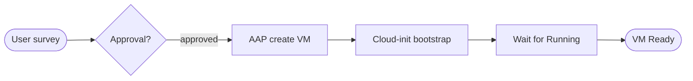


<div class="guide-header">

<h1>VM provisioning workflows</h1>

<span class="guide-type-badge guide-type-badge--use-case"><i class="fas fa-layer-group" aria-hidden="true"></i> Virtualization Use Case</span>

</div>

<style>
  div#toc {
    display: none;
  }
</style>

## Overview

Self-service VM provisioning on OpenShift Virtualization with Ansible surveys and approval workflows. Create VirtualMachines with specified CPU, memory, storage, and network -- consistent deployments with no configuration drift from day 1.

**Maturity:** Walk (Initial Deployment). **Customer question:** How do we self-service create VMs on OpenShift Virtualization with approvals?

Start from the [Common virtualization automation use cases hub](virtualization-use-cases.md) or the foundational [Virtualization automation with Ansible](README-Virtualization.md) guide.

## Background

AVA 301 highlights `kubevirt_vm` modules and Controller surveys (CPU, memory, disks, VLAN, hypervisor) for governed create paths. This use case shows the full provisioning lifecycle: survey-driven creation with cloud-init bootstrapping, wait-for-ready verification, and governed teardown.

### Key modules

| Module | Collection | Purpose |
|--------|-----------|---------|
| `kubevirt_vm` | `redhat.openshift_virtualization` | Create, modify, and delete VirtualMachine resources |
| `k8s` | `kubernetes.core` | Manage PVCs, services, and supporting resources |
| `k8s_info` | `kubernetes.core` | Query VMI status and wait for Running phase |

## Solution

- **Ansible Automation Platform** job templates and surveys for governed self-service
- **OpenShift Virtualization** / kubevirt VirtualMachine resources
- **Cloud-init** for initial user, SSH key, and network bootstrap
- **Approval workflows** when business process requires them

### Who Benefits

| Persona | Challenge | What They Gain |
|---------|-----------|----------------|
| **End users / app teams** | Ticket queues for every VM | Self-service within approved limits |
| **Virt admins** | One-off UI creates | Standardized templates and audit |
| **Security / compliance** | Untracked sprawl | RBAC and job history on every create |

## Prerequisites

- AAP 2.5+ with OpenShift credentials (kubeconfig or token)
- Target namespace with resource quotas configured
- Storage class available for DataVolume provisioning (for example `ocs-storagecluster-ceph-rbd`)
- Golden image PVC in `openshift-virtualization-os-images` namespace (for example `rhel9-base`)
- Execution environment with `redhat.openshift_virtualization`, `kubernetes.core`, and `python3-openshift`

## Workflow



## Solution Walkthrough

### Step 1: Define a Controller survey for size and placement

Configure a survey on the job template with these variables. AAP enforces allowed values so users cannot request resources outside policy.

| Survey variable | Type | Description | Example default |
|----------------|------|-------------|-----------------|
| `survey_vm_name` | Text | VM name (DNS-safe) | `web-prod-01` |
| `survey_namespace` | Text | Target namespace | `vms` |
| `survey_cpu_cores` | Integer | vCPU count | `2` |
| `survey_memory` | Text | Memory with unit | `4Gi` |
| `survey_disk_size` | Text | Root disk size | `40Gi` |
| `survey_network` | Multiple choice | Network attachment | `default` |
| `survey_ssh_pubkey` | Textarea | SSH public key for cloud-init | -- |

### Step 2: Create VM with cloud-init and DataVolume

**Operational Impact:** Medium -- creates new workloads on the cluster.

```yaml
---
- name: Provision VM on OpenShift Virtualization
  hosts: localhost
  connection: local
  gather_facts: false
  vars:
    vm_name: "{{ survey_vm_name }}"
    vm_namespace: "{{ survey_namespace | default('vms') }}"
    vm_cpu_cores: "{{ survey_cpu_cores | default(2) | int }}"
    vm_memory: "{{ survey_memory | default('4Gi') }}"
    vm_disk_size: "{{ survey_disk_size | default('40Gi') }}"
    vm_network: "{{ survey_network | default('default') }}"
    vm_ssh_pubkey: "{{ survey_ssh_pubkey | default('') }}"
    golden_image_name: rhel9-base
    golden_image_namespace: openshift-virtualization-os-images
    storage_class: ocs-storagecluster-ceph-rbd
  tasks:
    - name: Validate inputs
      ansible.builtin.assert:
        that:
          - vm_name is match('^[a-z0-9][a-z0-9-]*[a-z0-9]$')
          - vm_cpu_cores | int >= 1
          - vm_cpu_cores | int <= 16
          - vm_memory is match('^[0-9]+[GM]i$')
        fail_msg: "Survey inputs failed validation"

    - name: Verify golden image exists
      kubernetes.core.k8s_info:
        api_version: v1
        kind: PersistentVolumeClaim
        name: "{{ golden_image_name }}"
        namespace: "{{ golden_image_namespace }}"
      register: golden_pvc
      failed_when: golden_pvc.resources | length == 0

    - name: Create VirtualMachine with cloud-init
      redhat.openshift_virtualization.kubevirt_vm:
        state: present
        name: "{{ vm_name }}"
        namespace: "{{ vm_namespace }}"
        labels:
          app: "{{ vm_name }}"
          managed-by: aap
          provisioned-by: controller-survey
        spec:
          running: true
          template:
            metadata:
              labels:
                app: "{{ vm_name }}"
            spec:
              domain:
                cpu:
                  cores: "{{ vm_cpu_cores }}"
                resources:
                  requests:
                    memory: "{{ vm_memory }}"
                  limits:
                    memory: "{{ vm_memory }}"
                devices:
                  disks:
                    - name: rootdisk
                      disk:
                        bus: virtio
                    - name: cloudinitdisk
                      disk:
                        bus: virtio
                  interfaces:
                    - name: "{{ vm_network }}"
                      masquerade: {}
              networks:
                - name: "{{ vm_network }}"
                  pod: {}
              volumes:
                - name: rootdisk
                  dataVolume:
                    name: "{{ vm_name }}-rootdisk"
                - name: cloudinitdisk
                  cloudInitNoCloud:
                    userData: |
                      #cloud-config
                      user: ansible
                      ssh_authorized_keys:
                        - {{ vm_ssh_pubkey }}
                      chpasswd:
                        expire: false
                      runcmd:
                        - [ systemctl, enable, --now, qemu-guest-agent ]
          dataVolumeTemplates:
            - metadata:
                name: "{{ vm_name }}-rootdisk"
              spec:
                storage:
                  resources:
                    requests:
                      storage: "{{ vm_disk_size }}"
                  storageClassName: "{{ storage_class }}"
                source:
                  pvc:
                    name: "{{ golden_image_name }}"
                    namespace: "{{ golden_image_namespace }}"
      register: vm_result

    - name: Wait for VirtualMachineInstance to reach Running
      kubernetes.core.k8s_info:
        api_version: kubevirt.io/v1
        kind: VirtualMachineInstance
        name: "{{ vm_name }}"
        namespace: "{{ vm_namespace }}"
      register: vmi_status
      until:
        - vmi_status.resources | length > 0
        - vmi_status.resources[0].status.phase | default('') == "Running"
      retries: 30
      delay: 10

    - name: Wait for guest agent to report
      kubernetes.core.k8s_info:
        api_version: kubevirt.io/v1
        kind: VirtualMachineInstance
        name: "{{ vm_name }}"
        namespace: "{{ vm_namespace }}"
      register: vmi_agent
      until:
        - vmi_agent.resources[0].status.guestOSInfo.name | default('') | length > 0
      retries: 20
      delay: 15

    - name: Report provisioning result
      ansible.builtin.debug:
        msg: >-
          VM {{ vm_name }} provisioned in {{ vm_namespace }}.
          Phase: {{ vmi_status.resources[0].status.phase }}.
          Guest OS: {{ vmi_agent.resources[0].status.guestOSInfo.name | default('agent pending') }}.
          IP: {{ vmi_agent.resources[0].status.interfaces[0].ipAddress | default('pending') }}.
```

### Step 3: Delete VM with proper cleanup

A separate job template with tighter RBAC handles teardown. Survey prompts for the VM name and namespace; the playbook removes the VM, its DataVolumes, and any associated services.

```yaml
---
- name: Deprovision VM from OpenShift Virtualization
  hosts: localhost
  connection: local
  gather_facts: false
  vars:
    vm_name: "{{ survey_vm_name }}"
    vm_namespace: "{{ survey_namespace | default('vms') }}"
  tasks:
    - name: Confirm VM exists before delete
      kubernetes.core.k8s_info:
        api_version: kubevirt.io/v1
        kind: VirtualMachine
        name: "{{ vm_name }}"
        namespace: "{{ vm_namespace }}"
      register: vm_check
      failed_when: vm_check.resources | length == 0

    - name: Stop VM before deletion
      redhat.openshift_virtualization.kubevirt_vm:
        state: present
        name: "{{ vm_name }}"
        namespace: "{{ vm_namespace }}"
        spec:
          running: false
      when: vm_check.resources | length > 0

    - name: Wait for VMI to terminate
      kubernetes.core.k8s_info:
        api_version: kubevirt.io/v1
        kind: VirtualMachineInstance
        name: "{{ vm_name }}"
        namespace: "{{ vm_namespace }}"
      register: vmi_gone
      until: vmi_gone.resources | length == 0
      retries: 20
      delay: 5

    - name: Delete VirtualMachine (cascades DataVolumes)
      redhat.openshift_virtualization.kubevirt_vm:
        state: absent
        name: "{{ vm_name }}"
        namespace: "{{ vm_namespace }}"

    - name: Clean up any orphaned PVCs
      kubernetes.core.k8s:
        state: absent
        api_version: v1
        kind: PersistentVolumeClaim
        name: "{{ vm_name }}-rootdisk"
        namespace: "{{ vm_namespace }}"
      ignore_errors: true

    - name: Clean up associated services
      kubernetes.core.k8s:
        state: absent
        api_version: v1
        kind: Service
        namespace: "{{ vm_namespace }}"
        label_selectors:
          - "app={{ vm_name }}"
      ignore_errors: true
```

### Step 4: Add approvals where required

In AAP Controller, build a workflow template:

1. **Approval node** -- manager or platform team reviews the survey inputs
2. **Create VM node** -- runs the provisioning job template on approval
3. **Configure guest node** -- chains to [use case 5](README-Virtualization-Use-Case-05-Guest-OS-and-Apps.md) for post-provision hardening

This enforces change management without slowing down lab or dev provisioning (skip the approval node for non-production namespaces using Controller labels or inventory groups).

## Validation

### Test

```bash
# Verify the VM was created
oc get vm <vm-name> -n <namespace>

# Confirm VMI is Running
oc get vmi <vm-name> -n <namespace> -o jsonpath='{.status.phase}'

# Check guest agent is reporting OS info
oc get vmi <vm-name> -n <namespace> -o jsonpath='{.status.guestOSInfo.name}'

# Verify cloud-init user can SSH
ssh ansible@<vm-ip> 'hostname'

# Confirm DataVolume provisioned correctly
oc get dv <vm-name>-rootdisk -n <namespace> -o jsonpath='{.status.phase}'
```

### Expected Result

```
VM object exists; VMI reaches Running within 5 minutes.
Guest agent reports OS name (for example "Red Hat Enterprise Linux 9.x").
Cloud-init user can SSH with the provided public key.
DataVolume phase is "Succeeded".
```

### Troubleshooting

| Symptom | Likely Cause | Fix |
|---------|-------------|-----|
| Pending PVC / DataVolume stuck | Storage class missing or quota exceeded | Verify `oc get sc`; check `ResourceQuota` in namespace |
| VMI stays in Scheduling | Insufficient node CPU or memory | Check `oc describe vmi`; review node capacity |
| Cloud-init user cannot SSH | Network policy or firewall | Check `NetworkPolicy` objects; verify pod network |
| Guest agent not reporting | `qemu-guest-agent` not installed or started | Verify cloud-init `runcmd` executed; check guest logs |
| Auth failure from Controller | Expired or wrong kubeconfig | Update Controller credential; test `oc whoami` from EE |

## Maturity Path

| Maturity | For this use case |
|----------|-------------------|
| **Crawl** | Admin-run create templates in lab |
| **Walk** | Self-service surveys with approval workflows and namespace-scoped RBAC |
| **Run** | ITSM-triggered provisioning; catalog integration; auto-decommission policies |

## Summary

**VM provisioning workflows** is use case 4 -- Initial Deployment consistency on OpenShift Virtualization. Survey-driven creation, cloud-init bootstrapping, and governed teardown replace ad-hoc UI creates with auditable, repeatable automation.

## Next Steps

1. Return to [Virtualization automation with Ansible](README-Virtualization.md).
2. Browse [all nine use cases](virtualization-use-cases.md).
3. Continue with [Guest OS and application configuration](README-Virtualization-Use-Case-05-Guest-OS-and-Apps.md) to harden and configure VMs after provisioning.

