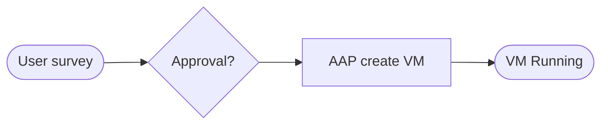


<div class="guide-header">

<h1>VM provisioning workflows</h1>

<span class="guide-type-badge guide-type-badge--use-case"><i class="fas fa-layer-group" aria-hidden="true"></i> Virtualization Use Case</span>

</div>

<style>
  div#toc {
    display: none;
  }
</style>

## Overview

Self-service VM provisioning on OpenShift Virtualization with Ansible surveys and approval workflows. Create VirtualMachines with specified CPU, memory, storage, and network -- consistent deployments with no configuration drift from day 1.

**Maturity:** Walk (Initial Deployment). **Customer question:** How do we self-service create VMs on OpenShift Virtualization with approvals?

Start from the [Common virtualization automation use cases hub](virtualization-use-cases.md) or the foundational [Virtualization automation with Ansible](README-Virtualization.md) guide.

## Background

AVA 301 highlights kubevirt_vm modules and Controller surveys (CPU, memory, disks, VLAN, hypervisor) for governed create paths. This page scaffolds that Initial Deployment pattern.

## Solution

- **Ansible Automation Platform** job templates and surveys
- **OpenShift Virtualization** / kubevirt VirtualMachine resources
- **Approval workflows** when business process requires them

### Who Benefits

| Persona | Challenge | What They Gain |
|---------|-----------|----------------|
| **End users / app teams** | Ticket queues for every VM | Self-service within approved limits |
| **Virt admins** | One-off UI creates | Standardized templates and audit |
| **Security / compliance** | Untracked sprawl | RBAC and job history on every create |

## Prerequisites

- AAP with OpenShift credentials
- Namespaces and storage classes ready for lab provisioning

## Workflow



## Solution Walkthrough

### Step 1: Define a survey for size and placement

CPU, memory, disks, VLAN, and target namespace or cluster.

### Step 2: Publish create / delete job templates

Use kubevirt VirtualMachine modules with check mode in lab first.

### Step 3: Add approvals where required

Workflow nodes for manager or platform approval before create.

## Validation

### Test

```bash
oc get vm -n <lab-namespace>
```

### Expected Result

```
Survey-driven job creates a VirtualMachine that reaches a Running VMI; job ends with failed=0.
```

### Troubleshooting

| Symptom | Likely Cause | Fix |
|---------|-------------|-----|
| Pending PVC | Storage class or quota | Fix storage and resource quotas |
| Auth failure | Missing kube credential | Add Controller credential to the template |

## Maturity Path

| Maturity | For this use case |
|----------|-------------------|
| **Crawl** | Admin-run create templates |
| **Walk** | Self-service surveys with approvals |
| **Run** | Catalog / ITSM-triggered provisioning |

## Summary

**VM provisioning workflows** is use case 4 -- Initial Deployment consistency on OpenShift Virtualization.

## Next Steps

1. Return to [Virtualization automation with Ansible](README-Virtualization.md).
2. Browse [all nine use cases](virtualization-use-cases.md).
3. Continue with [Guest OS and application configuration](README-Virtualization-Use-Case-05-Guest-OS-and-Apps.md).

