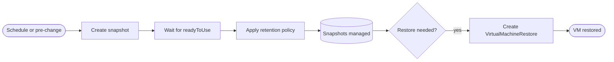
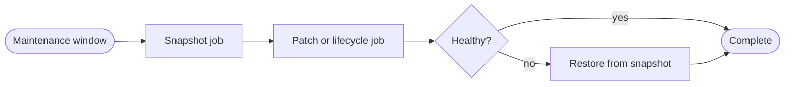


<div class="guide-header">

<h1>Snapshot and backup management</h1>

<span class="guide-type-badge guide-type-badge--use-case"><i class="fas fa-layer-group" aria-hidden="true"></i> Virtualization Use Case</span>

</div>

<style>
  div#toc {
    display: none;
  }
</style>

## Overview

Create, manage, and restore VM snapshots and backups with Ansible so recovery is a governed job -- not a console session. Supports data integrity before patch windows and facilitates restore drills.

**Maturity:** Walk (toward Day-2). **Customer question:** How do we create, manage, and restore VM snapshots consistently?

Start from the [Common virtualization automation use cases hub](virtualization-use-cases.md) or the foundational [Virtualization automation with Ansible](README-Virtualization.md) guide.

## Background

AVA 301 lists automated snapshots as a Production (Day-2) capability and as a dedicated day-2 category. This use case covers the full snapshot lifecycle: creation, readiness verification, retention management, restore, and pre-change hook patterns.

### Key resources

| Kubernetes resource | API group | Purpose |
|--------------------|-----------|---------|
| `VirtualMachineSnapshot` | `snapshot.kubevirt.io/v1beta1` | Point-in-time capture of VM state and disks |
| `VirtualMachineRestore` | `snapshot.kubevirt.io/v1beta1` | Restore a VM from a named snapshot |
| `VolumeSnapshot` | `snapshot.storage.k8s.io/v1` | Underlying storage snapshot (created by kubevirt) |
| `VolumeSnapshotClass` | `snapshot.storage.k8s.io/v1` | Storage provider snapshot configuration |

## Solution

- **Ansible Automation Platform** for scheduled and on-demand snapshot jobs
- **OpenShift Virtualization** snapshot APIs via `kubernetes.core.k8s`
- **RBAC and surveys** so restore is controlled separately from create
- **Retention policies** as Ansible logic enforcing snapshot count or age limits

### Who Benefits

| Persona | Challenge | What They Gain |
|---------|-----------|----------------|
| **Virt admins** | Inconsistent manual snapshots | Scheduled, auditable snapshot jobs |
| **App owners** | Fear of patch without rollback | Pre-change snapshot in the workflow |
| **DR / compliance** | Weak restore evidence | Restore drills with AAP history |

## Prerequisites

- AAP 2.5+ with cluster credentials that can create snapshots in target namespaces
- `VolumeSnapshotClass` configured for your storage provider (for example `ocs-storagecluster-rbdplugin-snapclass`)
- Execution environment with:
  - <a target="_blank" href="https://console.redhat.com/ansible/automation-hub/repo/published/kubernetes/core/">kubernetes.core</a>
  - <a target="_blank" href="https://console.redhat.com/ansible/automation-hub/repo/published/redhat/openshift_virtualization/">redhat.openshift_virtualization</a>
  - `python3-openshift`
- Lab VMs for restore drill testing before production use

## Workflow



## Solution Walkthrough

### Step 1: Create a snapshot and wait for readiness

**Operational Impact:** Low -- snapshots are non-disruptive to running VMs on most storage providers.

```yaml
---
- name: Create VM snapshot
  hosts: localhost
  connection: local
  gather_facts: true
  vars:
    vm_name: "{{ survey_vm_name }}"
    vm_namespace: "{{ survey_namespace | default('vms') }}"
    snapshot_prefix: "{{ survey_snapshot_prefix | default('snap') }}"
  tasks:
    - name: Set snapshot name with timestamp
      ansible.builtin.set_fact:
        snapshot_name: "{{ vm_name }}-{{ snapshot_prefix }}-{{ ansible_date_time.iso8601_basic_short }}"

    - name: Verify VM exists and is running
      kubernetes.core.k8s_info:
        api_version: kubevirt.io/v1
        kind: VirtualMachine
        name: "{{ vm_name }}"
        namespace: "{{ vm_namespace }}"
      register: vm_check
      failed_when: vm_check.resources | length == 0

    - name: Create VirtualMachineSnapshot
      kubernetes.core.k8s:
        state: present
        definition:
          apiVersion: snapshot.kubevirt.io/v1beta1
          kind: VirtualMachineSnapshot
          metadata:
            name: "{{ snapshot_name }}"
            namespace: "{{ vm_namespace }}"
            labels:
              app: "{{ vm_name }}"
              managed-by: aap
              snapshot-type: "{{ snapshot_prefix }}"
          spec:
            source:
              apiGroup: kubevirt.io
              kind: VirtualMachine
              name: "{{ vm_name }}"

    - name: Wait for snapshot to be ready
      kubernetes.core.k8s_info:
        api_version: snapshot.kubevirt.io/v1beta1
        kind: VirtualMachineSnapshot
        name: "{{ snapshot_name }}"
        namespace: "{{ vm_namespace }}"
      register: snap_status
      until:
        - snap_status.resources | length > 0
        - snap_status.resources[0].status.readyToUse | default(false)
      retries: 20
      delay: 15
      failed_when: not (snap_status.resources[0].status.readyToUse | default(false))

    - name: Report snapshot result
      ansible.builtin.debug:
        msg: >-
          Snapshot {{ snapshot_name }} created for {{ vm_name }}.
          Ready: {{ snap_status.resources[0].status.readyToUse }}.
          Creation time: {{ snap_status.resources[0].status.creationTime | default('pending') }}.
```

### Step 2: Manage retention policy

Enforce a maximum snapshot count per VM to prevent storage exhaustion. This task runs after every snapshot creation.

```yaml
---
- name: Enforce snapshot retention policy
  hosts: localhost
  connection: local
  gather_facts: false
  vars:
    vm_name: "{{ survey_vm_name }}"
    vm_namespace: "{{ survey_namespace | default('vms') }}"
    max_snapshots: "{{ survey_max_snapshots | default(5) | int }}"
  tasks:
    - name: List all snapshots for this VM
      kubernetes.core.k8s_info:
        api_version: snapshot.kubevirt.io/v1beta1
        kind: VirtualMachineSnapshot
        namespace: "{{ vm_namespace }}"
        label_selectors:
          - "app={{ vm_name }}"
          - "managed-by=aap"
      register: all_snapshots

    - name: Sort snapshots by creation time (oldest first)
      ansible.builtin.set_fact:
        sorted_snapshots: >-
          {{ all_snapshots.resources
             | sort(attribute='metadata.creationTimestamp') }}

    - name: Identify snapshots to remove
      ansible.builtin.set_fact:
        snapshots_to_remove: >-
          {{ sorted_snapshots[:-max_snapshots] if sorted_snapshots | length > max_snapshots else [] }}

    - name: Remove oldest snapshots beyond retention limit
      kubernetes.core.k8s:
        state: absent
        api_version: snapshot.kubevirt.io/v1beta1
        kind: VirtualMachineSnapshot
        name: "{{ item.metadata.name }}"
        namespace: "{{ vm_namespace }}"
      loop: "{{ snapshots_to_remove }}"
      loop_control:
        label: "{{ item.metadata.name }}"
      when: snapshots_to_remove | length > 0

    - name: Report retention status
      ansible.builtin.debug:
        msg: >-
          {{ vm_name }}: {{ all_snapshots.resources | length }} total snapshots,
          {{ snapshots_to_remove | length }} removed,
          {{ [all_snapshots.resources | length - snapshots_to_remove | length, max_snapshots] | min }} retained.
```

### Step 3: Restore from snapshot

**Operational Impact:** High -- restore overwrites the current VM state.

Use a separate job template with tighter RBAC. The survey captures the snapshot name to restore from.

```yaml
---
- name: Restore VM from snapshot
  hosts: localhost
  connection: local
  gather_facts: true
  vars:
    vm_name: "{{ survey_vm_name }}"
    vm_namespace: "{{ survey_namespace | default('vms') }}"
    snapshot_name: "{{ survey_snapshot_name }}"
  tasks:
    - name: Verify snapshot exists and is ready
      kubernetes.core.k8s_info:
        api_version: snapshot.kubevirt.io/v1beta1
        kind: VirtualMachineSnapshot
        name: "{{ snapshot_name }}"
        namespace: "{{ vm_namespace }}"
      register: snap_check
      failed_when: >-
        snap_check.resources | length == 0
        or not (snap_check.resources[0].status.readyToUse | default(false))

    - name: Stop VM before restore
      redhat.openshift_virtualization.kubevirt_vm:
        state: present
        name: "{{ vm_name }}"
        namespace: "{{ vm_namespace }}"
        spec:
          running: false

    - name: Wait for VMI to terminate
      kubernetes.core.k8s_info:
        api_version: kubevirt.io/v1
        kind: VirtualMachineInstance
        name: "{{ vm_name }}"
        namespace: "{{ vm_namespace }}"
      register: vmi_gone
      until: vmi_gone.resources | length == 0
      retries: 20
      delay: 5

    - name: Create VirtualMachineRestore
      kubernetes.core.k8s:
        state: present
        definition:
          apiVersion: snapshot.kubevirt.io/v1beta1
          kind: VirtualMachineRestore
          metadata:
            name: "{{ vm_name }}-restore-{{ ansible_date_time.iso8601_basic_short }}"
            namespace: "{{ vm_namespace }}"
          spec:
            target:
              apiGroup: kubevirt.io
              kind: VirtualMachine
              name: "{{ vm_name }}"
            virtualMachineSnapshotName: "{{ snapshot_name }}"
      register: restore_result

    - name: Wait for restore to complete
      kubernetes.core.k8s_info:
        api_version: snapshot.kubevirt.io/v1beta1
        kind: VirtualMachineRestore
        name: "{{ vm_name }}-restore-{{ ansible_date_time.iso8601_basic_short }}"
        namespace: "{{ vm_namespace }}"
      register: restore_status
      until:
        - restore_status.resources | length > 0
        - restore_status.resources[0].status.complete | default(false)
      retries: 30
      delay: 10

    - name: Start VM after restore
      redhat.openshift_virtualization.kubevirt_vm:
        state: present
        name: "{{ vm_name }}"
        namespace: "{{ vm_namespace }}"
        spec:
          running: true

    - name: Wait for VMI to reach Running
      kubernetes.core.k8s_info:
        api_version: kubevirt.io/v1
        kind: VirtualMachineInstance
        name: "{{ vm_name }}"
        namespace: "{{ vm_namespace }}"
      register: vmi_running
      until:
        - vmi_running.resources | length > 0
        - vmi_running.resources[0].status.phase | default('') == "Running"
      retries: 30
      delay: 10
```

### Step 4: Pre-change snapshot hook

Chain snapshots before risky operations (patching, lifecycle changes) using an AAP Controller workflow.



In AAP Controller, configure a workflow template with:

1. **Snapshot node** -- runs the create snapshot playbook from step 1
2. **Change node** -- runs the patch job (use case 7) or lifecycle job (use case 8) on success
3. **Verify node** -- checks guest health after the change
4. **Restore node** -- runs only on failure of the verify node

### Step 5: Scheduled snapshot jobs

In AAP Controller, set a **schedule** on the snapshot job template for recurring snapshots:

- **Daily production snapshots** -- run at 02:00 with a survey defaulting to `max_snapshots: 7`
- **Pre-maintenance snapshots** -- triggered by the workflow hook before any change window
- **Weekly compliance snapshots** -- run every Sunday with `snapshot_prefix: compliance`

Use Controller labels or inventory groups to target different VM sets on different schedules.

## Validation

### Test

```bash
# List all snapshots for a VM
oc get virtualmachinesnapshot -n <namespace> -l app=<vm-name>

# Verify snapshot is ready
oc get virtualmachinesnapshot <snap-name> -n <namespace> \
  -o jsonpath='{.status.readyToUse}'

# Check underlying VolumeSnapshot was created
oc get volumesnapshot -n <namespace> -l app=<vm-name>

# Verify VolumeSnapshotClass is configured
oc get volumesnapshotclass

# Test restore in lab
oc get virtualmachinerestore -n <namespace>
```

### Expected Result

```text
$ oc get virtualmachinesnapshot demo-web-prepatch -n vms \
    -o jsonpath='{.status.readyToUse}{"\n"}'
true

$ oc get volumesnapshot -n vms
NAME                         READYTOUSE   SOURCEPVC
demo-web-prepatch-rootdisk   true         demo-web-rootdisk

$ oc get volumesnapshotclass
NAME                                      DRIVER
ocs-storagecluster-rbdplugin-snapclass    openshift-storage.rbd.csi.ceph.com
```

### Troubleshooting

| Symptom | Likely Cause | Fix |
|---------|-------------|-----|
| Snapshot stays not ready | VolumeSnapshotClass missing | Create a `VolumeSnapshotClass` for your CSI driver |
| Snapshot fails immediately | VM has hotplug volumes not supporting snapshot | Check `oc describe virtualmachinesnapshot`; exclude unsupported volumes |
| Restore blocked by RBAC | Insufficient permissions | Grant `virtualmachinerestores/create` to the service account |
| Restore fails mid-way | Storage capacity or PVC conflict | Verify storage has capacity; check for PVC name collisions |
| Retention deletes wrong snapshots | Label mismatch | Ensure all AAP-managed snapshots have `managed-by=aap` and `app=<vm-name>` labels |

## Maturity Path

| Maturity | For this use case |
|----------|-------------------|
| **Crawl** | On-demand admin snapshots via manual job launch |
| **Walk** | Scheduled snapshots with retention; pre-change workflow hooks |
| **Run** | Policy-driven retention SLAs; automated restore drills; compliance-tagged snapshots |

## Summary

**Snapshot and backup management** is use case 6 -- recovery as automation, not heroics. AAP manages the full lifecycle: create, verify readiness, enforce retention, and restore on demand or as part of a pre-change safety net.

## Next Steps

1. Return to [Virtualization automation with Ansible](README-Virtualization.md).
2. Browse [all nine use cases](virtualization-use-cases.md).
3. Continue with [Patch and package management](README-Virtualization-Use-Case-07-Patch-and-Package-Management.md) and use the pre-change snapshot hook before patching.

