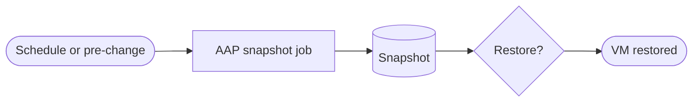


<div class="guide-header">

<h1>Snapshot and backup management</h1>

<span class="guide-type-badge guide-type-badge--use-case"><i class="fas fa-layer-group" aria-hidden="true"></i> Virtualization Use Case</span>

</div>

<style>
  div#toc {
    display: none;
  }
</style>

## Overview

Create, manage, and restore VM snapshots and backups with Ansible so recovery is a governed job -- not a console session. Supports data integrity before patch windows and facilitates restore drills.

**Maturity:** Walk (toward Day-2). **Customer question:** How do we create, manage, and restore VM snapshots consistently?

Start from the [Common virtualization automation use cases hub](virtualization-use-cases.md) or the foundational [Virtualization automation with Ansible](README-Virtualization.md) guide.

## Background

AVA 301 lists automated snapshots as a Production (Day-2) capability and as a dedicated day-2 category. This scaffold covers snapshot and restore automation on OpenShift Virtualization.

## Solution

- **Ansible Automation Platform** for scheduled and on-demand snapshot jobs
- **OpenShift Virtualization** snapshot APIs / modules
- **RBAC and surveys** so restore is controlled

### Who Benefits

| Persona | Challenge | What They Gain |
|---------|-----------|----------------|
| **Virt admins** | Inconsistent manual snapshots | Scheduled, auditable snapshot jobs |
| **App owners** | Fear of patch without rollback | Pre-change snapshot in the workflow |
| **DR / compliance** | Weak restore evidence | Restore drills with AAP history |

## Prerequisites

- AAP with cluster credentials that can snapshot target VMs
- Lab VMs that support the snapshot API you will use

## Workflow



## Solution Walkthrough

### Step 1: Publish create / list / restore templates

Separate create from restore with tighter RBAC on restore.

### Step 2: Hook snapshots before risky change

Chain snapshot before patch or lifecycle jobs.

### Step 3: Practice restore in lab

Prove restore path before relying on it in production.

## Validation

### Test

```bash
# Replace with your snapshot job template name in Controller, or playbook path
ansible-playbook -i inventories/virt-lab.yml snapshot.yml --check
```

### Expected Result

```
Snapshot job completes with failed=0; snapshot object visible for the lab VM.
```

### Troubleshooting

| Symptom | Likely Cause | Fix |
|---------|-------------|-----|
| Snapshot unsupported | Storage or VM state | Confirm volume snapshot class and VM readiness |
| Restore blocked | RBAC | Grant restore only to platform roles |

## Maturity Path

| Maturity | For this use case |
|----------|-------------------|
| **Crawl** | On-demand admin snapshots |
| **Walk** | Scheduled snapshots; pre-change hooks |
| **Run** | Policy-driven retention and restore SLAs |

## Summary

**Snapshot and backup management** is use case 6 -- recovery as automation, not heroics.

## Next Steps

1. Return to [Virtualization automation with Ansible](README-Virtualization.md).
2. Browse [all nine use cases](virtualization-use-cases.md).
3. Continue with [Patch and package management](README-Virtualization-Use-Case-07-Patch-and-Package-Management.md).

