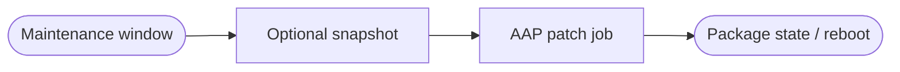


<div class="guide-header">

<h1>Patch and package management</h1>

<span class="guide-type-badge guide-type-badge--use-case"><i class="fas fa-layer-group" aria-hidden="true"></i> Virtualization Use Case</span>

</div>

<style>
  div#toc {
    display: none;
  }
</style>

## Overview

Automate guest package updates and security patches on OpenShift Virtualization VMs inside maintenance windows. Use dynamic inventory from the platform and AAP job history as audit proof -- production automation from day 1 of operations.

**Maturity:** Run (Day-2 Operations). **Customer question:** How do we patch guest VMs inside maintenance windows with audit proof?

Start from the [Common virtualization automation use cases hub](virtualization-use-cases.md) or the foundational [Virtualization automation with Ansible](README-Virtualization.md) guide.

## Background

AVA 301 shows package update playbooks (for example `dnf` state latest) as an operational task for VM administrators, and lists patch management under Production (Day-2) outcomes.

## Solution

- **Ansible Automation Platform** schedules and workflows with maintenance windows
- **Dynamic inventory** of OpenShift Virtualization guests
- **Optional snapshot pre-step** from use case 6

### Who Benefits

| Persona | Challenge | What They Gain |
|---------|-----------|----------------|
| **Virt / OS admins** | Manual guest patching at scale | Windowed, inventory-driven jobs |
| **Security** | Unclear patch evidence | AAP artifacts tied to CVE or advisory work |
| **App owners** | Unplanned reboots | Surveys and windows they can predict |

## Prerequisites

- Guest credentials and package repositories reachable from the EE
- Agreement on maintenance windows and reboot policy

## Workflow



## Solution Walkthrough

### Step 1: Target guests via kubevirt inventory

Limit blast radius with groups or labels.

### Step 2: Run package updates with change control

Survey package lists; honor reboot flags.

### Step 3: Record and report

Job output and optional ITSM update as proof.

## Validation

### Test

```bash
ansible-playbook -i inventories/virt-lab.yml patch-packages.yml --check
```

### Expected Result

```
Check mode reports expected package changes; full run in lab ends with failed=0.
```

### Troubleshooting

| Symptom | Likely Cause | Fix |
|---------|-------------|-----|
| Repo errors | Proxy or subscription | Fix guest repo config |
| Host unreachable mid-window | Network policy | Align inventory and firewall rules |

## Maturity Path

| Maturity | For this use case |
|----------|-------------------|
| **Crawl** | Ad-hoc patch jobs |
| **Walk** | Scheduled windows with surveys |
| **Run** | Advisory-driven or EDA-triggered patch workflows |

## Summary

**Patch and package management** is use case 7 -- continuous VM operations beyond configuration management alone.

## Next Steps

1. Return to [Virtualization automation with Ansible](README-Virtualization.md).
2. Browse [all nine use cases](virtualization-use-cases.md).
3. Continue with [Lifecycle management](README-Virtualization-Use-Case-08-Lifecycle-Management.md).

