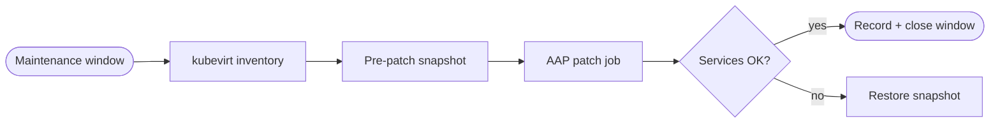


<div class="guide-header">

<h1>Patch and package management</h1>

<span class="guide-type-badge guide-type-badge--use-case"><i class="fas fa-layer-group" aria-hidden="true"></i> Virtualization Use Case</span>

</div>

<style>
  div#toc {
    display: none;
  }
</style>

## Overview

Automate guest package updates and security patches on OpenShift Virtualization VMs inside maintenance windows. Use dynamic inventory from the platform and AAP job history as audit proof -- production automation from day 1 of operations. Chain a pre-patch snapshot so rollback is a governed job, not a fire drill.

**Maturity:** Run (Day-2 Operations). **Customer question:** How do we patch guest VMs inside maintenance windows with audit proof?

Start from the [Common virtualization automation use cases hub](virtualization-use-cases.md) or the foundational [Virtualization automation with Ansible](README-Virtualization.md) guide.

## Background

AVA 301 shows package update playbooks (for example `dnf` state latest) as an operational task for VM administrators, and lists patch management under Production (Day-2) outcomes. Production patching requires more than `dnf update` -- it needs inventory targeting, pre-change snapshots, conditional reboots, post-patch verification, and a rollback path when things go wrong.

## Solution

- **Ansible Automation Platform** schedules and workflows with maintenance windows
- **Dynamic inventory** of OpenShift Virtualization guests via the kubevirt inventory plugin
- **Pre-patch snapshot** from [use case 6](README-Virtualization-Use-Case-06-Snapshot-and-Backup.md) for rollback
- **Survey-driven job templates** for selective or security-only patching
- **Post-patch verification** to confirm services are healthy before closing the window

### Who Benefits

| Persona | Challenge | What They Gain |
|---------|-----------|----------------|
| **Virt / OS admins** | Manual guest patching at scale | Windowed, inventory-driven jobs with snapshot rollback |
| **Security** | Unclear patch evidence | AAP artifacts tied to CVE or advisory work |
| **App owners** | Unplanned reboots | Surveys and windows they can predict |

## Prerequisites

- AAP 2.5+ with Controller and a custom execution environment containing:
  - <a target="_blank" href="https://console.redhat.com/ansible/automation-hub/repo/published/redhat/rhel_system_roles/">redhat.rhel_system_roles</a>
  - <a target="_blank" href="https://console.redhat.com/ansible/automation-hub/repo/published/kubernetes/core/">kubernetes.core</a>
  - <a target="_blank" href="https://console.redhat.com/ansible/automation-hub/repo/published/redhat/openshift_virtualization/">redhat.openshift_virtualization</a>
- Guest credentials (SSH for Linux, WinRM for Windows) reachable from the EE
- Package repositories accessible from guest VMs (subscription-manager or local mirror)
- Agreement on maintenance windows and reboot policy
- kubevirt dynamic inventory source configured in Controller

> **Warning:** Patch windows.
>
> Security updates and kernel reboots interrupt workloads. Schedule maintenance windows, take a snapshot first, and keep a tested restore path.

## Workflow



## Solution Walkthrough

### Step 1: Configure kubevirt dynamic inventory

Target VMs by namespace, label, or annotation to limit blast radius during patch windows.

**kubevirt inventory file (`kubevirt_inventory.yml`):**

```yaml
---
plugin: kubernetes.core.k8s
connections:
  - kubeconfig: "{{ lookup('env', 'K8S_AUTH_KUBECONFIG') }}"

compose:
  ansible_host: >-
    status.interfaces[0].ipAddress
  ansible_user: "'cloud-user'"

groups:
  patch_group_a: >-
    labels.get('patch-group', '') == 'a'
  patch_group_b: >-
    labels.get('patch-group', '') == 'b'
  rhel_guests: >-
    labels.get('os-type', '') == 'rhel'

filters:
  - apiVersion: kubevirt.io/v1
    kind: VirtualMachineInstance
    namespace: "{{ target_namespace | default('vms') }}"
    label_selector: "managed-by=aap"
```

### Step 2: Create pre-patch snapshot

Chain the snapshot step from [use case 6](README-Virtualization-Use-Case-06-Snapshot-and-Backup.md) before any package changes. This runs on localhost against the OpenShift API.

```yaml
---
- name: Pre-patch snapshot for maintenance window
  hosts: localhost
  connection: local
  gather_facts: true
  vars:
    vm_list: "{{ groups['patch_group_a'] }}"
    vm_namespace: "{{ target_namespace | default('vms') }}"
    snapshot_prefix: "prepatch"
  tasks:
    - name: Create snapshot for each VM in the patch group
      kubernetes.core.k8s:
        state: present
        definition:
          apiVersion: snapshot.kubevirt.io/v1beta1
          kind: VirtualMachineSnapshot
          metadata:
            name: "{{ item }}-{{ snapshot_prefix }}-{{ ansible_date_time.iso8601_basic_short }}"
            namespace: "{{ vm_namespace }}"
            labels:
              snapshot-type: pre-patch
              patch-window: "{{ ansible_date_time.date }}"
          spec:
            source:
              apiGroup: kubevirt.io
              kind: VirtualMachine
              name: "{{ item }}"
      loop: "{{ vm_list }}"
      register: snapshot_results

    - name: Wait for all snapshots to be ready
      kubernetes.core.k8s_info:
        api_version: snapshot.kubevirt.io/v1beta1
        kind: VirtualMachineSnapshot
        name: "{{ item }}-{{ snapshot_prefix }}-{{ ansible_date_time.iso8601_basic_short }}"
        namespace: "{{ vm_namespace }}"
      register: snap_check
      until: snap_check.resources[0].status.readyToUse | default(false)
      retries: 20
      delay: 15
      loop: "{{ vm_list }}"
```

### Step 3: Apply patches with survey control

This playbook supports two modes via Controller survey variables: security-only patches or selective package updates.

```yaml
---
- name: Patch guest VMs in maintenance window
  hosts: "{{ patch_target_group | default('patch_group_a') }}"
  become: true
  serial: "{{ patch_batch_size | default('25%') }}"
  vars:
    patch_mode: "{{ survey_patch_mode | default('security') }}"
    specific_packages: "{{ survey_packages | default('') }}"
    allow_reboot: "{{ survey_allow_reboot | default(true) | bool }}"
    reboot_timeout: 600
  tasks:
    - name: Record pre-patch package state
      ansible.builtin.command: rpm -qa --queryformat '%{NAME}-%{VERSION}-%{RELEASE}.%{ARCH}\n'
      register: pre_patch_packages
      changed_when: false

    - name: Apply security-only updates
      ansible.builtin.dnf:
        name: "*"
        state: latest
        security: true
        update_cache: true
      register: security_patch_result
      when: patch_mode == "security"

    - name: Apply selective package updates
      ansible.builtin.dnf:
        name: "{{ specific_packages.split(',') | map('trim') | list }}"
        state: latest
        update_cache: true
      register: selective_patch_result
      when: patch_mode == "selective" and specific_packages | length > 0

    - name: Apply all available updates
      ansible.builtin.dnf:
        name: "*"
        state: latest
        update_cache: true
      register: full_patch_result
      when: patch_mode == "full"

    - name: Combine patch results
      ansible.builtin.set_fact:
        patch_result: >-
          {{ security_patch_result if patch_mode == 'security'
             else (selective_patch_result if patch_mode == 'selective'
             else full_patch_result) }}

    - name: Check if kernel was updated
      ansible.builtin.set_fact:
        kernel_updated: >-
          {{ patch_result.results | default([])
             | select('search', 'kernel') | list | length > 0 }}

    - name: Reboot if kernel updated and reboot is allowed
      ansible.builtin.reboot:
        reboot_timeout: "{{ reboot_timeout }}"
        msg: "Ansible patching -- kernel update requires reboot"
      when: kernel_updated | bool and allow_reboot | bool

    - name: Wait for system to stabilize after reboot
      ansible.builtin.wait_for_connection:
        delay: 10
        timeout: 300
      when: kernel_updated | bool and allow_reboot | bool
```

### Step 4: Verify services after patching

Confirm critical services are running and the guest is healthy before declaring the patch window closed.

```yaml
    - name: Gather service facts
      ansible.builtin.service_facts:

    - name: Assert critical services are running
      ansible.builtin.assert:
        that:
          - ansible_facts.services['sshd.service'].state == 'running'
          - ansible_facts.services['chronyd.service'].state == 'running'
        fail_msg: "Critical service down after patching on {{ inventory_hostname }}"
        success_msg: "All critical services healthy on {{ inventory_hostname }}"

    - name: Record post-patch package state
      ansible.builtin.command: rpm -qa --queryformat '%{NAME}-%{VERSION}-%{RELEASE}.%{ARCH}\n'
      register: post_patch_packages
      changed_when: false

    - name: Calculate packages changed
      ansible.builtin.set_fact:
        packages_changed: >-
          {{ (post_patch_packages.stdout_lines | difference(pre_patch_packages.stdout_lines)) | length }}

    - name: Report patch summary
      ansible.builtin.debug:
        msg: >-
          Host {{ inventory_hostname }}: {{ packages_changed }} packages updated.
          Kernel updated: {{ kernel_updated }}.
          Reboot performed: {{ kernel_updated | bool and allow_reboot | bool }}.
```

### Step 5: Rollback on failure

If post-patch verification fails, restore the pre-patch snapshot. This runs on localhost against the OpenShift API.

```yaml
---
- name: Rollback VM to pre-patch snapshot
  hosts: localhost
  connection: local
  gather_facts: false
  vars:
    vm_name: "{{ failed_vm }}"
    vm_namespace: "{{ target_namespace | default('vms') }}"
  tasks:
    - name: Find most recent pre-patch snapshot
      kubernetes.core.k8s_info:
        api_version: snapshot.kubevirt.io/v1beta1
        kind: VirtualMachineSnapshot
        namespace: "{{ vm_namespace }}"
        label_selectors:
          - "snapshot-type=pre-patch"
      register: available_snapshots

    - name: Select snapshot for this VM
      ansible.builtin.set_fact:
        restore_snapshot: >-
          {{ available_snapshots.resources
             | selectattr('spec.source.name', 'equalto', vm_name)
             | sort(attribute='metadata.creationTimestamp', reverse=true)
             | first }}

    - name: Stop the VM before restore
      redhat.openshift_virtualization.kubevirt_vm:
        name: "{{ vm_name }}"
        namespace: "{{ vm_namespace }}"
        state: present
        spec:
          running: false

    - name: Wait for VMI to terminate
      kubernetes.core.k8s_info:
        api_version: kubevirt.io/v1
        kind: VirtualMachineInstance
        name: "{{ vm_name }}"
        namespace: "{{ vm_namespace }}"
      register: vmi_check
      until: vmi_check.resources | length == 0
      retries: 30
      delay: 10

    - name: Restore from snapshot
      kubernetes.core.k8s:
        state: present
        definition:
          apiVersion: snapshot.kubevirt.io/v1beta1
          kind: VirtualMachineRestore
          metadata:
            name: "{{ vm_name }}-restore-{{ ansible_date_time.epoch }}"
            namespace: "{{ vm_namespace }}"
          spec:
            target:
              apiGroup: kubevirt.io
              kind: VirtualMachine
              name: "{{ vm_name }}"
            virtualMachineSnapshotName: "{{ restore_snapshot.metadata.name }}"

    - name: Start the VM after restore
      redhat.openshift_virtualization.kubevirt_vm:
        name: "{{ vm_name }}"
        namespace: "{{ vm_namespace }}"
        state: present
        spec:
          running: true

    - name: Verify VM is running after restore
      kubernetes.core.k8s_info:
        api_version: kubevirt.io/v1
        kind: VirtualMachineInstance
        name: "{{ vm_name }}"
        namespace: "{{ vm_namespace }}"
      register: restored_vmi
      until: >-
        restored_vmi.resources | length > 0
        and restored_vmi.resources[0].status.phase == "Running"
      retries: 30
      delay: 10
```

### Controller workflow pattern

Wire these steps into an AAP workflow template:

```
[Pre-patch snapshot] --> [Patch guests] --> [Verify services]
                                                  |
                                            (on failure)
                                                  |
                                           [Rollback VM]
```

Schedule the workflow template during maintenance windows. Use Controller surveys to select the patch group, patch mode (security / selective / full), and reboot policy.

## Validation

### Test

```bash
# Verify kubevirt inventory returns expected hosts
ansible-inventory -i kubevirt_inventory.yml --graph --vars

# Dry-run the patch playbook (check mode)
ansible-playbook -i kubevirt_inventory.yml patch-guests.yml \
  --check -e patch_mode=security -e patch_target_group=patch_group_a

# Verify snapshot exists after pre-patch step
oc get virtualmachinesnapshot -n vms -l snapshot-type=pre-patch

# Confirm guest package state after patching
ansible -i kubevirt_inventory.yml patch_group_a -m command -a "dnf check-update --security" --become
```

### Expected Result

```text
$ ansible-playbook patch-guests.yml --check -v
...
TASK [Apply all available security updates] ************************************
ok: [demo-web] => {"changed": true, "msg": "Check mode: would update 14 packages"}

$ ansible-playbook patch-guests.yml -v
...
PLAY RECAP *********************************************************************
demo-web                   : ok=9    changed=3    unreachable=0    failed=0

$ oc get virtualmachinesnapshot -n vms -l app=demo-web \
    -o jsonpath='{range .items[*]}{.metadata.name}{" "}{.status.readyToUse}{"\n"}{end}'
demo-web-prepatch-20261113 true

$ ansible demo-web -a 'dnf check-update' ; echo exit:$?
exit:0
```

### Troubleshooting

| Symptom | Likely Cause | Fix |
|---------|-------------|-----|
| Repo errors during dnf | Proxy, subscription, or DNS | Verify guest can reach repositories; check subscription-manager status |
| Host unreachable mid-window | Network policy or guest firewall | Align kubevirt network policy and SSH firewall rules |
| Snapshot not ready before patch starts | Storage backend slow or quota hit | Increase snapshot wait retries; check VolumeSnapshotClass and PV capacity |
| Reboot timeout exceeded | Guest BIOS or grub issue | Increase reboot_timeout; check VM console via `virtctl` |
| Rollback restore fails | Snapshot deleted or VM spec changed | Verify snapshot still exists; check VM and snapshot compatibility |
| Kernel updated but reboot skipped | survey_allow_reboot set to false | Inform app owner; schedule reboot in next window |

## Maturity Path

| Maturity | For this use case |
|----------|-------------------|
| **Crawl** | Ad-hoc patch jobs with manual snapshot |
| **Walk** | Scheduled windows with surveys, pre-patch snapshots, and post-patch verification |
| **Run** | Advisory-driven or EDA-triggered patch workflows with automatic rollback on failure |

## Summary

**Patch and package management** is use case 7 -- production patching with snapshot safety nets, survey-controlled scope, and automatic rollback. The same kubevirt inventory and snapshot patterns from earlier use cases chain into a governed patch workflow.

## Next Steps

1. Return to [Virtualization automation with Ansible](README-Virtualization.md).
2. Browse [all nine use cases](virtualization-use-cases.md).
3. Continue with [Lifecycle management](README-Virtualization-Use-Case-08-Lifecycle-Management.md).

