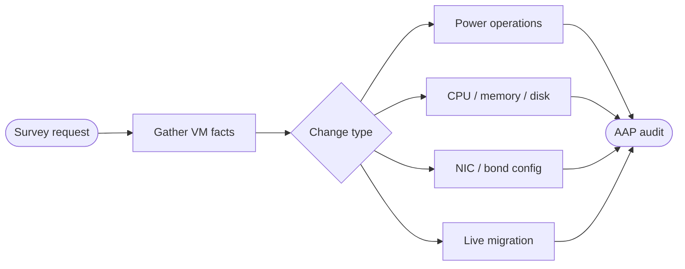


<div class="guide-header">

<h1>Lifecycle management</h1>

<span class="guide-type-badge guide-type-badge--use-case"><i class="fas fa-layer-group" aria-hidden="true"></i> Virtualization Use Case</span>

</div>

<style>
  div#toc {
    display: none;
  }
</style>

## Overview

Day-2 lifecycle operations for OpenShift Virtualization VMs: gather facts, power on/off, change resource allocations (vCPU, memory, storage), and reconfigure network adapters (NIC, bonds). Hot-add style changes become survey-driven AAP jobs instead of console edits -- every mutation tracked in Controller job history.

**Maturity:** Run (Day-2 Operations). **Customer question:** How do we power, scale, and reconfigure NICs and storage on running VMs?

Start from the [Common virtualization automation use cases hub](virtualization-use-cases.md) or the foundational [Virtualization automation with Ansible](README-Virtualization.md) guide.

## Background

AVA 301 groups these under Lifecycle Management and shows Controller surveys such as Update Memory. Full VM lifecycle modules cover create, start, stop, delete, live migrate, snapshot, and resource scaling. Each operation maps to a separate job template with its own survey, RBAC, and approval requirements.

## Solution

- **Ansible Automation Platform** surveys for safe parameter entry
- **OpenShift Virtualization** lifecycle modules (`kubevirt_vm`, `kubevirt_vm_info`) for power and spec changes
- **`kubernetes.core.k8s`** for strategic merge patches on VirtualMachine specs
- **RBAC** separating read-only facts from disruptive changes

### Who Benefits

| Persona | Challenge | What They Gain |
|---------|-----------|----------------|
| **Virt admins** | Click-ops for every resize | Repeatable scale and power jobs |
| **App teams** | Slow capacity changes | Requestable surveys within policy |
| **Platform owners** | Untracked live changes | Full job history per mutation |

## Prerequisites

- AAP 2.5+ with Controller and a custom execution environment containing `kubernetes.core` and `redhat.openshift_virtualization`
- Cluster credentials with rights to patch VirtualMachine specs
- Clear policy for live vs restart-required changes
- `NetworkAttachmentDefinition` resources pre-configured for secondary NIC use cases

## Workflow



## Solution Walkthrough

### Step 1: Gather VM facts

Safe, read-only visibility before any change. Use this as a standalone template or as the first node in a workflow.

```yaml
---
- name: Gather OpenShift Virtualization VM facts
  hosts: localhost
  connection: local
  gather_facts: false
  vars:
    vm_name: "{{ survey_vm_name }}"
    vm_namespace: "{{ survey_namespace | default('vms') }}"
  tasks:
    - name: Get VirtualMachine spec
      redhat.openshift_virtualization.kubevirt_vm_info:
        name: "{{ vm_name }}"
        namespace: "{{ vm_namespace }}"
      register: vm_info

    - name: Get VirtualMachineInstance runtime state
      kubernetes.core.k8s_info:
        api_version: kubevirt.io/v1
        kind: VirtualMachineInstance
        name: "{{ vm_name }}"
        namespace: "{{ vm_namespace }}"
      register: vmi_info

    - name: Display VM configuration
      ansible.builtin.debug:
        msg:
          name: "{{ vm_info.resources[0].metadata.name }}"
          namespace: "{{ vm_info.resources[0].metadata.namespace }}"
          running: "{{ vm_info.resources[0].spec.running | default('unknown') }}"
          cpu_cores: "{{ vm_info.resources[0].spec.template.spec.domain.cpu.cores | default('N/A') }}"
          memory: "{{ vm_info.resources[0].spec.template.spec.domain.resources.requests.memory | default('N/A') }}"
          disks: "{{ vm_info.resources[0].spec.template.spec.domain.devices.disks | map(attribute='name') | list }}"
          interfaces: "{{ vm_info.resources[0].spec.template.spec.domain.devices.interfaces | map(attribute='name') | list }}"
          phase: "{{ vmi_info.resources[0].status.phase | default('Not running') }}"
          node: "{{ vmi_info.resources[0].status.nodeName | default('N/A') }}"
          guest_os: "{{ vmi_info.resources[0].status.guestOSInfo.id | default('N/A') }}"
          ip_addresses: >-
            {{ vmi_info.resources[0].status.interfaces
               | default([]) | map(attribute='ipAddress') | select('defined') | list }}
```

### Step 2: Power operations

Start, stop, and restart VMs with survey-driven templates. These are separate job templates in Controller so RBAC and approvals can differ per action.

```yaml
---
- name: VM power operations
  hosts: localhost
  connection: local
  gather_facts: false
  vars:
    vm_name: "{{ survey_vm_name }}"
    vm_namespace: "{{ survey_namespace | default('vms') }}"
    power_action: "{{ survey_power_action }}"
  tasks:
    - name: Start VM
      redhat.openshift_virtualization.kubevirt_vm:
        name: "{{ vm_name }}"
        namespace: "{{ vm_namespace }}"
        state: present
        spec:
          running: true
      when: power_action == "start"

    - name: Stop VM
      redhat.openshift_virtualization.kubevirt_vm:
        name: "{{ vm_name }}"
        namespace: "{{ vm_namespace }}"
        state: present
        spec:
          running: false
      when: power_action == "stop"

    - name: Restart VM (stop then start)
      block:
        - name: Stop the VM
          redhat.openshift_virtualization.kubevirt_vm:
            name: "{{ vm_name }}"
            namespace: "{{ vm_namespace }}"
            state: present
            spec:
              running: false

        - name: Wait for VMI to terminate
          kubernetes.core.k8s_info:
            api_version: kubevirt.io/v1
            kind: VirtualMachineInstance
            name: "{{ vm_name }}"
            namespace: "{{ vm_namespace }}"
          register: vmi_gone
          until: vmi_gone.resources | length == 0
          retries: 30
          delay: 10

        - name: Start the VM
          redhat.openshift_virtualization.kubevirt_vm:
            name: "{{ vm_name }}"
            namespace: "{{ vm_namespace }}"
            state: present
            spec:
              running: true
      when: power_action == "restart"

    - name: Wait for VMI to reach Running
      kubernetes.core.k8s_info:
        api_version: kubevirt.io/v1
        kind: VirtualMachineInstance
        name: "{{ vm_name }}"
        namespace: "{{ vm_namespace }}"
      register: vmi_status
      until: >-
        vmi_status.resources | length > 0
        and vmi_status.resources[0].status.phase == "Running"
      retries: 30
      delay: 10
      when: power_action in ["start", "restart"]
```

### Step 3: CPU and memory scaling

Scale VM resources via strategic merge patch. Some changes require a VM restart depending on the kubevirt version and whether live migration with updated resources is supported.

```yaml
---
- name: Scale VM CPU and memory
  hosts: localhost
  connection: local
  gather_facts: false
  vars:
    vm_name: "{{ survey_vm_name }}"
    vm_namespace: "{{ survey_namespace | default('vms') }}"
    new_cpu_cores: "{{ survey_cpu_cores | int }}"
    new_memory: "{{ survey_memory }}"
  tasks:
    - name: Get current VM spec for comparison
      redhat.openshift_virtualization.kubevirt_vm_info:
        name: "{{ vm_name }}"
        namespace: "{{ vm_namespace }}"
      register: current_vm

    - name: Display current vs requested
      ansible.builtin.debug:
        msg: >-
          {{ vm_name }}: CPU {{ current_vm.resources[0].spec.template.spec.domain.cpu.cores }}
          -> {{ new_cpu_cores }}, Memory
          {{ current_vm.resources[0].spec.template.spec.domain.resources.requests.memory }}
          -> {{ new_memory }}

    - name: Patch VirtualMachine spec with new resources
      kubernetes.core.k8s:
        state: present
        merge_type: strategic-merge-patch
        definition:
          apiVersion: kubevirt.io/v1
          kind: VirtualMachine
          metadata:
            name: "{{ vm_name }}"
            namespace: "{{ vm_namespace }}"
          spec:
            template:
              spec:
                domain:
                  cpu:
                    cores: "{{ new_cpu_cores }}"
                  resources:
                    requests:
                      memory: "{{ new_memory }}"
                    limits:
                      memory: "{{ new_memory }}"

    - name: Restart VM to apply changes if running
      block:
        - name: Check if VMI exists (VM is running)
          kubernetes.core.k8s_info:
            api_version: kubevirt.io/v1
            kind: VirtualMachineInstance
            name: "{{ vm_name }}"
            namespace: "{{ vm_namespace }}"
          register: vmi_exists

        - name: Restart VMI to pick up new spec
          kubernetes.core.k8s:
            state: present
            merge_type: strategic-merge-patch
            definition:
              apiVersion: kubevirt.io/v1
              kind: VirtualMachine
              metadata:
                name: "{{ vm_name }}"
                namespace: "{{ vm_namespace }}"
              spec:
                running: false
          when: vmi_exists.resources | length > 0

        - name: Wait for VMI to terminate
          kubernetes.core.k8s_info:
            api_version: kubevirt.io/v1
            kind: VirtualMachineInstance
            name: "{{ vm_name }}"
            namespace: "{{ vm_namespace }}"
          register: vmi_gone
          until: vmi_gone.resources | length == 0
          retries: 30
          delay: 10
          when: vmi_exists.resources | length > 0

        - name: Start VM with new spec
          kubernetes.core.k8s:
            state: present
            merge_type: strategic-merge-patch
            definition:
              apiVersion: kubevirt.io/v1
              kind: VirtualMachine
              metadata:
                name: "{{ vm_name }}"
                namespace: "{{ vm_namespace }}"
              spec:
                running: true
          when: vmi_exists.resources | length > 0
      when: survey_restart_after_scale | default(true) | bool
```

### Step 4: Add or remove data disks

Create a PVC and attach it as a new data disk, or detach and optionally delete an existing disk.

```yaml
---
- name: Manage VM data disks
  hosts: localhost
  connection: local
  gather_facts: false
  vars:
    vm_name: "{{ survey_vm_name }}"
    vm_namespace: "{{ survey_namespace | default('vms') }}"
    disk_action: "{{ survey_disk_action }}"
    disk_name: "{{ survey_disk_name | default('data-disk-01') }}"
    disk_size: "{{ survey_disk_size | default('20Gi') }}"
    storage_class: "{{ survey_storage_class | default('ocs-storagecluster-ceph-rbd') }}"
  tasks:
    - name: Create PVC for new data disk
      kubernetes.core.k8s:
        state: present
        definition:
          apiVersion: v1
          kind: PersistentVolumeClaim
          metadata:
            name: "{{ vm_name }}-{{ disk_name }}"
            namespace: "{{ vm_namespace }}"
            labels:
              app: "{{ vm_name }}"
              disk-type: data
          spec:
            accessModes:
              - ReadWriteOnce
            resources:
              requests:
                storage: "{{ disk_size }}"
            storageClassName: "{{ storage_class }}"
      when: disk_action == "add"

    - name: Get current VM spec
      redhat.openshift_virtualization.kubevirt_vm_info:
        name: "{{ vm_name }}"
        namespace: "{{ vm_namespace }}"
      register: current_vm

    - name: Build updated disk list (add)
      ansible.builtin.set_fact:
        updated_disks: >-
          {{ current_vm.resources[0].spec.template.spec.domain.devices.disks + [
            {'name': disk_name, 'disk': {'bus': 'virtio'}}
          ] }}
        updated_volumes: >-
          {{ current_vm.resources[0].spec.template.spec.volumes + [
            {'name': disk_name, 'persistentVolumeClaim': {'claimName': vm_name + '-' + disk_name}}
          ] }}
      when: disk_action == "add"

    - name: Build updated disk list (remove)
      ansible.builtin.set_fact:
        updated_disks: >-
          {{ current_vm.resources[0].spec.template.spec.domain.devices.disks
             | rejectattr('name', 'equalto', disk_name) | list }}
        updated_volumes: >-
          {{ current_vm.resources[0].spec.template.spec.volumes
             | rejectattr('name', 'equalto', disk_name) | list }}
      when: disk_action == "remove"

    - name: Apply disk changes to VM spec
      kubernetes.core.k8s:
        state: present
        force: true
        definition:
          apiVersion: kubevirt.io/v1
          kind: VirtualMachine
          metadata:
            name: "{{ vm_name }}"
            namespace: "{{ vm_namespace }}"
          spec:
            template:
              spec:
                domain:
                  devices:
                    disks: "{{ updated_disks }}"
                volumes: "{{ updated_volumes }}"

    - name: Delete PVC after disk removal
      kubernetes.core.k8s:
        state: absent
        api_version: v1
        kind: PersistentVolumeClaim
        name: "{{ vm_name }}-{{ disk_name }}"
        namespace: "{{ vm_namespace }}"
      when: disk_action == "remove" and (survey_delete_pvc | default(false) | bool)
```

### Step 5: Secondary NIC reconfiguration

Add a secondary network interface backed by a `NetworkAttachmentDefinition`. This enables multus-based connectivity for VMs that need access to VLAN-tagged or isolated networks.

```yaml
---
- name: Add secondary NIC to VM
  hosts: localhost
  connection: local
  gather_facts: false
  vars:
    vm_name: "{{ survey_vm_name }}"
    vm_namespace: "{{ survey_namespace | default('vms') }}"
    nic_name: "{{ survey_nic_name | default('secondary-nic') }}"
    network_name: "{{ survey_network_name }}"
  tasks:
    - name: Verify NetworkAttachmentDefinition exists
      kubernetes.core.k8s_info:
        api_version: k8s.cni.cncf.io/v1
        kind: NetworkAttachmentDefinition
        name: "{{ network_name }}"
        namespace: "{{ vm_namespace }}"
      register: nad_check
      failed_when: nad_check.resources | length == 0

    - name: Get current VM spec
      redhat.openshift_virtualization.kubevirt_vm_info:
        name: "{{ vm_name }}"
        namespace: "{{ vm_namespace }}"
      register: current_vm

    - name: Build updated interface and network lists
      ansible.builtin.set_fact:
        updated_interfaces: >-
          {{ current_vm.resources[0].spec.template.spec.domain.devices.interfaces + [
            {'name': nic_name, 'bridge': {}}
          ] }}
        updated_networks: >-
          {{ current_vm.resources[0].spec.template.spec.networks + [
            {'name': nic_name, 'multus': {'networkName': network_name}}
          ] }}

    - name: Patch VM with secondary NIC
      kubernetes.core.k8s:
        state: present
        force: true
        definition:
          apiVersion: kubevirt.io/v1
          kind: VirtualMachine
          metadata:
            name: "{{ vm_name }}"
            namespace: "{{ vm_namespace }}"
          spec:
            template:
              spec:
                domain:
                  devices:
                    interfaces: "{{ updated_interfaces }}"
                networks: "{{ updated_networks }}"
```

### Step 6: Live migration

Move a running VM to a different node without downtime. Useful for planned maintenance or load rebalancing.

```yaml
---
- name: Live migrate VM to target node
  hosts: localhost
  connection: local
  gather_facts: false
  vars:
    vm_name: "{{ survey_vm_name }}"
    vm_namespace: "{{ survey_namespace | default('vms') }}"
  tasks:
    - name: Verify VM is currently running
      kubernetes.core.k8s_info:
        api_version: kubevirt.io/v1
        kind: VirtualMachineInstance
        name: "{{ vm_name }}"
        namespace: "{{ vm_namespace }}"
      register: vmi_info
      failed_when: >-
        vmi_info.resources | length == 0
        or vmi_info.resources[0].status.phase != "Running"

    - name: Record source node
      ansible.builtin.set_fact:
        source_node: "{{ vmi_info.resources[0].status.nodeName }}"

    - name: Initiate live migration
      kubernetes.core.k8s:
        state: present
        definition:
          apiVersion: kubevirt.io/v1
          kind: VirtualMachineInstanceMigration
          metadata:
            name: "{{ vm_name }}-migrate-{{ ansible_date_time.epoch }}"
            namespace: "{{ vm_namespace }}"
          spec:
            vmiName: "{{ vm_name }}"

    - name: Wait for migration to complete
      kubernetes.core.k8s_info:
        api_version: kubevirt.io/v1
        kind: VirtualMachineInstance
        name: "{{ vm_name }}"
        namespace: "{{ vm_namespace }}"
      register: migrated_vmi
      until: >-
        migrated_vmi.resources | length > 0
        and migrated_vmi.resources[0].status.phase == "Running"
        and migrated_vmi.resources[0].status.nodeName != source_node
      retries: 60
      delay: 10

    - name: Report migration result
      ansible.builtin.debug:
        msg: >-
          {{ vm_name }} migrated from {{ source_node }}
          to {{ migrated_vmi.resources[0].status.nodeName }}.
```

## Validation

### Test

```bash
# Gather facts for a specific VM
ansible-playbook vm-facts.yml -e survey_vm_name=test-vm -e survey_namespace=vms

# Verify power state after operation
oc get vmi test-vm -n vms -o jsonpath='{.status.phase}'

# Confirm resource change applied
oc get vm test-vm -n vms -o jsonpath='{.spec.template.spec.domain.cpu.cores}'
oc get vm test-vm -n vms -o jsonpath='{.spec.template.spec.domain.resources.requests.memory}'

# List attached disks
oc get vm test-vm -n vms -o jsonpath='{.spec.template.spec.domain.devices.disks[*].name}'

# List network interfaces
oc get vm test-vm -n vms -o jsonpath='{.spec.template.spec.domain.devices.interfaces[*].name}'

# Confirm migration completed
oc get vmim -n vms --sort-by=.metadata.creationTimestamp | tail -1
```

### Expected Result

```
Facts template returns current VM config without changes.
Power operations transition VMI phase within 5 minutes.
CPU/memory patch reflects in VM spec; VMI shows new values after restart.
Disk add creates PVC and adds volume to VM spec.
NIC add shows new interface in VM spec referencing the NetworkAttachmentDefinition.
Live migration shows different nodeName on the VMI after completion.
All jobs end with failed=0.
```

### Troubleshooting

| Symptom | Likely Cause | Fix |
|---------|-------------|-----|
| Change not applied after patch | VM needs restart for spec changes | Enable survey_restart_after_scale; restart VM |
| Survey rejected by Controller | Validation regex too strict | Align survey constraints with allowed sizes and names |
| PVC stuck in Pending | Storage class missing or quota exceeded | Verify StorageClass exists; check ResourceQuota |
| Secondary NIC no connectivity | NetworkAttachmentDefinition misconfigured | Check NAD spec; verify VLAN and bridge config on nodes |
| Live migration fails | Live migration not supported for VM config | Check `kubevirt.io/allow-live-migration` annotation; verify shared storage |
| Live migration times out | Large memory or slow network | Increase migration bandwidth limit; check node resources |

## Maturity Path

| Maturity | For this use case |
|----------|-------------------|
| **Crawl** | Admin-only power and scale with manual approval |
| **Walk** | Survey self-service with workflow approvals; disk and NIC operations |
| **Run** | Policy-driven capacity scaling, automated live migration, and deprovision automation |

## Summary

**Lifecycle management** is use case 8 -- operate VMs in OpenShift at scale with survey-driven templates for power, scale, disk, NIC, and migration operations. Every mutation is an AAP job with RBAC, audit trail, and optional approval gates.

## Next Steps

1. Return to [Virtualization automation with Ansible](README-Virtualization.md).
2. Browse [all nine use cases](virtualization-use-cases.md).
3. Continue with [Event-driven remediation](README-Virtualization-Use-Case-09-Event-Driven-Remediation.md).

