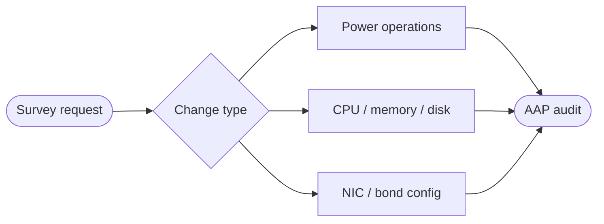


<div class="guide-header">

<h1>Lifecycle management</h1>

<span class="guide-type-badge guide-type-badge--use-case"><i class="fas fa-layer-group" aria-hidden="true"></i> Virtualization Use Case</span>

</div>

<style>
  div#toc {
    display: none;
  }
</style>

## Overview

Day-2 lifecycle operations for OpenShift Virtualization VMs: gather facts, power on/off, change resource allocations (vCPU, memory, storage), and reconfigure network adapters (NIC, bonds). Hot-add style changes become survey-driven AAP jobs instead of console edits.

**Maturity:** Run (Day-2 Operations). **Customer question:** How do we power, scale, and reconfigure NICs and storage on running VMs?

Start from the [Common virtualization automation use cases hub](virtualization-use-cases.md) or the foundational [Virtualization automation with Ansible](README-Virtualization.md) guide.

## Background

AVA 301 groups these under Lifecycle Management and shows Controller surveys such as Update Memory. Full VM lifecycle modules cover create, start, stop, delete, live migrate, snapshot, and resource scaling.

## Solution

- **Ansible Automation Platform** surveys for safe parameter entry
- **OpenShift Virtualization** lifecycle modules (power, scale, network)
- **RBAC** separating read-only facts from disruptive changes

### Who Benefits

| Persona | Challenge | What They Gain |
|---------|-----------|----------------|
| **Virt admins** | Click-ops for every resize | Repeatable scale and power jobs |
| **App teams** | Slow capacity changes | Requestable surveys within policy |
| **Platform owners** | Untracked live changes | Full job history per mutation |

## Prerequisites

- Cluster credentials with rights to patch VirtualMachine specs
- Clear policy for live vs restart-required changes

## Workflow



## Solution Walkthrough

### Step 1: Publish fact-gathering templates

Safe visibility before change.

### Step 2: Add power and scale job templates

Survey VM name, namespace, and target resources (as in AVA demos).

### Step 3: Gate disruptive changes

Approvals for production namespaces; lab first.

## Validation

### Test

```bash
oc get vm <name> -n <namespace> -o jsonpath='{.spec.template.spec.domain.resources}'
```

### Expected Result

```
After a lab Update Memory (or similar) job, the VirtualMachine spec reflects the surveyed values; job failed=0.
```

### Troubleshooting

| Symptom | Likely Cause | Fix |
|---------|-------------|-----|
| Change not applied | Restart required or conflict | Confirm kubevirt conditions; restart if policy allows |
| Survey rejected | Validation regex | Align survey constraints with allowed sizes |

## Maturity Path

| Maturity | For this use case |
|----------|-------------------|
| **Crawl** | Admin-only power and scale |
| **Walk** | Survey self-service with approvals |
| **Run** | Policy-driven capacity and deprovision automation |

## Summary

**Lifecycle management** is use case 8 -- operate VMs in OpenShift at scale with the same Ansible skills used to migrate.

## Next Steps

1. Return to [Virtualization automation with Ansible](README-Virtualization.md).
2. Browse [all nine use cases](virtualization-use-cases.md).
3. Continue with [Event-driven remediation](README-Virtualization-Use-Case-09-Event-Driven-Remediation.md).

