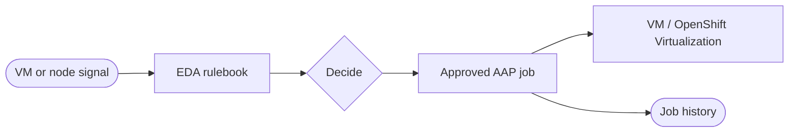


<div class="guide-header">

<h1>Event-driven remediation</h1>

<span class="guide-type-badge guide-type-badge--use-case"><i class="fas fa-layer-group" aria-hidden="true"></i> Virtualization Use Case</span>

</div>

<style>
  div#toc {
    display: none;
  }
</style>

## Overview

Use Event-Driven Ansible to turn OpenShift, kubevirt, and monitoring events (for example Kafka, Prometheus, Dynatrace) into governed remediations: restart or recreate a VMI, live-migrate off a failing node, enrich an ITSM ticket, or run an approved guest fix -- proactive, not reactive.

**Maturity:** Run (Day-2 Operations). **Customer question:** How do platform and monitoring events drive governed VM auto-remediation?

Start from the [Common virtualization automation use cases hub](virtualization-use-cases.md) or the foundational [Virtualization automation with Ansible](README-Virtualization.md) guide.

**Related catalog depth:** [Self-healing VMs on OpenShift](README-Self-Healing-VMs-OpenShift.md)

## Background

AVA 301 calls out event-driven automation via Event-Driven Ansible for auto-remediation as an operations-team value, and lists event-driven remediation under Production (Day-2) capabilities. The Self-healing VMs Solution Guide is the deep executable companion.

## Solution

- **Event-Driven Ansible** rulebooks on platform or monitoring signals
- **Ansible Automation Platform** approved remediation job templates
- **OpenShift Virtualization** as the action plane

### Who Benefits

| Persona | Challenge | What They Gain |
|---------|-----------|----------------|
| **SRE / Virt ops** | Guest failures wait on tickets | Near-real-time approved remediations |
| **Platform owners** | Scripts without RBAC | EDA + AAP audit on every action |
| **Leadership** | High MTTR | Measurable reduction in manual recovery |

## Prerequisites

- AAP with EDA
- Event source (OpenShift API, Prometheus, Kafka, or partner tooling)
- Lab remediations with clear blast radius

## Workflow



## Solution Walkthrough

### Step 1: Start with notify-or-restart only

High-confidence actions in a lab namespace.

### Step 2: Wire EDA to approved job templates

No ad-hoc commands from the rulebook.

### Step 3: Expand to migrate and capacity actions

As trust grows, add live migration and richer remediations -- see the Self-healing VMs guide.

## Validation

### Test

```bash
# Confirm lab VMs are visible; remediation path tested via manual job first
oc get vm -A
```

### Expected Result

```
Manual remediation job succeeds with failed=0; a replayed EDA event launches the same template.
```

### Troubleshooting

| Symptom | Likely Cause | Fix |
|---------|-------------|-----|
| EDA never fires | Filter or source misconfigured | Replay payload; adjust rulebook |
| Job unauthorized | Template or credential | Fix RBAC and credentials on the JT |

## Maturity Path

| Maturity | For this use case |
|----------|-------------------|
| **Crawl** | Manual remediation jobs only |
| **Walk** | EDA with approvals / notify-first |
| **Run** | Broader self-healing inside policy |

## Summary

**Event-driven remediation** is use case 9 -- the Run end of automation-first virtualization, with Self-healing VMs as the detailed Solution Guide.

## Next Steps

1. Read [Self-healing VMs on OpenShift](README-Self-Healing-VMs-OpenShift.md).
2. Return to [Virtualization automation with Ansible](README-Virtualization.md).
3. Browse [all nine use cases](virtualization-use-cases.md).

