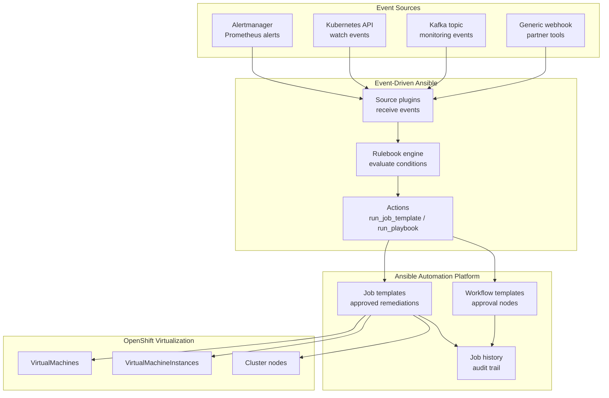
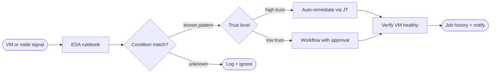
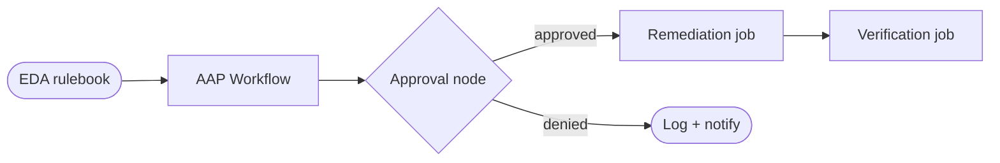


<div class="guide-header">

<h1>Event-driven remediation</h1>

<span class="guide-type-badge guide-type-badge--use-case"><i class="fas fa-layer-group" aria-hidden="true"></i> Virtualization Use Case</span>

</div>

<style>
  div#toc {
    display: none;
  }
</style>

## Overview

Use Event-Driven Ansible to turn OpenShift, kubevirt, and monitoring events (for example Kafka, Prometheus, Dynatrace) into governed remediations: restart or recreate a VMI, live-migrate off a failing node, enrich an ITSM ticket, or run an approved guest fix -- proactive, not reactive.

**Maturity:** Run (Day-2 Operations). **Customer question:** How do platform and monitoring events drive governed VM auto-remediation?

Start from the [Common virtualization automation use cases hub](virtualization-use-cases.md) or the foundational [Virtualization automation with Ansible](README-Virtualization.md) guide.

**Related catalog depth:** [Self-healing VMs on OpenShift](README-Self-Healing-VMs-OpenShift.md)

## Background

AVA 301 calls out event-driven automation via Event-Driven Ansible for auto-remediation as an operations-team value, and lists event-driven remediation under Production (Day-2) capabilities. The Self-healing VMs Solution Guide is the deep executable companion.

This use case covers the full EDA architecture: how source plugins collect signals, how rulebooks match conditions and choose actions, how remediation job templates execute governed changes, and how trust escalation moves teams from notify-only to automatic self-healing.

### EDA architecture

Event-Driven Ansible has three layers:

1. **Source plugins** -- collect events from external systems (Alertmanager webhooks, Kubernetes API watches, Kafka topics, generic webhooks)
2. **Rulebooks** -- YAML files that define conditions on incoming events and map them to actions
3. **Actions** -- what happens when a condition matches: run a job template, run a playbook, post to a webhook, print a debug message, or do nothing (for filtering)



## Solution

- **Event-Driven Ansible** rulebooks on platform or monitoring signals
- **Ansible Automation Platform** approved remediation job templates
- **OpenShift Virtualization** as the action plane
- **Alertmanager** and **Kubernetes events** as primary signal sources
- **Approval workflows** for higher-risk remediations

### Who Benefits

| Persona | Challenge | What They Gain |
|---------|-----------|----------------|
| **SRE / Virt ops** | Guest failures wait on tickets | Near-real-time approved remediations |
| **Platform owners** | Scripts without RBAC | EDA + AAP audit on every action |
| **Leadership** | High MTTR | Measurable reduction in manual recovery |

## Prerequisites

- AAP 2.5+ with Controller and Event-Driven Ansible controller
- Custom execution environment with `ansible.eda`, `kubernetes.core`, and `redhat.openshift_virtualization`
- Event source configured:
  - **Alertmanager**: webhook receiver pointing to EDA endpoint
  - **Kubernetes events**: service account with watch permissions on target namespaces
  - **Kafka** (optional): topic and consumer group for monitoring events
- Lab remediations with clear blast radius tested manually first
- AAP job templates for each remediation action (created in advance)
- Decision token or API credential for EDA to call Controller job templates

## Workflow



## Solution Walkthrough

### Step 1: Configure Alertmanager source plugin

Connect Prometheus Alertmanager to EDA. Alertmanager sends alert payloads as webhooks; the EDA `alertmanager` source plugin receives and parses them.

**Alertmanager receiver configuration (`alertmanager.yml`):**

```yaml
receivers:
  - name: eda-receiver
    webhook_configs:
      - url: "http://eda-controller.ansible-eda.svc:8000/endpoint"
        send_resolved: true

route:
  receiver: default
  routes:
    - match_re:
        alertname: "KubeVirt.*|KubeNode.*"
      receiver: eda-receiver
      group_wait: 30s
      group_interval: 5m
      repeat_interval: 1h
```

**EDA source plugin in the rulebook:**

```yaml
sources:
  - ansible.eda.alertmanager:
      host: 0.0.0.0
      port: 8000
      data_alerts_path: alerts
      data_host_path: alerts[0].labels.instance
      data_path_prefix: alerts[0].labels
```

### Step 2: Configure Kubernetes events source plugin

Watch for kubevirt-specific events directly from the Kubernetes API -- useful for events that do not go through Alertmanager (for example `FailedScheduling`, `SuccessfulCreate`, `Migrating`).

```yaml
sources:
  - ansible.eda.k8s:
      api_version: v1
      kind: Event
      namespace: "{{ watch_namespace | default('vms') }}"
      label_selector: ""
      field_selector: "involvedObject.kind=VirtualMachineInstance"
```

### Step 3: Build the production rulebook

This rulebook covers four remediation patterns: VMI crash loop restart, node failure migration, guest agent heartbeat loss, and resource pressure throttling.

```yaml
---
- name: OpenShift Virtualization event-driven remediation
  hosts: all

  sources:
    - ansible.eda.alertmanager:
        host: 0.0.0.0
        port: 8000

  rules:
    # ---- Pattern 1: VMI CrashLoop restart ----
    - name: Restart VMI in CrashLoop
      condition: >-
        event.alerts is defined
        and event.alerts | length > 0
        and event.alerts[0].status == "firing"
        and (event.alerts[0].labels.alertname == "KubeVirtVMICrashLoop"
             or event.alerts[0].labels.alertname == "KubeVirtVMIExcessiveMigrations")
      throttle:
        once_within: 10 minutes
        group_by:
          - event.alerts[0].labels.name
          - event.alerts[0].labels.namespace
      action:
        run_job_template:
          name: "Remediate VM - Restart VMI"
          organization: Default
          job_args:
            extra_vars:
              vm_name: "{{ event.alerts[0].labels.name }}"
              vm_namespace: "{{ event.alerts[0].labels.namespace }}"
              alert_name: "{{ event.alerts[0].labels.alertname }}"
              severity: "{{ event.alerts[0].labels.severity | default('warning') }}"

    # ---- Pattern 2: Node NotReady -- live migrate VMs ----
    - name: Migrate VMs off unhealthy node
      condition: >-
        event.alerts is defined
        and event.alerts | length > 0
        and event.alerts[0].status == "firing"
        and event.alerts[0].labels.alertname == "KubeNodeNotReady"
      throttle:
        once_within: 15 minutes
        group_by:
          - event.alerts[0].labels.node
      action:
        run_job_template:
          name: "Remediate VM - Evacuate Node"
          organization: Default
          job_args:
            extra_vars:
              target_node: "{{ event.alerts[0].labels.node }}"
              alert_name: "{{ event.alerts[0].labels.alertname }}"

    # ---- Pattern 3: Guest agent heartbeat loss ----
    - name: Investigate guest agent heartbeat loss
      condition: >-
        event.alerts is defined
        and event.alerts | length > 0
        and event.alerts[0].status == "firing"
        and event.alerts[0].labels.alertname == "KubeVirtVMIGuestAgentDown"
      throttle:
        once_within: 10 minutes
        group_by:
          - event.alerts[0].labels.name
      action:
        run_job_template:
          name: "Remediate VM - Guest Agent Recovery"
          organization: Default
          job_args:
            extra_vars:
              vm_name: "{{ event.alerts[0].labels.name }}"
              vm_namespace: "{{ event.alerts[0].labels.namespace }}"

    # ---- Pattern 4: Resource pressure throttle ----
    - name: Handle node resource pressure
      condition: >-
        event.alerts is defined
        and event.alerts | length > 0
        and event.alerts[0].status == "firing"
        and event.alerts[0].labels.alertname == "KubeNodeResourcePressure"
      throttle:
        once_within: 30 minutes
        group_by:
          - event.alerts[0].labels.node
      action:
        run_job_template:
          name: "Remediate VM - Resource Pressure"
          organization: Default
          job_args:
            extra_vars:
              target_node: "{{ event.alerts[0].labels.node }}"
              pressure_type: "{{ event.alerts[0].labels.condition | default('unknown') }}"

    # ---- Catch-all: unknown kubevirt alert ----
    - name: Notify on unhandled kubevirt alert
      condition: >-
        event.alerts is defined
        and event.alerts | length > 0
        and event.alerts[0].status == "firing"
        and event.alerts[0].labels.alertname is match("KubeVirt.*", ignorecase=true)
      action:
        run_job_template:
          name: "VM Alert - Notify Only"
          organization: Default
          job_args:
            extra_vars:
              alert_payload: "{{ event.alerts[0] | to_json }}"
```

### Step 4: Remediation job templates

Each pattern above maps to one or more AAP job templates. These are the playbooks behind those templates.

**Restart VMI:**

```yaml
---
- name: Restart unhealthy VirtualMachineInstance
  hosts: localhost
  connection: local
  gather_facts: false
  vars:
    vm_name: "{{ vm_name }}"
    vm_namespace: "{{ vm_namespace }}"
    max_restart_attempts: 3
  tasks:
    - name: Get current VMI state
      kubernetes.core.k8s_info:
        api_version: kubevirt.io/v1
        kind: VirtualMachineInstance
        name: "{{ vm_name }}"
        namespace: "{{ vm_namespace }}"
      register: vmi_state

    - name: Check restart count annotation
      ansible.builtin.set_fact:
        restart_count: >-
          {{ vmi_state.resources[0].metadata.annotations['eda-restart-count'] | default('0') | int }}
      when: vmi_state.resources | length > 0

    - name: Abort if max restarts exceeded
      ansible.builtin.fail:
        msg: >-
          VM {{ vm_name }} has been restarted {{ restart_count }} times by EDA.
          Exceeds max {{ max_restart_attempts }}. Manual intervention required.
      when: restart_count | int >= max_restart_attempts

    - name: Delete the VMI to trigger recreation
      kubernetes.core.k8s:
        state: absent
        api_version: kubevirt.io/v1
        kind: VirtualMachineInstance
        name: "{{ vm_name }}"
        namespace: "{{ vm_namespace }}"

    - name: Wait for new VMI to reach Running
      kubernetes.core.k8s_info:
        api_version: kubevirt.io/v1
        kind: VirtualMachineInstance
        name: "{{ vm_name }}"
        namespace: "{{ vm_namespace }}"
      register: new_vmi
      until: >-
        new_vmi.resources | length > 0
        and new_vmi.resources[0].status.phase == "Running"
      retries: 30
      delay: 10

    - name: Update restart count annotation
      kubernetes.core.k8s:
        state: present
        merge_type: strategic-merge-patch
        definition:
          apiVersion: kubevirt.io/v1
          kind: VirtualMachine
          metadata:
            name: "{{ vm_name }}"
            namespace: "{{ vm_namespace }}"
            annotations:
              eda-restart-count: "{{ (restart_count | int + 1) | string }}"
              eda-last-restart: "{{ now(utc=true).isoformat() }}"
```

**Evacuate node (live migrate all VMs off a failing node):**

```yaml
---
- name: Evacuate VMs from unhealthy node
  hosts: localhost
  connection: local
  gather_facts: false
  vars:
    target_node: "{{ target_node }}"
  tasks:
    - name: Find all running VMIs on the target node
      kubernetes.core.k8s_info:
        api_version: kubevirt.io/v1
        kind: VirtualMachineInstance
      register: all_vmis

    - name: Filter VMIs on the failing node
      ansible.builtin.set_fact:
        vmis_to_migrate: >-
          {{ all_vmis.resources
             | selectattr('status.nodeName', 'equalto', target_node)
             | selectattr('status.phase', 'equalto', 'Running')
             | list }}

    - name: Report VMs to migrate
      ansible.builtin.debug:
        msg: >-
          Node {{ target_node }}: {{ vmis_to_migrate | length }} running VMIs to migrate.
          VMs: {{ vmis_to_migrate | map(attribute='metadata.name') | list }}

    - name: Initiate live migration for each VMI
      kubernetes.core.k8s:
        state: present
        definition:
          apiVersion: kubevirt.io/v1
          kind: VirtualMachineInstanceMigration
          metadata:
            name: "{{ item.metadata.name }}-evacuate-{{ ansible_date_time.epoch }}"
            namespace: "{{ item.metadata.namespace }}"
          spec:
            vmiName: "{{ item.metadata.name }}"
      loop: "{{ vmis_to_migrate }}"
      loop_control:
        label: "{{ item.metadata.name }}"

    - name: Wait for all migrations to complete
      kubernetes.core.k8s_info:
        api_version: kubevirt.io/v1
        kind: VirtualMachineInstance
        name: "{{ item.metadata.name }}"
        namespace: "{{ item.metadata.namespace }}"
      register: migrated_vmi
      until: >-
        migrated_vmi.resources | length > 0
        and migrated_vmi.resources[0].status.phase == "Running"
        and migrated_vmi.resources[0].status.nodeName != target_node
      retries: 60
      delay: 10
      loop: "{{ vmis_to_migrate }}"
      loop_control:
        label: "{{ item.metadata.name }}"
```

**Guest agent recovery:**

```yaml
---
- name: Recover guest agent on VM
  hosts: localhost
  connection: local
  gather_facts: false
  vars:
    vm_name: "{{ vm_name }}"
    vm_namespace: "{{ vm_namespace }}"
  tasks:
    - name: Get VMI IP address for SSH
      kubernetes.core.k8s_info:
        api_version: kubevirt.io/v1
        kind: VirtualMachineInstance
        name: "{{ vm_name }}"
        namespace: "{{ vm_namespace }}"
      register: vmi_info

    - name: Set guest connection variables
      ansible.builtin.set_fact:
        guest_ip: "{{ vmi_info.resources[0].status.interfaces[0].ipAddress }}"
      when: vmi_info.resources | length > 0

    - name: Attempt to restart qemu-guest-agent via SSH
      ansible.builtin.command:
        cmd: >-
          ssh -o StrictHostKeyChecking=no -o ConnectTimeout=10
          cloud-user@{{ guest_ip }}
          "sudo systemctl restart qemu-guest-agent"
      register: agent_restart
      ignore_errors: true
      when: guest_ip is defined

    - name: If SSH fails, restart the VMI
      kubernetes.core.k8s:
        state: absent
        api_version: kubevirt.io/v1
        kind: VirtualMachineInstance
        name: "{{ vm_name }}"
        namespace: "{{ vm_namespace }}"
      when: agent_restart is failed

    - name: Wait for VMI to be Running again
      kubernetes.core.k8s_info:
        api_version: kubevirt.io/v1
        kind: VirtualMachineInstance
        name: "{{ vm_name }}"
        namespace: "{{ vm_namespace }}"
      register: recovered_vmi
      until: >-
        recovered_vmi.resources | length > 0
        and recovered_vmi.resources[0].status.phase == "Running"
      retries: 30
      delay: 10
      when: agent_restart is failed
```

**Notify-only (catch-all):**

```yaml
---
- name: Notify on unhandled VM alert
  hosts: localhost
  connection: local
  gather_facts: false
  vars:
    alert_payload: "{{ alert_payload }}"
  tasks:
    - name: Parse alert details
      ansible.builtin.set_fact:
        alert_data: "{{ alert_payload | from_json }}"

    - name: Log alert to job output
      ansible.builtin.debug:
        msg:
          alert: "{{ alert_data.labels.alertname }}"
          vm: "{{ alert_data.labels.name | default('N/A') }}"
          namespace: "{{ alert_data.labels.namespace | default('N/A') }}"
          severity: "{{ alert_data.labels.severity | default('unknown') }}"
          summary: "{{ alert_data.annotations.summary | default('No summary') }}"
          action: "Logged for review -- no automatic remediation configured for this alert."

    - name: Create ITSM incident for review
      servicenow.itsm.incident:
        instance:
          host: "{{ snow_instance }}"
          username: "{{ snow_username }}"
          password: "{{ snow_password }}"
        state: new
        short_description: >-
          VM alert: {{ alert_data.labels.alertname }} on {{ alert_data.labels.name | default('unknown') }}
        description: "{{ alert_payload }}"
        urgency: "{{ '1' if alert_data.labels.severity == 'critical' else '3' }}"
        assignment_group: "Platform Operations"
      when: snow_instance is defined
```

### Step 5: Approval workflow pattern

For higher-risk remediations (node evacuation, VM deletion), EDA triggers a Controller workflow that includes an approval node. A human must approve before the destructive action runs.



Configure this in Controller by creating a workflow template with:

1. **Node 1:** Approval node (assigned to platform-ops team)
2. **Node 2 (on approval):** Remediation job template
3. **Node 3 (on success):** Verification job template
4. **Node 2 (on denial):** Notification job (log the denial and alert the team)

The EDA rulebook `run_job_template` action references the workflow template name instead of a direct job template for these higher-risk patterns.

### Step 6: Verification playbook

After any remediation, verify the VM returned to a healthy state. Use this as the final node in remediation workflows.

```yaml
---
- name: Verify VM health after remediation
  hosts: localhost
  connection: local
  gather_facts: false
  vars:
    vm_name: "{{ vm_name }}"
    vm_namespace: "{{ vm_namespace }}"
  tasks:
    - name: Check VMI is Running
      kubernetes.core.k8s_info:
        api_version: kubevirt.io/v1
        kind: VirtualMachineInstance
        name: "{{ vm_name }}"
        namespace: "{{ vm_namespace }}"
      register: vmi_health
      until: >-
        vmi_health.resources | length > 0
        and vmi_health.resources[0].status.phase == "Running"
      retries: 30
      delay: 10

    - name: Verify guest agent is reporting
      ansible.builtin.assert:
        that:
          - vmi_health.resources[0].status.guestOSInfo is defined
          - vmi_health.resources[0].status.guestOSInfo.id is defined
        fail_msg: >-
          Guest agent not reporting on {{ vm_name }} after remediation.
          Manual investigation required.
        success_msg: >-
          Guest agent healthy on {{ vm_name }}.
          OS: {{ vmi_health.resources[0].status.guestOSInfo.id }}.

    - name: Verify network connectivity
      ansible.builtin.assert:
        that:
          - vmi_health.resources[0].status.interfaces | length > 0
          - vmi_health.resources[0].status.interfaces[0].ipAddress is defined
        fail_msg: "No network interface with IP found on {{ vm_name }}"
        success_msg: >-
          Network healthy. IP: {{ vmi_health.resources[0].status.interfaces[0].ipAddress }}

    - name: Record verification result as annotation
      kubernetes.core.k8s:
        state: present
        merge_type: strategic-merge-patch
        definition:
          apiVersion: kubevirt.io/v1
          kind: VirtualMachine
          metadata:
            name: "{{ vm_name }}"
            namespace: "{{ vm_namespace }}"
            annotations:
              eda-last-verified: "{{ now(utc=true).isoformat() }}"
              eda-last-verification-result: "healthy"
```

### Step 7: Trust escalation

Teams should grow their EDA trust level over time. Do not jump from manual operations to full auto-remediation in one step.

| Trust level | EDA behavior | When to use |
|------------|-------------|-------------|
| **Level 0 -- Manual** | No EDA. Operators run remediation job templates by hand from Controller. | Before any EDA deployment. Validates that job templates work correctly. |
| **Level 1 -- Notify only** | EDA receives events and runs the notify-only template. No automated changes. | First EDA deployment. Proves events flow correctly and conditions match. |
| **Level 2 -- Approve then act** | EDA triggers a workflow with an approval node. A human approves before remediation runs. | After Level 1 proves reliable. Adds the safety of human review before action. |
| **Level 3 -- Auto-remediate with limits** | EDA runs remediation directly but with throttle limits and max-restart guards. | After Level 2 approval patterns show consistent correctness. |
| **Level 4 -- Full self-healing** | EDA auto-remediates across all known patterns, including node evacuation. | Mature environments with proven patterns and comprehensive verification. |

**To escalate trust:**

1. Run at Level 1 for two weeks. Review every notify event. Confirm every event would have triggered the correct remediation.
2. Move to Level 2. Approve remediations for one week. Track false positives.
3. Move to Level 3 for the patterns with zero false positives. Keep Level 2 for higher-risk patterns.
4. Move to Level 4 only after Level 3 has run for a month with no incidents.

Adjust the rulebook by changing `run_job_template` targets:

```yaml
# Level 1: notify only
action:
  run_job_template:
    name: "VM Alert - Notify Only"

# Level 2: workflow with approval
action:
  run_job_template:
    name: "Remediate VM - Restart VMI (Approval Workflow)"

# Level 3+: direct remediation with throttle
action:
  run_job_template:
    name: "Remediate VM - Restart VMI"
```

## Validation

### Test

```bash
# Verify EDA controller is running
oc get pods -n ansible-eda -l app=eda

# Confirm EDA rulebook activation is active
# (check in the EDA Controller UI or via API)

# Replay a test alert to the EDA endpoint
curl -X POST http://eda-controller.ansible-eda.svc:8000/endpoint \
  -H "Content-Type: application/json" \
  -d '{
    "alerts": [{
      "status": "firing",
      "labels": {
        "alertname": "KubeVirtVMICrashLoop",
        "name": "test-vm",
        "namespace": "vms",
        "severity": "warning"
      },
      "annotations": {
        "summary": "Test alert for EDA validation"
      }
    }]
  }'

# Check if the job was triggered in Controller
awx job_templates list --name "Remediate VM*" -f human
awx jobs list --job_template "Remediate VM - Restart VMI" --order_by=-created -f human | head -5

# Verify the test VM is still healthy after remediation
oc get vmi test-vm -n vms -o jsonpath='{.status.phase}'
```

### Expected Result

```
EDA pod is Running in the ansible-eda namespace.
Rulebook activation shows "running" status.
Replayed alert triggers the matching job template within 60 seconds.
Job completes with failed=0.
Test VM returns to Running phase after remediation.
Verification annotations are present on the VM.
```

### Troubleshooting

| Symptom | Likely Cause | Fix |
|---------|-------------|-----|
| EDA never fires on alerts | Source plugin misconfigured or port blocked | Replay payload with `curl`; check EDA pod logs for connection errors |
| EDA fires but job fails to launch | Credential or template name mismatch | Verify EDA decision environment has Controller API token; check template name matches exactly |
| Job launches but fails | Missing EE packages or cluster credentials | Verify EE includes required collections; check kubeconfig credential in the template |
| False positive remediations | Condition too broad or throttle too short | Narrow condition regex; increase throttle `once_within` duration |
| Multiple remediations on same VM | Missing throttle block | Add `throttle.once_within` and `group_by` on VM name + namespace |
| Remediation succeeds but VM unhealthy | Root cause not addressed by restart | Add verification step; escalate to manual investigation after max retries |
| Node evacuation times out | Too many VMs or slow shared storage | Increase migration retries; stagger migrations with `serial` |

## Maturity Path

| Maturity | For this use case |
|----------|-------------------|
| **Crawl** | Manual remediation jobs only; no EDA |
| **Walk** | EDA with notify-first and approval workflows (Level 1-2) |
| **Run** | Auto-remediation with throttle limits and verification (Level 3-4) |

## Summary

**Event-driven remediation** is use case 9 -- the Run end of automation-first virtualization. EDA source plugins collect signals from Alertmanager and the Kubernetes API, rulebooks match known unhealthy patterns, and approved AAP job templates remediate or evacuate. Trust escalation from notify-only through full self-healing gives teams a safe path to lower MTTR. The [Self-healing VMs on OpenShift](README-Self-Healing-VMs-OpenShift.md) Solution Guide provides the complete executable companion.

## Next Steps

1. Read [Self-healing VMs on OpenShift](README-Self-Healing-VMs-OpenShift.md) for the full executable self-healing pattern.
2. Return to [Virtualization automation with Ansible](README-Virtualization.md).
3. Browse [all nine use cases](virtualization-use-cases.md).

