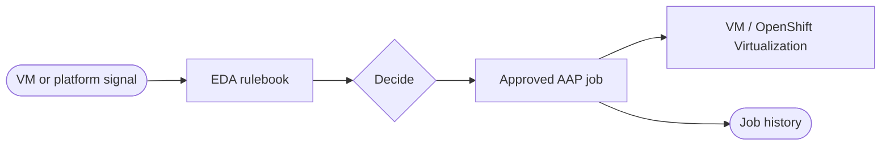


<div class="guide-header">

<h1>Virtualization automation with Ansible</h1>

<span class="guide-type-badge guide-type-badge--solution"><i class="fas fa-check-circle" aria-hidden="true"></i> Solution Guide</span>

</div>

<style>
  div#toc {
    display: none;
  }
</style>

<div class="guide-hero-callout" role="img" aria-label="Ansible unlocks Virtualization">
  
  <p class="guide-hero-callout__text">
    <span class="guide-hero-callout__ansible">Ansible</span>
    <span class="guide-hero-callout__unlocks">unlocks</span>
    <span class="guide-hero-callout__aiops">Virtualization</span>
  </p>
</div>

## Overview

Virtual machine estates still heal slowly: a guest goes unhealthy, an operator gets a ticket, and recovery is a console session or a one-off script. This foundational guide frames how **Ansible Automation Platform (AAP)**, **Event-Driven Ansible (EDA)**, and **OpenShift Virtualization** (and related platforms) turn VM and platform signals into governed remediation -- lifecycle, health, and self-healing -- before you open deeper Solution Guides in this category.

<div class="guide-outcome">
<strong>Outcome:</strong> A Crawl/Walk/Run path for virtualization automation with AAP: inventory and lifecycle jobs first, then event-driven healing of VMs on OpenShift Virtualization and related platforms.
</div>

- [Background](#background)
- [Solution](#solution)
- [Common virtualization automation patterns](#common-virtualization-automation-patterns)
- [Prerequisites](#prerequisites)
- [Virtualization automation workflow](#virtualization-automation-workflow)
- [Solution Walkthrough](#solution-walkthrough)
- [Validation](#validation)
- [Maturity Path](#maturity-path)
- [Summary](#summary)
- [Next Steps](#next-steps)

## Background

**Virtualization automation** applies the same AAP strengths used for servers and networks to **VM lifecycle and health**: create, configure, snapshot, migrate, restart, and remediate under RBAC. On **OpenShift Virtualization**, VMs are first-class Kubernetes resources -- so Kubernetes and OpenShift events become natural EDA inputs, while AAP remains the governed executor for guest and infrastructure change.

Foundational ideas:

- **Platform signals** -- OpenShift / KubeVirt / hypervisor health and guest metrics
- **Inventory** -- AAP knows which VMs and namespaces matter
- **Approved jobs** -- restart, resize, reconfigure, patch inside the guest
- **EDA** -- react when a VM or node leaves the healthy state

## Solution

What makes up the foundational pattern?

- **Ansible Automation Platform** for orchestration and audit
- **Event-Driven Ansible** for OpenShift and monitoring triggers
- **OpenShift Virtualization** (or compatible virt platforms) as the VM plane
- **Approved VM lifecycle and remediation job templates**

### Who Benefits

| Persona | Challenge | What They Gain |
|---------|-----------|----------------|
| **Platform / Virt Admin** | Manual VM babysitting and inconsistent recovery | Event-driven remediations with AAP history |
| **SRE** | Guest failures wait on tickets | Self-healing paths scoped to approved actions |
| **IT Leader** | Virtualization ops do not scale with estate size | Crawl/Walk/Run adoption with measurable MTTR |

## Common virtualization automation patterns

| Pattern | Maturity | What it solves |
|---------|----------|----------------|
| VM inventory and day-2 jobs | Crawl | Consistent lifecycle operations from AAP |
| Guest config / patch via AAP | Crawl–Walk | OS and app changes inside VMs under governance |
| Health-triggered restart / migrate | Walk | EDA reacts to unhealthy VM or node signals |
| Self-healing VMs on OpenShift | Walk–Run | Closed loop: detect, decide, remediate, verify |
| Capacity and placement automation | Run | Policy-driven resize, evacuate, or rebalance |

See [Self-healing VMs on OpenShift](README-Self-Healing-VMs-OpenShift.md) for the first deep Solution Guide in this category.

## Prerequisites

### Ansible Automation Platform

- **Ansible Automation Platform 2.4+** with Controller (and EDA for event-driven healing)

### Featured Ansible Content Collections

| Collection | Type | Purpose |
|-----------|------|---------|
| <a target="_blank" href="https://console.redhat.com/ansible/automation-hub/repo/published/ansible/eda/">ansible.eda</a> | Certified | Rulebooks and event sources |
| <a target="_blank" href="https://console.redhat.com/ansible/automation-hub/repo/published/kubernetes/core/">kubernetes.core</a> | Certified | OpenShift / Kubernetes API automation |
| <a target="_blank" href="https://console.redhat.com/ansible/automation-hub/repo/published/redhat/rhel_system_roles/">redhat.rhel_system_roles</a> | Certified | Guest OS configuration on RHEL VMs |

### External Systems

| System | Required | Purpose |
|--------|----------|---------|
| OpenShift Virtualization (or equivalent) | Recommended | VM platform under automation |
| Metrics / alerting | Optional for Crawl | Health signals into EDA |
| AAP credentials for cluster and guests | Yes | API and guest access |

**Operational Impact:** Medium to High -- VM remediations can interrupt workloads.

## Virtualization automation workflow



A health or lifecycle signal reaches EDA. The rulebook selects an approved job. AAP changes the VM or cluster object and records the result.

## Solution Walkthrough

> **Scaffold note:** This foundational page will grow with inventory examples, KubeVirt event mappings, and EE guidance. For a concrete self-healing narrative, open the Self-healing VMs guide.

### Step 1: Inventory VMs and namespaces in AAP

**Operational Impact:** Low

Sync or static-group the VMs and OpenShift projects you will manage.

### Step 2: Publish lifecycle job templates

**Operational Impact:** Low

Create restart, snapshot, and guest-config templates with surveys and credentials.

### Step 3: Add EDA for unhealthy VM events

**Operational Impact:** Medium

Subscribe to OpenShift or monitoring events; start with restart-or-notify only.

## Validation

### Test

```bash
# Confirm cluster access from an EE and list VirtualMachine objects (lab cluster)
oc get vm -A
```

### Expected Result

```
VirtualMachine list returns expected namespaces; a lab remediation job completes with failed=0.
```

### Troubleshooting

| Symptom | Likely Cause | Fix |
|---------|-------------|-----|
| oc / k8s auth fails in job | Missing kubeconfig credential | Add Controller credential and EE packages |
| EDA ignores VM events | Wrong API or filter | Align rulebook with event payload |
| Guest job unreachable | Network or SSH/WinRM | Fix inventory and credential |

## Maturity Path

| Maturity | Description |
|----------|-------------|
| **Crawl** | Manual AAP jobs for VM lifecycle and guest config |
| **Walk** | EDA-triggered remediations with approvals |
| **Run** | Broader self-healing, placement, and policy-driven recovery |

## Summary

Virtualization automation with Ansible brings governed execution to VM estates -- especially OpenShift Virtualization, where platform events and AAP jobs meet. Use this foundational page for Crawl/Walk/Run language, then open the Self-healing VMs Solution Guide for a concrete EDA + OpenShift pattern.

## Next Steps

1. Read [Self-healing VMs on OpenShift](README-Self-Healing-VMs-OpenShift.md).
2. Cross-link AIOps self-healing patterns in [AIOps automation with Ansible](README-AIOps.md) when guest issues are part of a broader ops loop.
3. Return to the catalog **Virtualization** section as more partner and platform guides land.

