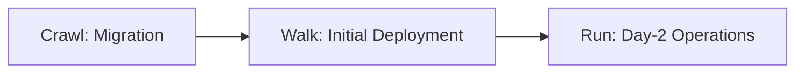
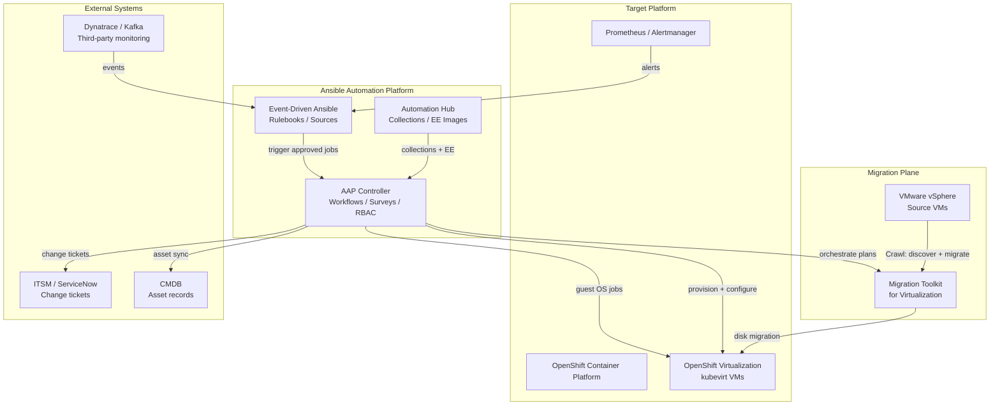


<div class="guide-header">

<h1>Virtualization automation with Ansible</h1>

<span class="guide-type-badge guide-type-badge--solution"><i class="fas fa-check-circle" aria-hidden="true"></i> Solution Guide</span>

</div>

<style>
  div#toc {
    display: none;
  }
</style>

<div class="guide-hero-callout" role="img" aria-label="Ansible unlocks Virtualization">
  
  <p class="guide-hero-callout__text">
    <span class="guide-hero-callout__ansible">Ansible</span>
    <span class="guide-hero-callout__unlocks">unlocks</span>
    <span class="guide-hero-callout__aiops">Virtualization</span>
  </p>
</div>

## Overview

Virtualization change is still too often two disconnected worlds: a UI-driven migration project, then a different set of tools for day-2 operations. Drift returns, recovery stays reactive, and the skills used to migrate do not transfer to production. This foundational guide frames **Ansible Automation Platform (AAP) for OpenShift Virtualization** -- automate from migration to production with one platform, one skillset, and auditable playbooks.

The maturity language matches the AVA 301 lifecycle map: **Migration → Initial Deployment → Day-2 Operations**, mapped here to **Crawl / Walk / Run**.

<div class="guide-outcome">
<strong>Outcome:</strong> A shared Crawl/Walk/Run reference for virtualization automation with nine use cases -- from VMware discovery and MTV orchestration through provisioning and guest configuration to snapshots, patching, lifecycle, and event-driven remediation.
</div>

- [Background](#background)
- [Solution](#solution)
- [Architecture](#architecture)
- [Common virtualization automation use cases](#common-virtualization-automation-use-cases)
- [Prerequisites](#prerequisites)
- [Collection and module mapping](#collection-and-module-mapping)
- [Virtualization automation workflow](#virtualization-automation-workflow)
- [Solution Walkthrough](#solution-walkthrough)
- [ITSM integration](#itsm-integration)
- [Validation](#validation)
- [Maturity Path](#maturity-path)
- [Summary](#summary)
- [Next Steps](#next-steps)

## Background

**Virtualization automation** uses AAP to orchestrate the full VM journey onto and on **OpenShift Virtualization**. Migration Toolkit for Virtualization (MTV) moves the disks; AAP makes migrations repeatable across clusters -- pre-flight checks, plan creation, wave ordering, post-migration validation, and ITSM approvals. The same Ansible skills then provision VMs, configure guests, and run day-2 operations: snapshots, patches, resource changes, and Event-Driven Ansible remediations.

Shared themes from the AVA 301 narrative:

- **Automation-first** -- do not migrate first and automate later; automate once, benefit always
- **Two collection journeys** -- `infra.openshift_virtualization_migration` for MTV at scale; `redhat.openshift_virtualization` / ops content for production VM lifecycle
- **Unified value** -- AAP supplies workflow orchestration, RBAC, and audit; OpenShift Virtualization supplies kubevirt runtime, storage, and network abstraction
- **Day-2 from day one** -- self-service provisioning, patching windows, dynamic inventory, and event-driven auto-remediation

Partner and deeper Solution Guides specialize (for example self-healing VMs). Start here for the shared journey and the nine use cases.

## Solution

What makes up the foundational pattern?

- **Ansible Automation Platform** for orchestration, surveys, scheduling, RBAC, and audit
- **Migration Toolkit for Virtualization (MTV)** for the data-plane move -- orchestrated by AAP
- **OpenShift Virtualization** as the VM runtime (kubevirt)
- **Event-Driven Ansible** for monitoring- and platform-triggered remediations
- **ITSM / CMDB integrations** for change tickets and approvals when required

### Who Benefits

| Persona | Challenge | What They Gain |
|---------|-----------|----------------|
| **Migration Team** | UI mistakes and one-off MTV plans across many clusters | Codified plans, pre-flight checks, and wave orchestration |
| **Virt / Platform Ops** | Different tools for migrate vs operate | Same Ansible skills from cutover into day-2 |
| **Leadership** | Migration risk and ops headcount scaling | Faster, safer migrations and lower MTTR without new tool sprawl |



## Architecture

The following diagram shows how each component connects across the Crawl / Walk / Run journey. AAP Controller is the orchestration hub; EDA subscribes to platform and monitoring events; MTV handles the data-plane migration; and OpenShift Virtualization is the target runtime.



### Execution environment requirements

All playbooks in this guide run inside an execution environment (EE). Build or extend an EE that includes:

| Package / Collection | Why |
|---------------------|-----|
| `kubernetes.core` | OpenShift API access (`k8s`, `k8s_info`, inventory plugin) |
| `redhat.openshift` | OpenShift-specific resources |
| `redhat.openshift_virtualization` | `kubevirt_vm`, `kubevirt_vm_info` modules |
| `infra.openshift_virtualization_migration` | MTV plan and mapping modules (Crawl) |
| `ansible.eda` | Rulebooks and source plugins (Run) |
| `redhat.rhel_system_roles` | Guest OS configuration (Walk / Run) |
| `servicenow.itsm` | ITSM integration (optional) |
| `python3-openshift` / `kubernetes` Python libs | Required by `kubernetes.core` |
| `oc` CLI | Used in validation tasks |

Pin collection versions to match your Automation Hub or validated content set.

<h2 id="common-virtualization-automation-use-cases">Common virtualization automation use cases</h2>

Nine patterns for customer conversations (from the Ansible OpenShift Virtualization Automation 301 use-case map). **One investment delivers value at every phase.** Each row maps to **Crawl**, **Walk**, or **Run**.

### How work starts

Virtualization automation can begin from a discovery job against VMware, an MTV plan workflow, a self-service survey in Automation controller, a schedule for patching or snapshots, or a platform/monitoring event into EDA. The use case describes the **pattern**; the entry point depends on the customer environment.

Each pattern has its own **Virtualization Use Case** page with production-ready playbook examples. Pick a row below or open the [Common virtualization automation use cases hub](virtualization-use-cases.md).

This foundational guide's [workflow](#virtualization-automation-workflow) is a **high-level Assess → Migrate → Deploy → Operate** loop. Open a strip item for the dedicated pattern page.

<div class="cards-track-section cards-track-section--use-cases">
<nav class="use-case-strip" aria-label="Virtualization automation use cases">
<a class="use-case-strip__item" href="README-Virtualization-Use-Case-01-Discover-and-Analyze.html">
  <span class="use-case-strip__num">1</span>
  <span class="use-case-strip__body">
    <span class="use-case-strip__title">Discover and analyze</span>
    <span class="use-case-strip__question">How do we inventory VMware and hardware before migration waves?</span>
  </span>
  <span class="use-case-maturity-chip use-case-maturity-chip--crawl">Crawl</span>
</a>
<a class="use-case-strip__item" href="README-Virtualization-Use-Case-02-Pre-Migration-Validation.html">
  <span class="use-case-strip__num">2</span>
  <span class="use-case-strip__body">
    <span class="use-case-strip__title">Pre-migration validation</span>
    <span class="use-case-strip__question">How do we prove target readiness and MTV prerequisites before cutover?</span>
  </span>
  <span class="use-case-maturity-chip use-case-maturity-chip--crawl">Crawl</span>
</a>
<a class="use-case-strip__item" href="README-Virtualization-Use-Case-03-MTV-Migration-Orchestration.html">
  <span class="use-case-strip__num">3</span>
  <span class="use-case-strip__body">
    <span class="use-case-strip__title">MTV migration orchestration</span>
    <span class="use-case-strip__question">How do we run the same migration plan across clusters without UI mistakes?</span>
  </span>
  <span class="use-case-maturity-chip use-case-maturity-chip--crawl">Crawl</span>
</a>
<a class="use-case-strip__item" href="README-Virtualization-Use-Case-04-VM-Provisioning.html">
  <span class="use-case-strip__num">4</span>
  <span class="use-case-strip__body">
    <span class="use-case-strip__title">VM provisioning workflows</span>
    <span class="use-case-strip__question">How do we self-service create VMs on OpenShift Virtualization with approvals?</span>
  </span>
  <span class="use-case-maturity-chip use-case-maturity-chip--walk">Walk</span>
</a>
<a class="use-case-strip__item" href="README-Virtualization-Use-Case-05-Guest-OS-and-Apps.html">
  <span class="use-case-strip__num">5</span>
  <span class="use-case-strip__body">
    <span class="use-case-strip__title">Guest OS and application configuration</span>
    <span class="use-case-strip__question">How do we configure guests and deploy apps without day-1 drift?</span>
  </span>
  <span class="use-case-maturity-chip use-case-maturity-chip--walk">Walk</span>
</a>
<a class="use-case-strip__item" href="README-Virtualization-Use-Case-06-Snapshot-and-Backup.html">
  <span class="use-case-strip__num">6</span>
  <span class="use-case-strip__body">
    <span class="use-case-strip__title">Snapshot and backup management</span>
    <span class="use-case-strip__question">How do we create, manage, and restore VM snapshots consistently?</span>
  </span>
  <span class="use-case-maturity-chip use-case-maturity-chip--walk">Walk</span>
</a>
<a class="use-case-strip__item" href="README-Virtualization-Use-Case-07-Patch-and-Package-Management.html">
  <span class="use-case-strip__num">7</span>
  <span class="use-case-strip__body">
    <span class="use-case-strip__title">Patch and package management</span>
    <span class="use-case-strip__question">How do we patch guest VMs inside maintenance windows with audit proof?</span>
  </span>
  <span class="use-case-maturity-chip use-case-maturity-chip--run">Run</span>
</a>
<a class="use-case-strip__item" href="README-Virtualization-Use-Case-08-Lifecycle-Management.html">
  <span class="use-case-strip__num">8</span>
  <span class="use-case-strip__body">
    <span class="use-case-strip__title">Lifecycle management</span>
    <span class="use-case-strip__question">How do we power, scale, and reconfigure NICs and storage on running VMs?</span>
  </span>
  <span class="use-case-maturity-chip use-case-maturity-chip--run">Run</span>
</a>
<a class="use-case-strip__item" href="README-Virtualization-Use-Case-09-Event-Driven-Remediation.html">
  <span class="use-case-strip__num">9</span>
  <span class="use-case-strip__body">
    <span class="use-case-strip__title">Event-driven remediation</span>
    <span class="use-case-strip__question">How do platform and monitoring events drive governed VM auto-remediation?</span>
  </span>
  <span class="use-case-maturity-chip use-case-maturity-chip--run">Run</span>
</a>
</nav>
</div>

## Prerequisites

Requirements depend on which use case or partner guide you implement.

### Ansible Automation Platform

- **Ansible Automation Platform 2.5+** recommended (EDA + Controller); 2.4 minimum for Controller-only Crawl paths
- **Event-Driven Ansible** when you adopt use case 9 (event-driven remediation)
- **Custom execution environment** with the collections and Python dependencies listed in the [Architecture](#architecture) section

### Featured Ansible Content Collections

| Collection | Type | Purpose | Use cases |
|-----------|------|---------|-----------|
| <a target="_blank" href="https://console.redhat.com/ansible/automation-hub/repo/published/kubernetes/core/">kubernetes.core</a> | Certified | OpenShift / Kubernetes API automation, dynamic inventory | All |
| <a target="_blank" href="https://console.redhat.com/ansible/automation-hub/repo/published/redhat/openshift/">redhat.openshift</a> | Certified | OpenShift platform resources | All |
| <a target="_blank" href="https://console.redhat.com/ansible/automation-hub/repo/published/redhat/openshift_virtualization/">redhat.openshift_virtualization</a> | Certified | `kubevirt_vm`, `kubevirt_vm_info` modules for VM lifecycle | 4, 5, 6, 7, 8 |
| infra.openshift_virtualization_migration | Community / Validated | MTV plan creation, network/storage mappings, wave orchestration | 1, 2, 3 |
| <a target="_blank" href="https://console.redhat.com/ansible/automation-hub/repo/published/ansible/eda/">ansible.eda</a> | Certified | Rulebooks for platform and monitoring events | 9 |
| <a target="_blank" href="https://console.redhat.com/ansible/automation-hub/repo/published/redhat/rhel_system_roles/">redhat.rhel_system_roles</a> | Certified | Guest OS configuration on RHEL VMs | 5, 7 |
| <a target="_blank" href="https://console.redhat.com/ansible/automation-hub/repo/published/servicenow/itsm/">servicenow.itsm</a> | Certified | ITSM change records and incident enrichment | Optional for all |
| <a target="_blank" href="https://console.redhat.com/ansible/automation-hub/repo/published/community/vmware/">community.vmware</a> | Community | VMware vCenter discovery and pre-migration facts | 1 |

### External Systems

| System | Required | Purpose |
|--------|----------|---------|
| OpenShift Virtualization | Yes | Target VM platform (kubevirt) |
| Migration Toolkit for Virtualization (MTV) | For migration use cases | Data-plane migration; AAP orchestrates plans |
| VMware vSphere | For migration discovery | Source inventory and pre-config |
| Metrics / alerting (Prometheus, Dynatrace, Kafka, and so on) | Optional for Crawl | Health signals into EDA at Run |
| ITSM (for example ServiceNow) | Optional | Change tickets and approvals |

**Operational Impact:** Medium to High -- migration cutovers and day-2 remediations can interrupt workloads. Prefer lab clusters and approvals first.

## Collection and module mapping

Each use case relies on specific modules. This table maps use cases to the primary modules and plugins so teams know exactly what to include in their execution environment and playbooks.

| Use case | Collection | Key modules / plugins | What they do |
|----------|-----------|----------------------|-------------|
| **1 -- Discover** | `community.vmware` | `vmware_vm_info`, `vmware_host_info`, `vmware_datastore_info` | Pull VM, host, and datastore facts from vCenter |
| **1 -- Discover** | `kubernetes.core` | `k8s_info` | Query target cluster readiness and existing VMs |
| **2 -- Validate** | `kubernetes.core` | `k8s_info` | Check MTV CRDs, storage classes, network attachments |
| **2 -- Validate** | `infra.openshift_virtualization_migration` | `mtv_provider_info`, `mtv_plan_info` | Verify source/target providers and plan prerequisites |
| **3 -- Migrate** | `infra.openshift_virtualization_migration` | `mtv_plan`, `mtv_networkmap`, `mtv_storagemap`, `mtv_hook` | Create and execute MTV plans programmatically |
| **4 -- Provision** | `redhat.openshift_virtualization` | `kubevirt_vm` | Create VirtualMachine resources with desired specs |
| **4 -- Provision** | `kubernetes.core` | `k8s`, `k8s_info` | Manage PVCs, services, and related resources |
| **5 -- Guest config** | `redhat.rhel_system_roles` | `rhel_system_roles.firewall`, `rhel_system_roles.timesync`, `rhel_system_roles.crypto_policies` | Harden and configure RHEL guests |
| **5 -- Guest config** | `ansible.builtin` | `dnf`, `service`, `template`, `user` | Install packages, manage services, deploy configs |
| **6 -- Snapshot** | `kubernetes.core` | `k8s` | Create and restore `VirtualMachineSnapshot` and `VirtualMachineRestore` objects |
| **7 -- Patch** | `ansible.builtin` | `dnf`, `yum`, `reboot` | Apply package updates and handle reboots |
| **7 -- Patch** | `redhat.rhel_system_roles` | `rhel_system_roles.selinux` | Relabel after kernel updates |
| **8 -- Lifecycle** | `redhat.openshift_virtualization` | `kubevirt_vm` | Modify CPU, memory, disks on existing VMs |
| **8 -- Lifecycle** | `kubernetes.core` | `k8s` | Patch VirtualMachine specs for NIC and storage changes |
| **9 -- EDA** | `ansible.eda` | `alertmanager` source, `k8s` source | Subscribe to Prometheus alerts and Kubernetes events |
| **9 -- EDA** | `redhat.openshift_virtualization` | `kubevirt_vm` | Restart, recreate, or live-migrate VMs from remediation jobs |

## Virtualization automation workflow


Assess the VMware estate and target readiness. Orchestrate MTV plans with AAP. Provision and configure on OpenShift Virtualization. Run day-2 snapshots, patches, lifecycle changes, and event-driven remediations -- with every action in the AAP audit trail.

## Solution Walkthrough

Each step below includes a representative playbook. Full production examples live in the individual [use case pages](#common-virtualization-automation-use-cases).

### Step 1: Assess and validate (Crawl / Migration)

**Operational Impact:** Low to Medium

Inventory VMware and supporting hardware; validate MTV prerequisites and target cluster readiness before any cutover.

```yaml
---
- name: Discover VMware estate for migration planning
  hosts: localhost
  connection: local
  gather_facts: false
  vars:
    vcenter_hostname: "{{ lookup('env', 'VMWARE_HOST') }}"
    vcenter_username: "{{ lookup('env', 'VMWARE_USER') }}"
    vcenter_password: "{{ lookup('env', 'VMWARE_PASSWORD') }}"
  tasks:
    - name: Gather all VM info from vCenter
      community.vmware.vmware_vm_info:
        hostname: "{{ vcenter_hostname }}"
        username: "{{ vcenter_username }}"
        password: "{{ vcenter_password }}"
        validate_certs: false
      register: vmware_vms

    - name: Build migration candidate report
      ansible.builtin.set_fact:
        migration_candidates: >-
          {{ vmware_vms.virtual_machines | selectattr('power_state', 'equalto', 'poweredOn')
             | map(attribute='guest_name') | list }}

    - name: Validate target OpenShift cluster access
      kubernetes.core.k8s_info:
        api_version: kubevirt.io/v1
        kind: VirtualMachine
        namespace: "{{ target_namespace | default('default') }}"
      register: existing_vms

    - name: Check MTV operator is installed
      kubernetes.core.k8s_info:
        api_version: forklift.konveyor.io/v1beta1
        kind: Provider
      register: mtv_providers

    - name: Report readiness
      ansible.builtin.debug:
        msg: >-
          Found {{ migration_candidates | length }} powered-on VMs in VMware.
          {{ existing_vms.resources | length }} VMs already on target.
          MTV providers: {{ mtv_providers.resources | map(attribute='metadata.name') | list }}.
```

### Step 2: Migrate and deploy (Walk)

**Operational Impact:** High

Orchestrate MTV plans and waves with AAP; provision new VMs with surveys; configure guest OS and applications so day-1 state matches intent.

```yaml
---
- name: Provision a VM on OpenShift Virtualization
  hosts: localhost
  connection: local
  gather_facts: false
  vars:
    vm_name: "{{ survey_vm_name }}"
    vm_namespace: "{{ survey_namespace | default('vms') }}"
    vm_cpu_cores: "{{ survey_cpu | default(2) }}"
    vm_memory: "{{ survey_memory | default('4Gi') }}"
    vm_disk_size: "{{ survey_disk | default('40Gi') }}"
  tasks:
    - name: Create VirtualMachine
      redhat.openshift_virtualization.kubevirt_vm:
        state: present
        name: "{{ vm_name }}"
        namespace: "{{ vm_namespace }}"
        labels:
          app: "{{ vm_name }}"
          managed-by: aap
        spec:
          running: true
          template:
            spec:
              domain:
                cpu:
                  cores: "{{ vm_cpu_cores | int }}"
                resources:
                  requests:
                    memory: "{{ vm_memory }}"
                devices:
                  disks:
                    - name: rootdisk
                      disk:
                        bus: virtio
                  interfaces:
                    - name: default
                      masquerade: {}
              networks:
                - name: default
                  pod: {}
              volumes:
                - name: rootdisk
                  dataVolume:
                    name: "{{ vm_name }}-rootdisk"
          dataVolumeTemplates:
            - metadata:
                name: "{{ vm_name }}-rootdisk"
              spec:
                storage:
                  resources:
                    requests:
                      storage: "{{ vm_disk_size }}"
                  storageClassName: ocs-storagecluster-ceph-rbd
                source:
                  pvc:
                    name: rhel9-base
                    namespace: openshift-virtualization-os-images
      register: vm_result

    - name: Wait for VM to reach Running
      kubernetes.core.k8s_info:
        api_version: kubevirt.io/v1
        kind: VirtualMachineInstance
        name: "{{ vm_name }}"
        namespace: "{{ vm_namespace }}"
      register: vmi_status
      until: vmi_status.resources | length > 0 and vmi_status.resources[0].status.phase == "Running"
      retries: 30
      delay: 10
```

### Step 3: Operate continuously (Run)

**Operational Impact:** Medium to High

Automate snapshots, guest patching in maintenance windows, resource and NIC lifecycle, and EDA-driven remediations for unhealthy VMs or nodes.

```yaml
---
- name: Maintenance window -- snapshot, patch, verify
  hosts: localhost
  connection: local
  gather_facts: false
  vars:
    vm_name: "{{ target_vm }}"
    vm_namespace: "{{ target_namespace | default('vms') }}"
  tasks:
    - name: Create pre-patch snapshot
      kubernetes.core.k8s:
        state: present
        definition:
          apiVersion: snapshot.kubevirt.io/v1beta1
          kind: VirtualMachineSnapshot
          metadata:
            name: "{{ vm_name }}-prepatch-{{ ansible_date_time.iso8601_basic_short }}"
            namespace: "{{ vm_namespace }}"
          spec:
            source:
              apiGroup: kubevirt.io
              kind: VirtualMachine
              name: "{{ vm_name }}"

    - name: Wait for snapshot to be ready
      kubernetes.core.k8s_info:
        api_version: snapshot.kubevirt.io/v1beta1
        kind: VirtualMachineSnapshot
        name: "{{ vm_name }}-prepatch-{{ ansible_date_time.iso8601_basic_short }}"
        namespace: "{{ vm_namespace }}"
      register: snap_status
      until: snap_status.resources[0].status.readyToUse | default(false)
      retries: 20
      delay: 15

- name: Patch guest OS packages
  hosts: "{{ target_vm }}"
  become: true
  tasks:
    - name: Apply all available security updates
      ansible.builtin.dnf:
        name: "*"
        state: latest
        security: true
        update_cache: true
      register: patch_result

    - name: Reboot if kernel updated
      ansible.builtin.reboot:
        reboot_timeout: 600
      when: patch_result.results | select('search', 'kernel') | list | length > 0

    - name: Verify services are running after patch
      ansible.builtin.service_facts:

    - name: Assert critical services are active
      ansible.builtin.assert:
        that:
          - ansible_facts.services['sshd.service'].state == 'running'
        fail_msg: "Critical service not running after patching"
```

**EDA rulebook for event-driven remediation (use case 9):**

```yaml
---
- name: OpenShift Virtualization VM health remediation
  hosts: all
  sources:
    - ansible.eda.alertmanager:
        host: 0.0.0.0
        port: 8000
  rules:
    - name: Restart failed VMI
      condition: >-
        event.alerts[0].labels.alertname == "KubeVirtVMIExcessiveMigrations"
        or event.alerts[0].labels.alertname == "KubeVirtVMICrashLoop"
      action:
        run_job_template:
          name: "Remediate VM - Restart VMI"
          organization: Default
          job_args:
            extra_vars:
              vm_name: "{{ event.alerts[0].labels.name }}"
              vm_namespace: "{{ event.alerts[0].labels.namespace }}"
              alert_name: "{{ event.alerts[0].labels.alertname }}"

    - name: Migrate VM off unhealthy node
      condition: >-
        event.alerts[0].labels.alertname == "KubeNodeNotReady"
      action:
        run_job_template:
          name: "Remediate VM - Live Migrate"
          organization: Default
          job_args:
            extra_vars:
              target_node: "{{ event.alerts[0].labels.node }}"
              alert_name: "{{ event.alerts[0].labels.alertname }}"

    - name: Notify on unknown VM alert
      condition: >-
        event.alerts[0].labels.alertname is match("KubeVirt.*", ignorecase=true)
      action:
        run_job_template:
          name: "VM Alert - Notify Only"
          organization: Default
          job_args:
            extra_vars:
              alert_payload: "{{ event.alerts[0] }}"
```

## ITSM integration

AAP workflows can create or update ServiceNow change records at migration gates, pre-patch approvals, and post-remediation audit steps. This pattern applies across all nine use cases wherever change management is required.

### Creating a change record before migration

```yaml
- name: Create ServiceNow change record for migration wave
  servicenow.itsm.change_request:
    instance:
      host: "{{ snow_instance }}"
      username: "{{ snow_username }}"
      password: "{{ snow_password }}"
    state: new
    type: standard
    short_description: "AAP migration wave -- {{ wave_name }}"
    description: >-
      Automated migration wave {{ wave_name }} via AAP.
      Source: VMware cluster {{ source_cluster }}.
      Target: OpenShift Virtualization namespace {{ target_namespace }}.
      VMs: {{ migration_vms | join(', ') }}.
    assignment_group: "Platform Operations"
    risk: moderate
  register: change_record
```

### Closing a change record after completion

```yaml
- name: Close change record with job results
  servicenow.itsm.change_request:
    instance:
      host: "{{ snow_instance }}"
      username: "{{ snow_username }}"
      password: "{{ snow_password }}"
    number: "{{ change_record.record.number }}"
    state: closed
    close_code: successful
    close_notes: >-
      Migration completed. AAP job ID: {{ tower_job_id }}.
      VMs migrated: {{ migrated_count }}. Failed: {{ failed_count }}.
```

## Validation

Validation covers each phase of the Crawl / Walk / Run journey. Run these checks from within your execution environment.

### Crawl -- migration readiness

```bash
# Confirm VMware credentials and VM discovery
ansible-playbook discover-vmware.yml --check -v

# Verify MTV operator and providers
oc get csv -n openshift-mtv | grep forklift
oc get providers.forklift.konveyor.io -A

# List existing migration plans
oc get plans.forklift.konveyor.io -A
```

### Walk -- provisioning and configuration

```bash
# List VMs across all namespaces
oc get vm -A

# Confirm a provisioned VM is running
oc get vmi <vm-name> -n <namespace> -o jsonpath='{.status.phase}'

# Verify guest agent is reporting
oc get vmi <vm-name> -n <namespace> -o jsonpath='{.status.guestOSInfo}'

# Check dynamic inventory from kubevirt
ansible-inventory -i kubevirt.yml --graph
```

### Run -- day-2 operations

```bash
# Verify snapshot exists and is ready
oc get virtualmachinesnapshot -n <namespace>
oc get virtualmachinesnapshot <snap-name> -n <namespace> -o jsonpath='{.status.readyToUse}'

# Confirm EDA is running and connected
oc get pods -n ansible-eda -l app=eda

# Check AAP job history for recent remediation runs
awx job_templates list --name "Remediate VM*" -f human
```

### Expected Results

| Phase | Check | Pass criteria |
|-------|-------|---------------|
| Crawl | VMware discovery | `vmware_vm_info` returns expected VM count |
| Crawl | MTV readiness | Provider and plan CRDs exist; operator CSV is `Succeeded` |
| Walk | VM provisioning | VMI reaches `Running` within 5 minutes; guest agent reports |
| Walk | Guest config | `ansible-playbook --check` shows no drift on configured guests |
| Run | Snapshot | `readyToUse: true` within 5 minutes of creation |
| Run | Patch | `dnf` reports 0 packages to update post-run |
| Run | EDA | Replayed alert triggers correct job template within 60 seconds |

### Troubleshooting

| Symptom | Likely Cause | Fix |
|---------|-------------|-----|
| `oc` / k8s auth fails in job | Missing kubeconfig credential or expired token | Add Controller credential; verify EE has `python3-openshift` |
| MTV plan fails pre-checks | Source or mapping incomplete | Re-run use case 2 validation; fix network/storage maps |
| EDA ignores VM events | Wrong source plugin config or filter mismatch | Replay payload with `curl`; adjust rulebook conditions |
| VM stuck in Scheduling | Insufficient node resources or missing storage class | Check `oc describe vmi`; verify storage class and node capacity |
| Guest unreachable after provision | Network policy blocking SSH/WinRM | Check `NetworkAttachmentDefinition` and pod network policies |
| Snapshot never reaches readyToUse | Volume snapshot class missing or storage backend issue | Verify `VolumeSnapshotClass` exists for your storage provider |
| ITSM ticket not created | ServiceNow credential or instance URL wrong | Test `servicenow.itsm.now` connectivity from EE |

## Maturity Path

| Maturity | Lifecycle phase | Focus | Use cases |
|----------|-----------------|-------|-----------|
| **Crawl** | Migration | Discover, validate, orchestrate MTV | 1 Discover and analyze, 2 Pre-migration validation, 3 MTV migration orchestration |
| **Walk** | Initial Deployment | Provision and configure without drift | 4 VM provisioning, 5 Guest OS and apps, 6 Snapshot and backup |
| **Run** | Day-2 Operations | Patch, lifecycle, event-driven healing | 7 Patch and package management, 8 Lifecycle management, 9 Event-driven remediation |

## Summary

Virtualization automation with Ansible is an automation-first journey: MTV does the heavy lifting; AAP keeps migrations consistent and turns the same skills into production operations on OpenShift Virtualization. This guide provides the architecture, collection mapping, production playbooks, and validation checks to move from VMware discovery through event-driven day-2 operations -- with every action in the AAP audit trail.

## Next Steps

1. Browse the [Common virtualization automation use cases hub](virtualization-use-cases.md) for per-pattern production playbooks.
2. For a concrete Run pattern, open [Self-healing VMs on OpenShift](README-Self-Healing-VMs-OpenShift.md).
3. Build your execution environment with the [collection and module mapping](#collection-and-module-mapping) table.
4. Return to the catalog **Virtualization** section as more platform guides land.

