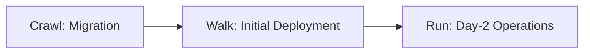


<div class="guide-header">

<h1>Virtualization automation with Ansible</h1>

<span class="guide-type-badge guide-type-badge--solution"><i class="fas fa-check-circle" aria-hidden="true"></i> Solution Guide</span>

</div>

<style>
  div#toc {
    display: none;
  }
</style>

<div class="guide-hero-callout" role="img" aria-label="Ansible unlocks Virtualization">
  
  <p class="guide-hero-callout__text">
    <span class="guide-hero-callout__ansible">Ansible</span>
    <span class="guide-hero-callout__unlocks">unlocks</span>
    <span class="guide-hero-callout__aiops">Virtualization</span>
  </p>
</div>

## Overview

Virtualization change is still too often two disconnected worlds: a UI-driven migration project, then a different set of tools for day-2 operations. Drift returns, recovery stays reactive, and the skills used to migrate do not transfer to production. This foundational guide frames **Ansible Automation Platform (AAP) for OpenShift Virtualization** -- automate from migration to production with one platform, one skillset, and auditable playbooks.

The maturity language matches the AVA 301 lifecycle map: **Migration → Initial Deployment → Day-2 Operations**, mapped here to **Crawl / Walk / Run**.

<div class="guide-outcome">
<strong>Outcome:</strong> A shared Crawl/Walk/Run reference for virtualization automation with nine use cases -- from VMware discovery and MTV orchestration through provisioning and guest configuration to snapshots, patching, lifecycle, and event-driven remediation.
</div>

- [Background](#background)
- [Solution](#solution)
- [Common virtualization automation use cases](#common-virtualization-automation-use-cases)
- [Prerequisites](#prerequisites)
- [Virtualization automation workflow](#virtualization-automation-workflow)
- [Solution Walkthrough](#solution-walkthrough)
- [Validation](#validation)
- [Maturity Path](#maturity-path)
- [Summary](#summary)
- [Next Steps](#next-steps)

## Background

**Virtualization automation** uses AAP to orchestrate the full VM journey onto and on **OpenShift Virtualization**. Migration Toolkit for Virtualization (MTV) moves the disks; AAP makes migrations repeatable across clusters -- pre-flight checks, plan creation, wave ordering, post-migration validation, and ITSM approvals. The same Ansible skills then provision VMs, configure guests, and run day-2 operations: snapshots, patches, resource changes, and Event-Driven Ansible remediations.

Shared themes from the AVA 301 narrative:

- **Automation-first** -- do not migrate first and automate later; automate once, benefit always
- **Two collection journeys** -- `infra.openshift_virtualization_migration` for MTV at scale; `redhat.openshift_virtualization` / ops content for production VM lifecycle
- **Unified value** -- AAP supplies workflow orchestration, RBAC, and audit; OpenShift Virtualization supplies kubevirt runtime, storage, and network abstraction
- **Day-2 from day one** -- self-service provisioning, patching windows, dynamic inventory, and event-driven auto-remediation

Partner and deeper Solution Guides specialize (for example self-healing VMs). Start here for the shared journey and the nine use cases.

## Solution

What makes up the foundational pattern?

- **Ansible Automation Platform** for orchestration, surveys, scheduling, RBAC, and audit
- **Migration Toolkit for Virtualization (MTV)** for the data-plane move -- orchestrated by AAP
- **OpenShift Virtualization** as the VM runtime (kubevirt)
- **Event-Driven Ansible** for monitoring- and platform-triggered remediations
- **ITSM / CMDB integrations** for change tickets and approvals when required

### Who Benefits

| Persona | Challenge | What They Gain |
|---------|-----------|----------------|
| **Migration Team** | UI mistakes and one-off MTV plans across many clusters | Codified plans, pre-flight checks, and wave orchestration |
| **Virt / Platform Ops** | Different tools for migrate vs operate | Same Ansible skills from cutover into day-2 |
| **Leadership** | Migration risk and ops headcount scaling | Faster, safer migrations and lower MTTR without new tool sprawl |



<h2 id="common-virtualization-automation-use-cases">Common virtualization automation use cases</h2>

Nine patterns for customer conversations (from the Ansible OpenShift Virtualization Automation 301 use-case map). **One investment delivers value at every phase.** Each row maps to **Crawl**, **Walk**, or **Run**.

### How work starts

Virtualization automation can begin from a discovery job against VMware, an MTV plan workflow, a self-service survey in Automation controller, a schedule for patching or snapshots, or a platform/monitoring event into EDA. The use case describes the **pattern**; the entry point depends on the customer environment.

Each pattern has its own **Virtualization Use Case** page (scaffold today; deepen over time). Pick a row below or open the [Common virtualization automation use cases hub](virtualization-use-cases.md).

This foundational guide's [workflow](#virtualization-automation-workflow) is a **high-level Assess → Migrate → Deploy → Operate** loop. Open a strip item for the dedicated pattern page.

<div class="cards-track-section cards-track-section--use-cases">
<nav class="use-case-strip" aria-label="Virtualization automation use cases">
<a class="use-case-strip__item" href="README-Virtualization-Use-Case-01-Discover-and-Analyze.html">
  <span class="use-case-strip__num">1</span>
  <span class="use-case-strip__body">
    <span class="use-case-strip__title">Discover and analyze</span>
    <span class="use-case-strip__question">How do we inventory VMware and hardware before migration waves?</span>
  </span>
  <span class="use-case-maturity-chip use-case-maturity-chip--crawl">Crawl</span>
</a>
<a class="use-case-strip__item" href="README-Virtualization-Use-Case-02-Pre-Migration-Validation.html">
  <span class="use-case-strip__num">2</span>
  <span class="use-case-strip__body">
    <span class="use-case-strip__title">Pre-migration validation</span>
    <span class="use-case-strip__question">How do we prove target readiness and MTV prerequisites before cutover?</span>
  </span>
  <span class="use-case-maturity-chip use-case-maturity-chip--crawl">Crawl</span>
</a>
<a class="use-case-strip__item" href="README-Virtualization-Use-Case-03-MTV-Migration-Orchestration.html">
  <span class="use-case-strip__num">3</span>
  <span class="use-case-strip__body">
    <span class="use-case-strip__title">MTV migration orchestration</span>
    <span class="use-case-strip__question">How do we run the same migration plan across clusters without UI mistakes?</span>
  </span>
  <span class="use-case-maturity-chip use-case-maturity-chip--crawl">Crawl</span>
</a>
<a class="use-case-strip__item" href="README-Virtualization-Use-Case-04-VM-Provisioning.html">
  <span class="use-case-strip__num">4</span>
  <span class="use-case-strip__body">
    <span class="use-case-strip__title">VM provisioning workflows</span>
    <span class="use-case-strip__question">How do we self-service create VMs on OpenShift Virtualization with approvals?</span>
  </span>
  <span class="use-case-maturity-chip use-case-maturity-chip--walk">Walk</span>
</a>
<a class="use-case-strip__item" href="README-Virtualization-Use-Case-05-Guest-OS-and-Apps.html">
  <span class="use-case-strip__num">5</span>
  <span class="use-case-strip__body">
    <span class="use-case-strip__title">Guest OS and application configuration</span>
    <span class="use-case-strip__question">How do we configure guests and deploy apps without day-1 drift?</span>
  </span>
  <span class="use-case-maturity-chip use-case-maturity-chip--walk">Walk</span>
</a>
<a class="use-case-strip__item" href="README-Virtualization-Use-Case-06-Snapshot-and-Backup.html">
  <span class="use-case-strip__num">6</span>
  <span class="use-case-strip__body">
    <span class="use-case-strip__title">Snapshot and backup management</span>
    <span class="use-case-strip__question">How do we create, manage, and restore VM snapshots consistently?</span>
  </span>
  <span class="use-case-maturity-chip use-case-maturity-chip--walk">Walk</span>
</a>
<a class="use-case-strip__item" href="README-Virtualization-Use-Case-07-Patch-and-Package-Management.html">
  <span class="use-case-strip__num">7</span>
  <span class="use-case-strip__body">
    <span class="use-case-strip__title">Patch and package management</span>
    <span class="use-case-strip__question">How do we patch guest VMs inside maintenance windows with audit proof?</span>
  </span>
  <span class="use-case-maturity-chip use-case-maturity-chip--run">Run</span>
</a>
<a class="use-case-strip__item" href="README-Virtualization-Use-Case-08-Lifecycle-Management.html">
  <span class="use-case-strip__num">8</span>
  <span class="use-case-strip__body">
    <span class="use-case-strip__title">Lifecycle management</span>
    <span class="use-case-strip__question">How do we power, scale, and reconfigure NICs and storage on running VMs?</span>
  </span>
  <span class="use-case-maturity-chip use-case-maturity-chip--run">Run</span>
</a>
<a class="use-case-strip__item" href="README-Virtualization-Use-Case-09-Event-Driven-Remediation.html">
  <span class="use-case-strip__num">9</span>
  <span class="use-case-strip__body">
    <span class="use-case-strip__title">Event-driven remediation</span>
    <span class="use-case-strip__question">How do platform and monitoring events drive governed VM auto-remediation?</span>
  </span>
  <span class="use-case-maturity-chip use-case-maturity-chip--run">Run</span>
</a>
</nav>
</div>

## Prerequisites

Requirements depend on which use case or partner guide you implement.

### Ansible Automation Platform

- **Ansible Automation Platform 2.4+** with Controller
- **Event-Driven Ansible** when you adopt use case 9 (event-driven remediation)

### Featured Ansible Content Collections

| Collection | Type | Purpose |
|-----------|------|---------|
| <a target="_blank" href="https://console.redhat.com/ansible/automation-hub/repo/published/kubernetes/core/">kubernetes.core</a> | Certified | OpenShift / Kubernetes API automation |
| <a target="_blank" href="https://console.redhat.com/ansible/automation-hub/repo/published/redhat/openshift/">redhat.openshift</a> | Certified | OpenShift platform resources |
| <a target="_blank" href="https://console.redhat.com/ansible/automation-hub/repo/published/ansible/eda/">ansible.eda</a> | Certified | Rulebooks for platform and monitoring events |
| <a target="_blank" href="https://console.redhat.com/ansible/automation-hub/repo/published/redhat/rhel_system_roles/">redhat.rhel_system_roles</a> | Certified | Guest OS configuration on RHEL VMs |

Migration-focused content such as **infra.openshift_virtualization_migration** and OpenShift Virtualization lifecycle modules (**kubevirt_vm**, **kubevirt_vm_info**, kubevirt inventory) appear in AVA labs and partner materials -- pin the versions your Hub or validated content set publishes.

### External Systems

| System | Required | Purpose |
|--------|----------|---------|
| OpenShift Virtualization | Recommended | Target VM platform (kubevirt) |
| Migration Toolkit for Virtualization (MTV) | For migration use cases | Data-plane migration; AAP orchestrates plans |
| VMware vSphere (or source virt) | For migration discovery | Source inventory and pre-config |
| Metrics / alerting (Prometheus, Dynatrace, Kafka, and so on) | Optional for Crawl | Health signals into EDA at Run |
| ITSM (for example ServiceNow) | Optional | Change tickets and approvals |

**Operational Impact:** Medium to High -- migration cutovers and day-2 remediations can interrupt workloads. Prefer lab clusters and approvals first.

## Virtualization automation workflow


Assess the VMware estate and target readiness. Orchestrate MTV plans with AAP. Provision and configure on OpenShift Virtualization. Run day-2 snapshots, patches, lifecycle changes, and event-driven remediations -- with every action in the AAP audit trail.

## Solution Walkthrough

> **Scaffold note:** Expand with production YAML as use-case pages mature. See [Self-healing VMs on OpenShift](README-Self-Healing-VMs-OpenShift.md) for a concrete EDA + OpenShift Virtualization day-2 path.

### Step 1: Assess and validate (Crawl / Migration)

**Operational Impact:** Low to Medium

Inventory VMware and supporting hardware; validate MTV prerequisites and target cluster readiness before any cutover.

### Step 2: Migrate and deploy (Walk)

**Operational Impact:** High

Orchestrate MTV plans and waves with AAP; provision new VMs with surveys; configure guest OS and applications so day-1 state matches intent.

### Step 3: Operate continuously (Run)

**Operational Impact:** Medium to High

Automate snapshots, guest patching in maintenance windows, resource and NIC lifecycle, and EDA-driven remediations for unhealthy VMs or nodes.

## Validation

### Test

```bash
# Confirm cluster access from an EE and list VirtualMachine objects (lab cluster)
oc get vm -A
```

### Expected Result

```
VirtualMachine list returns expected namespaces; a lab migration-prep or lifecycle job
completes with failed=0 and leaves an AAP job artifact.
```

### Troubleshooting

| Symptom | Likely Cause | Fix |
|---------|-------------|-----|
| oc / k8s auth fails in job | Missing kubeconfig credential | Add Controller credential and EE packages |
| MTV plan fails pre-checks | Source or mapping incomplete | Re-run use case 2 validation; fix network/storage maps |
| EDA ignores VM events | Wrong API or filter | Align rulebook with OpenShift / monitoring payload |

## Maturity Path

| Maturity | Lifecycle phase | Focus | Use cases |
|----------|-----------------|-------|-----------|
| **Crawl** | Migration | Discover, validate, orchestrate MTV | 1 Discover and analyze, 2 Pre-migration validation, 3 MTV migration orchestration |
| **Walk** | Initial Deployment | Provision and configure without drift | 4 VM provisioning, 5 Guest OS and apps, 6 Snapshot and backup |
| **Run** | Day-2 Operations | Patch, lifecycle, event-driven healing | 7 Patch and package management, 8 Lifecycle management, 9 Event-driven remediation |

## Summary

Virtualization automation with Ansible is an automation-first journey: MTV does the heavy lifting; AAP keeps migrations consistent and turns the same skills into production operations on OpenShift Virtualization. Use this foundational page and the nine use-case strip for customer conversations, then open deeper guides such as Self-healing VMs for executable day-2 patterns.

## Next Steps

1. Browse the [Common virtualization automation use cases hub](virtualization-use-cases.md).
2. For a concrete Run pattern, open [Self-healing VMs on OpenShift](README-Self-Healing-VMs-OpenShift.md).
3. Return to the catalog **Virtualization** section as more platform guides land.

