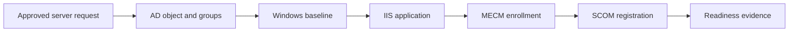


<link rel="stylesheet" href="assets/css/windows-solution-guides.css">

<div class="guide-header">

<h1>Standardize Windows server onboarding</h1>

<span class="guide-type-badge guide-type-badge--solution"><i class="fas fa-check-circle" aria-hidden="true"></i> Solution Guide</span>

</div>

<div class="guide-hero-callout guide-hero-partner guide-hero-partner--windows" role="img" aria-label="Ansible Automation Platform and Microsoft Windows">
  
  <span class="guide-hero-partner__plus" aria-hidden="true">+</span>
  <span class="guide-hero-partner__partner card-partner-logo-set">
    
    
  </span>
</div>

## Overview

New Windows servers pass through separate identity, operating system, application, endpoint-management, and monitoring processes. Manual handoffs make it difficult to prove that a server is ready for service. This guide uses Red Hat Ansible Automation Platform with Microsoft technologies to move a server from directory onboarding through baseline configuration, IIS deployment, and management registration.

### Business value

Reduce manual server handoffs and retain a consistent readiness record before releasing a host to application teams. Capture a baseline before rollout and compare actual results at 30, 60, and 90 days. The source document does not provide measured results for this scenario.

### Technical value

Use version-controlled automation, scoped inventories, centrally managed credentials, and AAP workflow history to coordinate the Microsoft systems involved in this outcome.

> **Draft:** Technical validation pending.
>
> This is a reformatted source draft. Code excerpts preserve the author's intended patterns and require module, parameter, version, and lab verification before publication. Proposed tests below are acceptance criteria, not completed validation.

## Table of Contents

- [Background](#background)
- [Solution](#solution)
- [Prerequisites](#prerequisites)
- [Workflow and Architecture](#workflow-and-architecture)
- [Solution Walkthrough](#solution-walkthrough)
- [Validation](#validation)
- [Maturity Path](#maturity-path)
- [Summary](#summary)
- [Sources](#sources)
- [Next Steps](#next-steps)

## Background

Move a server from directory onboarding through baseline configuration, IIS deployment, and management registration. Windows operations rely on dependencies across identity, host configuration, applications, and management systems. AAP coordinates those dependencies through discrete job templates and success or failure paths rather than leaving the sequence to manual handoffs.

The target environment is an existing Windows estate with an existing AAP deployment. Establish the access, change window, recovery procedure, and component versions before enabling automation. 

## Solution

### Components

| **Collection** | **Purpose** |
| --- | --- |
| `ansible.windows` | Windows feature installation, service management, registry, audit policy, reboot |
| `microsoft.ad` | Computer account creation, group membership, OU placement |
| `microsoft.iis` | Application pool creation, website deployment, HTTPS binding |
| `microsoft.mecm` | MECM client enrollment and site assignment |
| `microsoft.scom` | SCOM agent registration and monitoring rule assignment |

Automation controller coordinates the job templates, inventory, credentials, approvals, and execution history. 

### Who Benefits

| Persona | Challenge | What They Gain |
|---|---|---|
| Windows administrator | Manual steps and inconsistent handoffs | A repeatable workflow with explicit verification |
| Automation architect | Dependencies across Microsoft systems | A reference flow with scoped credentials and job boundaries |
| Operations lead | Limited visibility into changes and recovery | Job evidence, acceptance gates, and a defined escalation path |

### Recommended Demos and Self-Paced Labs

- [Ansible self-paced labs](https://www.redhat.com/en/interactive-labs/ansible)

A scenario-specific demonstration was not supplied in the source document.

## Prerequisites

### Ansible Automation Platform

Use an existing AAP deployment with automation controller, a versioned execution environment, and access to the collections below. 

**Required platform version: Red Hat Ansible Automation Platform 2.5+.** Record the exact AAP, ansible-core, collection, Windows Server, PowerShell, and Microsoft product versions used for validation before publishing.

### Featured Ansible Content Collections

| Collection | Purpose | Version and support |
|---|---|---|
| [ansible.windows](https://console.redhat.com/ansible/automation-hub/repo/published/ansible/windows/) | Windows operations and health checks | Exact version and support status require confirmation |
| [microsoft.ad](https://console.redhat.com/ansible/automation-hub/repo/published/microsoft/ad/) | Directory objects and domain membership | Exact version and support status require confirmation |
| [microsoft.iis](https://console.redhat.com/ansible/automation-hub/repo/published/microsoft/iis/) | IIS sites, pools, and bindings | Exact version and support status require confirmation |
| [microsoft.mecm](https://console.redhat.com/ansible/automation-hub/repo/published/microsoft/mecm/) | Endpoint management integration | Exact version and support status require confirmation |
| [microsoft.scom](https://console.redhat.com/ansible/automation-hub/repo/published/microsoft/scom/) | Monitoring integration | Exact version and support status require confirmation |

Only install the collections required for this scenario. Use the Automation Hub entry for the selected version as the source of support and dependency information. Do not infer certification from the namespace.

### External Systems and Access

- A non-production Windows target for initial validation, with WinRM configured and reachable from the execution node.
- The Microsoft management systems shown in the architecture, with service identities and permissions scoped to the operations performed.
- Working DNS and time synchronization for domain authentication; trusted certificates for HTTPS and LDAPS where used.
- AAP Machine credentials for Windows access; separate credentials for directory discovery or integration services when their APIs require them.
- A version-controlled project containing the playbooks, documented variables, and a tested recovery procedure.

### Connectivity and Credentials

This reference pattern uses WinRM over HTTPS on TCP 5986 with certificate validation enabled. Use Kerberos for domain accounts where appropriate. Select delegation only for a demonstrated second-hop requirement; CredSSP is not mandatory for every MECM or SCOM operation. Keep secrets in AAP credentials or an approved secret store.

AD module execution on a Windows host and LDAP inventory discovery from an execution environment are distinct paths. Configure credentials, Python dependencies, and network access for the path actually used.

**Operational Impact:** Medium; High if a production reboot or application change is required. Directory writes and changes to monitoring state are changes even when no Windows service restarts. Read-only discovery and health checks have no intended configuration impact.

## Workflow and Architecture



### Narrative Walkthrough

**AD is the trigger.** When a new server needs provisioning, you create its computer account in the correct OU and assign it to the appropriate security groups. Every downstream step depends on this object existing in Active Directory first.

**Group membership drives policy and access.** Adding the computer to security groups controls Group Policy application, patching schedules, and firewall rules. These memberships must be in place before the host joins the domain.

**Windows base configuration locks down the host.** You install required features (Web-Server, .NET Framework), disable unnecessary services, apply registry hardening (SMBv1 disabled), and set audit policies. This stage has the highest operational impact because it modifies the host's running state. A reboot may be required after feature installation.

**IIS deployment stands up the application layer.** You create an application pool with a managed service account, deploy the website with its physical path, and bind the HTTPS certificate. The app pool runs under a domain service account, so AD group membership from step two must already be complete.

**MECM enrollment registers the host for management.** The MECM client installs and registers with the site server. This is a lightweight operation -- it does not push configuration policies immediately. MECM handles patch compliance, software distribution, and inventory going forward.

**SCOM registration enables monitoring.** The SCOM agent installs on the host and registers with the management server. You then assign monitoring rules and management packs. SCOM needs the host fully configured before registration so that baseline health checks pass on first evaluation.

Rerun behavior must be validated for each stage. Use the AAP workflow history to identify completed work and resume only after reviewing the failure.

## Solution Walkthrough

Replace all angle-bracket placeholders and survey variables with documented lab values. Map each playbook to a job template with its own target limit and credential. Configure workflow success and failure edges so that a failed readiness gate cannot silently advance the workflow.


### Step 1: AD Computer Onboarding

```yaml
---
- name: Onboard server to Active Directory
  hosts: localhost
  gather_facts: false
  vars:
    server_name: "{{ survey_server_name }}"
    server_ou: "OU=Web,OU=Servers,DC=contoso,DC=com"
    server_groups:
      - WebServers
      - PatchingRing1
  tasks:
    - name: Create computer account in target OU
      microsoft.ad.computer:
        name: "{{ server_name }}"
        path: "{{ server_ou }}"
        description: "Provisioned by AAP - {{ ansible_date_time.date }}"
        state: present
      delegate_to: <DOMAIN_CONTROLLER>
    - name: Add server to security groups
      microsoft.ad.group:
        name: "{{ item }}"
        members:
          add:
            - "{{ server_name }}$"
        state: present
      loop: "{{ server_groups }}"
      delegate_to: <DOMAIN_CONTROLLER>
```

### Step 2: Windows Server Hardening

```yaml
---
- name: Apply Windows server baseline configuration
  hosts: "{{ target_hosts }}"
  gather_facts: true
  tasks:
    - name: Install required Windows features
      ansible.windows.win_feature:
        name:
          - Web-Server
          - Web-Mgmt-Tools
          - NET-Framework-45-Core
        state: present
      register: feature_result
    - name: Disable unnecessary services
      ansible.windows.win_service:
        name: "{{ item }}"
        start_mode: disabled
        state: stopped
      loop:
        - XblGameSave
        - XblAuthManager
        - MapsBroker
        - RetailDemo
    - name: Apply registry hardening - disable SMBv1
      ansible.windows.win_regedit:
        path: HKLM:\SYSTEM\CurrentControlSet\Services\LanmanServer\Parameters
        name: SMB1
        data: 0
        type: dword
    - name: Enable command-line auditing
      ansible.windows.win_audit_policy_system:
        subcategory: Process Creation
        audit_type: success, failure
    - name: Reboot if features required it
      ansible.windows.win_reboot:
        reboot_timeout: 300
      when: feature_result.reboot_required
```

### Step 3: IIS Site Deployment with HTTPS

```yaml
---
- name: Deploy IIS web application
  hosts: web_servers
  gather_facts: false
  tasks:
    - name: Create application pool
      microsoft.iis.web_app_pool:
        name: "{{ app_name }}_pool"
        state: started
        attributes:
          managedRuntimeVersion: v4.0
          managedPipelineMode: Integrated
          processModel.identityType: SpecificUser
          processModel.userName: "{{ app_svc_account }}"
          processModel.password: "{{ vault_app_svc_password }}"
          recycling.periodicRestart.time: "02:00:00"
    - name: Create website with HTTPS binding
      microsoft.iis.website:
        name: "{{ app_name }}"
        state: started
        physical_path: "C:\\inetpub\\{{ app_name }}"
        application_pool: "{{ app_name }}_pool"
        bindings:
          - protocol: https
            ip: "*"
            port: 443
            hostname: "{{ app_hostname }}"
            certificate_hash: "{{ ssl_cert_thumbprint }}"
            certificate_store_name: My
```


### AAP Integration and Production Decisions

**Tip:** Use AD as your single source of truth. When a new server object appears in AD, the LDAP inventory plugin picks it up automatically. Pair this with an AAP webhook or scheduled inventory sync to trigger the full provisioning workflow without manual job launches.

**Note:** MECM and SCOM operations require CredSSP authentication due to double-hop. The Ansible task runs on the Windows host, which then needs to reach the MECM or SCOM management server. Configure CredSSP on target hosts before running enrollment playbooks. Set `ansible_winrm_transport: credssp` in your inventory for hosts that run MECM or SCOM tasks.

**Tip:** Separate your workflow into discrete Job Templates in AAP Controller. Map each snippet to its own template, then chain them in a Workflow Job Template. This gives you per-stage approval gates, retry logic, and clear audit trails in the AAP activity stream.

**Note:** The `server_groups` variable in Snippet 1 controls downstream behavior beyond Ansible. Group Policy Objects linked to those groups apply automatically after domain join. Design your AD group structure to align with your patching rings, firewall zones, and compliance tiers so that a single list of group names drives both Ansible automation and native Windows policy.

---

**Completeness check:** The source includes code for AD onboarding, Windows baseline configuration, and IIS deployment. MECM enrollment, SCOM registration, and the complete controller workflow still need repository-backed playbooks and lab evidence.

## Validation

### Connectivity Test

Create an inventory alias named `windows_validation_target` for the lab host and supply its connection credentials through your approved mechanism. Run the following from the selected execution environment. This verifies the Windows transport and module execution; it does not validate the full solution.

```bash
ansible windows_validation_target -i inventory.yml -m ansible.windows.win_ping
```

Expected response shape (illustrative; not a captured lab result):

```json
{
  "changed": false,
  "ping": "pong"
}
```

### End-to-End Test

Launch the onboarding workflow against one disposable Windows server. Check the computer object and group membership in Active Directory, refresh the AAP inventory, check the IIS HTTPS health endpoint, and confirm the host appears in MECM and SCOM.

### Expected Result

One intended computer object; correct OU and groups; reachable host in AAP; HTTP 200 from the application health endpoint; host visible in both management systems. Retain the AAP workflow and job IDs, relevant Microsoft-system records, timestamps, and health-check output. Replace illustrative output with captured results after the lab run.

### Failure and Recovery Test

Rerun the workflow against the same server and compare job results. Confirm that completed stages converge without duplicate objects. Force a non-production IIS stage failure and verify that downstream enrollment stages do not run.

### Troubleshooting

| Symptom | Likely Cause | Fix |
|---|---|---|
| WinRM connection fails | Listener, certificate trust, firewall, or inventory mismatch | Verify the listener and TCP 5986 path; align hostname and certificate trust with inventory |
| Domain authentication fails | DNS, clock skew, account permissions, or delegation mismatch | Verify name resolution, time synchronization, identity scope, and the actual second-hop requirement |
| Collection task cannot load or rejects parameters | Collection version or source example differs from the installed API | Inspect the installed module documentation and pin the verified collection version |
| Workflow advances after a failed check | Success/failure edges or batch failure policy are incomplete | Correct the workflow gate and repeat the lab failure test before expanding scope |

## Maturity Path

| Maturity | Description | Evidence Before Advancing |
|---|---|---|
| **Crawl** | Discover targets and run health checks; operators review the proposed change | Correct inventory, working credentials, and an agreed baseline |
| **Walk** | Execute this workflow on a small approved scope with human approval and explicit validation | Successful and failed lab scenarios; recovery procedure; retained job evidence |
| **Run** | Expand policy-governed automation to the approved estate  | Demonstrated target controls, bounded failures, monitoring, and an owned escalation path |

## Summary

Move a server from directory onboarding through baseline configuration, IIS deployment, and management registration. The operational result depends on sequencing changes, verifying the service outcome, and retaining evidence. Measure server readiness time and the percentage of onboarding workflows requiring manual intervention against the pre-automation baseline.

## Sources

- [Windows Remote Management](https://docs.ansible.com/projects/ansible/latest/os_guide/windows_winrm.html)
- [Ansible Automation Platform documentation](https://docs.redhat.com/en/documentation/red_hat_ansible_automation_platform)
- [ansible.windows on Automation Hub](https://console.redhat.com/ansible/automation-hub/repo/published/ansible/windows/)
- [microsoft.ad on Automation Hub](https://console.redhat.com/ansible/automation-hub/repo/published/microsoft/ad/)
- [microsoft.iis on Automation Hub](https://console.redhat.com/ansible/automation-hub/repo/published/microsoft/iis/)
- [microsoft.mecm on Automation Hub](https://console.redhat.com/ansible/automation-hub/repo/published/microsoft/mecm/)
- [microsoft.scom on Automation Hub](https://console.redhat.com/ansible/automation-hub/repo/published/microsoft/scom/)

## Next Steps

| | |
|---|---|
| [Try Ansible Automation Platform](https://www.redhat.com/en/technologies/management/ansible/trial) | Evaluate the workflow in an isolated environment |
| [Red Hat Consulting](https://www.redhat.com/en/services/consulting) | Review the architecture for your Microsoft estate |
| [Training and Certification](https://www.redhat.com/en/services/training-and-certification) | Build automation administration and development skills |

---

<span class="guide-closing-logo-set">


</span>


