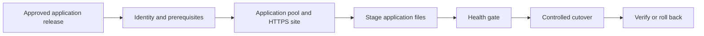


<link rel="stylesheet" href="assets/css/windows-solution-guides.css">

<div class="guide-header">

<h1>Deploy and validate IIS web applications</h1>

<span class="guide-type-badge guide-type-badge--solution"><i class="fas fa-check-circle" aria-hidden="true"></i> Solution Guide</span>

</div>

<div class="guide-hero-callout guide-hero-partner guide-hero-partner--windows" role="img" aria-label="Ansible Automation Platform and Microsoft Windows">
  
  <span class="guide-hero-partner__plus" aria-hidden="true">+</span>
  <span class="guide-hero-partner__partner card-partner-logo-set">
    
    
  </span>
</div>

## Overview

IIS deployments depend on coordinated changes to application identities, Windows features, application pools, files, and HTTPS bindings. Independent scripts and manual cutovers make deployments difficult to repeat and recover. This guide uses Red Hat Ansible Automation Platform with Microsoft technologies to deploy an IIS application with a dedicated identity, HTTPS binding, and an application health gate.

### Business value

Make application releases repeatable and preserve a defined recovery path when validation fails. Capture a baseline before rollout and compare actual results at 30, 60, and 90 days. The source document does not provide measured results for this scenario.

### Technical value

Use version-controlled automation, scoped inventories, centrally managed credentials, and AAP workflow history to coordinate the Microsoft systems involved in this outcome.

> **Draft:** Technical validation pending.
>
> This is a reformatted source draft. Code excerpts preserve the author's intended patterns and require module, parameter, version, and lab verification before publication. Proposed tests below are acceptance criteria, not completed validation.

## Table of Contents

- [Background](#background)
- [Solution](#solution)
- [Prerequisites](#prerequisites)
- [Workflow and Architecture](#workflow-and-architecture)
- [Solution Walkthrough](#solution-walkthrough)
- [Validation](#validation)
- [Maturity Path](#maturity-path)
- [Summary](#summary)
- [Sources](#sources)
- [Next Steps](#next-steps)

## Background

Deploy an IIS application with a dedicated identity, HTTPS binding, and an application health gate. Windows operations rely on dependencies across identity, host configuration, applications, and management systems. AAP coordinates those dependencies through discrete job templates and success or failure paths rather than leaving the sequence to manual handoffs.

The target environment is an existing Windows estate with an existing AAP deployment. Establish the access, change window, recovery procedure, and component versions before enabling automation. 

## Solution

### Components

| **Collection** | **Role** |
| --- | --- |
| `microsoft.iis` | IIS site, app pool, and binding management |
| `microsoft.ad` | Active Directory service account provisioning |
| `ansible.windows` | Windows feature installation, file deployment, health checks |

Automation controller coordinates the job templates, inventory, credentials, approvals, and execution history. 

### Who Benefits

| Persona | Challenge | What They Gain |
|---|---|---|
| Windows administrator | Manual steps and inconsistent handoffs | A repeatable workflow with explicit verification |
| Automation architect | Dependencies across Microsoft systems | A reference flow with scoped credentials and job boundaries |
| Operations lead | Limited visibility into changes and recovery | Job evidence, acceptance gates, and a defined escalation path |

### Recommended Demos and Self-Paced Labs

- [Ansible self-paced labs](https://www.redhat.com/en/interactive-labs/ansible)

A scenario-specific demonstration was not supplied in the source document.

## Prerequisites

### Ansible Automation Platform

Use an existing AAP deployment with automation controller, a versioned execution environment, and access to the collections below. 

**Required platform version: Red Hat Ansible Automation Platform 2.5+.** Record the exact AAP, ansible-core, collection, Windows Server, PowerShell, and Microsoft product versions used for validation before publishing.

### Featured Ansible Content Collections

| Collection | Purpose | Version and support |
|---|---|---|
| [microsoft.iis](https://console.redhat.com/ansible/automation-hub/repo/published/microsoft/iis/) | IIS sites, pools, and bindings | Exact version and support status require confirmation |
| [microsoft.ad](https://console.redhat.com/ansible/automation-hub/repo/published/microsoft/ad/) | Directory objects and domain membership | Exact version and support status require confirmation |
| [ansible.windows](https://console.redhat.com/ansible/automation-hub/repo/published/ansible/windows/) | Windows operations and health checks | Exact version and support status require confirmation |

Only install the collections required for this scenario. Use the Automation Hub entry for the selected version as the source of support and dependency information. Do not infer certification from the namespace.

### External Systems and Access

- A non-production Windows target for initial validation, with WinRM configured and reachable from the execution node.
- The Microsoft management systems shown in the architecture, with service identities and permissions scoped to the operations performed.
- Working DNS and time synchronization for domain authentication; trusted certificates for HTTPS and LDAPS where used.
- AAP Machine credentials for Windows access; separate credentials for directory discovery or integration services when their APIs require them.
- A version-controlled project containing the playbooks, documented variables, and a tested recovery procedure.

### Connectivity and Credentials

This reference pattern uses WinRM over HTTPS on TCP 5986 with certificate validation enabled. Use Kerberos for domain accounts where appropriate. Select delegation only for a demonstrated second-hop requirement; CredSSP is not mandatory for every MECM or SCOM operation. Keep secrets in AAP credentials or an approved secret store.

AD module execution on a Windows host and LDAP inventory discovery from an execution environment are distinct paths. Configure credentials, Python dependencies, and network access for the path actually used.

**Operational Impact:** Medium; High during a production application cutover. Directory writes and changes to monitoring state are changes even when no Windows service restarts. Read-only discovery and health checks have no intended configuration impact.

## Workflow and Architecture



### Narrative Walkthrough

The workflow begins with Active Directory. You create a dedicated service account before touching the web server. This account becomes the app pool identity, providing security isolation and an auditable trail. Every application gets its own account. No sharing.

Next, Ansible ensures Windows features are present. IIS, .NET hosting bundles, and any required Windows components are installed idempotently. If they already exist, the task reports no change. This step runs once per server build and is effectively free on subsequent executions.

The app pool is configured with the AD service account as its identity. You never use LocalSystem or NetworkService for production workloads. The pool is set to `AlwaysRunning` with a scheduled recycle window during off-peak hours. Managed pipeline mode is `Integrated` for modern .NET applications.

The IIS site is created with an HTTPS binding. The SSL certificate is referenced by thumbprint from the Windows certificate store. No PFX files on disk. No plaintext private keys. The certificate lifecycle is managed separately through your PKI tooling.

For blue/green deployments, you deploy the new application version to the inactive site directory. A health check validates the new deployment locally before any traffic is routed. Once validated, the active site is stopped, the site path is updated to point at the new deployment, and the site is restarted. A final production health check confirms end-to-end connectivity.

If the production health check fails, the path is reverted to the previous deployment directory. The rollback is a single task, not a full re-deployment.

## Solution Walkthrough

Replace all angle-bracket placeholders and survey variables with documented lab values. Map each playbook to a job template with its own target limit and credential. Configure workflow success and failure edges so that a failed readiness gate cannot silently advance the workflow.


### Step 1: IIS Site with HTTPS and Custom App Pool

```yaml
---
- name: Deploy web application to IIS
  hosts: web_servers
  gather_facts: false
  vars:
    app_name: "{{ survey_app_name }}"
    app_hostname: <APP_HOSTNAME>
    ssl_thumbprint: "{{ vault_ssl_cert_thumbprint }}"
    svc_account: "CONTOSO\\svc_{{ app_name }}"
  tasks:
    - name: Create dedicated application pool
      microsoft.iis.web_app_pool:
        name: "{{ app_name }}_pool"
        state: started
        attributes:
          managedRuntimeVersion: v4.0
          managedPipelineMode: Integrated
          processModel.identityType: SpecificUser
          processModel.userName: "{{ svc_account }}"
          processModel.password: "{{ vault_svc_password }}"
          startMode: AlwaysRunning
          recycling.periodicRestart.time: "03:00:00"
    - name: Create website with HTTPS binding
      microsoft.iis.website:
        name: "{{ app_name }}"
        state: started
        physical_path: "C:\\apps\\{{ app_name }}\\current"
        application_pool: "{{ app_name }}_pool"
        bindings:
          - protocol: https
            ip: "*"
            port: 443
            hostname: "{{ app_hostname }}"
            certificate_hash: "{{ ssl_thumbprint }}"
            certificate_store_name: My
```

### Step 2: AD Service Account for App Pool Identity

```yaml
---
- name: Provision AD service account for IIS app pool
  hosts: <DOMAIN_CONTROLLER>
  gather_facts: false
  vars:
    app_name: "{{ survey_app_name }}"
    app_hostname: <APP_HOSTNAME>
  tasks:
    - name: Create application service account
      microsoft.ad.user:
        name: "svc_{{ app_name }}"
        path: "OU=ServiceAccounts,DC=contoso,DC=com"
        upn: "svc_{{ app_name }}@contoso.com"
        password: "{{ vault_svc_password }}"
        password_never_expires: true
        user_cannot_change_password: true
        enabled: true
        description: "Service account for {{ app_name }} IIS app pool"
        state: present
```

**Note:** If `microsoft.ad.service_account` (group Managed Service Account) is available in your collection version, prefer it over `microsoft.ad.user`. gMSAs eliminate password rotation overhead entirely. The module shown here uses `microsoft.ad.user` for broad compatibility.

### Step 3: Blue/Green Deployment Swap

```yaml
---
- name: Blue/Green deployment swap
  hosts: web_servers
  gather_facts: false
  vars:
    app_name: "{{ survey_app_name }}"
    app_hostname: <APP_HOSTNAME>
  tasks:
    - name: Deploy new version to green site
      ansible.windows.win_copy:
        src: "{{ artifact_path }}/"
        dest: "C:\\apps\\{{ app_name }}\\green\\"
        remote_src: false
    - name: Validate green site health
      ansible.windows.win_uri:
        url: "https://localhost:8443/health"
        method: GET
        validate_certs: false
      register: health
      retries: 3
      delay: 5
      until: health.status_code == 200
    - name: Stop blue (current live) site
      microsoft.iis.website:
        name: "{{ app_name }}"
        state: stopped
    - name: Update site path to green
      microsoft.iis.website:
        name: "{{ app_name }}"
        physical_path: "C:\\apps\\{{ app_name }}\\green"
        state: started
    - name: Verify production health check
      ansible.windows.win_uri:
        url: "https://{{ app_hostname }}/health"
        method: GET
      register: prod_health
      failed_when: prod_health.status_code != 200
    - name: Rollback to blue on failure
      microsoft.iis.website:
        name: "{{ app_name }}"
        physical_path: "C:\\apps\\{{ app_name }}\\blue"
        state: started
      when: prod_health is failed
```


### AAP Integration and Production Decisions

**Tip:** Always use a dedicated AD service account as the app pool identity -- never LocalSystem or NetworkService. This provides an audit trail, least-privilege access, and the ability to revoke access without touching the server.

**Note:** Blue/green via IIS site path swap is simpler than load balancer manipulation for single-server deployments. For multi-server farms, combine with a rolling update strategy using the Ansible `serial` keyword.

**Tip:** Store SSL certificate thumbprints in Ansible Vault or an external credential store. Never embed thumbprints or certificate material in playbook variables. Reference them at runtime through `vault_` prefixed variables or a credential lookup plugin.

---

**Cutover check:** The source's stop/change/start sequence is a controlled application cutover. It does not establish zero downtime. Validate traffic handling and rollback before making an availability claim.

## Validation

### Connectivity Test

Create an inventory alias named `windows_validation_target` for the lab host and supply its connection credentials through your approved mechanism. Run the following from the selected execution environment. This verifies the Windows transport and module execution; it does not validate the full solution.

```bash
ansible windows_validation_target -i inventory.yml -m ansible.windows.win_ping
```

Expected response shape (illustrative; not a captured lab result):

```json
{
  "changed": false,
  "ping": "pong"
}
```

### End-to-End Test

Launch the deployment workflow for an isolated IIS site using a lab certificate and test service identity. Request the configured HTTPS health endpoint, inspect its certificate and hostname, and check the application pool identity in IIS.

### Expected Result

HTTP 200 with the expected application version; matching HTTPS hostname and certificate; intended pool identity; successful post-deployment health gate. Retain the AAP workflow and job IDs, relevant Microsoft-system records, timestamps, and health-check output. Replace illustrative output with captured results after the lab run.

### Failure and Recovery Test

Deploy an unhealthy test artifact. Confirm the workflow blocks traffic cutover or restores the prior application path and bindings using the documented rollback. The source's stop/change/start example requires a disruption window; validate any zero-downtime claim separately.

### Troubleshooting

| Symptom | Likely Cause | Fix |
|---|---|---|
| WinRM connection fails | Listener, certificate trust, firewall, or inventory mismatch | Verify the listener and TCP 5986 path; align hostname and certificate trust with inventory |
| Domain authentication fails | DNS, clock skew, account permissions, or delegation mismatch | Verify name resolution, time synchronization, identity scope, and the actual second-hop requirement |
| Collection task cannot load or rejects parameters | Collection version or source example differs from the installed API | Inspect the installed module documentation and pin the verified collection version |
| Workflow advances after a failed check | Success/failure edges or batch failure policy are incomplete | Correct the workflow gate and repeat the lab failure test before expanding scope |

## Maturity Path

| Maturity | Description | Evidence Before Advancing |
|---|---|---|
| **Crawl** | Discover targets and run health checks; operators review the proposed change | Correct inventory, working credentials, and an agreed baseline |
| **Walk** | Execute this workflow on a small approved scope with human approval and explicit validation | Successful and failed lab scenarios; recovery procedure; retained job evidence |
| **Run** | Expand policy-governed automation to the approved estate  | Demonstrated target controls, bounded failures, monitoring, and an owned escalation path |

## Summary

Deploy an IIS application with a dedicated identity, HTTPS binding, and an application health gate. The operational result depends on sequencing changes, verifying the service outcome, and retaining evidence. Measure deployment success, cutover duration, and recovery time against the pre-automation baseline.

## Sources

- [Windows Remote Management](https://docs.ansible.com/projects/ansible/latest/os_guide/windows_winrm.html)
- [Ansible Automation Platform documentation](https://docs.redhat.com/en/documentation/red_hat_ansible_automation_platform)
- [microsoft.iis on Automation Hub](https://console.redhat.com/ansible/automation-hub/repo/published/microsoft/iis/)
- [microsoft.ad on Automation Hub](https://console.redhat.com/ansible/automation-hub/repo/published/microsoft/ad/)
- [ansible.windows on Automation Hub](https://console.redhat.com/ansible/automation-hub/repo/published/ansible/windows/)

## Next Steps

| | |
|---|---|
| [Try Ansible Automation Platform](https://www.redhat.com/en/technologies/management/ansible/trial) | Evaluate the workflow in an isolated environment |
| [Red Hat Consulting](https://www.redhat.com/en/services/consulting) | Review the architecture for your Microsoft estate |
| [Training and Certification](https://www.redhat.com/en/services/training-and-certification) | Build automation administration and development skills |

---

<span class="guide-closing-logo-set">


</span>


