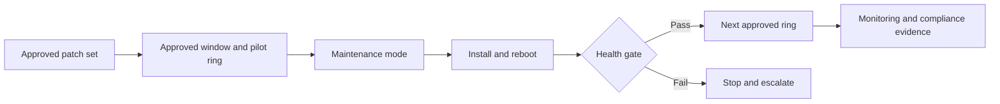


<link rel="stylesheet" href="assets/css/windows-solution-guides.css">

<div class="guide-header">

<h1>Patch Windows servers in stages with health checks</h1>

<span class="guide-type-badge guide-type-badge--solution"><i class="fas fa-check-circle" aria-hidden="true"></i> Solution Guide</span>

</div>

<div class="guide-hero-callout guide-hero-partner guide-hero-partner--windows" role="img" aria-label="Ansible Automation Platform and Microsoft Windows">
  
  <span class="guide-hero-partner__plus" aria-hidden="true">+</span>
  <span class="guide-hero-partner__partner card-partner-logo-set">
    
    
  </span>
</div>

## Overview

Windows patching crosses approval, maintenance scheduling, installation, reboot, application validation, and monitoring. A successful update installation alone does not prove that a business service has recovered. This guide uses Red Hat Ansible Automation Platform with Microsoft technologies to apply approved Windows updates in controlled rings with reboot coordination, health checks, and compliance evidence.

### Business value

Improve patch compliance while controlling service disruption and retaining evidence for each deployment ring. Capture a baseline before rollout and compare actual results at 30, 60, and 90 days. The source document does not provide measured results for this scenario.

### Technical value

Use version-controlled automation, scoped inventories, centrally managed credentials, and AAP workflow history to coordinate the Microsoft systems involved in this outcome.

> **Draft:** Technical validation pending.
>
> This is a reformatted source draft. Code excerpts preserve the author's intended patterns and require module, parameter, version, and lab verification before publication. Proposed tests below are acceptance criteria, not completed validation.

## Table of Contents

- [Background](#background)
- [Solution](#solution)
- [Prerequisites](#prerequisites)
- [Workflow and Architecture](#workflow-and-architecture)
- [Solution Walkthrough](#solution-walkthrough)
- [Validation](#validation)
- [Maturity Path](#maturity-path)
- [Summary](#summary)
- [Sources](#sources)
- [Next Steps](#next-steps)

## Background

Apply approved Windows updates in controlled rings with reboot coordination, health checks, and compliance evidence. Windows operations rely on dependencies across identity, host configuration, applications, and management systems. AAP coordinates those dependencies through discrete job templates and success or failure paths rather than leaving the sequence to manual handoffs.

The target environment is an existing Windows estate with an existing AAP deployment. Establish the access, change window, recovery procedure, and component versions before enabling automation. 

## Solution

### Components

| **Collection** | **Role** |
| --- | --- |
| `microsoft.mecm` | Software update group identification, deployment triggering, compliance reporting |
| `ansible.windows` | Patch installation, reboot orchestration, service validation |
| `microsoft.scom` | Maintenance window lifecycle to suppress false alerts |

Automation controller coordinates the job templates, inventory, credentials, approvals, and execution history. 

### Who Benefits

| Persona | Challenge | What They Gain |
|---|---|---|
| Windows administrator | Manual steps and inconsistent handoffs | A repeatable workflow with explicit verification |
| Automation architect | Dependencies across Microsoft systems | A reference flow with scoped credentials and job boundaries |
| Operations lead | Limited visibility into changes and recovery | Job evidence, acceptance gates, and a defined escalation path |

### Recommended Demos and Self-Paced Labs

- [Ansible self-paced labs](https://www.redhat.com/en/interactive-labs/ansible)

A scenario-specific demonstration was not supplied in the source document.

## Prerequisites

### Ansible Automation Platform

Use an existing AAP deployment with automation controller, a versioned execution environment, and access to the collections below. 

**Required platform version: Red Hat Ansible Automation Platform 2.5+.** Record the exact AAP, ansible-core, collection, Windows Server, PowerShell, and Microsoft product versions used for validation before publishing.

### Featured Ansible Content Collections

| Collection | Purpose | Version and support |
|---|---|---|
| [ansible.windows](https://console.redhat.com/ansible/automation-hub/repo/published/ansible/windows/) | Windows operations and health checks | Exact version and support status require confirmation |
| [microsoft.mecm](https://console.redhat.com/ansible/automation-hub/repo/published/microsoft/mecm/) | Endpoint management integration | Exact version and support status require confirmation |
| [microsoft.scom](https://console.redhat.com/ansible/automation-hub/repo/published/microsoft/scom/) | Monitoring integration | Exact version and support status require confirmation |

Only install the collections required for this scenario. Use the Automation Hub entry for the selected version as the source of support and dependency information. Do not infer certification from the namespace.

### External Systems and Access

- A non-production Windows target for initial validation, with WinRM configured and reachable from the execution node.
- The Microsoft management systems shown in the architecture, with service identities and permissions scoped to the operations performed.
- Working DNS and time synchronization for domain authentication; trusted certificates for HTTPS and LDAPS where used.
- AAP Machine credentials for Windows access; separate credentials for directory discovery or integration services when their APIs require them.
- A version-controlled project containing the playbooks, documented variables, and a tested recovery procedure.

### Connectivity and Credentials

This reference pattern uses WinRM over HTTPS on TCP 5986 with certificate validation enabled. Use Kerberos for domain accounts where appropriate. Select delegation only for a demonstrated second-hop requirement; CredSSP is not mandatory for every MECM or SCOM operation. Keep secrets in AAP credentials or an approved secret store.

AD module execution on a Windows host and LDAP inventory discovery from an execution environment are distinct paths. Configure credentials, Python dependencies, and network access for the path actually used.

**Operational Impact:** High for production update installation and reboots. Directory writes and changes to monitoring state are changes even when no Windows service restarts. Read-only discovery and health checks have no intended configuration impact.

## Workflow and Architecture



### Narrative Walkthrough

This architecture separates two concerns. MECM determines *which* patches are approved. Ansible orchestrates *when* and *how* they are applied. Your existing MECM governance stays intact. Ansible adds the staging, validation, and rollback that MECM lacks.

The pipeline begins with SCOM. You set a maintenance window on every target host before the first patch is installed. Without this step, expected service restarts during patching trigger SCOM alerts. Those alerts may trigger your Event-Driven Ansible closed-loop remediation, creating a feedback loop that fights the patching process.

MECM identifies the approved software update group for this patch cycle. The update group defines which KBs are in scope. Ansible does not make approval decisions. It reads the approved list and executes.

Patching proceeds in three rings. Ring 1 is Dev -- your canary environment. A small number of non-critical servers receive patches first. After installation, Ansible validates that critical Windows services are running, required ports are responding, and application health endpoints return HTTP 200. If any validation fails, the pipeline stops. No patches reach Staging.

Ring 2 is Staging. The same patch set is applied to a larger group of servers that mirror production workloads. Validation is identical but covers more infrastructure. This ring catches issues that only surface under realistic load or configuration.

Ring 3 is Production. Patches are applied using the `serial` keyword to limit the blast radius. A `serial: "20%"` setting means only 20% of production hosts are patched at a time. If validation fails on the first batch, the remaining 80% are untouched. This is your built-in circuit breaker.

After all rings pass validation, the SCOM maintenance window is cleared. A compliance report is generated showing patch status across the estate.

## Solution Walkthrough

Replace all angle-bracket placeholders and survey variables with documented lab values. Map each playbook to a job template with its own target limit and credential. Configure workflow success and failure edges so that a failed readiness gate cannot silently advance the workflow.


### Step 1: MECM Software Update Deployment

```yaml
---
- name: Deploy approved updates via MECM
  hosts: <MECM_SITE_SERVER>
  gather_facts: false
  vars:
    patch_cycle_name: "{{ survey_patch_cycle }}"
    target_collection: "{{ survey_target_collection }}"
    patch_deadline: "{{ survey_patch_deadline }}"
  tasks:
    - name: Trigger MECM update deployment
      microsoft.mecm.install_updates:
        update_group: "{{ patch_cycle_name }}"
        collection: "{{ target_collection }}"
        deadline: "{{ patch_deadline }}"
        maintenance_window: true
        reboot_behavior: server_restart
      register: mecm_deploy
    - name: Wait for MECM deployment status
      microsoft.mecm.dp_status_info:
        deployment_id: "{{ mecm_deploy.deployment_id }}"
      register: deploy_status
      retries: 30
      delay: 60
      until: deploy_status.status == 'Success'
```

### Step 2: Windows Update with Staged Reboot and Validation

```yaml
---
- name: Apply Windows updates with validation
  hosts: "{{ patching_ring }}"
  serial: "{{ batch_size | default('20%') }}"
  gather_facts: true
  vars:
    critical_services:
      - W3SVC
      - MSSQLSERVER
      - WinRM
    health_endpoints:
      - "https://<APP_HOSTNAME>/health"
      - "https://<APP_HOSTNAME>/api/status"
  tasks:
    - name: Install all approved updates
      ansible.windows.win_updates:
        category_names:
          - SecurityUpdates
          - CriticalUpdates
          - UpdateRollups
        state: installed
        reboot: false
      register: update_result
    - name: Reboot if required
      ansible.windows.win_reboot:
        reboot_timeout: 600
        post_reboot_delay: 60
        msg: "Patching reboot initiated by AAP"
      when: update_result.reboot_required
    - name: Validate critical services are running
      ansible.windows.win_service:
        name: "{{ item }}"
      register: svc_check
      failed_when: svc_check.state != 'running'
      loop: "{{ critical_services }}"
    - name: Validate application health endpoints
      ansible.windows.win_uri:
        url: "{{ item }}"
        method: GET
        status_code: 200
      loop: "{{ health_endpoints }}"
      retries: 3
      delay: 10
    - name: Report patch status
      ansible.builtin.debug:
        msg: >-
          {{ inventory_hostname }}:
          {{ update_result.installed_update_count }} updates installed,
          reboot={{ update_result.reboot_required }}
```

### Step 3: SCOM Maintenance Window Lifecycle

```yaml
---
- name: Manage SCOM maintenance window for patching
  hosts: <SCOM_MGMT_SERVER>
  gather_facts: false
  vars:
    patching_ring: "{{ survey_patching_ring }}"
    patch_cycle_name: "{{ survey_patch_cycle }}"
    maint_window_hours: 4
  tasks:
    - name: Set maintenance window before patching
      ansible.windows.win_powershell:
        script: |
          Import-Module OperationsManager
          $instances = Get-SCOMClassInstance -Name "{{ item }}"
          foreach ($instance in $instances) {
            Start-SCOMMaintenanceMode -Instance $instance `
              -EndTime (Get-Date).AddHours({{ maint_window_hours }}) `
              -Reason PlannedOther `
              -Comment "AAP Patching - {{ patch_cycle_name }}"
          }
      loop: "{{ groups[patching_ring] }}"
    - name: Clear maintenance window after validation
      ansible.windows.win_powershell:
        script: |
          Import-Module OperationsManager
          $instances = Get-SCOMClassInstance -Name "{{ item }}"
          foreach ($instance in $instances) {
            $mm = Get-SCOMMaintenanceMode -Instance $instance
            if ($mm) {
              Set-SCOMMaintenanceMode -MaintenanceModeEntry $mm `
                -EndTime (Get-Date).AddSeconds(1)
            }
          }
      loop: "{{ groups[patching_ring] }}"
```


### AAP Integration and Production Decisions

**Tip:** MECM handles the *what* (patch approval authority). Ansible orchestrates the *when* and *how* (ring-based staging, validation gates, rollback). This preserves your existing MECM governance while adding the orchestration it lacks.

**Note:** Use the Ansible `serial` keyword for rolling patches across a ring. Setting `serial: "20%"` patches 20% of hosts at a time. Configure an explicit failure policy and validate that a failed batch prevents further rollout. The serial setting controls batch size.

**Tip:** Always set SCOM maintenance windows BEFORE patching begins. Without it, expected service restarts during patching trigger alerts, which may trigger your EDA closed-loop remediation, creating a feedback loop that fights the patching process.

**Note:** The validation gate between rings is your most important control. Define `critical_services` and `health_endpoints` as group variables per ring. Production rings should have stricter validation than dev rings. A failed health check in any ring stops the entire pipeline -- no automatic rollforward to the next ring.

---

**Rollout check:** Configure an explicit failure policy such as an appropriately scoped fatal-error gate and validate it in the lab. Choose one approved patch source per workflow; MECM approval and Windows Update behavior must be reconciled in the tested design.

## Validation

### Connectivity Test

Create an inventory alias named `windows_validation_target` for the lab host and supply its connection credentials through your approved mechanism. Run the following from the selected execution environment. This verifies the Windows transport and module execution; it does not validate the full solution.

```bash
ansible windows_validation_target -i inventory.yml -m ansible.windows.win_ping
```

Expected response shape (illustrative; not a captured lab result):

```json
{
  "changed": false,
  "ping": "pong"
}
```

### End-to-End Test

Launch the patch workflow against a non-production pilot ring inside its approved window. Confirm the approved update source and policy, monitor reboot recovery, verify per-host services and application endpoints, and compare before/after compliance reports.

### Expected Result

Only the pilot ring changes; failed updates and pending reboots are accounted for; required services run; health endpoints return HTTP 200; monitoring resumes; compliance evidence is retained. Retain the AAP workflow and job IDs, relevant Microsoft-system records, timestamps, and health-check output. Replace illustrative output with captured results after the lab run.

### Failure and Recovery Test

Cause a health-gate failure on one lab host. Confirm the workflow blocks the next ring and stops additional batches according to an explicit failure policy. Ansible serial controls batch size; it does not alone guarantee that all later batches stop.

### Troubleshooting

| Symptom | Likely Cause | Fix |
|---|---|---|
| WinRM connection fails | Listener, certificate trust, firewall, or inventory mismatch | Verify the listener and TCP 5986 path; align hostname and certificate trust with inventory |
| Domain authentication fails | DNS, clock skew, account permissions, or delegation mismatch | Verify name resolution, time synchronization, identity scope, and the actual second-hop requirement |
| Collection task cannot load or rejects parameters | Collection version or source example differs from the installed API | Inspect the installed module documentation and pin the verified collection version |
| Workflow advances after a failed check | Success/failure edges or batch failure policy are incomplete | Correct the workflow gate and repeat the lab failure test before expanding scope |

## Maturity Path

| Maturity | Description | Evidence Before Advancing |
|---|---|---|
| **Crawl** | Discover targets and run health checks; operators review the proposed change | Correct inventory, working credentials, and an agreed baseline |
| **Walk** | Execute this workflow on a small approved scope with human approval and explicit validation | Successful and failed lab scenarios; recovery procedure; retained job evidence |
| **Run** | Expand policy-governed automation to the approved estate  | Demonstrated target controls, bounded failures, monitoring, and an owned escalation path |

## Summary

Apply approved Windows updates in controlled rings with reboot coordination, health checks, and compliance evidence. The operational result depends on sequencing changes, verifying the service outcome, and retaining evidence. Measure compliance within the patch SLA, application recovery, and failed-ring containment against the pre-automation baseline.

## Sources

- [Windows Remote Management](https://docs.ansible.com/projects/ansible/latest/os_guide/windows_winrm.html)
- [Ansible Automation Platform documentation](https://docs.redhat.com/en/documentation/red_hat_ansible_automation_platform)
- [ansible.windows on Automation Hub](https://console.redhat.com/ansible/automation-hub/repo/published/ansible/windows/)
- [microsoft.mecm on Automation Hub](https://console.redhat.com/ansible/automation-hub/repo/published/microsoft/mecm/)
- [microsoft.scom on Automation Hub](https://console.redhat.com/ansible/automation-hub/repo/published/microsoft/scom/)

## Next Steps

| | |
|---|---|
| [Try Ansible Automation Platform](https://www.redhat.com/en/technologies/management/ansible/trial) | Evaluate the workflow in an isolated environment |
| [Red Hat Consulting](https://www.redhat.com/en/services/consulting) | Review the architecture for your Microsoft estate |
| [Training and Certification](https://www.redhat.com/en/services/training-and-certification) | Build automation administration and development skills |

---

<span class="guide-closing-logo-set">


</span>


