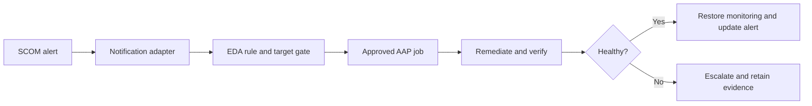


<link rel="stylesheet" href="assets/css/windows-solution-guides.css">

<div class="guide-header">

<h1>Resolve known Windows service incidents from SCOM alerts</h1>

<span class="guide-type-badge guide-type-badge--solution"><i class="fas fa-check-circle" aria-hidden="true"></i> Solution Guide</span>

</div>

<div class="guide-hero-callout guide-hero-partner guide-hero-partner--windows" role="img" aria-label="Ansible Automation Platform and Microsoft Windows">
  
  <span class="guide-hero-partner__plus" aria-hidden="true">+</span>
  <span class="guide-hero-partner__partner card-partner-logo-set">
    
    
  </span>
</div>

## Overview

SCOM detects Windows service failures, but operators still need to interpret the alert, choose a remediation, verify recovery, and update the incident. Repetitive manual response delays recovery for known failure patterns. This guide uses Red Hat Ansible Automation Platform with Microsoft technologies to route a known SCOM incident through Event-Driven Ansible, controlled remediation, health verification, and escalation.

### Business value

Reduce manual triage for approved, repeatable incidents while retaining escalation for unsuccessful recovery. Capture a baseline before rollout and compare actual results at 30, 60, and 90 days. The source document does not provide measured results for this scenario.

### Technical value

Use version-controlled automation, scoped inventories, centrally managed credentials, and AAP workflow history to coordinate the Microsoft systems involved in this outcome.

> **Draft:** Technical validation pending.
>
> This is a reformatted source draft. Code excerpts preserve the author's intended patterns and require module, parameter, version, and lab verification before publication. Proposed tests below are acceptance criteria, not completed validation.

## Table of Contents

- [Background](#background)
- [Solution](#solution)
- [Prerequisites](#prerequisites)
- [Workflow and Architecture](#workflow-and-architecture)
- [Solution Walkthrough](#solution-walkthrough)
- [Validation](#validation)
- [Maturity Path](#maturity-path)
- [Summary](#summary)
- [Sources](#sources)
- [Next Steps](#next-steps)

## Background

Route a known SCOM incident through Event-Driven Ansible, controlled remediation, health verification, and escalation. Windows operations rely on dependencies across identity, host configuration, applications, and management systems. AAP coordinates those dependencies through discrete job templates and success or failure paths rather than leaving the sequence to manual handoffs.

The target environment is an existing Windows estate with an existing AAP deployment. Establish the access, change window, recovery procedure, and component versions before enabling automation. 

## Solution

### Components

| **Collection** | **Role** |
| --- | --- |
| `microsoft.scom` | Alert detection, maintenance windows, alert resolution |
| `ansible.windows` | Service remediation, health checks, OS-level fixes |
| Event-Driven Ansible (EDA) | Webhook ingestion, rule evaluation, job dispatch |

Automation controller coordinates the job templates, inventory, credentials, approvals, and execution history. Event-Driven Ansible evaluates incoming monitoring events; an environment-specific SCOM notification adapter supplies the webhook payload.

### Who Benefits

| Persona | Challenge | What They Gain |
|---|---|---|
| Windows administrator | Manual steps and inconsistent handoffs | A repeatable workflow with explicit verification |
| Automation architect | Dependencies across Microsoft systems | A reference flow with scoped credentials and job boundaries |
| Operations lead | Limited visibility into changes and recovery | Job evidence, acceptance gates, and a defined escalation path |

### Recommended Demos and Self-Paced Labs

- [Ansible self-paced labs](https://www.redhat.com/en/interactive-labs/ansible)

A scenario-specific demonstration was not supplied in the source document.

## Prerequisites

### Ansible Automation Platform

Use an existing AAP deployment with automation controller, a versioned execution environment, and access to the collections below. Event-Driven Ansible also requires a decision environment, a running rulebook activation, and credentials for the target AAP job template.

**Required platform version: Red Hat Ansible Automation Platform 2.5+.** Record the exact AAP, ansible-core, collection, Windows Server, PowerShell, and Microsoft product versions used for validation before publishing.

### Featured Ansible Content Collections

| Collection | Purpose | Version and support |
|---|---|---|
| [ansible.windows](https://console.redhat.com/ansible/automation-hub/repo/published/ansible/windows/) | Windows operations and health checks | Exact version and support status require confirmation |
| [ansible.eda](https://console.redhat.com/ansible/automation-hub/repo/published/ansible/eda/) | EDA event source and rules | Exact version and support status require confirmation |
| [microsoft.scom](https://console.redhat.com/ansible/automation-hub/repo/published/microsoft/scom/) | Monitoring integration | Exact version and support status require confirmation |

Only install the collections required for this scenario. Use the Automation Hub entry for the selected version as the source of support and dependency information. Do not infer certification from the namespace.

### External Systems and Access

- A non-production Windows target for initial validation, with WinRM configured and reachable from the execution node.
- The Microsoft management systems shown in the architecture, with service identities and permissions scoped to the operations performed.
- Working DNS and time synchronization for domain authentication; trusted certificates for HTTPS and LDAPS where used.
- AAP Machine credentials for Windows access; separate credentials for directory discovery or integration services when their APIs require them.
- A version-controlled project containing the playbooks, documented variables, and a tested recovery procedure.

### Connectivity and Credentials

This reference pattern uses WinRM over HTTPS on TCP 5986 with certificate validation enabled. Use Kerberos for domain accounts where appropriate. Select delegation only for a demonstrated second-hop requirement; CredSSP is not mandatory for every MECM or SCOM operation. Keep secrets in AAP credentials or an approved secret store.

AD module execution on a Windows host and LDAP inventory discovery from an execution environment are distinct paths. Configure credentials, Python dependencies, and network access for the path actually used.

**Operational Impact:** Medium; High when production services are restarted. Directory writes and changes to monitoring state are changes even when no Windows service restarts. Read-only discovery and health checks have no intended configuration impact.

## Workflow and Architecture



### Narrative Walkthrough

The closed-loop remediation pattern eliminates the gap between detection and response. SCOM detects the issue. Event-Driven Ansible evaluates it. Ansible Automation Platform fixes it. SCOM confirms the fix. No human touches the keyboard for known, high-confidence failure modes.

The loop begins when SCOM fires an alert. You configure SCOM notification channels to send a webhook payload to the Event-Driven Ansible Controller. The payload includes severity, alert type, affected host, and the specific service or monitor that triggered.

The Event-Driven Ansible rulebook evaluates the incoming event against your defined rules. Severity drives routing. Critical alerts with known remediation patterns trigger immediate automated response. Warning alerts create ITSM tickets and page the on-call engineer. Info alerts are logged for trend analysis.

For critical alerts, the first action is setting a SCOM maintenance window on the affected host. This is the circuit breaker. Without it, the remediation itself -- restarting a service, applying a configuration change -- triggers new SCOM alerts, creating a cascading loop of false positives.

With the maintenance window in place, Event-Driven Ansible dispatches a remediation job to automation controller. The job template targets the affected host and passes the service name and alert context as extra variables. The playbook restarts the failed service, waits for a health check to confirm it is listening on the expected port, and verifies the service state.

If validation succeeds, the playbook clears the maintenance window and resolves the original SCOM alert programmatically. The loop is closed. If validation fails, the playbook does not retry. It escalates to a human operator by creating a P1 incident in your ITSM system. No retry loops. One attempt, then escalate.

**Note:** Always set a SCOM maintenance window before remediation. Without it, the remediation itself (service restart, config change) triggers new alerts, creating a cascading loop. The maintenance window is your circuit breaker.

**Tip:** Event-Driven Ansible + SCOM is the self-healing Windows story. Start with one high-confidence alert type (e.g., IIS App Pool crash) before expanding to broader remediation. Build trust in the automation incrementally.

## Solution Walkthrough

Replace all angle-bracket placeholders and survey variables with documented lab values. Map each playbook to a job template with its own target limit and credential. Configure workflow success and failure edges so that a failed readiness gate cannot silently advance the workflow.


### Step 1: Event-Driven Ansible Rulebook for SCOM Webhooks

```yaml
---
- name: SCOM Alert Remediation
  hosts: all
  sources:
    - ansible.eda.webhook:
        host: 0.0.0.0
        port: 5000
  rules:
    - name: Critical service failure - auto-remediate
      condition: >
        event.payload.severity == "Critical" and
        event.payload.alert_type == "ServiceFailure"
      action:
        run_job_template:
          name: "Windows Service Remediation"
          organization: Default
          job_args:
            extra_vars:
              target_host: "{{ event.payload.host }}"
              service_name: "{{ event.payload.service }}"
              scom_alert_id: "{{ event.payload.alert_id }}"
              service_port: "{{ event.payload.service_port | default(443) }}"
    - name: Critical disk space - auto-remediate
      condition: >
        event.payload.severity == "Critical" and
        event.payload.alert_type == "DiskSpace"
      action:
        run_job_template:
          name: "Windows Disk Cleanup"
          organization: Default
          job_args:
            extra_vars:
              target_host: "{{ event.payload.host }}"
              drive_letter: "{{ event.payload.drive }}"
              scom_alert_id: "{{ event.payload.alert_id }}"
    - name: Warning alerts - create ticket
      condition: event.payload.severity == "Warning"
      action:
        run_job_template:
          name: "Create ITSM Ticket"
          organization: Default
          job_args:
            extra_vars:
              alert_details: "{{ event.payload }}"
              urgency: 3
    - name: Info alerts - log only
      condition: event.payload.severity == "Information"
      action:
        debug:
          msg: "SCOM info alert logged: {{ event.payload.alert_name }} on {{ event.payload.host }}"
```

### Step 2: Windows Service Remediation Playbook

```yaml
---
- name: Remediate Windows service failure
  hosts: "{{ target_host }}"
  gather_facts: false
  tasks:
    - name: Set SCOM maintenance window
      ansible.windows.win_powershell:
        script: |
          Import-Module OperationsManager
          $instance = Get-SCOMClassInstance -Name "{{ target_host }}"
          $end = (Get-Date).AddMinutes(30)
          New-SCOMMaintenanceMode -Instance $instance `
            -EndTime $end `
            -Reason PlannedOther `
            -Comment "Ansible auto-remediation: {{ service_name }}"
      delegate_to: scom-mgmt01.corp.contoso.com
    - name: Restart failed service
      ansible.windows.win_service:
        name: "{{ service_name }}"
        state: restarted
        force_dependent_services: true
    - name: Wait for service health check
      ansible.windows.win_wait_for:
        port: "{{ service_port | default(443) }}"
        timeout: 60
    - name: Verify service is running
      ansible.windows.win_service:
        name: "{{ service_name }}"
      register: svc_status
      failed_when: svc_status.state != 'running'
    - name: Clear SCOM maintenance window
      ansible.windows.win_powershell:
        script: |
          Import-Module OperationsManager
          $instance = Get-SCOMClassInstance -Name "{{ target_host }}"
          Get-SCOMMaintenanceMode -Instance $instance |
            Set-SCOMMaintenanceMode -EndTime (Get-Date).AddSeconds(1) `
              -Comment "Ansible remediation complete"
      delegate_to: scom-mgmt01.corp.contoso.com
    - name: Resolve SCOM alert
      ansible.windows.win_powershell:
        script: |
          Import-Module OperationsManager
          $alert = Get-SCOMAlert -Id "{{ scom_alert_id }}"
          $alert | Set-SCOMAlert -ResolutionState 255 `
            -Comment "Auto-resolved by Ansible remediation"
      delegate_to: scom-mgmt01.corp.contoso.com
  rescue:
    - name: Clear maintenance window on failure
      ansible.windows.win_powershell:
        script: |
          Import-Module OperationsManager
          $instance = Get-SCOMClassInstance -Name "{{ target_host }}"
          Get-SCOMMaintenanceMode -Instance $instance |
            Set-SCOMMaintenanceMode -EndTime (Get-Date).AddSeconds(1) `
              -Comment "Ansible remediation failed - escalating"
      delegate_to: scom-mgmt01.corp.contoso.com
      ignore_errors: true
    - name: Escalate - create P1 incident
      ansible.builtin.uri:
        url: "https://itsm.corp.contoso.com/api/now/table/incident"
        method: POST
        body_format: json
        body:
          short_description: >-
            Auto-remediation failed: {{ service_name }}
            on {{ target_host }}
          description: >-
            SCOM Alert ID: {{ scom_alert_id }}.
            Ansible attempted to restart {{ service_name }}
            but post-restart validation failed.
            Manual intervention required.
          urgency: 1
          impact: 1
          assignment_group: "Windows Operations"
          category: "Software"
          subcategory: "Operating System"
        headers:
          Authorization: "Bearer {{ vault_itsm_token }}"
          Content-Type: "application/json"
        status_code: 201
    - name: Notify on-call via webhook
      ansible.builtin.uri:
        url: "{{ oncall_webhook_url }}"
        method: POST
        body_format: json
        body:
          text: >-
            CRITICAL: Auto-remediation failed for {{ service_name }}
            on {{ target_host }}. P1 incident created.
            SCOM Alert: {{ scom_alert_id }}
```

### Step 3: Reusable SCOM Maintenance Window Role

```yaml
# roles/scom_maintenance_window/tasks/main.yml
---
- name: Validate required variables
  ansible.builtin.assert:
    that:
      - scom_target_host is defined
      - scom_mgmt_server is defined
      - scom_window_action in ['set', 'clear']
    fail_msg: "Required variables: scom_target_host, scom_mgmt_server, scom_window_action"
- name: Set SCOM maintenance window
  ansible.windows.win_powershell:
    script: |
      Import-Module OperationsManager
      $instance = Get-SCOMClassInstance -Name "{{ scom_target_host }}"
      if (-not $instance) {
          throw "SCOM instance not found: {{ scom_target_host }}"
      }
      $end = (Get-Date).AddMinutes({{ scom_window_duration_minutes | default(30) }})
      New-SCOMMaintenanceMode -Instance $instance `
        -EndTime $end `
        -Reason {{ scom_window_reason | default('PlannedOther') }} `
        -Comment "{{ scom_window_comment | default('Ansible maintenance window') }}"
  delegate_to: "{{ scom_mgmt_server }}"
  when: scom_window_action == 'set'
- name: Clear SCOM maintenance window
  ansible.windows.win_powershell:
    script: |
      Import-Module OperationsManager
      $instance = Get-SCOMClassInstance -Name "{{ scom_target_host }}"
      $mm = Get-SCOMMaintenanceMode -Instance $instance
      if ($mm) {
          $mm | Set-SCOMMaintenanceMode `
            -EndTime (Get-Date).AddSeconds(1) `
            -Comment "{{ scom_window_comment | default('Ansible maintenance window cleared') }}"
      }
  delegate_to: "{{ scom_mgmt_server }}"
  when: scom_window_action == 'clear'
# roles/scom_maintenance_window/defaults/main.yml
---
scom_window_duration_minutes: 30
scom_window_reason: PlannedOther
scom_window_comment: "Ansible automated maintenance window"
scom_window_action: set
```

**Usage in playbooks:**

```yaml
- name: Set maintenance window before changes
  ansible.builtin.include_role:
    name: scom_maintenance_window
  vars:
    scom_target_host: "{{ inventory_hostname }}"
    scom_mgmt_server: scom-mgmt01.corp.contoso.com
    scom_window_action: set
    scom_window_duration_minutes: 45
    scom_window_comment: "Patching cycle - {{ ansible_date_time.date }}"
# ... perform changes ...
- name: Clear maintenance window after changes
  ansible.builtin.include_role:
    name: scom_maintenance_window
  vars:
    scom_target_host: "{{ inventory_hostname }}"
    scom_mgmt_server: scom-mgmt01.corp.contoso.com
    scom_window_action: clear
    scom_window_comment: "Patching complete"
```


### AAP Integration and Production Decisions

**Decision: Single-attempt remediation.** The playbook does not retry failed fixes. One attempt, then escalate. Retry loops mask deeper problems and extend outages. If the first restart does not restore the service, a human needs to investigate root cause.

**Decision: Maintenance window as circuit breaker.** The SCOM maintenance window is not optional. It is the mechanism that prevents the remediation from triggering a cascade of new alerts. Set it before any change. Clear it after validation. Clear it on failure too -- you want SCOM monitoring the host again as soon as possible after escalation.

**Decision: Severity-based routing in **Event-Driven Ansible**.** Not every alert deserves automated remediation. Critical alerts with known, tested fix procedures get automation. Warning alerts get tickets. Info alerts get logs. This tiered approach builds organizational trust in the automation incrementally.

**Decision: Rescue block for guaranteed escalation.** The `rescue` block ensures that a failed remediation always produces a visible artifact -- an ITSM ticket and an on-call notification. Silent failures in a self-healing system are worse than no automation at all.

---

**Completeness check:** Validate the SCOM notification adapter, payload schema, target and service allowlists, duplicate-event handling, bounded attempts, and actual ITSM escalation. The source's expected incident lifecycle is not evidence that these integrations are complete.

## Validation

### Connectivity Test

Create an inventory alias named `windows_validation_target` for the lab host and supply its connection credentials through your approved mechanism. Run the following from the selected execution environment. This verifies the Windows transport and module execution; it does not validate the full solution.

```bash
ansible windows_validation_target -i inventory.yml -m ansible.windows.win_ping
```

Expected response shape (illustrative; not a captured lab result):

```json
{
  "changed": false,
  "ping": "pong"
}
```

### End-to-End Test

On an isolated monitored test server, stop the approved test service using the lab procedure. Confirm SCOM produces the expected event, the configured notification adapter delivers its payload to EDA, and the approved AAP job targets only that host.

### Expected Result

One correlated event and remediation job; service and application health restored; maintenance mode cleared; original alert handled according to its monitor or rule behavior. Record elapsed time rather than assuming a five-minute result. Retain the AAP workflow and job IDs, relevant Microsoft-system records, timestamps, and health-check output. Replace illustrative output with captured results after the lab run.

### Failure and Recovery Test

Use a test event for a service that cannot be recovered. Confirm bounded execution, no repeating remediation loop, a recorded failure, and an escalation through the configured ITSM integration. Confirm maintenance mode expires or is cleaned up.

### Troubleshooting

| Symptom | Likely Cause | Fix |
|---|---|---|
| WinRM connection fails | Listener, certificate trust, firewall, or inventory mismatch | Verify the listener and TCP 5986 path; align hostname and certificate trust with inventory |
| Domain authentication fails | DNS, clock skew, account permissions, or delegation mismatch | Verify name resolution, time synchronization, identity scope, and the actual second-hop requirement |
| Collection task cannot load or rejects parameters | Collection version or source example differs from the installed API | Inspect the installed module documentation and pin the verified collection version |
| Workflow advances after a failed check | Success/failure edges or batch failure policy are incomplete | Correct the workflow gate and repeat the lab failure test before expanding scope |

## Maturity Path

| Maturity | Description | Evidence Before Advancing |
|---|---|---|
| **Crawl** | Discover targets and run health checks; operators review the proposed change | Correct inventory, working credentials, and an agreed baseline |
| **Walk** | Execute this workflow on a small approved scope with human approval and explicit validation | Successful and failed lab scenarios; recovery procedure; retained job evidence |
| **Run** | Expand policy-governed automation to the approved estate and selected event-driven incidents | Demonstrated target controls, bounded failures, monitoring, and an owned escalation path |

## Summary

Route a known SCOM incident through Event-Driven Ansible, controlled remediation, health verification, and escalation. The operational result depends on sequencing changes, verifying the service outcome, and retaining evidence. Measure alert-to-recovery time and the proportion of events safely resolved without manual intervention against the pre-automation baseline.

## Sources

- [Windows Remote Management](https://docs.ansible.com/projects/ansible/latest/os_guide/windows_winrm.html)
- [Ansible Automation Platform documentation](https://docs.redhat.com/en/documentation/red_hat_ansible_automation_platform)
- [ansible.windows on Automation Hub](https://console.redhat.com/ansible/automation-hub/repo/published/ansible/windows/)
- [ansible.eda on Automation Hub](https://console.redhat.com/ansible/automation-hub/repo/published/ansible/eda/)
- [microsoft.scom on Automation Hub](https://console.redhat.com/ansible/automation-hub/repo/published/microsoft/scom/)

## Next Steps

| | |
|---|---|
| [Try Ansible Automation Platform](https://www.redhat.com/en/technologies/management/ansible/trial) | Evaluate the workflow in an isolated environment |
| [Red Hat Consulting](https://www.redhat.com/en/services/consulting) | Review the architecture for your Microsoft estate |
| [Training and Certification](https://www.redhat.com/en/services/training-and-certification) | Build automation administration and development skills |

---

<span class="guide-closing-logo-set">


</span>


