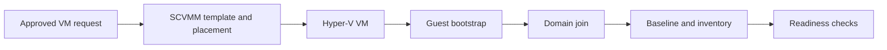


<link rel="stylesheet" href="assets/css/windows-solution-guides.css">

<div class="guide-header">

<h1>Provision Windows virtual machines with SCVMM and Hyper-V</h1>

<span class="guide-type-badge guide-type-badge--solution"><i class="fas fa-check-circle" aria-hidden="true"></i> Solution Guide</span>

</div>

<div class="guide-hero-callout guide-hero-partner guide-hero-partner--windows" role="img" aria-label="Ansible Automation Platform and Microsoft Windows">
  
  <span class="guide-hero-partner__plus" aria-hidden="true">+</span>
  <span class="guide-hero-partner__partner card-partner-logo-set">
    
    
  </span>
</div>

## Overview

Template-based VM provisioning still leaves teams coordinating host placement, guest configuration, domain membership, and monitoring by hand. A VM can exist in the virtualization platform without being ready for operations. This guide uses Red Hat Ansible Automation Platform with Microsoft technologies to provision a template-based Windows VM and bring it into domain inventory and baseline management.

### Business value

Reduce the time between an approved VM request and an operationally managed Windows guest. Capture a baseline before rollout and compare actual results at 30, 60, and 90 days. The source document does not provide measured results for this scenario.

### Technical value

Use version-controlled automation, scoped inventories, centrally managed credentials, and AAP workflow history to coordinate the Microsoft systems involved in this outcome.

> **Draft:** Technical validation pending.
>
> This is a reformatted source draft. Code excerpts preserve the author's intended patterns and require module, parameter, version, and lab verification before publication. Proposed tests below are acceptance criteria, not completed validation.

## Table of Contents

- [Background](#background)
- [Solution](#solution)
- [Prerequisites](#prerequisites)
- [Workflow and Architecture](#workflow-and-architecture)
- [Solution Walkthrough](#solution-walkthrough)
- [Validation](#validation)
- [Maturity Path](#maturity-path)
- [Summary](#summary)
- [Sources](#sources)
- [Next Steps](#next-steps)

## Background

Provision a template-based Windows VM and bring it into domain inventory and baseline management. Windows operations rely on dependencies across identity, host configuration, applications, and management systems. AAP coordinates those dependencies through discrete job templates and success or failure paths rather than leaving the sequence to manual handoffs.

The target environment is an existing Windows estate with an existing AAP deployment. Establish the access, change window, recovery procedure, and component versions before enabling automation. The source also discusses VMware conversion. That is an optional extension requiring its own current tooling and migration validation; the main workflow here is template-based provisioning.

## Solution

### Components

| **Collection** | **Role** |
| --- | --- |
| `microsoft.scvmm` | Template management, host placement, VM registration |
| `microsoft.hyper_v` | VM provisioning, checkpoints, live migration |
| `ansible.windows` | OS configuration, sysprep, service management |
| `microsoft.ad` | Domain join, OU placement, group policy |

Automation controller coordinates the job templates, inventory, credentials, approvals, and execution history. 

### Who Benefits

| Persona | Challenge | What They Gain |
|---|---|---|
| Windows administrator | Manual steps and inconsistent handoffs | A repeatable workflow with explicit verification |
| Automation architect | Dependencies across Microsoft systems | A reference flow with scoped credentials and job boundaries |
| Operations lead | Limited visibility into changes and recovery | Job evidence, acceptance gates, and a defined escalation path |

### Recommended Demos and Self-Paced Labs

- [Ansible self-paced labs](https://www.redhat.com/en/interactive-labs/ansible)

A scenario-specific demonstration was not supplied in the source document.

## Prerequisites

### Ansible Automation Platform

Use an existing AAP deployment with automation controller, a versioned execution environment, and access to the collections below. 

**Required platform version: Red Hat Ansible Automation Platform 2.5+.** Record the exact AAP, ansible-core, collection, Windows Server, PowerShell, and Microsoft product versions used for validation before publishing.

### Featured Ansible Content Collections

| Collection | Purpose | Version and support |
|---|---|---|
| [microsoft.scvmm](https://console.redhat.com/ansible/automation-hub/repo/published/microsoft/scvmm/) | Template and placement integration | Exact version and support status require confirmation |
| [microsoft.hyper_v](https://console.redhat.com/ansible/automation-hub/repo/published/microsoft/hyper_v/) | Hyper-V VM operations | Exact version and support status require confirmation |
| [ansible.windows](https://console.redhat.com/ansible/automation-hub/repo/published/ansible/windows/) | Windows operations and health checks | Exact version and support status require confirmation |
| [microsoft.ad](https://console.redhat.com/ansible/automation-hub/repo/published/microsoft/ad/) | Directory objects and domain membership | Exact version and support status require confirmation |

Only install the collections required for this scenario. Use the Automation Hub entry for the selected version as the source of support and dependency information. Do not infer certification from the namespace.

### External Systems and Access

- A non-production Windows target for initial validation, with WinRM configured and reachable from the execution node.
- The Microsoft management systems shown in the architecture, with service identities and permissions scoped to the operations performed.
- Working DNS and time synchronization for domain authentication; trusted certificates for HTTPS and LDAPS where used.
- AAP Machine credentials for Windows access; separate credentials for directory discovery or integration services when their APIs require them.
- A version-controlled project containing the playbooks, documented variables, and a tested recovery procedure.

### Connectivity and Credentials

This reference pattern uses WinRM over HTTPS on TCP 5986 with certificate validation enabled. Use Kerberos for domain accounts where appropriate. Select delegation only for a demonstrated second-hop requirement; CredSSP is not mandatory for every MECM or SCOM operation. Keep secrets in AAP credentials or an approved secret store.

AD module execution on a Windows host and LDAP inventory discovery from an execution environment are distinct paths. Configure credentials, Python dependencies, and network access for the path actually used.

**Operational Impact:** Medium; High for migration, restore, or production VM relocation. Directory writes and changes to monitoring state are changes even when no Windows service restarts. Read-only discovery and health checks have no intended configuration impact.

## Workflow and Architecture



### Narrative Walkthrough

The provisioning chain begins at SCVMM. You select a golden template, and SCVMM determines optimal host placement based on cluster capacity. SCVMM then delegates the actual VM creation to the target Hyper-V host.

Once the VM is provisioned, Hyper-V executes the boot sequence. The unattend.xml embedded in the template drives sysprep, setting the hostname, locale, and initial network configuration. Ansible connects to the VM over WinRM as soon as Windows completes its first boot.

From that point, two collections take over. `ansible.windows` handles OS-level configuration: timezone, regional settings, Windows features, firewall rules, and local accounts. `microsoft.ad` handles domain join, placing the computer object in the correct OU and applying initial group memberships.

For VMware migrations, Ansible orchestrates the workflow but does not perform disk conversion. You convert VMDK files to VHDX format using StarWind V2V Converter or Microsoft Virtual Machine Converter (MVMC) outside of Ansible. Once the VHDX file is ready, `microsoft.hyper_v.hv_vm_transfer` imports it into a Hyper-V host. You then register the imported VM with SCVMM for centralized management. After registration, the VM enters the same domain-join and configuration pipeline as a newly provisioned VM.

**Tip:** VMware migration path -- convert VMDK to VHDX using StarWind V2V Converter or Microsoft MVMC externally. Ansible orchestrates the import via `microsoft.hyper_v.hv_vm_transfer` and SCVMM registration. Do not try to automate disk conversion. It is a one-time operation best handled by dedicated tools.

**Note:** For clustered Hyper-V, target the cluster node that currently owns the VM. Use `hv_vm_info` to discover current ownership before operations.

## Solution Walkthrough

Replace all angle-bracket placeholders and survey variables with documented lab values. Map each playbook to a job template with its own target limit and credential. Configure workflow success and failure edges so that a failed readiness gate cannot silently advance the workflow.


### Step 1: VM Deployment from SCVMM Template

```yaml
---
- name: Deploy VM from SCVMM golden template
  hosts: localhost
  gather_facts: false
  vars:
    scvmm_host: scvmm01.corp.contoso.com
    vm_name: web-prod-04
    template_name: Win2022-Base-Gold
    cloud_name: Production
    vm_network: VLAN-200-WebTier
  tasks:
    - name: Provision VM from template
      microsoft.scvmm.scvmm_vm:
        name: "{{ vm_name }}"
        template: "{{ template_name }}"
        cloud: "{{ cloud_name }}"
        vm_network: "{{ vm_network }}"
        cpu_count: 2
        memory_mb: 8192
        dynamic_memory: true
        dynamic_memory_min_mb: 4096
        dynamic_memory_max_mb: 16384
        description: "Deployed by Ansible - {{ ansible_date_time.date }}"
        start_action: always_auto_turn_on
        stop_action: save
        state: present
      delegate_to: "{{ scvmm_host }}"
    - name: Start the VM
      microsoft.scvmm.scvmm_vm:
        name: "{{ vm_name }}"
        state: running
      delegate_to: "{{ scvmm_host }}"
    - name: Wait for WinRM availability
      ansible.builtin.wait_for:
        host: "{{ vm_name }}.corp.contoso.com"
        port: 5986
        timeout: 300
        delay: 30
```

### Step 2: Hyper-V Checkpoint Management

```yaml
---
- name: Checkpoint-protected patching workflow
  hosts: "{{ target_host }}"
  gather_facts: false
  vars:
    hyperv_host: hv-node03.corp.contoso.com
    checkpoint_name: "pre-patching-{{ ansible_date_time.iso8601_basic_short }}"
  tasks:
    - name: Create pre-change checkpoint
      microsoft.hyper_v.hv_checkpoint:
        vm_name: "{{ vm_name }}"
        checkpoint_name: "{{ checkpoint_name }}"
        state: present
      delegate_to: "{{ hyperv_host }}"
    - name: Apply Windows updates
      ansible.windows.win_updates:
        category_names:
          - SecurityUpdates
          - CriticalUpdates
        reboot: true
        reboot_timeout: 600
      register: patch_result
      ignore_errors: true
    - name: Verify services after patching
      ansible.windows.win_service:
        name: "{{ item }}"
      register: svc_check
      failed_when: svc_check.state != 'running'
      loop:
        - W3SVC
        - WinRM
        - EventLog
      when: patch_result is succeeded
    - name: Restore checkpoint on failure
      microsoft.hyper_v.hv_checkpoint:
        vm_name: "{{ vm_name }}"
        checkpoint_name: "{{ checkpoint_name }}"
        state: restored
      delegate_to: "{{ hyperv_host }}"
      when: patch_result is failed
    - name: Remove checkpoint after successful patching
      microsoft.hyper_v.hv_checkpoint:
        vm_name: "{{ vm_name }}"
        checkpoint_name: "{{ checkpoint_name }}"
        state: absent
      delegate_to: "{{ hyperv_host }}"
      when: patch_result is succeeded
```

### Step 3: Live Migration Between Hosts

```yaml
---
- name: Live migrate VMs for host maintenance
  hosts: localhost
  gather_facts: false
  vars:
    source_host: hv-node01.corp.contoso.com
    target_host: hv-node02.corp.contoso.com
  tasks:
    - name: Get VMs on source host
      microsoft.hyper_v.hv_vm_info:
        host: "{{ source_host }}"
      delegate_to: "{{ source_host }}"
      register: source_vms
    - name: Live migrate VM to target host
      microsoft.hyper_v.hv_vm_move:
        vm_name: "{{ item.name }}"
        destination_host: "{{ target_host }}"
        move_type: live
      delegate_to: "{{ source_host }}"
      loop: "{{ source_vms.vms }}"
      loop_control:
        label: "{{ item.name }}"
      when: item.state == 'Running'
    - name: Verify VM is running on target
      microsoft.hyper_v.hv_vm_info:
        vm_name: "{{ item.name }}"
      delegate_to: "{{ target_host }}"
      register: vm_status
      failed_when: vm_status.vms[0].state != 'Running'
      loop: "{{ source_vms.vms }}"
      loop_control:
        label: "{{ item.name }}"
      when: item.state == 'Running'
    - name: Confirm source host is drained
      microsoft.hyper_v.hv_vm_info:
        host: "{{ source_host }}"
      delegate_to: "{{ source_host }}"
      register: remaining
      failed_when: remaining.vms | selectattr('state', 'equalto', 'Running') | list | length > 0
```


### AAP Integration and Production Decisions

**Decision: Template-first provisioning.** Golden templates in SCVMM encode your approved OS build, security baseline, and sysprep configuration. Every VM starts from the same known state. This eliminates the "snowflake server" problem at the point of creation rather than trying to remediate it after the fact.

**Decision: External disk conversion.** Ansible does not convert VMDK to VHDX directly. StarWind V2V Converter and Microsoft MVMC are purpose-built for this task and handle edge cases (thick/thin provisioning, dynamic disks, snapshots) that a generic automation tool should not attempt. Ansible's value is in orchestrating what happens before and after conversion.

**Decision: Checkpoint lifecycle.** Always create a checkpoint before destructive operations and always remove it after success. Orphaned checkpoints consume storage and degrade VM performance. The playbook explicitly manages both creation and cleanup paths.

---

**Recovery check:** Define cleanup for partially created VMs and use application-consistent backup and recovery procedures. A Hyper-V checkpoint alone is not a backup strategy.

## Validation

### Connectivity Test

Create an inventory alias named `windows_validation_target` for the lab host and supply its connection credentials through your approved mechanism. Run the following from the selected execution environment. This verifies the Windows transport and module execution; it does not validate the full solution.

```bash
ansible windows_validation_target -i inventory.yml -m ansible.windows.win_ping
```

Expected response shape (illustrative; not a captured lab result):

```json
{
  "changed": false,
  "ping": "pong"
}
```

### End-to-End Test

Launch the provisioning workflow with a unique VM name and an approved template on a test host. Check the VM in SCVMM and Hyper-V, confirm domain membership, refresh the LDAP inventory, and run the connectivity check below against that host.

### Expected Result

Exactly one VM with the requested sizing and placement; completed domain join; one corresponding inventory host; successful Windows connectivity check. Retain the AAP workflow and job IDs, relevant Microsoft-system records, timestamps, and health-check output. Replace illustrative output with captured results after the lab run.

### Failure and Recovery Test

Submit a deliberately unavailable template in the lab. Confirm the workflow stops before guest configuration, records the failure, and leaves no untracked VM. Treat VMware migration as a separately validated extension.

### Troubleshooting

| Symptom | Likely Cause | Fix |
|---|---|---|
| WinRM connection fails | Listener, certificate trust, firewall, or inventory mismatch | Verify the listener and TCP 5986 path; align hostname and certificate trust with inventory |
| Domain authentication fails | DNS, clock skew, account permissions, or delegation mismatch | Verify name resolution, time synchronization, identity scope, and the actual second-hop requirement |
| Collection task cannot load or rejects parameters | Collection version or source example differs from the installed API | Inspect the installed module documentation and pin the verified collection version |
| Workflow advances after a failed check | Success/failure edges or batch failure policy are incomplete | Correct the workflow gate and repeat the lab failure test before expanding scope |

## Maturity Path

| Maturity | Description | Evidence Before Advancing |
|---|---|---|
| **Crawl** | Discover targets and run health checks; operators review the proposed change | Correct inventory, working credentials, and an agreed baseline |
| **Walk** | Execute this workflow on a small approved scope with human approval and explicit validation | Successful and failed lab scenarios; recovery procedure; retained job evidence |
| **Run** | Expand policy-governed automation to the approved estate  | Demonstrated target controls, bounded failures, monitoring, and an owned escalation path |

## Summary

Provision a template-based Windows VM and bring it into domain inventory and baseline management. The operational result depends on sequencing changes, verifying the service outcome, and retaining evidence. Measure request-to-ready time and provisioning success rate against the pre-automation baseline.

## Sources

- [Windows Remote Management](https://docs.ansible.com/projects/ansible/latest/os_guide/windows_winrm.html)
- [Ansible Automation Platform documentation](https://docs.redhat.com/en/documentation/red_hat_ansible_automation_platform)
- [microsoft.scvmm on Automation Hub](https://console.redhat.com/ansible/automation-hub/repo/published/microsoft/scvmm/)
- [microsoft.hyper_v on Automation Hub](https://console.redhat.com/ansible/automation-hub/repo/published/microsoft/hyper_v/)
- [ansible.windows on Automation Hub](https://console.redhat.com/ansible/automation-hub/repo/published/ansible/windows/)
- [microsoft.ad on Automation Hub](https://console.redhat.com/ansible/automation-hub/repo/published/microsoft/ad/)

## Next Steps

| | |
|---|---|
| [Try Ansible Automation Platform](https://www.redhat.com/en/technologies/management/ansible/trial) | Evaluate the workflow in an isolated environment |
| [Red Hat Consulting](https://www.redhat.com/en/services/consulting) | Review the architecture for your Microsoft estate |
| [Training and Certification](https://www.redhat.com/en/services/training-and-certification) | Build automation administration and development skills |

---

<span class="guide-closing-logo-set">


</span>


