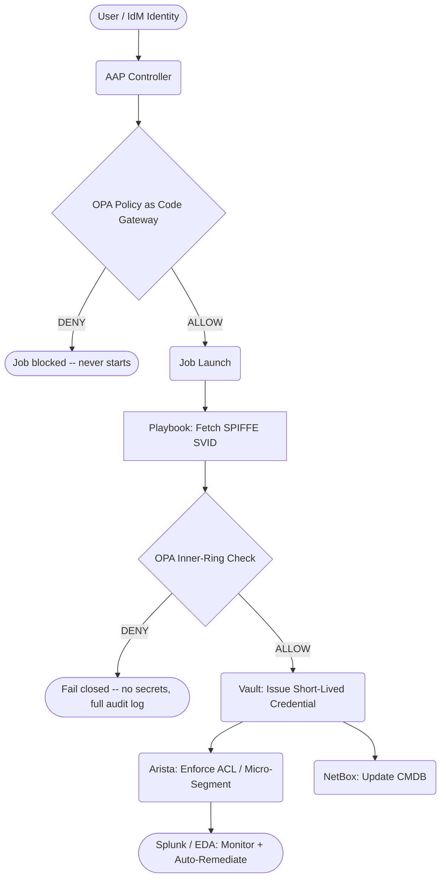
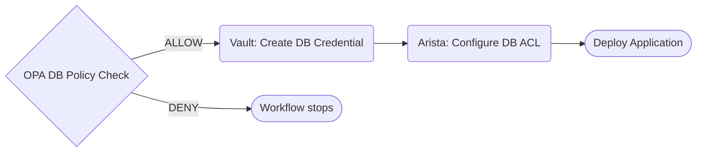


<div class="guide-header">
<h1>Zero Trust Architecture infrastructure with Ansible Automation Platform</h1>
<span class="guide-type-badge guide-type-badge--solution"><i class="fas fa-check-circle" aria-hidden="true"></i> Solution Guide</span>
</div>

<style>
  div#toc { display: none; }
</style>

<div class="guide-hero-callout guide-hero-partner guide-hero-partner--zero-trust" role="img" aria-label="Ansible Automation Platform and Zero Trust Architecture">
  
  <span class="guide-hero-partner__plus" aria-hidden="true">+</span>
  <span class="guide-hero-partner__partner card-partner-logo-set card-partner-logo-set--zero-trust">
    
    
    <span class="card-partner-logo-label">Zero Trust</span>
  </span>
</div>

<!-- tags: ansible, aap, opa, vault, spiffe, spire, idm, netbox, arista, splunk, zta, security, nist -->

## Overview

Modern infrastructure automation creates a paradox: the tools that make operations faster also create new attack surfaces. When automation platforms hold long-lived credentials, run without identity verification, and make changes without policy gates, a single compromised account can pivot across every layer of the stack. This guide shows how to integrate Ansible Automation Platform 2.6 as the **Policy Enforcement Point (PEP)** in a NIST SP 800-207 Zero Trust Architecture -- wiring identity (IdM), policy (OPA), secrets (Vault), workload identity (SPIFFE/SPIRE), and network enforcement (Arista) into a single, auditable automation fabric where every job proves it is authorized before a single task runs.

<div class="guide-outcome">
<strong>Outcome:</strong> AAP 2.6 configured as the central Zero Trust Policy Enforcement Point -- every infrastructure change passes five independent trust gates (IdM identity, OPA platform policy, OPA in-playbook check, SPIFFE workload identity, and Arista ACL) before executing, with short-lived Vault credentials and a full audit trail.
</div>

- [Background](#background)
- [Solution](#solution)
- [Prerequisites](#prerequisites)
- [ZTA Infrastructure Workflow](#zta-infrastructure-workflow)
- [Solution Walkthrough](#solution-walkthrough)
- [Validation](#validation)
- [Maturity Path](#maturity-path)
- [Summary](#summary)

<h2 id="background"></h2>

## Background

Traditional perimeter-based security assumes that anything inside the network boundary can be trusted. That model fails when attackers phish their way past the firewall, when insiders go rogue, and when workloads are spread across clouds, containers, and partner networks where "inside" no longer means anything. **NIST Special Publication 800-207** formalised the alternative: Zero Trust Architecture, where every request -- from a person, an application, or an automation job -- must prove it should be allowed, every time, with no implicit trust based on network location.

For infrastructure automation, this creates specific demands. Every operational change -- patching a server, rotating a credential, updating a firewall rule -- needs to pass through identity checks, policy gates, and an audit trail. Wiring each action individually to an identity provider, policy engine, secrets manager, and SIEM produces a tangled mess of one-off integrations. Ansible Automation Platform sits in the middle and ties it all together as the single PEP: the place where policy decisions are enforced for every kind of infrastructure change.

 <a target="_blank" href="https://www.redhat.com/en/topics/security/what-is-zero-trust">Zero Trust Architecture -- redhat.com</a>

 <a target="_blank" href="https://csrc.nist.gov/publications/detail/sp/800-207/final">NIST SP 800-207: Zero Trust Architecture</a>

<h2 id="solution"></h2>

## Solution

The ZTA infrastructure stack maps directly onto the three NIST components:

-  **Ansible Automation Platform (AAP) 2.6** as the Policy Enforcement Point -- the single platform through which every infrastructure change flows <a target="_blank" href="https://www.redhat.com/en/technologies/management/ansible">[Link]</a>
-  **Open Policy Agent (OPA)** as the Policy Decision Point -- evaluates Rego policies and returns allow/deny before any job runs <a target="_blank" href="https://www.openpolicyagent.org/">[Link]</a>
-  **HashiCorp Vault** for short-lived, least-privilege secrets -- dynamic database credentials (5-minute TTL) and Vault-signed SSH certificates instead of static keys <a target="_blank" href="https://www.vaultproject.io/">[Link]</a>
-  **Red Hat Identity Management (FreeIPA / IdM)** as the identity source of truth -- user and group memberships that flow into AAP teams via LDAP <a target="_blank" href="https://www.redhat.com/en/technologies/linux-platforms/enterprise-linux/identity-management">[Link]</a>
-  **SPIFFE/SPIRE** for workload identity -- cryptographic proof that a job runs on the attested AAP node, not a rogue laptop <a target="_blank" href="https://spiffe.io/">[Link]</a>
-  **NetBox** as the infrastructure source of truth -- IPAM and DCIM state that feeds inventory and policy context <a target="_blank" href="https://netboxlabs.com/">[Link]</a>
-  **Splunk + Wazuh + Event-Driven Ansible (EDA)** for continuous monitoring and automated incident response <a target="_blank" href="https://www.redhat.com/en/technologies/management/ansible/event-driven-ansible">[Link]</a>

### Who Benefits

| Persona | Challenge | What They Gain |
|---------|-----------|---------------|
|  **Security Engineer** | Long-lived credentials, implicit trust across automation layers, no audit trail for "who ran what" | Every job is identity-verified, policy-gated, secrets are ephemeral, and every decision is logged with a chain of evidence from code commit to OPA decision to job output |
|  **Automation Architect** | Maintaining parallel access controls in each tool (Ansible, Vault, LDAP, network) that drift out of sync | A single IdM group change cascades to AAP team membership, OPA policy context, and Vault access -- no separate updates in each system |
|  **CISO / Compliance Manager** | Proving that operational changes were authorized and auditable against NIST 800-207 or CISA ZT Maturity Model | Policy-as-code in Git, OPA decisions logged, Vault leases tracked, and EDA response times measurable -- all the evidence a compliance audit requires |

## Prerequisites

### Ansible Automation Platform

- **Ansible Automation Platform 2.6+** -- required for the native **Policy as Code** gateway (OPA integration built into the platform controller). Earlier versions can implement playbook-level OPA checks but lack the platform-level gateway.

### Featured Ansible Content Collections

| Collection | Type | Purpose |
|-----------|------|---------|
| <a target="_blank" href="https://console.redhat.com/ansible/automation-hub/repo/published/ansible/builtin/">ansible.builtin</a> | Certified | URI module for OPA queries; template, copy, assert for policy enforcement tasks |
| <a target="_blank" href="https://console.redhat.com/ansible/automation-hub/repo/published/ansible/controller/">ansible.controller</a> | Certified | AAP credential, inventory, project, and job template management via playbooks |
| <a target="_blank" href="https://console.redhat.com/ansible/automation-hub/repo/published/arista/eos/">arista.eos</a> | Certified | Arista EOS switch configuration -- ACL and VLAN management for micro-segmentation |
| <a target="_blank" href="https://console.redhat.com/ansible/automation-hub/repo/published/netbox/netbox/">netbox.netbox</a> | Certified | NetBox IPAM/DCIM -- VLAN creation, device inventory, source-of-truth sync |
| <a target="_blank" href="https://console.redhat.com/ansible/automation-hub/repo/published/ansible/posix/">ansible.posix</a> | Certified | SSH hardening, audit rules, and filesystem permission enforcement |

### External Systems

| System | Required | Notes |
|--------|----------|-------|
| Identity Provider (LDAP/LDAPS) | Yes | Red Hat IdM (FreeIPA), Active Directory |
| Policy Decision Point | Yes | Open Policy Agent (OPA) with Rego policies |
| Secrets Manager | Yes | HashiCorp Vault (KV v2, database secrets engine, SSH CA) |
| CMDB / IPAM | Yes | NetBox |
| Workload Identity | Yes for network automation | SPIFFE/SPIRE |
| Network fabric | Yes for micro-segmentation | Arista EOS (cEOS for lab), Cisco IOS, or equivalent |
| SIEM | Optional (required for EDA incident response) | Splunk, Wazuh |
| Git server | Yes | Gitea, GitHub, GitLab |

**Operational Impact:** Medium -- initial configuration requires access to LDAP, Vault, and OPA. Day-2 operations (job launches, credential rotations) are non-disruptive.

## ZTA Infrastructure Workflow

Zero Trust infrastructure configuration with AAP follows a **layered trust establishment** pattern. The outer rings (identity and policy) are configured first; the inner rings (secrets, workload identity, segmentation) depend on them.

The pipeline enforces five independent trust decisions on every sensitive operation: (1) Is the user in the right IdM group? (2) Does AAP Policy as Code permit this job template for this team? (3) Does OPA's in-playbook check confirm the operation context is valid? (4) Does SPIFFE confirm the request originates from the attested automation platform? (5) Does the network fabric permit the traffic path? Each decision is evaluated independently -- passing one does not grant implicit trust at any other layer.



### Operational Impact per Stage

| Stage | Impact | Description |
|-------|--------|-------------|
| 1. Vault credential integration | None | AAP credential objects store Vault paths; secrets resolved at job time |
| 2. LDAP authentication and team mapping | Low | Existing users gain new login path; local admin remains as fallback during cutover |
| 3. OPA policy gateway (Policy as Code) | Low | Audit mode available before enforcement; violations log before blocking |
| 4. In-playbook OPA checks | Low | Added to new templates first; existing templates unchanged during rollout |
| 5. SPIFFE workload identity | Medium | SPIRE agent must be deployed to execution nodes |
| 6. Arista micro-segmentation | High | ACL changes affect live network paths -- test in staging with shadow rules before production |

## Solution Walkthrough

### 1. Configure Vault Credential Integration in AAP

**Operational Impact:** None

AAP's Vault lookup plugin allows credential objects to store **Vault paths** rather than actual secrets. The controller resolves secrets at job runtime and never persists them to the AAP database. This applies the ZTA principle of least privilege: if AAP itself is compromised, an attacker finds Vault paths -- not usable credentials.

Three credential types cover the full ZTA stack: machine credentials (SSH to RHEL hosts), network credentials (Arista eAPI), and database admin credentials. Vault SSH CA credentials replace static key distribution entirely -- Vault signs short-lived certificates on demand, hosts trust only the CA.

**Featured Tasks:**

```yaml
- name: Read machine credential from Vault
  community.hashi_vault.vault_kv2_get:
    path: machine/rhel
    engine_mount_point: secret
  register: machine_cred

- name: Read Vault SSH CA configuration
  ansible.builtin.command: vault read ssh/config/ca
  register: ssh_ca_output
```

> **RBAC:** Restrict Vault lookup credentials to platform admins only.
>
> The `ZTA Vault Credential` (bootstrap Vault auth) should not be assigned to job templates directly -- only used by AAP's credential lookup mechanism. Keep it in the `Default` org with no team-level execute permissions.

**AAP Credential Configuration:**

| Credential | Type | Source |
|-----------|------|--------|
| `ZTA Vault Credential` | HashiCorp Vault | Bootstrap auth (stored in AAP -- tighten with AppRole in production) |
| `ZTA Machine Credential` | Machine | KV `secret/data/machine/rhel` resolved at job time |
| `ZTA Arista Credential` | Network | KV `secret/data/network/arista` resolved at job time |
| `ZTA Vault SSH Credential` | Vault Signed SSH | AppRole + `ssh/roles/ssh-signer` CA |

### 2. Configure LDAP Authentication and Team Mapping

**Operational Impact:** Low

IdM is the single source of truth for user identity. Configuring AAP to authenticate via LDAP and map group memberships to AAP teams means that revoking an IdM group membership immediately removes the associated AAP team access on next login -- no local account changes, no CSV imports, no stale permissions.

**AAP LDAP Authentication Settings:**

```yaml
# Settings → Authentication Methods → Create (Type: LDAP)
LDAP Server URI: "ldaps://central.zta.lab"
LDAP Bind DN: "uid=admin,cn=users,cn=accounts,dc=zta,dc=lab"
LDAP Group Type: "MemberDNGroupType"
LDAP Start TLS: false
LDAP Group Search:
  - "cn=groups,cn=accounts,dc=zta,dc=lab"
  - SCOPE_SUBTREE
  - "(objectClass=groupOfNames)"
LDAP User Search:
  - "cn=users,cn=accounts,dc=zta,dc=lab"
  - SCOPE_SUBTREE
  - "(uid=%(user)s)"
```

**Required Authenticator Mappings:**

| Mapping | Trigger | IdM Group DN | AAP Role |
|---------|---------|-------------|----------|
| ZTA-ORG | Always | -- | Organization Member (Default org) |
| ZTA-Admins | Groups | `cn=zta-admins,...` | Organization Admin |
| Infrastructure team | Groups | `cn=team-infrastructure,...` | Team Member (Infrastructure) |
| DevOps team | Groups | `cn=team-devops,...` | Team Member (DevOps) |
| Security team | Groups | `cn=team-security,...` | Team Member (Security) |
| Applications team | Groups | `cn=team-applications,...` | Team Member (Applications) |

> **Zero Trust principle:** Authentication alone is insufficient.
>
> A successful LDAP bind proves identity but grants no permissions. Without authenticator maps, the user lands on a blank platform. The maps translate verified external identity into scoped, least-privilege access -- no parallel local accounts to maintain.

### 3. Configure OPA Policy as Code (Platform Gateway)

**Operational Impact:** Low (audit mode available before enforcement)

AAP 2.6 introduces a native OPA gateway: the controller sends full job context (template name, launching user, their AAP team memberships) to OPA before enqueuing the job. If OPA returns a deny, the job never starts -- not "it fails partway through," but never begins.

**AAP Policy as Code Configuration** (Settings → Automation Execution → Policy):

| Field | Value |
|-------|-------|
| OPA Hostname | `192.168.1.11` (or OPA FQDN) |
| Port | `8181` |
| OPA Request Timeout | `5` |
| OPA Request Retry Count | `2` |

**Sample OPA Rego policy (`aap/gateway/decision`):**

```rego
package aap.gateway

default decision = {"allow": false, "violations": {}}

decision = {"allow": true} {
    not has_violations
}

violations["patch_team"] {
    is_patch_template
    not user_in_patch_team
}

is_patch_template {
    contains(lower(input.template.name), "patch")
}

user_in_patch_team {
    team := input.created_by.teams[_]
    team == "Infrastructure"
}
```

**Template classification and required teams:**

| Template name pattern | Required AAP team |
|----------------------|------------------|
| Contains "patch" | Infrastructure or Security |
| Contains "vlan" or "network" | Infrastructure |
| Contains "deploy" or "credential" | Applications or DevOps |
| All others | Any authenticated user |

### 4. Add In-Playbook OPA Checks (Inner Ring)

**Operational Impact:** Low

Platform-level Policy as Code catches "wrong user for this template type." In-playbook OPA checks add **context-specific authorization** -- validating the exact operation against the exact user, with the full input context available to Rego. Together they form two independent enforcement rings.

**Featured Tasks:**

```yaml
- name: Query OPA for database access decision
  ansible.builtin.uri:
    url: "{{ opa_url }}/v1/data/zta/db_access/decision"
    method: POST
    body_format: json
    body:
      input:
        user: "{{ awx_user_name }}"
        user_groups: "{{ user_idm_groups }}"
        target_database: "{{ db_name }}"
        requested_permissions: ["SELECT", "INSERT", "UPDATE"]
  register: opa_decision

- name: Enforce OPA decision -- fail closed on deny
  ansible.builtin.assert:
    that: opa_decision.json.result.allow | default(false)
    fail_msg: >
      ACCESS DENIED by OPA policy.
      User '{{ awx_user_name }}' is not authorised to request database credentials.
```



### 5. Configure SPIFFE Workload Identity for High-Risk Operations

**Operational Impact:** Medium

User identity proves *who is asking*. Workload identity proves *what is asking*. A stolen AAP token replayed from an attacker's laptop passes every user identity check -- SPIFFE closes that gap. The playbook fetches a short-lived X.509 SVID from the SPIRE agent (which only runs on attested AAP nodes), and OPA validates it before any network change proceeds.

**SPIRE Agent registration (on AAP execution node):**

```bash
spire-server entry create \
  -spiffeID spiffe://zta.lab/workload/network-automation \
  -parentID spiffe://zta.lab/agent/control \
  -selector unix:uid:0
```

**Featured Tasks:**

```yaml
- name: Fetch X.509 SVID from SPIRE Agent
  ansible.builtin.command: >
    /opt/spire/bin/spire-agent api fetch x509
    -socketPath /run/spire/agent/api.sock
  register: svid_result

- name: Parse SPIFFE ID from SVID output
  ansible.builtin.set_fact:
    workload_spiffe_id: "{{ svid_result.stdout
      | regex_search('SPIFFE ID:\\s+(spiffe://\\S+)', '\\1')
      | first }}"

- name: Query OPA with user identity + workload SVID
  ansible.builtin.uri:
    url: "{{ opa_url }}/v1/data/zta/network/decision"
    method: POST
    body_format: json
    body:
      input:
        spiffe_id: "{{ workload_spiffe_id }}"
        user: "{{ awx_user_name }}"
        user_groups: "{{ user_idm_groups }}"
        vlan_id: "{{ new_vlan_id | int }}"
        action: "create"
  register: opa_network_decision

- name: Enforce combined identity decision -- fail closed
  ansible.builtin.assert:
    that: opa_network_decision.json.result.allow == true
    fail_msg: "VLAN CONFIGURATION DENIED. Reason: {{ opa_network_decision.json.result.reason }}"
```

<h2 id="validation"></h2>

## Validation

### Test -- Verify the full ZTA chain

Launch the **Verify ZTA Services** job template from the AAP UI or via API. This single job checks IdM reachability, OPA policy responses, Vault KV reads, Vault dynamic database credentials, and Vault SSH CA -- confirming every integration before relying on it.

```bash
TOKEN="your-aap-token"
CONTROLLER="https://control.zta.lab"

JOB_ID=$(curl -sk -X POST "${CONTROLLER}/api/v2/job_templates/Verify%20ZTA%20Services/launch/" \
  -H "Authorization: Bearer ${TOKEN}" \
  -H "Content-Type: application/json" | jq -r '.id')

until curl -sk "${CONTROLLER}/api/v2/jobs/${JOB_ID}/" \
  -H "Authorization: Bearer ${TOKEN}" \
  | jq -e '.status == "successful"' > /dev/null 2>&1; do sleep 5; done

echo "ZTA verification complete -- job ${JOB_ID}"
```

**Expected Result:**

```
TASK [Display Vault integration results] *************************************
ok: [vault] => {
    "msg": [
        "KV secret read: PASS (secret/network/arista)",
        "Dynamic DB username: v-userpass-ztaapp-s-anmlwAfJij4NVbUPFDjj-1776239621",
        "Dynamic DB TTL: 300s",
        "Short-lived DB user expires after TTL (Zero Trust / least privilege)."
    ]
}

TASK [OPA policy test summary] ***********************************************
ok: [central] => {
    "msg": [
        "Test 1 -- Patch (authorised): ALLOW",
        "Test 2 -- Patch (wrong group): DENY",
        "Test 3 -- VLAN (network-admin): DENY",
        "Test 4 -- VLAN (no group): DENY",
        "Test 5 -- DB (app-deployer): ALLOW",
        "Zero Trust: deny-by-default, policy-driven access."
    ]
}
```

### Test -- Validate deny-by-default for unauthorized user

```bash
curl -sk -X POST "${CONTROLLER}/api/v2/job_templates/Apply%20Security%20Patch/launch/" \
  -H "Authorization: Bearer ${TOKEN_FOR_APPDEV}" \
  -H "Content-Type: application/json" | jq '.detail'
```

**Expected:** Policy violation message -- job never enqueued.

```json
"This job cannot be executed due to a policy violation or error. {'Violations': {'Organization': [\"user 'appdev' is not in an authorised team for patching templates (requires: {'Infrastructure', 'Security'}, has: {'Applications'})\"]}}"
```

### Troubleshooting

| Symptom | Likely Cause | Fix |
|---------|-------------|-----|
| LDAP users log in but see an empty platform | Missing `ZTA-ORG` authenticator map (Always → Organization Member) | Add the Always trigger map for the Default org first; it is a prerequisite for all other maps |
| Vault credential test fails with 403 | Vault policy does not allow the bootstrap auth path to read the target KV path | Check `vault policy read admin-policy` and confirm `secret/data/*` is included with `read` capability |
| OPA Policy as Code gateway returns 500 | Incorrect OPA hostname or port in AAP settings | Verify OPA is reachable from the AAP controller: `curl http://<opa-host>:8181/health` |
| SPIFFE SVID fetch fails in playbook | SPIRE agent not running or workload not registered | Check `systemctl status spire-agent`; verify registration with `spire-server entry show` |
| Dynamic DB credentials expire before application restarts | TTL shorter than restart window | Increase Vault role TTL or implement credential rotation with EDA before expiry |
| Arista ACL does not take effect | Switch did not save config | Add `arista.eos.eos_command: commands: [write memory]` after config tasks |

<h2 id="maturity-path"></h2>

## Maturity Path

| Maturity | Description |
|----------|-------------|
|  **Crawl** | Connect AAP to IdM LDAP, Vault KV, and OPA in audit-only mode. Log every policy decision without blocking. Verify Vault credential lookups replace the first set of static passwords. Confirm IdM groups flow into AAP team memberships. |
|  **Walk** | Enable OPA Policy as Code enforcement for high-risk template categories (patching, network changes). Add in-playbook OPA checks for secret issuance. Replace all machine credentials with Vault dynamic secrets. Deploy SPIFFE/SPIRE to execution nodes for network automation. Configure Arista ACLs through AAP-gated automation. |
|  **Run** | Event-Driven Ansible watches Splunk and Wazuh for security events and triggers automated remediation (credential revocation, host isolation) in under 30 seconds. OPA policies include time-based controls, risk scoring, and break-glass approval workflows. SPIFFE attestation covers the full supply chain -- container image hash, Git commit, and CI/CD pipeline. Every policy change is a Git commit, reviewed, tested, and deployed like application code. |

<h2 id="summary"></h2>

## Summary

This solution guide shows how to configure Ansible Automation Platform 2.6 as the central Policy Enforcement Point in a NIST SP 800-207-aligned Zero Trust Architecture. By integrating IdM for user identity, OPA for policy decisions, Vault for short-lived secrets, SPIFFE/SPIRE for workload identity, and Arista for network micro-segmentation, every infrastructure change passes through independent, auditable trust gates before a single task executes. The result is a measurable reduction in blast radius: stolen credentials expire within minutes, unauthorized users are blocked before secrets are issued, and rogue workloads are rejected even when they carry valid user tokens. The maturity path from audit-only LDAP integration to fully automated incident response is incremental -- each stage delivers real security value while building toward complete ZTA coverage.


