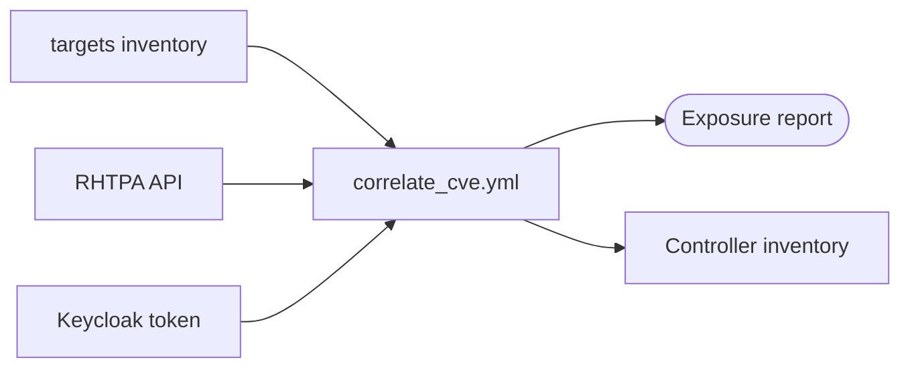


<div class="guide-header">
<h1>Exposure reporting</h1>
<span class="guide-type-badge guide-type-badge--implementation"><i class="fas fa-cogs" aria-hidden="true"></i> Implementation Guide</span>
</div>

<!-- tags: ansible, aap, rhtpa, sbom, cve, exposure-reporting -->

## Overview

Correlation is how Ansible turns a CVE stored in Red Hat Trusted Profile Analyzer (RHTPA) into a list of inventory hosts. The play asks RHTPA which stored SBOMs contain the vulnerable package, then keeps the SBOM names that equal `ansible_host` for a host in the `targets` group. It writes that list to an exposure report and creates a Controller inventory from the same hosts.

<div class="guide-outcome">
<strong>Outcome:</strong> An exposure report for <code>CVE-2026-51234</code> whose <code>affected_hosts</code> are Ansible inventory names, and a Controller inventory <code>affected_hosts-CVE-2026-51234</code> that contains those hosts.
</div>

Run `playbooks/correlate_cve.yml` from <a target="_blank" href="https://github.com/nmartins0611/lightwell-patch-to-production">lightwell-patch-to-production</a>. The play reads SBOMs and the CVE record that are already in RHTPA. Loading SBOMs, installing RHTPA, and remediating hosts are separate procedures. The pipeline that consumes this report is [Automated vulnerability remediation with Lightwell and Ansible](README-AAP-LightWell-AO.md).

- [Background](#background)
- [Architecture](#architecture)
- [Prerequisites](#prerequisites)
- [Implementation Walkthrough](#implementation-walkthrough)
- [Validation](#validation)
- [Day-2 Operations](#day-2-operations)
- [Related Guides](#related-guides)

## Background

RHTPA stores each SBOM under the name it was given at upload. This play joins on that name. `groups['targets']` supplies the Ansible side of the join: each host's `ansible_host` is a key, and the inventory hostname (`node1`, `node3`, `node4` in the reference inventory) is the value. A SBOM whose name is the inventory hostname, a filename, or an address you did not put in `ansible_host` drops out of `affected_hosts`.

The play makes two RHTPA calls. The vulnerability call uses `cve_id`:

```text
GET /api/v2/vulnerability?q=<cve_id>
```

The package call is fixed in `playbooks/correlate_cve.yml`:

```text
GET /api/v2/sbom/by-package?purl=pkg:pypi/cryptography@36.0.1
```

`affected_package` is copied into the report and onto the Controller hosts. It does not change the package URL. For this CVE the report label is `python-cryptography` and the query is the PyPI purl `pkg:pypi/cryptography@36.0.1`.

Several report fields are constants in the play, filled in after the join. `cvss_base_score` is `10.0`, `internet_facing` is `true`, `fix_available` is `false`, and `recommended_action` is the string `Apply compensating controls (CME mitigation)`. `production_hosts` lists affected hosts that are also members of an inventory group named `production`. The reference inventory has no such group, so that list is empty even when `environment_type` is `production`.

RHTPA in the reference repository answers HTTP on port `8443` (`HTTP_SERVER_TLS_ENABLED` is `false`). `rhtpa_api_endpoint` in `inventory/group_vars/all/main.yml` is currently `https`. The play calls that URL with `ansible.builtin.uri`. Leave the scheme on `https` and the TLS handshake fails before RHTPA returns a status code.

## Architecture



| Component | Role in the correlation |
|---|---|
| RHTPA | Answers the vulnerability query and `GET /api/v2/sbom/by-package`. |
| Keycloak | Issues a token for client `walker` with scope `openid read:document`. |
| Inventory group `targets` | Provides `ansible_host` values. Those strings must equal the stored SBOM names. |
| `playbooks/correlate_cve.yml` | Runs the queries on `localhost`, writes the report, then copies it to the `builders` group. |
| AAP Controller | Receives inventory `affected_hosts-<cve_id>` in organization `Default`. |

The join key is `ansible_host` because that is the name RHTPA stored. Correlating on inventory hostname would miss every SBOM in the reference data. The package URL is pinned in the play so a survey value cannot silently query a different component than the one this CVE record describes.

Product documentation: <a target="_blank" href="https://docs.redhat.com/en/documentation/red_hat_trusted_profile_analyzer">Red Hat Trusted Profile Analyzer</a>, <a target="_blank" href="https://docs.redhat.com/en/documentation/red_hat_ansible_automation_platform">Ansible Automation Platform</a>.

## Prerequisites

- **Operational impact:** Low. The play reads RHTPA, writes the exposure report, and creates one Controller inventory. It does not change packages or restart services on the targets.
- SBOMs for the hosts you care about are already in RHTPA, and each SBOM `name` equals that host's `ansible_host`.
- The CVE is already in RHTPA. The play asserts `total > 0` on the vulnerability query and stops when the assertion fails.
- Keycloak can issue a client-credentials token for client `walker`, realm `trustification`, with scope `openid read:document`.
- Controller is reachable at `vault_controller_host`. `vault_controller_token` can create inventories and hosts in organization `Default`.
- The control node can reach the RHTPA and Keycloak URLs. The publish play SSHs to the `builders` group and writes `report_web_dir`.

### Collection

| Collection | Purpose |
|---|---|
| <a target="_blank" href="https://console.redhat.com/ansible/automation-hub/repo/published/ansible/controller/">ansible.controller</a> | Creates the exposure inventory and adds the mapped hosts. |

`ansible.builtin.uri`, `set_fact`, `copy`, and `template` come with ansible-core. The job template that runs this play needs an execution environment that contains `ansible.controller`.

### Credentials

`playbooks/correlate_cve.yml` loads `vars/vault.yml` (Ansible Vault, no vault-id label). Decrypt with `--ask-vault-pass`.

| Secret | Variable | Who consumes it |
|---|---|---|
| Controller API | `vault_controller_host`, `vault_controller_token` | `ansible.controller.inventory` and `ansible.controller.host`. The host value is the Controller base URL, including `https://`. |
| OIDC client secret | `rhtpa_oidc_client_secret` | Token request. Set in `inventory/group_vars/all/main.yml`. Must match the `walker` client. |
| SSH to builders | `ansible_user` in the inventory, or the job's machine credential | The publish play uses `become: true`. The reference inventory uses `root`. |

> **Warning:** Lab client secret.
>
> `rhtpa_oidc_client_secret` is committed in `inventory/group_vars/all/main.yml`. Keep this lab on an isolated network. Move that value into `vars/vault.yml` before any shared environment.

### Variables the play reads

File: `inventory/group_vars/all/main.yml`.

| Variable | Value this play expects | Used for |
|---|---|---|
| `rhtpa_api_endpoint` | `http://{{ hostvars['node2']['ansible_host'] }}:8443` | Both RHTPA GET URLs. |
| `rhtpa_keycloak_url` | `http://{{ hostvars['node2']['ansible_host'] }}:8180` | Token URL. |
| `rhtpa_keycloak_realm` | `trustification` | Token path. |
| `rhtpa_oidc_client_id` | `walker` | Token form field `client_id`. |
| `demo_cve_id` | `CVE-2026-51234` | Default `cve_id`. Selects the vulnerability query and the report filename. |
| `demo_cve_package` | `python-cryptography` | Default `affected_package`. Report text. |
| `demo_cvss_vector` | `CVSS:3.1/AV:N/AC:L/PR:N/UI:N/S:C/C:H/I:H/A:H` | Report field. |
| `demo_cwe_ids` | `CWE-119`, `CWE-787` | Report field. |
| `report_output_dir` | `/tmp/demo-reports` | JSON and HTML on the control node. |
| `report_web_dir` | `/var/www/reports` | Copy destination on `builders`. |
| `report_server_url` | `http://{{ hostvars['node2']['ansible_host'] }}:8080` | URL printed after the copy. |

`rhtpa_api_endpoint` and `rhtpa_keycloak_url` both read `hostvars['node2']['ansible_host']`. The inventory hostname `node2` has to stay `node2`.

Set the API scheme before the first correlation run:

```yaml
# valid -- RHTPA in this repository is HTTP on port 8443
rhtpa_api_endpoint: "http://{{ hostvars['node2']['ansible_host'] }}:8443"

# invalid -- uri fails the TLS handshake before any HTTP status
rhtpa_api_endpoint: "https://{{ hostvars['node2']['ansible_host'] }}:8443"
```

### Host map

`inventory/hosts.yml` is the inventory the play joins against. These three `ansible_host` values are the SBOM names the reference data uses:

```yaml
targets:
  hosts:
    node1:
      ansible_host: rhel01.nostromo.io
      environment_type: production
    node3:
      ansible_host: rhel03.nostromo.io
      environment_type: production
    node4:
      ansible_host: rhel04.nostromo.io
      environment_type: staging
```

| | Valid | Invalid |
|---|---|---|
| SBOM name | Equals `ansible_host` at correlation time (`rhel01.nostromo.io`) | A SBOM stored as `node1`, a filename, or an old address |
| API scheme | `http://<node2>:8443` | `https://<node2>:8443` while RHTPA TLS is off |
| Package query | Leave the play URL on `pkg:pypi/cryptography@36.0.1` | `-e affected_package=openssl` and expect a different RHTPA query |
| CVE id | `CVE-2026-51234`, already present in RHTPA | A new `cve_id` when the vulnerability query returns `total` 0 |
| Vault file | `vars/vault.yml` plus `--ask-vault-pass` | `inventory/group_vars/vault.yml`. This play does not load it. |

> **Warning:** The package query is fixed.
>
> The play always requests `pkg:pypi/cryptography@36.0.1`. `affected_package` is report text. A different component requires an edit to that URL in `playbooks/correlate_cve.yml`.

## Implementation Walkthrough

### Step 1: Confirm the inputs RHTPA will be joined on

On the machine that will run the play, check the three facts the join uses. `NODE2` is `node2`'s `ansible_host`.

```bash
export NODE2=192.168.88.103
export RHTPA_CLIENT_SECRET="$(awk '/^rhtpa_oidc_client_secret:/ {print $2}' inventory/group_vars/all/main.yml | tr -d '"')"

TOKEN=$(curl -sf -X POST "http://${NODE2}:8180/realms/trustification/protocol/openid-connect/token" \
  -d "client_id=walker" \
  -d "client_secret=${RHTPA_CLIENT_SECRET}" \
  -d "grant_type=client_credentials" \
  -d "scope=openid read:document" \
  | python3 -c "import sys,json; print(json.load(sys.stdin)['access_token'])")

curl -sf "http://${NODE2}:8443/api/v2/vulnerability?q=CVE-2026-51234" \
  -H "Authorization: Bearer ${TOKEN}" \
  | python3 -c "import sys,json; d=json.load(sys.stdin); print('vuln', d.get('total'))"

curl -sf -G "http://${NODE2}:8443/api/v2/sbom/by-package" \
  --data-urlencode "purl=pkg:pypi/cryptography@36.0.1" \
  -H "Authorization: Bearer ${TOKEN}" \
  | python3 -c "import sys,json; d=json.load(sys.stdin); print('sbom', d.get('total'));
[print(i.get('name')) for i in d.get('items',[])]"
```

Vulnerability `total` is greater than 0. The by-package names include `rhel01.nostromo.io`, `rhel03.nostromo.io`, and `rhel04.nostromo.io`. If the names differ from `ansible_host`, fix the inventory or load the SBOMs again under the current names before you run the play. Reloading SBOMs is outside this guide.

### Step 2: Run the correlation play

From the repository root:

```bash
ansible-playbook playbooks/correlate_cve.yml -i inventory/hosts.yml --ask-vault-pass
```

The first play runs on `localhost`.

1. `POST` the Keycloak token URL with `grant_type=client_credentials`, client `walker`, and scope `openid read:document`.
2. `GET /api/v2/vulnerability?q=<cve_id>` and assert `total > 0`.
3. `GET /api/v2/sbom/by-package?purl=pkg:pypi/cryptography@36.0.1`.
4. Build `host_lookup` from `groups['targets']` and keep SBOM names that are keys of that map.
5. Write `/tmp/demo-reports/exposure-report-<cve_id>.json` and the HTML report next to it.
6. Create Controller inventory `affected_hosts-<cve_id>` in organization `Default` and add each mapped host.

The mapping tasks are:

```yaml
- name: Extract SBOM source names from RHTPA results
  ansible.builtin.set_fact:
    sbom_source_names: "{{ rhtpa_sbom_results.json['items'] | map(attribute='name') | list }}"

- name: Build reverse lookup of ansible_host to inventory_hostname
  ansible.builtin.set_fact:
    host_lookup: >-
      {{
        dict(
          groups['targets']
          | map('extract', hostvars, 'ansible_host')
          | zip(groups['targets'])
        )
      }}

- name: Map RHTPA SBOM names to inventory hosts
  ansible.builtin.set_fact:
    affected_hosts: >-
      {{
        sbom_source_names
        | select('in', host_lookup.keys())
        | map('extract', host_lookup)
        | list
      }}
```

Each Controller host receives `ansible_host` from the source inventory, plus `cve_id`, `affected_package`, `cvss_base_score`, `node_role`, and `environment_type`.

The local report files are written before the Controller tasks. A Controller authentication failure leaves the JSON on the control node and skips the publish play.

The second play targets `builders` with `become: true`, creates `report_web_dir`, and copies the same report there. The reference path is `/var/www/reports/` on `node2`. Standing up the web server is outside this guide. The copy fails when that user cannot become or cannot create the path, and by then the Controller inventory already exists.

**Blast radius.** One Controller inventory, two report files on the control node, and the same two files on `builders`. Targets are not contacted.

### Step 3: Launch CVE Correlation from Controller

Use this when the job template already exists. Creating the rest of the demo project is outside this guide.

| Field | Value |
|---|---|
| Name | `CVE Correlation` |
| Organization | `Default` |
| Playbook | `playbooks/correlate_cve.yml` |
| Inventory | The inventory that contains group `targets` |
| Credential | A machine credential that can reach `builders` |
| Privilege escalation | Off on the template. The publish play sets `become: true` inside the playbook. |
| Prompt on launch | On |
| Execution environment | An image that includes `ansible.controller` |
| Vault credential | Password for `vars/vault.yml`, Vault ID empty |

Leave the survey empty to use `demo_cve_id` and `demo_cve_package`. When you supply extra variables, only the fields below change. The package URL stays `pkg:pypi/cryptography@36.0.1`.

```yaml
cve_id: CVE-2026-51234
affected_package: python-cryptography
cvss_vector: CVSS:3.1/AV:N/AC:L/PR:N/UI:N/S:C/C:H/I:H/A:H
cwe_ids:
  - CWE-119
  - CWE-787
```

`cve_id` selects the vulnerability query, the report filename, and the Controller inventory name. `affected_package`, `cvss_vector`, and `cwe_ids` are written into the report.

From the Controller API, `CONTROLLER_HOST` is `vault_controller_host` with no trailing slash:

```bash
export CONTROLLER_HOST="https://aap.nostromo.io"
export CONTROLLER_TOKEN="<vault_controller_token>"

JOB_ID=$(curl -sk \
  -H "Authorization: Bearer ${CONTROLLER_TOKEN}" \
  "${CONTROLLER_HOST}/api/controller/v2/job_templates/?name=CVE%20Correlation" \
  | python3 -c "import sys,json; print(json.load(sys.stdin)['results'][0]['id'])")

curl -sk -X POST \
  -H "Authorization: Bearer ${CONTROLLER_TOKEN}" \
  -H "Content-Type: application/json" \
  "${CONTROLLER_HOST}/api/controller/v2/job_templates/${JOB_ID}/launch/" \
  -d '{}'
```

If that lookup returns HTTP 404, repeat it against `/api/v2/job_templates/`. Poll `status` on `/api/controller/v2/jobs/<job_id>/` until it is `successful`.

## Validation

Successful play output:

```text
CVE CVE-2026-51234 found in RHTPA (1 advisory)
RHTPA returned 3 SBOMs containing python-cryptography. Mapped to inventory: node1, node3, node4
Created inventory 'affected_hosts-CVE-2026-51234' on Controller with 3 hosts: node1, node3, node4
```

The host list follows the order RHTPA returned, limited to names that matched `ansible_host`.

```bash
python3 - <<'PY'
import json
doc = json.load(open("/tmp/demo-reports/exposure-report-CVE-2026-51234.json"))
assert doc["cve_id"] == "CVE-2026-51234"
assert doc["affected_package"] == "python-cryptography"
assert set(doc["affected_hosts"]) == {"node1", "node3", "node4"}
assert doc["cvss_base_score"] == 10.0
assert doc["environment_exposure"]["internet_facing"] is True
print("control-node report ok", doc["affected_count"])
PY
```

`affected_count` prints `3`. In the Controller UI, inventory `affected_hosts-CVE-2026-51234` contains `node1`, `node3`, and `node4`. Each host has `cve_id=CVE-2026-51234`, `affected_package=python-cryptography`, and `ansible_host` copied from the source inventory (`rhel01.nostromo.io`, `rhel03.nostromo.io`, `rhel04.nostromo.io`).

### Troubleshooting

| Symptom | Where to look | Fix |
|---|---|---|
| `uri` fails with an SSL handshake or "wrong version number" before any HTTP status | `rhtpa_api_endpoint` | Set `http://{{ hostvars['node2']['ansible_host'] }}:8443`. `validate_certs: false` does not fix a server that is not speaking TLS. |
| `CVE CVE-2026-51234 not found in RHTPA` | task **Confirm CVE exists in RHTPA** | The vulnerability query returned `total` 0. Load that CVE's advisory into RHTPA, then re-run. This play does not upload advisories. |
| `RHTPA returned 0 SBOMs` | by-package task URL | The play queries `pkg:pypi/cryptography@36.0.1` only. An RPM purl or a different version stays invisible until that URL is edited. |
| `total` is 3 and `Mapped to inventory:` is empty | task **Display RHTPA correlation results** | `items[].name` matched no `ansible_host` in `groups['targets']`. Align the names and re-run. |
| `groups['targets']` is undefined, or `affected_hosts` is empty while the names look right | inventory for this run | CLI needs `-i inventory/hosts.yml`. In Controller, the job inventory has to be the one that contains `targets`. |
| `ansible.controller` returns 401 or 403 | tasks **Create dynamic inventory** and **Add affected hosts** | `vault_controller_host` is the Controller base URL. The token can create inventories and hosts in organization `Default`. The execution node can reach that URL. |
| Local report exists and the job then fails on `builders` | play **Publish Exposure Report to Report Server** | The join already finished. The copy needs a writable `report_web_dir` and a user that can `become`. The reference user is `root`. |
| Report `production_hosts` is `[]` while hosts are marked production | `environment_exposure` in the play | Membership is `groups['production']`, which this inventory does not define. `environment_type` on the host is a separate field. |

> **Tip:** Read the RHTPA request log.
>
> `podman logs rhtpa-server` on the RHTPA host shows the path and status for `/api/v2/vulnerability` and `/api/v2/sbom/by-package`. Pair that with the `uri` body in the job log. A 403 body names the missing permission (`read.sbom`).

## Day-2 Operations

Re-running the play for the same `cve_id` overwrites the report files and ensures the Controller inventory exists. The host task adds the current `affected_hosts`. It does not remove hosts that were added on an earlier run and are absent from this RHTPA response. After a host is patched and its SBOM no longer matches the purl, delete that host from `affected_hosts-<cve_id>` or replace the inventory.

The join breaks when `ansible_host` changes after the SBOM was stored. RHTPA still returns the old name, and that name is no longer a key in `host_lookup`. Store the SBOM again under the new `ansible_host`, then correlate.

A new CVE id changes the vulnerability query, the report filename, and the inventory name. It does not change the package URL. Use a new `cve_id` only when that CVE is already in RHTPA and the exposed component is still `pkg:pypi/cryptography@36.0.1`. Any other component means editing the purl in `playbooks/correlate_cve.yml`.

Treat `cvss_base_score`, `internet_facing`, `fix_available`, and `recommended_action` as labels this play writes. They are not values returned by the RHTPA vulnerability call.

## Related Guides

- [Automated vulnerability remediation with Lightwell and Ansible](README-AAP-LightWell-AO.md) covers the pipeline that runs after this report exists, including patching and application rebuilds.
- [Automated CVE response and compliance verification with CME](README-CME.md) is the compensating-control path named in this play's `recommended_action` string.

